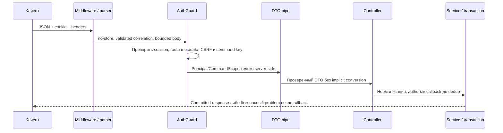

# HTTP boundaries

Для менеджера: технические GET / и /health public. Receiving create/post/get требуют
серверную сессию и роль именно нужного склада. Без сессии 401; без права/CSRF 403.
Неизвестные DTO-поля/UUID/key дают безопасный 400, credentials/SQL/stack не отражаются.
Старый dev actor удалён: development не означает обход настоящей auth.

## Для разработчика

HttpModule регистрирует AuthGuard/ProblemFilter/ValidationPipe и импортирует IdentityModule.
Controller отвечает за transport, identity — session/ACL, receiving — сценарий и свой SQL.
configureHttp ставит no-store/correlation до parser, ограничивает JSON body 256 КиБ,
включает /api/v1 с исключениями только для технических GET. CORS/trust proxy не включены.

| Файл                      | Ответственность                                                                |
| ------------------------- | ------------------------------------------------------------------------------ |
| http.module.ts            | Глобальные providers через APP_GUARD/FILTER/PIPE                               |
| auth.guard.ts             | Session + CSRF, default-deny metadata, trusted Principal/CommandScope          |
| request-context.ts        | Request-local correlation/scope, без общего currentActor                       |
| http-command.decorator.ts | Server operation, Idempotency-Key, public technical metadata                   |
| configure-http.ts         | Middleware/prefix/JSON parser одинаковы в production/test/OpenAPI              |
| problem.filter.ts         | Статические публичные code/status; query/SQL/token не отражаются               |
| openapi.ts                | Реальные controllers/DTO, cookie auth и Origin/CSRF headers; не будущие routes |

Detailed flow/SQL/гонки session revoke находятся у [identity](../../../../../docs/flows/identity.md),
posting/dedup — у receiving/idempotency. Session checks в guard не отменяют повторную
warehouse/session policy внутри command transaction до saved replay. Убранного
DevActorGuard нет ни в provider graph, ни как fallback файла; DEV_ACTOR_ENABLED=true
отклоняет startup. Test-only ProbeCommandController не подключён к production.

Конфигурация: общий RuntimeConfig + явные AUTH_ORIGIN/absolute/idle policy identity.
HTTPS перед внешней эксплуатацией обязателен; текущий backend не TLS gateway.
OpenAPI `pnpm openapi:generate/check` offline: DI config overrides без .env/БД/app.init.
Тесты: unit http-foundation/identity, integration identity/http/receiving/http-commands,
настоящие session fixtures вместо bypass. [Отчёт WMS-202](../../../../../docs/reports/wms-202.md).
