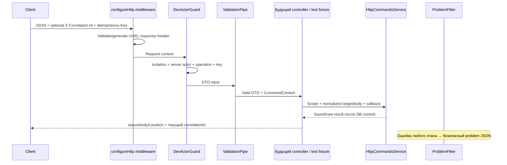

# HTTP-основа WMS-107

Единые HTTP boundaries для Nest API: prefix, DTO validation, request context,
безопасные ошибки и OpenAPI. WMS-108 подключает ReceivingController; прочие бизнес-endpoints ещё отсутствуют.

## Для менеджера

`GET /` и `GET /health` доступны без dev actor и не меняют склад.
Receiving create/post/get работают под `/api/v1/receipts` и требуют isolated dev actor. Неизвестные/некорректные поля команды
отклоняются, ошибка не показывает пароль, SQL или stack trace. Каждый ответ получает
X-Correlation-Id, позволяющий связать запрос со сценарием; централизованные логи ещё
запланированы WMS-401/402. Операционные ошибки не заменяют бизнес-аудит.

До identity бизнес-routes закрыты по умолчанию. Dev actor включается только явно:
NODE_ENV=development/test, DEV_ACTOR_ENABLED=true, DEV_ACTOR_ID=синтетический UUID,
HTTP_HOST=127.0.0.1 или ::1. Peer должен быть loopback, proxy headers запрещены.
В production включение отказывает при старте; guard дополнительно проверяет режим.
Это локальный учебный режим, не пользовательская аутентификация и не изоляция от
других процессов того же компьютера. Не подключать его через reverse proxy/внешний стенд.

## Для разработчика

HttpModule добавляет APP_PIPE/APP_FILTER/APP_GUARD. `configureHttp(app)` вызывается
одинаково в main, harness и OpenAPI generator до init: correlation middleware,
JSON body limit 256 КиБ и prefix `api/v1` с исключением технических GET `/`, `/health`.
Main слушает validated HTTP_HOST (default 127.0.0.1); middleware стоит до parser,
поэтому malformed JSON тоже получает correlationId/problem response.

| Файл | Назначение |
|---|---|
| configure-http.ts | Prefix, JSON bytes limit, correlation middleware до init |
| http.module.ts | Общая ValidationPipe, DevActorGuard, ProblemFilter через DI |
| request-context.ts | Request-local WeakMap, correlation UUID и frozen command scope |
| dev-actor.guard.ts | Fail-closed dev actor, server operation и UUID Idempotency-Key |
| http-command.decorator.ts | TechnicalRoute/HttpCommand/CommandContext, command OpenAPI metadata |
| problem.filter.ts | Статические error codes/statuses и безопасный problem envelope |
| openapi.ts | Swagger document из настоящего graph + Problem/header schemas |

Контроллер отвечает за HTTP: class DTO с class-validator и OpenAPI decorators,
явная нормализация body/path params и вызов HttpCommandsService. DTO живёт в dto/
его бизнес-модуля, не здесь. ValidationPipe создаёт DTO instance, но implicit conversion
выключен: строка "2" не становится числом. whitelist + forbidNonWhitelisted отклоняют
неизвестные поля, error target/value и полные validation messages наружу не выдаются.
В request body нельзя задавать actor. X-Actor-Id не является источником доверия.
Авторизация каждого запроса должна выполняться **до** dedup/replay, а состояние
бизнес-документа проверяется внутри transactional callback. Production identity — WMS-202.

HttpCommand получает постоянное operation из server code (например receiving.post),
а не URL/header клиента. Header Idempotency-Key обязателен и является UUID;
scope actorType/actorId/operation/key устанавливает guard. CommandContext возвращает
его контроллеру. TechnicalRoute используется только для явно технических маршрутов;
бизнес-контроллеры не должны наследовать это исключение AppController.

## Взаимодействие и движение данных



Командный путь используется ReceivingController и test/support/http-command.fixture.ts;
production graph содержит два технических GET и не содержит пробного POST.
HTTP adapter не открывает транзакцию: ей владеет HttpCommandsService, который
передаёт opaque context бизнес-сервисам. Не начинать дополнительный run в callback.
Ошибки дают rollback до HTTP mapping; отправка ответа выполняется после commit.
Разрыв клиента не отменяет уже запущенную DB-команду: повторять нужно с тем же ключом.

### Пример и ошибки

Синтетический test POST `/api/v1/commands`, body `{ "name":" Demo ","quantity":2 }`,
UUID key → normalized `{ "body":{"name":"Demo","quantity":2} }` → 201 с новым id.
Повтор с name=Demo и тем же key возвращает прежний id/201/Location; новый
X-Correlation-Id относится к текущему запросу, не меняет hash/result.
Это пример из harness, не работающий production endpoint.

Пример ответа ошибки:

```json
{"type":"urn:warehouse:problem:idempotency-conflict","title":"Idempotency key conflicts with request","status":409,"detail":"Idempotency key conflicts with request","instance":"/api/v1/commands","code":"IDEMPOTENCY_CONFLICT","correlationId":"dbb37b21-1c4a-4b32-9307-148df1647f4c"}
```

Content-Type — application/problem+json; instance содержит pathname без query.
Неверный correlationId → новый UUID в ответе и 400 INVALID_CORRELATION_ID.
Нет key → 400 IDEMPOTENCY_KEY_REQUIRED, неправильный → 400 INVALID_IDEMPOTENCY_KEY.
Невалидный DTO/JSON → 400 VALIDATION_FAILED, превышение JSON limit → 413 REQUEST_TOO_LARGE.
Dev actor недоступен → 403 DEV_ACTOR_UNAVAILABLE, другой hash → 409 IDEMPOTENCY_CONFLICT.
Известные HttpException/SQLSTATE получают статические 401/403/404/409/422/503 коды;
неизвестный Error, включая старые plain business errors, → 500 INTERNAL_ERROR.
Не угадывать status по error.message: новые бизнес-ошибки подключать явно.
40001/40P01 показывают 503 SERVICE_UNAVAILABLE, auto retry не включается.
Конфликт/ошибка не кешируются idempotency service. Stack, raw body, driver message
и произвольный exception detail не включаются. Фильтр не реализует полный error logging.

### OpenAPI и проверки

`pnpm openapi:generate` собирает backend и записывает docs/contracts/openapi.json.
`pnpm openapi:check` собирает и сравнивает bytes без изменения JSON. Test prepare
выполняет check после build. CLI использует @nestjs/testing с config override,
не читает .env, не вызывает app.init/listen/DB startup и закрывает созданный pool.
Generated JSON не править вручную. HTTP endpoint Swagger UI не добавлен.
В документе `/`, `/health` и три операции receiving; command decorator
добавляет Idempotency-Key к create/post. CI breaking comparison ещё нет.

Зависимости закреплены: Swagger 11.4.7 для Nest 11, class-validator 0.15.1,
class-transformer 0.5.1. Команды: pnpm typecheck/test:unit/test:integration/test.
[http-foundation.spec.ts](../../../test/unit/http-foundation.spec.ts) проверяет config;
[http-commands.spec.ts](../../../test/integration/http-commands.spec.ts) — настоящие
HTTP/DTO/headers/errors, dev mode запреты, timeout/retry, SQL и отсутствие test paths в OpenAPI.
Нет новых метрик/логов, inspect CLI или публичного складского CRUD.
См. [idempotency](../idempotency/README.md), [ADR-0013](../../../../../docs/adr/0013-http-idempotency.md).
