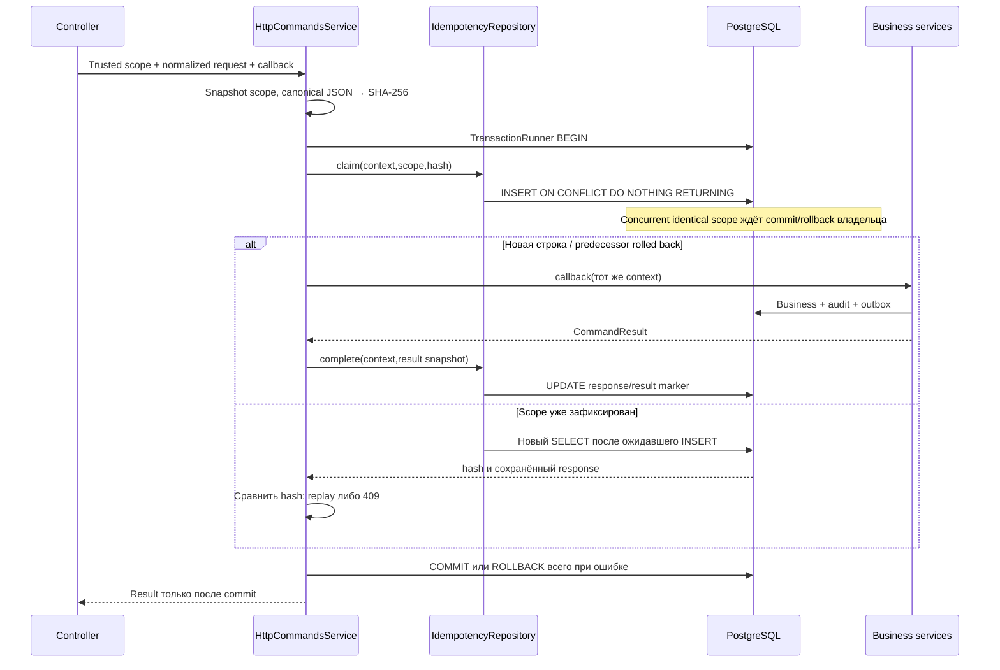

# HTTP idempotency WMS-107

Повторяемые команды с результатом, атомарным бизнес-изменению в PostgreSQL.

## Для менеджера

Один actor отправляет одну operation с одним UUID Idempotency-Key. Тот же
нормализованный запрос возвращает прежний успешный ответ без повторного эффекта;
другой запрос с тем же ключом получает 409. При rollback первая попытка не оставляет
ни эффекта, ни результата: повтор может выполнить команду заново. Потеря HTTP-ответа
не доказывает rollback — нужно повторить исходный ключ, не создавать новый.
Ключи/результаты пока не удаляются, TTL не включён. Это не consumer dedup и не
гарантия exactly once между БД и внешним сервисом. Реальная приёмка ещё не создана.

## Для разработчика

IdempotencyModule экспортирует HttpCommandsService, SQL repository приватный.
Сервис получает runner через общий TRANSACTION_RUNNER, создаёт единственный run;
callback вызывает business/AuditService/OutboxService с тем же context и awaited SQL.
Внешний I/O и вложенный run запрещены. Авторизацию выполнить до execute на каждом
запросе, в том числе replay; callback на повторе не выполняется.

| Файл | Назначение |
|---|---|
| idempotency.module.ts | Providers/import DatabaseModule/export command service |
| idempotency.schema.ts | Scope PK, SHA-256 hash, nullable pending/result fields и checks |
| repositories/idempotency.repository.ts | Claim unique INSERT, отдельный read committed SELECT, complete UPDATE |
| services/http-commands.service.ts | Canonical fingerprint, владелец transaction/callback, проверка result snapshot |

Scope: `(actor_type,actor_id,operation,key)`. Actor user/system UUID, key UUID,
operation — постоянный server identifier `[a-z][a-z0-9.-]{0,95}`. UUID нормализуется
lowercase. SHA-256 считается от shared canonicalJson(normalizedRequest): keys объектов
сортируются, порядок массивов сохраняется. Controller явно нормализует DTO и включает
target/path params в request; idempotency/correlation headers туда не входят.
В таблице не сохраняется исходный request, только hash и allowlisted success response.

normalizedRequest/result — plain JSON без class instances/toJSON/getters, undefined,
BigInt, циклов, не finite numbers; depth<=64 и JSON UTF-8<=256 КиБ. DTO instance нужно
преобразовать явной сборкой plain полей. Нормализация смысла данных принадлежит
бизнес-модулю, canonical serializer решает только порядок JSON keys.

CommandResult: statusCode 200/201/202, JSON body (включая null), optional headers.location
в виде ограниченного относительного `/api/v1/...` URL. Остальные headers, cookies,
credentials и non-JSON result запрещены; controller не должен возвращать секреты в body.
X-Correlation-Id не сохраняется: response header генерируется для текущей попытки.
Неверный server result откатывает бизнес и даёт 500. Новые response формы требуют
явного расширения контракта. Ошибочные HTTP ответы не кешируются.

## Взаимодействие и движение данных

Pending row содержит только identity/hash, response fields SQL NULL. Успех заполняет
status/body/headers/completed_at до выхода callback. JSON null body сохраняется как
JSONB null, не SQL NULL. created_at/completed_at используют transaction timestamp,
не точную отметку network response. Committed pending row не создаётся сервисом;
такое состояние при direct SQL/bug даёт безопасный 500, а не повтор бизнес-эффекта.

Отдельный SELECT нужен после ON CONFLICT DO NOTHING: winner мог быть невидим
исходному statement snapshot, пока запрос ждал unique lock. При rollback owner
ожидающий INSERT может стать владельцем новой строки. Скрытых retries/takeover timers
нет. Долгий callback задержит одинаковые ключи; разные actor/operation/key независимы.
В async handler/consumer этот HTTP service не использовать: у них свои markers.

Синтетический пример (тестовый controller, не production route):
`{name:" Demo ",quantity:2}` нормализуется в `{body:{name:"Demo",quantity:2}}`.
Первый ответ 201 с id=A и Location `/api/v1/commands/A`; такой же повтор возвращает A,
quantity=3 с тем же key → 409 IDEMPOTENCY_CONFLICT; после rollback новый вызов получает
собственный успешный ответ. ReceivingController включает `{target:{receiptId},body:{}}` в posting,
чтобы тот же key для другого документа конфликтовал, а не возвращал чужой результат.

## Хранение, ошибки и эксплуатация

Migrations 0007_dizzy_george_stacy.sql и 0008_idempotency-retention.sql новые.
Runtime warehouse_app имеет SELECT/INSERT/UPDATE, но не DELETE/TRUNCATE. Row trigger
запрещает изменение identity/hash и completed response даже owner обычным UPDATE;
retention trigger использует общий guard function WMS-106. DBA может отключить защиту.
Прямой SQL вне repository не является поддерживаемым command interface.
Delete/TTL не включены до решения о допустимом повторе/replay, диск растёт вместе с history.
Cleanup отключает retention trigger только в disposable Testcontainers DB.
Dev Compose применяет migrations явно: pnpm db:migrate, автоматического старта migration нет.

SQL errors и callback errors выходят до runner; HTTP mapper скрывает driver/details.
Connection loss при commit может означать неизвестный исход: retry с тем же key
прочитает success, если commit состоялся; нельзя автоматически повторять с новым key.
При недоступной БД response replay также недоступен. Записи в память/Redis не заменяют storage.
Новых env/метрик/worker здесь нет; runtime config и HTTP — в соседнем http README.

Проверки: [http-commands.spec.ts](../../../test/integration/http-commands.spec.ts),
[fixture](../../../test/support/http-command.fixture.ts). Реальные HTTP/SQL тестируют
same/different/concurrent requests, rollback всех таблиц, waiter после rollback,
client deadline до commit с последующим replay, JSON null, target hash, scope isolation,
immutable result и runtime grants. `pnpm test`, Docker обязателен для integration.
[ADR-0013](../../../../../docs/adr/0013-http-idempotency.md),
[transactions](../../../../../docs/transactions.md),
[contracts](../../../../../docs/contracts/README.md).
