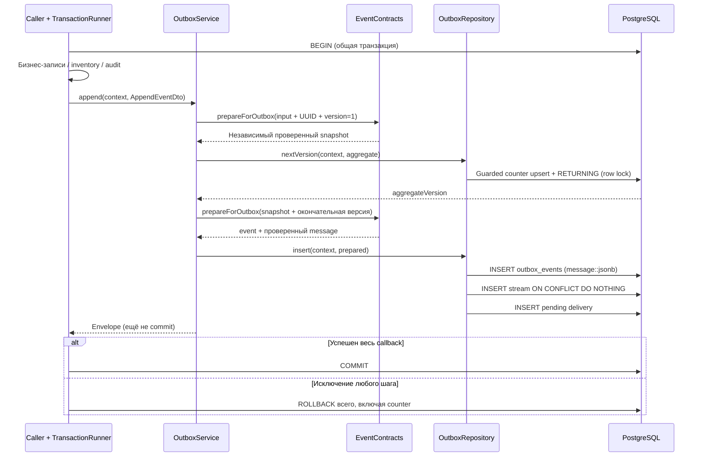

# Outbox writer WMS-106

Технический Nest-модуль записи событий в PostgreSQL, без dispatcher/worker/Kafka.

## Для менеджера

Складской сценарий может сохранить бизнес-изменение, movement, audit и событие
одной транзакцией. При ошибке ничего из нового не остаётся, включая выделенную
версию события. Успешная запись означает готовность к будущей доставке, а не
выполненное задание размещения. Документ приёмки и HTTP-команды подключены WMS-108;
совместная запись с InventoryService пока демонстрируется integration-тестом.

Для каждого события приёмки создаются pending delivery на `inventory.putaway`
и stream с cursor=0. Worker protocol готов WMS-109, handler зарегистрирован WMS-110: pending обрабатывается в task + marker/cursors/ack.
История не очищается по расписанию, immutable envelope не редактируется.
Исправление факта потребует нового события/бизнес-операции. Роль `warehouse_app`
не может изменять/удалять события; DBA способен обойти triggers — защиты от DBA нет.
Auth/роли пользователей здесь не проверяются: caller — доверенный внутренний сервис.

## Для разработчика

Публичный write interface — `OutboxService.append(context, input: AppendEventDto)`.
`OutboxModule` экспортирует только сервис, repository остаётся внутренним provider.
HTTP controller не нужен: пользовательского маршрута нет. PostgreSQL I/O находится
в infrastructure; общая JSON validation переиспользуется из shared/events.
Новых tokens/interfaces для каждого класса и собственного pool нет.

| Файл                              | Назначение                                                                               |
| --------------------------------- | ---------------------------------------------------------------------------------------- |
| outbox.module.ts                  | Nest providers/export без фонового запуска                                               |
| services/outbox.service.ts        | Проверка context, UUID, предварительный snapshot, версия, финальная validation           |
| repositories/outbox.repository.ts | Guarded upsert счётчика и последовательные INSERT в той же транзакции                    |
| dto/append-event.dto.ts           | Внутренняя команда без producer-controlled eventId/aggregateVersion                      |
| outbox-destinations.ts            | Единственный destination, подписка на полный receipt stream и безопасный version maximum |
| outbox.schema.ts                  | Четыре Drizzle-таблицы, constraints, FK, индексы                                         |

### Данные и инварианты

| Таблица                    | Identity / инварианты                                                                           |
| -------------------------- | ----------------------------------------------------------------------------------------------- |
| outbox_aggregate_sequences | PK `(aggregate_type,aggregate_id)`, last_version 1..9007199254740991                            |
| outbox_events              | event_id PK, UNIQUE `(aggregate_type,aggregate_id,aggregate_version)`, immutable envelope JSONB |
| outbox_deliveries          | PK `(event_id,destination)`, FK события, pending/processing/retry/completed/dead, attempts>=0   |
| delivery_streams           | PK `(destination,aggregate_type,aggregate_id)`, cursor 0..MAX, FK счётчика                      |

Счётчик — дополнительная физическая таблица к логической модели WMS-106, не
бизнес-версия Receipt. SQL bigint читается как number только в безопасном диапазоне
JSON Schema. `INSERT ... ON CONFLICT DO UPDATE last_version=last_version+1`
блокирует строку до commit/rollback, включая гонку первого INSERT. `setWhere < MAX`
предотвращает overflow. PostgreSQL sequence/nextval не используется: он оставлял бы
пропуски после rollback. Другие агрегаты не блокируются этим row lock.
При нескольких агрегатах в одном сценарии caller задаёт единый порядок захвата.
Скрытого retry нет, политика 40001/40P01 — [transactions](../../../../../docs/transactions.md).

SQL проверяет совпадение индексируемой identity с envelope (UUID case-insensitive),
но не повторяет всю JSON Schema. Прямой INSERT вне сервиса обходит contract validation
и не является поддерживаемым write interface. На production runtime запрещён UPDATE
outbox_events. Остальным трём таблицам разрешён UPDATE для counter/worker WMS-109,
но DELETE/TRUNCATE запрещены grants и retention triggers. У owner обычный
UPDATE/DELETE/TRUNCATE событий также отклоняется trigger, который DBA может отключить.

Индексы: unique aggregate version для порядка, created_at для диагностики,
partial deliveries available_at для active statuses, streams lease_until для будущего claim.
Lease token/time должны быть оба NULL либо оба заданы; completed требует completed_at.
Эти checks не реализуют claim/fencing и не дают готовой гарантии delivery protocol.

### Destination и хранение

Регистрация `inventory.putaway` зафиксирована кодом и CHECK в новой migration.
Подписка охватывает весь поток receipt, не фильтруется по type. Пока известен только
ReceivingPosted v1. После появления других типов handler обязан делать no-op для
неинтересных фактов с продвижением cursor. Новая подписка требует migration и
явного replay/стартовой позиции; редактирования массива destinations недостаточно.

Envelope не меняется при повторной доставке. Writer повторно вызванный с той же
командой создаёт **новое** событие с новым eventId/версией: это не command dedup.
WMS-107 реализует HTTP idempotency framework, WMS-108 реализует запрет повторного posting через parent lock/state. Future delivery
retries должны использовать уже сохранённый eventId и envelope, не вызывать append.
TTL/cleanup/архивации нет до утверждения replay/retention policy. Не удаляются
completed/dead deliveries, streams и counters; строки потребуют ёмкости на диске.

## Взаимодействие и движение данных



1. Владелец сценария начинает `TRANSACTION_RUNNER.run`; вход/права/состояние Receipt
   — его ответственность. AppendEventDto содержит type/version, aggregate identity,
   UTC occurredAt, correlationId, payload и optional metadata, без eventId/aggregateVersion.
2. Сервис проверяет opaque context до SQL: forged/stale/cross-scope запрещены.
   Явно переданные eventId/aggregateVersion отклоняются; UUID генерируется локально.
3. Синхронный preflight создаёт snapshot до первого await и проверяет schema/bytes
   с временной версией 1. Изменение входного объекта во время SQL не меняет snapshot.
4. Repository выделяет настоящую версию под row lock в той же транзакции. Сервис
   заново валидирует финальное сообщение (writer metadata снова накладывается поверх snapshot,
   поэтому input.toJSON не может подменить UUID/sequence): дополнительные цифры версии могут превысить
   256 КиБ. Любая ошибка должна выйти до runner: перехват append error с продолжением
   транзакции запрещён, особенно после уже выполненного counter update.
5. Сохраняется проверенный message через параметризованный `::jsonb`, без повторной
   сборки из input. JSONB может менять порядок ключей/пробелы; гарантируется смысл,
   а не побайтовая идентичность transport JSON. Worker WMS-109 сериализует
   JSONB компактно и использовать parseForHandler, не измерять pretty `jsonb::text` как wire JSON.
6. Stream создаётся лишь при отсутствии, существующие cursor/lease сохраняются.
   Delivery всегда новая pending с attempts=0. Ошибка её INSERT откатывает event,
   stream, counter и предшествующие бизнес-изменения при выходе из callback.
7. Возвращённый KnownEvent — результат записи внутри транзакции. Подтверждать команду
   можно лишь после успешного возврата runner. Отправки сообщений/файлов/HTTP внутри нет.

### Синтетический пример

Взять [contract fixture](../../../../../docs/contracts/examples/receiving.receipt-posted.v1.json),
убрать eventId/aggregateVersion и передать оставшиеся поля как AppendEventDto:

```ts
const event = await runner.run((context) => outbox.append(context, command));
// Первый append: aggregateVersion=1, новый eventId;
// в БД 1 event + 1 pending delivery inventory.putaway + 1 stream cursor=0 + counter=1.
```

Исключение после append оставит 0 новых строк всех четырёх таблиц; следующая
успешная запись этого нового агрегата получит версию 1. Это проверено также совместно
с реальными balance/movement/audit. Это пример внутренней композиции, не HTTP приёмки.

### Ошибки и проверка

- INVALID_EVENT/INVALID_JSON/UNSUPPORTED_EVENT/MESSAGE_TOO_LARGE — общий контракт;
  unsafe payload в диагностику не включается.
- Inactive/scope context — неправильный caller, fallback транзакция не открывается.
- Version limit — достигнут MAX_SAFE_INTEGER, событие/доставка не добавляются.
- 23505 — конфликт PK/unique, append не превращает его в успешную дедупликацию.
- 23503/23514 — нарушены FK/CHECK; 42501 — нарушение immutable/retention/прав.
- SQL ошибки передаются runner с исходным cause, публичного HTTP mapper здесь нет.
  JSONB может дополнительно отвергнуть JSON-значения, не поддерживаемые PostgreSQL
  (например, Unicode NUL); это также rollback, а не silent coercion.

Команды из корня: `pnpm db:generate`, `pnpm db:migrate`, `pnpm typecheck`, `pnpm test`.
Новые migrations: 0005_bitter_prism.sql (generated schema), 0006_outbox-retention.sql
(custom triggers/grants); snapshots/journal создаёт Drizzle Kit, старые migrations
не меняются. Dev Compose требует явного db:migrate, тесты его volume не трогают.
Writer собственных env не имеет; poll/batch/lease/retry config описана в ../worker/README.md.

[outbox.spec.ts](../../../test/integration/outbox.spec.ts) использует реальные migrations
Testcontainers PostgreSQL той же версии, что Compose. Покрыты commit/rollback,
видимость до commit, delivery failure, counter race/lock wait/rollback reuse,
независимый агрегат, UUID case, max version, final byte growth, PK/FK/CHECK и права.
Fault triggers/direct SQL нужны только для проверки constraints/сбоя и живут в
disposable DB. Reset отключает retention triggers только в admin test cleanup.
Worker redelivery, crash после claim и конкуренция проверяются WMS-109
в worker.spec.ts/worker-process.spec.ts, см. [worker](../worker/README.md). WMS-111 добавляет локальные JSON diagnostics/inspect/retry/signal; централизованные logs/metrics ещё впереди.

Связанные документы: [ADR-0012](../../../../../docs/adr/0012-outbox-writer.md),
[outbox protocol](../../../../../docs/outbox.md),
[проверенный локальный recovery runbook](../../../../../docs/runbooks/event-recovery.md).

## Локальное восстановление WMS-111

Для менеджера: inspect показывает состояние, signal проверяет dead/backlog, retry разрешает
новую попытку конкретного dead event после устранения причины. Приёмка/stock не меняются,
оператор/reason и прежний total attempt/error сохраняются. Отправки во внешние каналы нет.
[Реальные команды runbook](../../../../../docs/runbooks/event-recovery.md),
[подробный флоу/Mermaid](../../../../../docs/flows/outbox-recovery.md).

OutboxModule экспортирует OutboxRecoveryService вместе с writer, использует общие DatabaseModule
и AuditModule. API новых HTTP endpoints не получает, CLI не импортирует AppModule/WorkerModule.
recovery-options.ts проверяет flags/local env до DB; dto/recovery.dto.ts — адрес/operator/reason/
thresholds и безопасные error codes. outbox-admin.ts владеет executable/JSON/exit codes/close.
services/outbox-recovery.service.ts владеет bounded run каждого inspect/retry/signal;
repositories/recovery.repository.ts читает protocol snapshots/marker/cursor и пишет только
outbox scheduling/history. AuditService пишет журнал, чужие business tables не меняются.

Migrations 0016/0017 добавляют retry_attempt_base и outbox_recovery_actions с immutable guard,
NOLOGIN warehouse_outbox_admin и targeted grants. Worker attempts-base budget/backoff сохраняет
монотонный attempts. Retry требует dead, NOWAIT stream/delivery locks, неактивные leases,
отсутствующий marker, оба cursors=version-1 и запас int4 attempts. Audit/history/scheduling имеют
один commit; SQL failure откатывает всё. История source error/attempts/base/operator/reason/auditId
retained. Event/envelope/tasks/markers/cursors/last_error при scheduling не сбрасываются.

```mermaid
sequenceDiagram
  participant C as Local CLI
  participant S as OutboxRecoveryService
  participant R as RecoveryRepository
  participant A as AuditService
  participant DB as PostgreSQL
  C->>C: Strict args + dev/test opt-in + loopback DB
  C->>S: retry(address, operator, reason, correlation)
  S->>DB: BEGIN, timeout, admin role check
  S->>R: read with NOWAIT stream/delivery locks
  S->>S: Dead, lease, marker, cursor, counter checks
  S->>A: write intervention audit в том же context
  A->>DB: INSERT audit
  S->>R: history INSERT + retry/base scheduling
  R->>DB: SQL в том же context
  S->>DB: COMMIT
  S-->>C: Committed IDs; worker claim позже
```

Inspect без row locks advisory: по умолчанию payload omitted; --payload — actual contract
validation и allowlist первых 10 lines. LastError только safe code/REDACTED, source correlation
UUID/null, raw lease token не печатается. История в выводе последние 20 records, в БД не удаляется.
Signal одним SQL считает dead/backlog/blockedStreams/expiredProcessing/oldestBacklogAgeSeconds;
Node exit 0 healthy, 2 alert, 1 failure. Thresholds defaults 1 dead / 100 backlog / 60s age.
PNPM adds banners; для чистого JSON automation использует compiled Node executable.

OUTBOX_ADMIN_ENABLED=false default, explicit NODE_ENV dev/test и loopback DB обязательны CLI.
DB role проверяется service независимо от transport. Operator UUID — assertion локального
вызывающего, production authentication/RBAC и remote admin API не реализованы. NOLOGIN group
не создаёт runtime login/credentials, superuser/DBA может обойти guards. Existing trusted worker
UPDATE grants не объявляются защитой от произвольного malicious SQL. [ADR-0017](../../../../../docs/adr/0017-local-outbox-recovery.md).

Пример: attempts=10/base=0/dead → admin commit attempts=10/base=10/retry + audit/history →
worker claim attempts=11 → completed, одна task и прежний stock. Проверки:
[outbox-recovery.spec.ts](../../../test/integration/outbox-recovery.spec.ts),
[unit boundary](../../../test/unit/outbox-recovery.spec.ts), команда pnpm outbox:recovery-check.
Централизованные logging/metrics/notifications — WMS-401/402; replay/rebuild отсутствуют.

### Как читать реализацию восстановления

Для каждого публичного метода WMS-111 в коде описаны недоверенный ввод, безопасный результат,
ошибки и владелец транзакции. Рядом с NOWAIT, проверкой обоих курсоров и записью истории
объясняется причина порядка действий. Полная [карта файлов и отказов](../../../../../docs/flows/outbox-recovery.md#карта-реализации-и-чтение-кода-wms-111)
связывает CLI, DTO, сервис, SQL, shared diagnostics, worker и тесты без дублирования флоу.
Inspect читает состояние/историю разными запросами без блокировок: это диагностическое
наблюдение, а не согласованный snapshot и не разрешение на retry. Retry всегда повторяет
проверки по свежему состоянию под блокировками. Ошибка stdout/cleanup после commit
не означает откат вмешательства; следующий шаг оператора — inspect.
