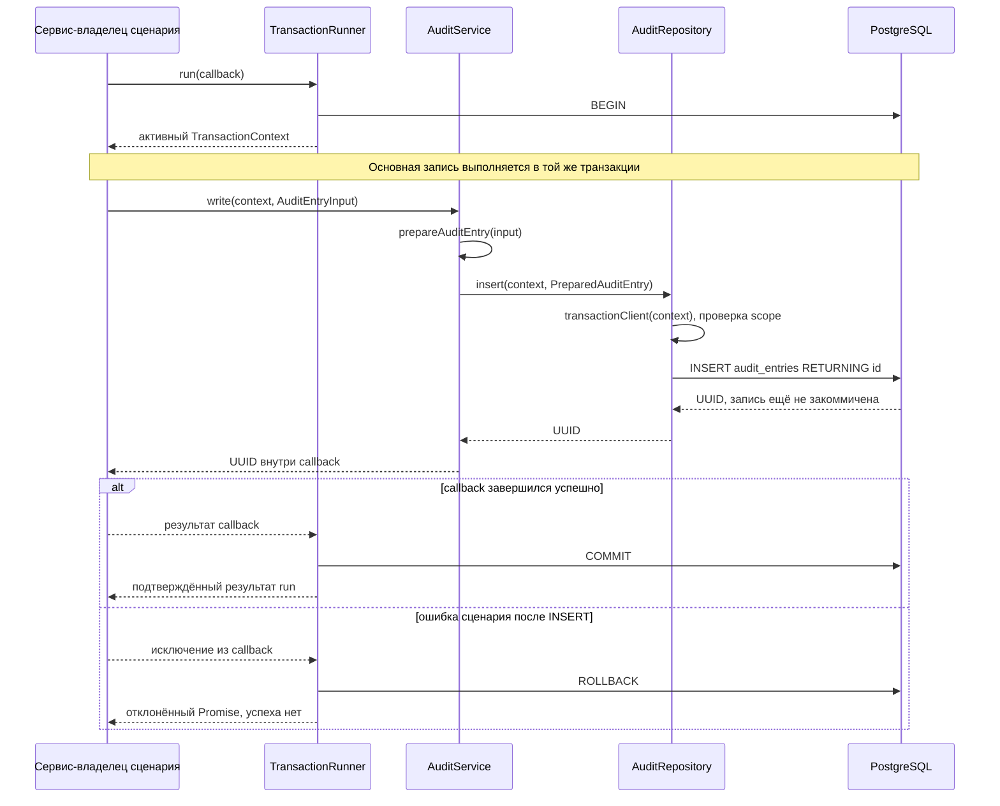

# Audit module

Модуль владеет append-only бизнес-аудитом и его внутренним write interface WMS-103.

## Для менеджера

Фиксирует, кто, когда, над каким объектом выполнил действие и на каком основании.
Ошибка записи истории откатывает связанную операцию. Исправление оформляется новой
записью, не редактированием старой. Авторизация пользователей и экран истории ещё
не реализованы. DBA может изменить БД: криптографической защиты журнала нет.

Критерий текущей реализации: техническая metadata-запись и история атомарны,
права runtime не позволяют изменить/удалить audit, unsafe data отфильтрованы.

## Для разработчика

| Файл | Назначение |
|---|---|
| audit.module.ts | Nest composition, private AuditRepository и экспорт AuditService |
| [services/audit.service.ts](services/audit.service.ts) | Сценарий записи: validation/redaction, вызов repository |
| [repositories/audit.repository.ts](repositories/audit.repository.ts) | SQL INSERT с обязательным действующим context, без собственного commit |
| [dto/audit-entry.dto.ts](dto/audit-entry.dto.ts) | Внутренние AuditEntryInput/PreparedAuditEntry/SafeAuditChange |
| [audit-entry.ts](audit-entry.ts) | Чистые helpers валидации/маскирования |
| audit.schema.ts | Drizzle таблица, constraints и индексы |

Внешние модули вызывают AuditService.write(context,input), который возвращает UUID.
Сервис использует конкретный repository через Nest DI; отдельного AuditWriter port/token нет.
Repository не получает pool и не создаёт транзакцию. Ошибка validation/SQL
передаётся вызывающему сервису и должна откатывать весь сценарий. Повтор write
в новой транзакции создаёт новую запись: это не HTTP/consumer deduplication.

Endpoints, read interface, event producer/consumer и собственная конфигурация отсутствуют.
Общий DB URL и pool конфигурируются database adapter. Событий аудита нет, поэтому
рекурсивного audit-of-audit здесь не создаётся.

Input/схема/роль/допустимые поля подробно описаны в
[transactions.md](../../../../../docs/transactions.md). Actor IDs и correlation IDs — UUID,
reasonCode — код, не свободный комментарий. Метаданные запроса и secrets не передавать.
Raw SQL audit INSERT из других модулей запрещён. Не логировать SQL errors с полным input.

Генерация/применение: `pnpm db:generate`, `pnpm db:migrate`. Permissions/trigger —
отдельная custom SQL migration 0002, схема — generated 0001. Применённые файлы не менять.
Для migration нужны соответствующие DB права; Compose dev-admin не production login.

Проверки: `pnpm test:unit`, `pnpm test:integration`, `pnpm typecheck`.
Unit audit-entry.spec.ts проверяет маскирование, audit.service.spec.ts — делегирование
безопасных данных и проброс ошибок; transactions-audit.spec.ts —
атомарность, роли и PostgreSQL constraints/trigger. Fixture audit.fixture.ts —
только синтетические UUID/коды. Собственных метрик и admin API пока нет.
При ошибке записи откатывается сценарий; диагностика по безопасному correlationId,
ремонт через прямое редактирование журнала не является штатной операцией.
Связанные решения: [ADR-0002](../../../../../docs/adr/0002-postgresql-inventory.md),
[ADR-0008](../../../../../docs/adr/0008-transactions-and-audit.md) и
[ADR-0009](../../../../../docs/adr/0009-nest-service-repository-default.md).

## Схема взаимодействия

Сейчас это внутренний модуль: вход — AuditService.write от другого сервиса.
HTTP controller, auth guard и consumer аудита пока отсутствуют. Сервис-владелец
складского сценария ещё не реализован; его роль в действующих integration tests
выполняет технический сценарий с metadata. Общая цепочка уже проверена на PostgreSQL:



Validation error останавливает исполнение до repository/INSERT. При SQL error
оставшиеся стрелки успешного пути также не выполняются; исключение приводит
к тому же ROLLBACK. Ветка ошибки на диаграмме показывает сбой после INSERT. Ошибка COMMIT может означать неизвестный исход при
потере связи; поведение описано в общей retry policy, автоматического повтора нет.

## Движение данных по шагам

| Шаг | Вход → результат | Ответственность |
|---|---|---|
| 1 | Команда/доверенный actor → AuditEntryInput | Вызывающий сервис формирует коды действия/основания, UUID объекта и correlationId; actor не берётся из произвольного body |
| 2 | run(callback) → TransactionContext | Runner открывает одну транзакцию; context передаётся явно, не является сериализуемым DTO |
| 3 | AuditEntryInput → PreparedAuditEntry | AuditService вызывает prepareAuditEntry: проверяет обязательные поля, оставляет безопасные changes, ставит redaction flag |
| 4 | context + PreparedAuditEntry → SQL INSERT | AuditRepository разрешает только активный context; schema задаёт колонки/defaults, SQL constraints защищают форму записи |
| 5 | INSERT → UUID | PostgreSQL создаёт id и occurredAt; repository возвращает только id, не ORM row; durable commit ещё не произошёл |
| 6 | Успешный callback → COMMIT → результат run | Владелец сценария может сообщить успех только после завершения run; ошибка откатывает основную запись и audit вместе |

DTO в dto/audit-entry.dto.ts — внутренние TypeScript interfaces, не HTTP DTO
с class-validator. Runtime validation реализована prepareAuditEntry в сервисном
пути. TransactionContext передаётся отдельным аргументом; DTO не содержит DB client.
Результат write — UUID. Полная строка аудита не возвращается, read API ещё нет.

## Пример преобразования

Все значения ниже синтетические; это пример внутреннего вызова, не существующий HTTP endpoint.
Сервис получает AuditEntryInput:

```json
{
  "actorType": "system",
  "actorId": "11111111-1111-4111-8111-111111111111",
  "action": "technical.metadata-created",
  "entityType": "technical-metadata",
  "entityId": "22222222-2222-4222-8222-222222222222",
  "correlationId": "33333333-3333-4333-8333-333333333333",
  "reasonCode": "integration-check",
  "changes": {
    "status": { "before": "draft", "after": "posted" },
    "password": { "after": "example-not-a-real-password" }
  }
}
```

Идентификаторы и коды проходят без изменения. Фрагмент PreparedAuditEntry,
передаваемый в repository:

```json
{
  "changes": { "status": { "before": "draft", "after": "posted" } },
  "hasRedactedChanges": true
}
```

Поле password и его значение не сохраняются. id/occurredAt в DTO не задаются —
их создаёт PostgreSQL. Пример вызова из тестового/будущего вызывающего сервиса:

```ts
const id = await transactions.run(async context => {
  // Основное изменение через repository своего модуля получает этот же context.
  return auditService.write(context, input);
});
// Здесь run завершён: id относится к подтверждённой транзакции.
```

transactions — внедрённый TransactionRunner, auditService — экспорт AuditModule,
input — объект выше. Пример показывает вызов, не самостоятельный bootstrap приложения.

## Ошибки и повтор

| Отказ | Где останавливается цепочка | Результат |
|---|---|---|
| Неверный actorId/action/reasonCode | AuditService, до repository | Ошибка без значения input; при распространении ошибки сценарий откатывается |
| Неизвестное/небезопасное changes-поле | Подготовка DTO в сервисе | Поле удаляется, hasRedactedChanges=true; допустимая запись продолжается |
| Поддельный, чужой или завершённый context | AuditRepository до SQL | Нет отдельной транзакции или fallback-подключения, Promise отклоняется |
| SQL/constraint error | PostgreSQL/repository | Ошибка передаётся наверх; вызывающий сервис не игнорирует её, runner выполняет rollback |
| Ошибка после успешного audit INSERT | Вызывающий сценарий | Audit и основная запись откатываются вместе |
| Повтор write в новом run | Новый вызов сервиса | Новая запись с новым UUID; deduplication пока не реализована |

Общий retry/recovery-контекст — [transactions](../../../../../docs/transactions.md),
а [event-recovery](../../../../../docs/runbooks/event-recovery.md) относится к будущей
доставке outbox, не к ремонту текущей audit-таблицы.

Подтверждающие тесты: [service](../../../test/unit/audit.service.spec.ts),
[validation/redaction](../../../test/unit/audit-entry.spec.ts),
[реальная транзакция, роли и rollback](../../../test/integration/transactions-audit.spec.ts).

WMS-104: OperationMetadata переиспользуется из shared/operations; UUID и stock
quantity validation — из shared/validation и shared/quantities. Для quantity,
onHand/reserved allowlist теперь также ограничен int4 максимумом 2147483647.
Прочие audit поля/маскирование не меняются. Movement хранит FK на audit UUID.
