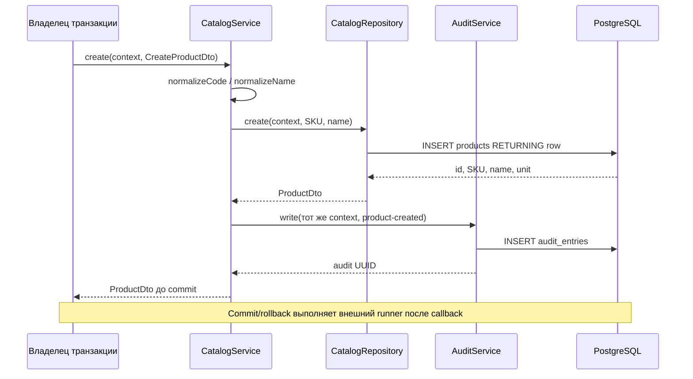

# Catalog module

Минимальный внутренний справочник товаров WMS-104. Владелец таблицы products — catalog.

## Для менеджера

Товар имеет UUID, уникальный SKU, название и единицу piece (штука). SKU приводится
к uppercase: demo-1 и DEMO-1 считаются одним кодом. Название не попадает в audit payload.
Организация пока одна, поэтому SKU уникален глобально. UI, HTTP CRUD, изменение и
удаление товаров ещё не реализованы. Создание используется dev fixtures и тестами.

## Для разработчика

| Файл                               | Назначение                                                     |
| ---------------------------------- | -------------------------------------------------------------- |
| catalog.module.ts                  | Экспорт CatalogService, private repository, импорт AuditModule |
| services/catalog.service.ts        | create(context,input), requireProduct(context,id)              |
| repositories/catalog.repository.ts | INSERT/lookup только собственной products table                |
| dto/product.dto.ts                 | CreateProductDto и ProductDto, не HTTP классы                  |
| catalog.schema.ts                  | id UUID, SKU unique/code, name 1..160, unit=piece              |

Сервис не открывает run. Внешний сервис передаёт существующий TransactionContext.
create нормализует SKU/name, делает INSERT, затем вызывает AuditService с тем же
context. Любая ошибка должна выйти в runner и откатить обе записи. requireProduct
проверяет UUID и существование; inventory использует этот сервис вместо SQL к products.
Типы входа — внутренние DTO; validation выполняется сервисом/shared helpers,
метаданные actor/correlation/reason проверяет AuditService. Auth пока нет, caller доверенный.

## Схема взаимодействия

Движение данных: input {sku: " demo-1 ", name: " Demo ", actor/correlation/reason}
→ нормализация → SQL {sku: "DEMO-1", name: "Demo"} → ProductDto
{id: UUID, sku: "DEMO-1", name: "Demo", unit: "piece"} → audit без SKU/name.
Это синтетический пример внутреннего вызова, не существующий endpoint.

Ошибки invalid SKU/name/UUID происходят до соответствующего SQL; unknown id —
Product not found. Duplicate SKU — PostgreSQL 23505. Invalid audit metadata после
INSERT также откатывает product, если ошибка не подавлена. Повтор create не является
идемпотентным: прежний SKU отклоняется. requireProduct ничего не изменяет, но требует context.

## Проверки и ограничения

pnpm test:unit / test:integration / typecheck. Реальные tests:
[stock.spec.ts](../../../test/integration/stock.spec.ts),
[stock-quantity.spec.ts](../../../test/unit/stock-quantity.spec.ts).
Конфигурация — общий DATABASE_URL, собственных переменных/метрик/events нет.
Runtime group получает SELECT/INSERT; owner/admin не является защищённой стороной.
Migrations 0003/0004 применяются pnpm db:migrate, dev fixtures — pnpm db:seed.
[Складской baseline](../../../../../docs/stock-baseline.md), [план](../../../../../docs/development-plan.md).

WMS-108: ReceivingService вызывает requireProduct при draft и через inventory при posting.
Missing product — typed CommandError PRODUCT_NOT_FOUND (HTTP 422); неожиданные SQL ошибки
не превращаются в отсутствие товара. Публичный CRUD не добавлен.
