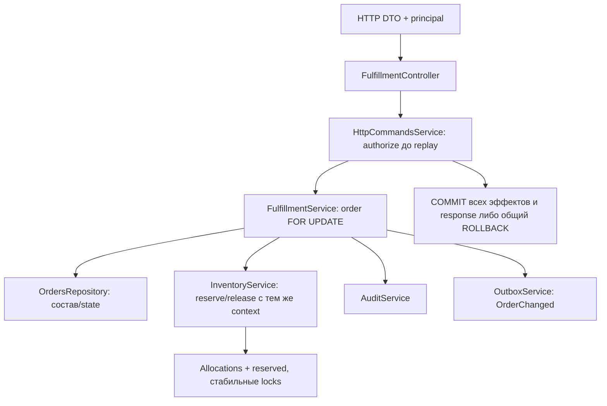
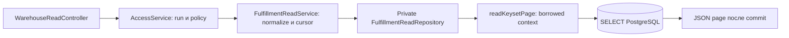

# Fulfillment: заказ, резервирование и сборка

## Для менеджера

Один заказ содержит 1..1000 разных товаров одного склада, quantity int4 в целых штуках.
Draft отдельно подтверждается в active. Можно явно зарезервировать часть заказа: на 10
заказать резерв 6 и оставить open=4. Если запрошены 10 при доступных 6, ничего не резервируется.
Release части возвращает её в open. Cancel до сборки освобождает все резервы и закрывает заказ.
При reserve/release stock физически не перемещается. При сборке WMS-205 товар и его
резерв переносятся в отгрузку вместе. TTL/expiration нет, решение об освобождении явное.

## Границы и интерфейсы

Controller → FulfillmentService → private OrdersRepository. Модуль экспортирует только
FulfillmentService, не repository. Сервис владеет orders/order_lines и общим callback context.
InventoryService единолично меняет allocations/reserved, audit/outbox — публичные сервисы.
Worker FulfillmentModule не импортирует: здесь API graph с Identity/Idempotency.

Входные UUID/количества/лишние поля валидируют DTO и сервис. Controller нормализует plain JSON
до fingerprint; actor/status не берутся из body. Права по actual warehouse проверяются до replay.
Межсервисные вызовы заимствуют context, не открывают nested run и не выполняют внешнего I/O.
Order lock сериализует reserve/release/cancel; inventory locks storage по product/location UUID.

## API и результат

POST /api/v1/orders — create, POST /:id/confirm — confirm, GET /:id — current snapshot,
POST /:id/reserve — lines[{lineId,quantity}], POST /:id/allocations/:allocationId/release — quantity,
POST /:id/cancel — пустая команда. Создание/confirm требуют order, reserve — reserve,
release/cancel — cancel, GET — read на склад. Все mutations — session/CSRF/Origin/key.
OrderDto/OrderLineDto/AllocationDto формируют Swagger output; OpenAPI генерируется штатно.

Пример: active order quantity=10, reserve=6 → open=4/reservedStorage=6. Release 2 → open=6,
active=4/released=2. Cancel → cancelled=10, active=0/released=6, stock.onHand прежний.
SQL/audit/outbox fault откатывает всю команду; исходный key затем можно повторить.
Новый key на terminal state →409; stale permissions →403 даже при сохранённом результате.

Факт fulfillment.order-changed v1 принадлежит order aggregate и содержит orderId/action.
Новых consumers пока нет; retained outbox факт не означает внешнюю доставку. История allocations
и immutable audit объясняют точные quantities. Движений физического stock при reserve/release нет.

## Файлы, эксплуатация и проверки

schemas/orders.schema.ts — DDL и объяснения типов; repositories/orders.repository.ts — SQL;
services/fulfillment.service.ts — сценарии; fulfillment.controller.ts/module.ts — API composition.
dto/create-order/reserve-order/release-allocation — input, dto/order/order-line/allocation — output.
Связанная allocation schema/services/repository принадлежат inventory. Migrations 0022–0024 новые,
applied SQL не редактируется; config и prerequisites те же, что у API (явная auth policy).

Подробный владелец шагов, Mermaid, ошибок, SQL, конкуренции и recovery —
[docs/flows/reservations.md](../../../../../docs/flows/reservations.md).
[Integration](../../../test/integration/reservations.spec.ts) проверяет real PostgreSQL locks,
reconciliation, faults/replay и runtime role. [DTO tests](../../../test/unit/order-dto.spec.ts)
проверяют input limits без Docker. [ADR-0022](../../../../../docs/adr/0022-order-reservations.md).

Сборка реализована WMS-205, отгрузка и возврат при отмене — WMS-206. Нет UI, automatic expiry или purge истории.
Allocation history в текущем GET пока не пагинируется. DBA способен обойти guards.

## Сборка WMS-205

Менеджер создаёт план из текущего резерва. Кладовщик сам принимает его через start.
Подтверждает только закреплённый исполнитель с действующим складским доступом.
Частичное подтверждение переносит найденное и сохраняет резерв недособранного.
Нехватка сама не списывает остатки. После shortage сборщик возобновляет задание через start.
Переназначения в этом API нет. До переноса отмена заказа закрывает план и освобождает резерв.
После переноса отмена переводит заказ в cancel_pending; закрытие требует подтверждения физического возврата WMS-206.

PickingController → HttpCommandsService → PickingService → PickingRepository.
PickingService вызывает InventoryService.pickReservedQuantity с тем же context.
Inventory пишет stock, allocations, историю переноса и движения. Fulfillment пишет
состояние, аудит и PickingProgressed v1; saved HTTP result фиксируется в том же commit.
Ошибка любого шага откатывает весь сценарий. GET удерживает order SHARE.

Схемы, последовательности, пример 10 → 6+4, команды, состояния и ошибки имеют одного
владельца — [флоу сборки](../../../../../docs/flows/picking.md).
[PostgreSQL tests](../../../test/integration/picking.spec.ts) подтверждают гонки, rollback,
ACL/replay и runtime role. Решение — [ADR-0023](../../../../../docs/adr/0023-picking-execution.md).

Новые файлы: picking.controller.ts; services/picking.service.ts;
repositories/picking.repository.ts; schemas/picking.schema.ts;
dto/confirm-picking.dto.ts, picking-line.dto.ts и picking-task.dto.ts.
Внутренний PickingService не экспортируется из Nest-модуля. Inventory не импортирует
его или OrdersRepository. Миграции 0026/0027 добавляют новые таблицы и guards.

Review WMS-205, 2026-11-02: migration 0028 дополнительно проверяет открытые планы при
изменении allocation, даже если release вызван другим сервисом. Deferred проверка
разрешает согласованную отмену в общей транзакции. [Подробный SQL-флоу и тесты](../../../../../docs/flows/picking.md#защита-обеспечения-при-изменении-allocation-review-2026-11-02).

## Отгрузка и физическая компенсация WMS-206

Оператор с правом ship готовит shipment из shipping allocations своего заказа и проводит
его. Draft не резервирует повторно; posting перепроверяет покрытие под order/header locks.
Списание уменьшает stock и резерв вместе. Несколько partial shipment допустимы.
Полностью исполненный заказ — completed, а posted документ не переоткрывается.

Менеджер запрашивает отмену. Если есть staged, cancel_pending сохраняет товар/резерв
и запрещает дальнейшее исполнение. Оператор с return физически перемещает весь staged
остаток в storage и подтверждает вектор с reasonCode. Отмена закрывает только неотгруженное:
closed_mixed сохраняет shipped, cancelled означает отсутствие shipped. Исторический pickedTotal
не исчезает. Произвольного списания недостачи или возврата shipped товара нет.

ShippingController → HttpCommandsService → ShippingService → ShipmentsRepository.
ShippingService вызывает InventoryService.applyShippingEffects в том же context;
inventory записывает расход/возврат и историю. Audit/outbox/saved result — один commit.
Ошибка любого шага откатывает все учётные записи. Действия оператора происходят вне DB locks.

[Подробный владелец флоу](../../../../../docs/flows/shipping.md) содержит реальные endpoints,
DTO, примеры, Mermaid, состояния, SQL и ошибки. [PostgreSQL tests](../../../test/integration/shipping.spec.ts)
проверяют race/fault/replay/roles. [ADR-0024](../../../../../docs/adr/0024-shipment-compensation.md).
Новые source: schemas/shipments.schema.ts; repositories/shipments.repository.ts;
services/shipping.service.ts; shipping.controller.ts; DTO prepare-shipment/line,
shipment/line, reason и cancellation-return/line. ShippingService и repository — private providers.

Review WMS-206: migration 0031 запрещает дополнение состава shipment после транзакции
создания. Multi-line prepare создаёт header/lines вместе; posting в новой транзакции
остаётся допустимым. ShippingChanged требует shipmentId для shipment action, но не
для отмены заказа. [Подробности и regression evidence](../../../../../docs/flows/shipping.md#исправления-review-состав-документа-и-идентичность-события).

## Чтение WMS-207

Для менеджера: `GET /api/v1/warehouses/:warehouseId/` со списками `orders, picking-tasks, shipments`
возвращает данные одного разрешённого склада. Право `read` проверяется для каждой
страницы. Полные документы и задания остаются в существующем detail API.

Для разработчика: `FulfillmentReadService` экспортируется, `FulfillmentReadRepository`
остаётся private provider. Query/read DTO лежат отдельно в dto/. API-only
WarehouseReadController регистрируется AppModule, worker его не импортирует.

[Шаги, DTO/пример, commit/rollback, ошибки, индексы и согласованность](../../../../../docs/flows/warehouse-reads.md).
Тесты: warehouse-reads.spec.ts, warehouse-read-plans.spec.ts, keyset-page.spec.ts.
Чтение не создаёт audit, event или HTTP idempotency запись. SQL timeout/ошибка
откатывает read run; публичный ответ не содержит SQL, credentials и ORM-модели.
