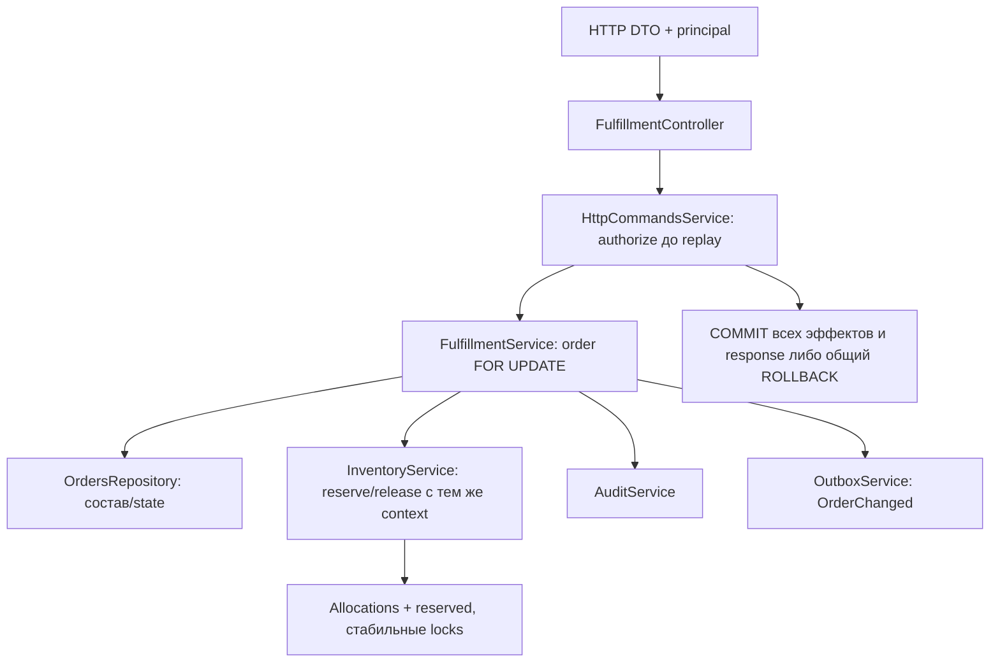

# Fulfillment: заказ и резервирование WMS-204

## Для менеджера

Один заказ содержит 1..1000 разных товаров одного склада, quantity int4 в целых штуках.
Draft отдельно подтверждается в active. Можно явно зарезервировать часть заказа: на 10
заказать резерв 6 и оставить open=4. Если запрошены 10 при доступных 6, ничего не резервируется.
Release части возвращает её в open. Cancel до сборки освобождает все резервы и закрывает заказ.
Stock физически не перемещается, onHand неизменен. TTL/expiration нет, решение об освобождении явное.

## Границы и интерфейсы

Controller → FulfillmentService → private OrdersRepository. Модуль экспортирует только
FulfillmentService, не repository. Сервис владеет orders/order_lines и общим callback context.
InventoryService единолично меняет allocations/reserved, audit/outbox — публичные сервисы.
Worker FulfillmentModule не импортирует: здесь API graph с Identity/Idempotency.

Входные UUID/количества/лишние поля валидируют DTO и сервис. Controller нормализует plain JSON
до fingerprint; actor/status не берутся из body. Права по actual warehouse проверяются до replay.
Межсервисные вызовы заимствуют context, не открывают nested run и не выполняют внешнего I/O.
Order lock сериализует reserve/release/cancel; inventory locks storage по product/location UUID.

## API и результат

POST /api/v1/orders — create, POST /:id/confirm — confirm, GET /:id — current snapshot,
POST /:id/reserve — lines[{lineId,quantity}], POST /:id/allocations/:allocationId/release — quantity,
POST /:id/cancel — пустая команда. Создание/confirm требуют order, reserve — reserve,
release/cancel — cancel, GET — read на склад. Все mutations — session/CSRF/Origin/key.
OrderDto/OrderLineDto/AllocationDto формируют Swagger output; OpenAPI генерируется штатно.

Пример: active order quantity=10, reserve=6 → open=4/reservedStorage=6. Release 2 → open=6,
active=4/released=2. Cancel → cancelled=10, active=0/released=6, stock.onHand прежний.
SQL/audit/outbox fault откатывает всю команду; исходный key затем можно повторить.
Новый key на terminal state →409; stale permissions →403 даже при сохранённом результате.

Факт fulfillment.order-changed v1 принадлежит order aggregate и содержит orderId/action.
Новых consumers пока нет; retained outbox факт не означает внешнюю доставку. История allocations
и immutable audit объясняют точные quantities. Движений физического stock при reserve/release нет.

## Файлы, эксплуатация и проверки

schemas/orders.schema.ts — DDL и объяснения типов; repositories/orders.repository.ts — SQL;
services/fulfillment.service.ts — сценарии; fulfillment.controller.ts/module.ts — API composition.
dto/create-order/reserve-order/release-allocation — input, dto/order/order-line/allocation — output.
Связанная allocation schema/services/repository принадлежат inventory. Migrations 0022–0024 новые,
applied SQL не редактируется; config и prerequisites те же, что у API (явная auth policy).

Подробный владелец шагов, Mermaid, ошибок, SQL, конкуренции и recovery —
[docs/flows/reservations.md](../../../../../docs/flows/reservations.md).
[Integration](../../../test/integration/reservations.spec.ts) проверяет real PostgreSQL locks,
reconciliation, faults/replay и runtime role. [DTO tests](../../../test/unit/order-dto.spec.ts)
проверяют input limits без Docker. [ADR-0022](../../../../../docs/adr/0022-order-reservations.md).

Нет picking/shipping/consumed и staged возврата, UI, automatic expiry или purge истории.
Allocation history в текущем GET пока не пагинируется. DBA способен обойти guards.
