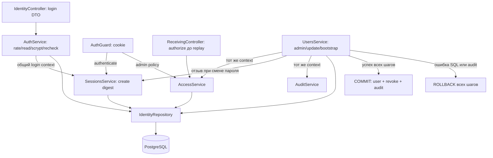

# Identity: пользователи, сессии и складские права

## Для менеджера

Модуль проверяет личность пользователя и его доступ к складам. Пользователь может войти,
получить свой профиль и выйти. Системный администратор создаёт пользователей,
назначает роли и отзывает сессии. Роль на складе A не даёт прав на склад B.
Матрица ролей принята в ADR-0019. Способ входа и границы защиты описаны в ADR-0018.
Пользовательский интерфейс, единый вход через внешнего провайдера и многофакторная
аутентификация ещё не реализованы. Публичной регистрации и внешнего развёртывания нет.

Пример: у пользователя роль кладовщика на складе A и наблюдателя на складе B.
Он может провести приёмку на A и читать документы B. Проведение приёмки на B даёт 403.
После отзыва роли сервер запрещает и новую команду, и получение сохранённого ответа
прежней команды. Истёкшая или отозванная сессия даёт 401. Блокировка пользователя
также запрещает доступ. Истечение сессии не освобождает товарный резерв: это отдельное
бизнес-правило B4.

## Ответственность и публичный интерфейс

Модуль экспортирует четыре сервиса. IdentityRepository и IdentityTransactionsService остаются
внутренними providers; другим модулям запрещены прямые записи users/sessions/grants.
Worker не импортирует identity HTTP graph. Большого IdentityService и отдельного facade нет.

| Сервис          | Ответственность и реальные потребители                                                                                                   |
| --------------- | ---------------------------------------------------------------------------------------------------------------------------------------- |
| AuthService     | login/logout: credentials, rate windows, scrypt вне SQL, координация SessionsService; IdentityController                                 |
| SessionsService | create/authenticate/requireSession/logout/revoke: digest, сроки, idle touch, отзыв; AuthService, AccessService, UsersService и AuthGuard |
| UsersService    | current/createUser/updateUser/setRoles/revokeSession/bootstrap: профиль, admin mutations, последний admin, audit; оба контроллера и CLI  |
| AccessService   | requireAdmin/requireWarehouse и короткий run для guard/read: session + актуальная policy; UsersService, AuthGuard и ReceivingController  |

IdentityTransactionsService переиспользует runner + прежний 5-second timeout, а не открывает
транзакцию при каждом межсервисном вызове. Например, UsersService.updateUser передаёт один
context в AccessService.requireAdmin, SessionsService.revoke и AuditService.write.
Любая ошибка откатывает одновременно пользователя, отзыв и аудит. Нельзя вызвать
AccessService.run/SessionsService.authenticate внутри уже открытого command callback:
использовать requireWarehouse/requireSession с его context.

Секреты не передаются в saved HTTP result/audit/logs: token только cookie, в БД digest;
пароль только salted scrypt hash. toUserProfile — общая внутренняя allowlist-проекция для
login/current/admin; SessionsService.requireSession тоже возвращает безопасный профиль.
Пользовательские поля не выбирают server actor. Подробности исполнения и гонок —
[docs/flows/identity.md](../../../../../docs/flows/identity.md).

Движение данных: guard → SessionsService проверяет cookie, active и сроки; HTTP DTO pipe
валидирует input; controller выбирает AuthService либо UsersService. В admin callback
AccessService повторяет допуск, UsersService меняет пользователя, SessionsService отзывает
сессии без собственного commit, AuditService пишет факт. Repository выполняет parameterized SQL.
Controller выставляет cookie/ответ после commit. Login использует отдельные rate/read/session
транзакции и scrypt между ними. При ошибке session INSERT cookie не выдаётся.

Пример: PATCH /api/v1/identity/users/:userId с {"active":false} от system_admin после commit
возвращает безопасный профиль с active=false; все сессии target отозваны, audit сохранён.
Если audit упал, active/password hash и сессии остаются прежними, HTTP даёт безопасный 500.
Real PostgreSQL test `password update and delegated session revoke roll back together when audit fails`
проверяет эту границу после межсервисного вызова, а не только отдельные mock методы.

## HTTP API и безопасные результаты

Все пути начинаются с `/api/v1`. Технические `/` и `/health` остаются public.

| Endpoint                                                   | Доступ / результат                                                                        |
| ---------------------------------------------------------- | ----------------------------------------------------------------------------------------- |
| POST /auth/login                                           | Origin + JSON + X-CSRF-Protection:1; 200 user/csrfToken + cookie; общий 401 либо 429      |
| GET /auth/me                                               | Действующая session; 200 user/свои warehouseRoles/csrfToken                               |
| POST /auth/logout                                          | Session + Origin/JSON/CSRF; 204 после server revoke и clear cookie                        |
| POST /identity/users                                       | system_admin + CSRF; 201 безопасный профиль, duplicate login 409                          |
| PATCH /identity/users/:userId                              | system_admin + CSRF; 200, active/password change отзывает target sessions; last admin 409 |
| POST /identity/users/:userId/warehouses/:warehouseId/roles | system_admin + CSRF; 201, полная замена одного склада, [] отзывает доступ                 |
| DELETE /identity/users/:userId/sessions                    | system_admin + CSRF; 200 после отзыва всех target sessions                                |
| DELETE /identity/users/:userId/sessions/:sessionId         | system_admin + CSRF; 200 после адресного отзыва                                           |

Auth/credential admin endpoints не используют business Idempotency-Key/cache, чтобы
не хранить быстрый SHA-256 fingerprint пароля. Receiving по-прежнему требует key,
а callback authorization вызывается **до** dedup и держит locks до commit.
Ошибки статические application/problem+json: 400 validation, 401 session/credentials,
403 permissions/CSRF, 404 user/object, 409 duplicate/last admin, 429 login budget,
500 неизвестный storage failure, 503 потеря ресурса/DB. Ответы no-store, SQL/hash/stack не раскрываются.
[Generated OpenAPI](../../../../../docs/contracts/openapi.json) создаётся штатным generator.

## DTO: один контракт — один файл

| Файл в dto/                | Доверие / назначение                                          |
| -------------------------- | ------------------------------------------------------------- |
| login.dto.ts               | Недоверенные credentials с форматами/длиной                   |
| create-user.dto.ts         | Admin input нового пользователя, наследует login fields       |
| update-user.dto.ts         | Admin active/systemAdmin/password, без ввода hash             |
| set-warehouse-roles.dto.ts | Полная замена уникальных warehouse roles                      |
| principal.dto.ts           | Внутренний trusted userId/sessionId после guard; не HTTP body |
| warehouse-role.types.ts    | Принятые имена ролей и server-side действий                   |
| user-profile.dto.ts        | Безопасный output, без credential/session hash                |
| login-response.dto.ts      | User + CSRF; token остаётся в cookie                          |
| warehouse-grant.dto.ts     | Связанные warehouseId/role, не независимые списки             |
| current-user.dto.ts        | Профиль/CSRF и свои grants                                    |

Старого identity.dto.ts/barrel нет: явные imports показывают зависимость от конкретного
контракта, output DTO не тянут все input decorators. DTO и ORM-модели не смешиваются.

## Schemas: одна таблица — один файл

| Файл в schemas/              | Причина выбора модели                                                                 |
| ---------------------------- | ------------------------------------------------------------------------------------- |
| users.schema.ts              | UUID identity, unique normalized login, fixed-format scrypt hash, active/global admin |
| sessions.schema.ts           | Digest token, FK user, absolute/idle timestamptz, retained revoked date, user index   |
| warehouse-roles.schema.ts    | Composite PK user/warehouse/role и FK, защищающие связанное назначение                |
| login-windows.schema.ts      | Shared PostgreSQL rate-limit окна, hash ключей и int4 saturation                      |
| identity-bootstrap.schema.ts | Единственный retained marker initial для one-time bootstrap                           |

В каждом файле есть file-level описание, русские JSDoc полей и объяснения типов/default/
NULL/keys. Агрегатор infrastructure/database/schema.ts экспортирует таблицы напрямую;
перенос файлов не меняет DDL, `pnpm db:generate` подтверждает отсутствие новых изменений.
[Нюансы PostgreSQL/JS](../../../../../docs/database-types.md). Migrations 0018/0019 создают
23-table baseline, runtime grants и bootstrap group/trigger; applied SQL не форматировать/редактировать.

Остальные файлы: identity.module.ts — composition; identity.config.ts — validated policy;
identity.http.ts — metadata/request principal/cookie/CSRF; controllers — transport;
services/auth.service.ts, sessions.service.ts, users.service.ts, access.service.ts — владельцы
сценариев; services/identity-transactions.service.ts — общий внутренний bounded run;
services/user-profile.ts — безопасная проекция; repositories/identity.repository.ts — SQL;
bootstrap.ts — отдельный executable первого admin, не seed и не HTTP backdoor.

## Конфигурация и запуск

AUTH_ORIGIN обязателен: ровно origin, production HTTPS; dev/test HTTP — loopback.
AUTH_SESSION_ABSOLUTE_SECONDS и AUTH_SESSION_IDLE_SECONDS обязательны явно, 30..86400,
idle<=absolute. Числа 12h/30m пока не утверждены и не подставляются автоматически.
Без настроек API/bootstrap fail closed; `.env.example` оставляет сроки пустыми.
Сначала оператор выбирает/задаёт их, затем build/migrate и одноразовый bootstrap.
Для Compose NODE_ENV=production нужен HTTPS AUTH_ORIGIN, перед внешним доступом TLS gateway.

Bootstrap требует IDENTITY_BOOTSTRAP_ENABLED=true только на вызов, локальный DB host
либо dev/test Docker postgres, DB role warehouse_identity_bootstrap и отсутствие users/marker.
Пароль подаётся stdin. Пример без argv/env/history секретов находится в flow; готовая CLI
`pnpm identity:bootstrap` после build. Marker не удалять для повторного использования.
Общих credentials в миграциях, API startup или fixtures рабочего окружения нет.

## Проверки и ограничения

[Integration](../../../test/integration/identity.spec.ts): реальная БД, login/logout,
expiry/revoke, CSRF/ACL/replay, locks, last-admin race, SQL faults, compiled bootstrap.
[Unit](../../../test/unit/identity.spec.ts): hashing/tokens/конфигурация; существующие
receiving/http suites используют реальные session fixtures из test/support, не bypass.
Docker gate тоже проходит реальный bootstrap/login/role assignment; fake actor удалён.
[Отчёт WMS-202](../../../../../docs/reports/wms-202.md) фиксирует числа и реально проверенные команды.

Складские права проверяются в работающих API приёмки, размещения и заказов с резервированием.
Сборка и отгрузка ещё не реализованы. Матрица определяет их будущие права, но не создаёт API.
Нет защиты от администратора БД или захвата сервера. Нет многофакторной аутентификации,
внешнего единого входа, интерфейса восстановления пароля и автоматического удаления сессий.
Политика доверенного прокси и защита от массовых сетевых запросов требуют отдельной настройки.
Внешнее развёртывание не выполнялось.

## Покрытие transport и ветвей отказа

`pnpm test:identity:coverage` запускает все unit/integration suites и формирует V8 HTML
в apps/backend/coverage/identity/index.html. IdentityController имеет обязательный порог
100% statements/branches/functions/lines; отдельный config проверяется тем же Jest.
[Команды и ограничения измерения](../../../test/README.md#проверка-покрытия-identity).

[Controller unit](../../../test/unit/identity.controller.spec.ts) проверяет login/me/logout,
HTTP/HTTPS cookie attributes, safe JSON/no-store/Vary, socket fallback, ожидание commit,
отсутствие Set-Cookie/clear-cookie/204 при отказе владельца сценария.
[HTTP unit](../../../test/unit/identity-http.spec.ts) — cookie ambiguity/length, immutable
principal и exact Origin/JSON/CSRF. [Auth unit](../../../test/unit/auth.service.spec.ts)
контролирует отказ при изменении credentials между read/recheck и crypto overload.
Моки задают fault boundaries, не заменяя production SQL integration tests.

Integration проверяет адресный revoke без затрагивания второй/чужой сессии, удаление
ролей только выбранного склада с audit, отсутствующего admin target, malformed login DTO,
logout SQL rollback и все действия матрицы ADR-0019 для четырёх warehouse ролей.
Bootstrap остаётся отдельным настоящим child CLI test; parent V8 coverage его не объединяет.

Logout получает session UPDATE lock до проверки valid; параметр `sessionLock: 'update'`
не продлевает срок. User lock предшествует session lock. Два logout сериализуются без upgrade
с SHARE: первый revoke commit, второй после ожидания получает UNAUTHORIZED. Regression case
с двумя SQL waits включён в integration/identity.spec.ts; схема —
[identity flow](../../../../../docs/flows/identity.md#logout-исправление-lock-upgrade).

## Собственные административные операции и понятные имена методов

При изменении собственного пользователя, назначении себе ролей или отзыве своих сессий
UsersService вызывает `requireAdminBeforeUserMutation` после общей административной блокировки.
Метод сначала берёт UPDATE пользователя. Затем AccessService проверяет сессию и права.
Параллельный вход по cookie ждёт пользователя, поэтому цикл user SHARE → session UPDATE
больше не возникает. Для чужого пользователя порядок прежний: инициатор и его сессия,
затем целевой пользователь. UUID сравниваются без учёта регистра.
Подробная последовательность и исходы — [владелец флоу](../../../../../docs/flows/identity.md#собственные-административные-операции).

Имена внутреннего репозитория показывают действия:
`setLocalTransactionTimeouts`, `findUserByLogin`, `lockAndFindUser`,
`findSessionByTokenHash`, `lockSessionAndReadValidity`, `refreshSessionIdleDeadline`.
Проверка валидности не продлевает срок. SessionsService вызывает продление отдельно
только для действующей сессии под UPDATE в той же транзакции.
Именованные параметры `sessionLock` и `refreshIdleSeconds` заменяют позиционные флаги.
HTTP-контракты и схема БД не изменились.

Integration-тест `self admin ... and authentication serialize without deadlock` проверяет
изменение пользователя, замену собственных ролей и отзыв одной/всех своих сессий.
Варианты с UUID в верхнем регистре проверяют тот же порядок блокировок.
Тест задерживает сценарий после реального допуска, ждёт SQL-блокировку второго запроса
и проверяет результат, аудит и роли. При отзыве параллельная проверка сессии получает 401;
после остальных операций она успешно завершается.
