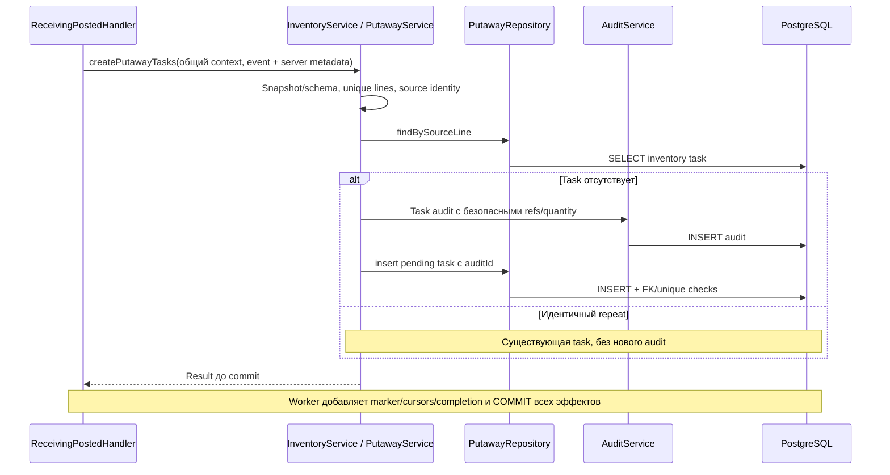
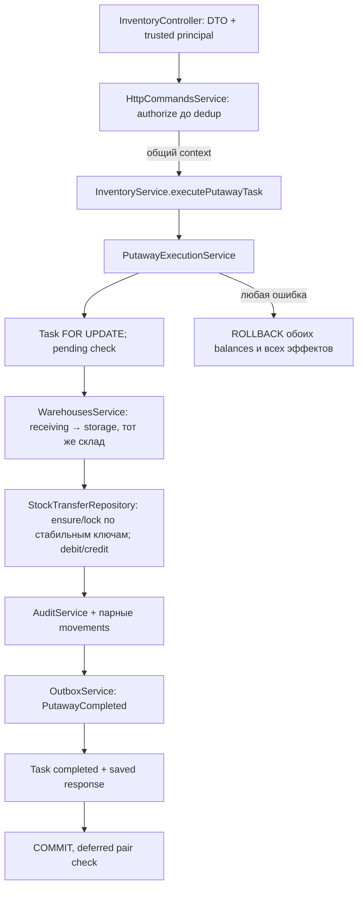

# Inventory module

WMS-104: StockBalance и immutable StockMovement. WMS-110: создание PutawayTask. WMS-203: полное выполнение receiving → storage.

## Для менеджера

Inventory — единственный владелец изменения остатков. Начисление добавляет товар
в приёмочную ячейку и одновременно сохраняет audit и движение с основанием.
Количество только в целых штуках: максимум 2147483647 на один остаток.
Два одновременных прихода не теряют количество. Повтор того же operationId
отклоняется без дополнительного начисления; прежний результат автоматически не возвращается.

Реализованы GET task и идемпотентный POST выполнения размещения. Общего stock CRUD/transfer, резервирования и отгрузки нет.
Receiving WMS-108 оркестрирует документ/HTTP idempotency/outbox, вызывая InventoryService. Dev fixtures создают только справочники, не остатки.
DBA способен менять БД: append-only не является криптографической защитой.

## Файлы и интерфейсы

| Файл                                 | Назначение                                                            |
| ------------------------------------ | --------------------------------------------------------------------- |
| inventory.module.ts                  | Экспорт InventoryService, imports сервисов catalog/warehouses/audit   |
| services/inventory.service.ts        | Публичные receive/getBalance/createPutawayTasks с borrowed context    |
| services/putaway.service.ts          | Source validation, duplicate/conflict и создание task/audit без stock |
| repositories/putaway.repository.ts   | SELECT/INSERT собственной putaway_tasks, SQL unique race защита       |
| dto/putaway-task.dto.ts              | Внутренний command и task result без ORM/HTTP                         |
| putaway-task.schema.ts               | Source provenance FK, unique line/event, pending и int4 constraints   |
| repositories/inventory.repository.ts | Guarded upsert, appendMovement и чтение собственного balance          |
| dto/stock.dto.ts                     | StockKeyDto, ReceiveStockDto, StockBalanceDto, ReceiveStockResultDto  |
| inventory.schema.ts                  | int4, unique/FK/CHECK, movement с audit link и operationId unique     |

Repository не экспортируется. Сервис получает только публичные сервисы других
модулей и не пишет в их таблицы. Schema может ссылаться на чужие schema для FK —
это описание ограничений, не обход владельца при записи.

## Движение данных

```mermaid
sequenceDiagram
    participant Caller as Владелец TransactionRunner.run
    participant Service as InventoryService
    participant Catalog as CatalogService
    participant Warehouses as WarehousesService
    participant Repo as InventoryRepository
    participant Audit as AuditService
    participant DB as PostgreSQL
    Caller->>Service: receive(context, ReceiveStockDto)
    Service->>Service: quantity 1..MAX, operationId UUID
    Service->>Catalog: requireProduct(context, productId)
    Catalog-->>Service: ProductDto
    Service->>Warehouses: requireLocation(context, warehouseId, locationId)
    Warehouses-->>Service: LocationDto
    Service->>Service: kind должен быть receiving
    Service->>Repo: credit(context, input)
    Repo->>DB: INSERT ON CONFLICT UPDATE с overflow guard
    DB-->>Service: StockBalanceDto
    Service->>Audit: stock-received, before/after onHand, identifiers
    Audit->>DB: INSERT audit_entries
    Audit-->>Service: auditId
    Service->>Repo: appendMovement(context, input, auditId)
    Repo->>DB: INSERT stock_movements, unique operationId
    Repo-->>Service: movementId
    Service-->>Caller: balance, movementId, auditId до commit
    Note over Caller,DB: COMMIT после всего callback; любое исключение вызывает ROLLBACK
```

Input — внутренний DTO: warehouseId/locationId/productId, quantity, operationId,
actorType/actorId/correlationId/reasonCode. Context — отдельный argument, не часть
JSON и не DB client. Trusted metadata берётся от вызывающего сервиса, не public body.

Пример (все UUID условные): ключ склада/приёмочной ячейки/товара, quantity=10,
новый operationId и reasonCode=dev-receipt → balance {id, те же ключи, onHand:10,
reserved:0} + audit {action:inventory.stock-received, onHand:0→10} + движение
{kind:receipt, quantity:10, operationId, auditId}. receive возвращает
{balance, movementId, auditId}; createdAt движения создаёт PostgreSQL.
Внешний успех разрешён только после await runner.run, не после одного INSERT.

getBalance: проверка product и ownership location → SELECT balance по тройке →
StockBalanceDto либо null. Это внутреннее чтение, не публичный API или auth policy.

## Транзакции, конкуренция и ошибки

- Один context на balance, audit и movement; service/repository не начинают run.
- Upsert по (warehouseId,locationId,productId) сериализует competing writers.
  Проверка onHand <= MAX-quantity выполняется до addition; stale read в JavaScript нет.
- reserved не изменяется начислением. Новая строка получает 0; CHECK сохраняет
  0 <= reserved <= onHand. Reservations/allocations появятся отдельной задачей.
- operationId уникален на одно движение/строку. Duplicate INSERT откатывает ранее
  выполненные в этой транзакции credit/audit. Это reject-on-repeat, не HTTP dedup.
- Missing product, неверный UUID, чужая/отсутствующая location или не receiving kind
  отклоняются до upsert. Валидация quantity не приводит строки к числу.
- Overflow, invalid audit, movement unique/FK или последующая ошибка вызывающего
  callback откатывают весь приход. Ошибки нельзя ловить и игнорировать внутри run.
- SQL constraints защищают scope баланса даже при обходе сервиса. Назначение receiving
  проверяет сервис, SQL FK сам по себе не проверяет kind.

Движения защищены grants SELECT/INSERT и триггером UPDATE/DELETE/TRUNCATE.
Runtime не может отключить trigger; owner/admin способен намеренно обойти защиту.
Прямой SQL баланс/движение из других модулей запрещён. Outbox пока не пишется:
он добавится WMS-106 в эту же транзакцию до появления реальных документов приёмки.

## Проверки и эксплуатация

pnpm test:unit / test:integration / typecheck. Реальная БД:
[stock.spec.ts](../../../test/integration/stock.spec.ts) проверяет barrier-синхронизированную
гонку отсутствующего balance, overflow, duplicate operation, FK/unique/CHECK,
неверные quantity/location и полный rollback. Unit
[stock-quantity.spec.ts](../../../test/unit/stock-quantity.spec.ts) сверяет диапазон
с draft JSON Schema; полноценная runtime JSON Schema validation реализована
в WMS-105 в [shared/events](../../shared/events/README.md). Inventory сам событий не публикует.

DATABASE_URL общий, специальных переменных/метрик/events нет. Миграции 0003/0004:
pnpm db:migrate. Fixture CLI pnpm db:seed не начисляет stock. Runbook outbox пока
не применим к восстановлению balance; исправлять journal прямым UPDATE нельзя.
[Модели/контракт](../../../../../docs/stock-baseline.md),
[транзакции](../../../../../docs/transactions.md), [ADR-0010](../../../../../docs/adr/0010-minimal-stock.md).

WMS-108: ReceivingService.post вызывает receive с UUID строки как operationId и общим
command context; receiving владеет документом и ReceivingPosted, inventory не создаёт
событие второй раз. Invalid receiving kind/overflow — typed INVALID_RECEIVING_LOCATION /
STOCK_LIMIT_EXCEEDED, HTTP 422. Внешние repos не импортируются.
[Оркестрация/тесты](../receiving/README.md).

## Планирование размещения WMS-110

Для менеджера: поступившие 10 штук остаются в receiving, а worker создаёт pending задание
на их будущее физическое размещение. Delivery completed и task pending — разные состояния.
WMS-203 добавляет target и полное выполнение через HTTP; отмена, partial execution и UI отсутствуют.
Одна task на source receipt line; повтор обработки не добавляет task, audit, movement или stock.

Для разработчика: единственный межмодульный вход InventoryService.createPutawayTasks(context,
CreatePutawayTasksDto). Модуль по-прежнему экспортирует только InventoryService; PutawayService
и PutawayRepository private. Worker получает тот же context и владеет commit/rollback.
Код не читает чужие repositories: source consistency защищают composite FK с receiving.
Входной event snapshot проверяется EventContracts, duplicate line/product и aggregate/payload
связь — inventory. Identical task возвращается без нового audit, конфликт — semantic permanent
отказ в handler. При direct absent-key race SQL unique откатывает проигравшего вместе с audit;
нельзя подавлять исключение до runner. Normal worker дополнительно сериализует delivery/marker.



Пример: ReceivingPosted v1 с одной line quantity=10 → task pending quantity=10, sourceEventId/
ReceiptId/LineId из event, actor system из handler. Stock onHand=10/reserved=0 и movement=1
остаются прежними. Подробные шаги, состояния/сбои/конкуренция и конкретные тесты:
[полный флоу](../../../../../docs/flows/putaway.md),
[SQL proof](../../../../../docs/examples/putaway-result.sql),
[ADR-0016](../../../../../docs/adr/0016-durable-putaway-handler.md).

Migrations 0013/0014/0015 последовательно добавляют receiving source keys, task schema и
runtime SELECT/INSERT + immutable/retained task guard. DBA может обойти защиту. Старые
applied SQL не менять; dev Compose требует явного pnpm db:migrate. Собственных env нет,
handler actor синтетический server constant, correlationId исходного event сохраняется в audit.
Проверки: putaway.spec.ts, worker-process.spec.ts production cases и handler unit suite.
Метрики/централизованные логи/tracing пока WMS-401/402; диагностика через read-only SQL.

## Выполнение размещения WMS-203

Триггер — подтверждение оператором task через POST /api/v1/putaway-tasks/:taskId/execute.
Body содержит только targetLocationId; quantity, source и warehouse берутся из task.
GET /api/v1/putaway-tasks/:taskId требует read на её складе; execute — putaway (operator/supervisor).
Session/CSRF/Origin и Idempotency-Key обязательны для POST. Прежний key возвращает saved snapshot;
новый key на completed →409, прежний key после отзыва прав →403 до replay.



Пример: source onHand=10/reserved=0, task quantity=10, target отсутствует. После 200:
source 0/0, target 10/0, два movements, task completed, один completion audit/event.
Количество int4; reserved не переносится. Source 11/reserved=1 допускает перенос свободных 10;
source 10/reserved=1 отклоняется. Source/target одного склада, только receiving/storage;
partial/cancel/arbitrary transfer/перемещение allocation в этот шаг не входят.

Публичный InventoryService добавляет readPutawayTask и executePutawayTask с borrowed context.
PutawayExecutionService, StockTransferRepository и PutawayRepository private. InventoryHttpModule
подключает controller/Identity/Idempotency только API; worker импортирует InventoryModule без auth.
Для HTTP adapter отдельного bounded context нет. PutawayService продолжает только создавать
задания по ReceivingPosted, включая безопасный повтор уже completed задания без stock credit.

Новые файлы: inventory.controller.ts, inventory-http.module.ts,
services/putaway-execution.service.ts, repositories/stock-transfer.repository.ts,
dto/execute-putaway.dto.ts, dto/putaway-task-response.dto.ts. Общее преобразование Date в snapshot
принадлежит PutawayRepository, а не дублируется в каждом методе.

Схема: четыре nullable completion поля task; status pending/completed; transferId у movements,
kind receipt/transfer-out/transfer-in; UNIQUE(transferId,kind), FK/state/deferred pair guards.
Audit создания не заменяется. Runtime UPDATE только completion columns, удаления запрещены;
новые migrations 0020/0021, прежние applied SQL не изменяются. DBA способен обойти guards.
Outbox aggregate putaway-task пока без consumers/deliveries: факт retained, будущий replay отдельно.

Ошибки/гонки/точный SQL порядок/состояния и evidence — один владелец
[docs/flows/putaway-execution.md](../../../../../docs/flows/putaway-execution.md).
[Integration](../../../test/integration/putaway-execution.spec.ts) проверяет успех, повтор,
конкуренцию с двумя наблюдаемыми SQL waits, недостаток/overflow/reserve, чужой склад,
permissions/replay revoke, faults после debit/credit/audit/movement/event/task и runtime role.
Новый event проверяется source schema/example, registry/generation и unit contract fixtures.
