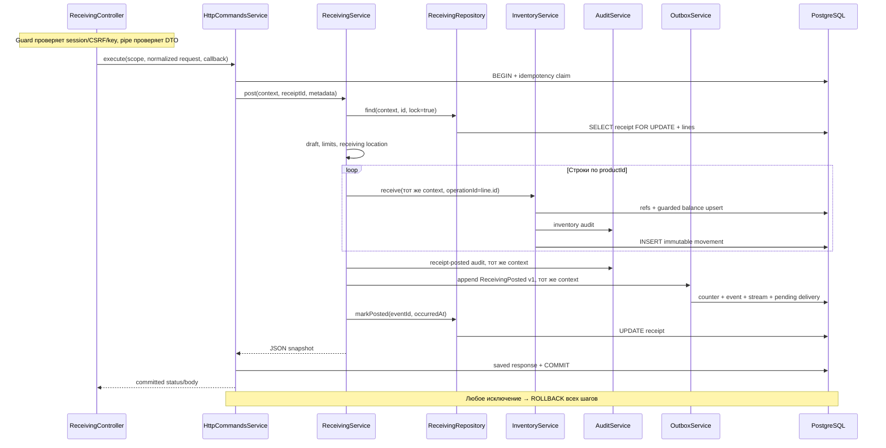

# Receiving — документ приёмки

## Для менеджера

WMS-108 реализована: локальный оператор создаёт документ фактической приёмки
`draft`, читает его и проводит в `posted`. Например, приёмка 10 штук увеличивает
остаток в зоне приёмки на 10, оставляет одно движение и один факт для размещения.
Создание draft остаток не меняет. При сбое проведения весь результат отменяется,
документ остаётся draft. После успешного проведения исправления требуют будущей
компенсирующей операции: редактирования, отмены и удаления пока нет.

Одна организация; 1–1000 строк, один товар в документе один раз; quantity — целые
штуки 1..2147483647. Лимит остатка тот же; переполнение отклоняется целиком.
У документа одна receiving-ячейка существующего склада; storage/shipping и чужая
ячейка запрещены. Состав draft фиксируется при создании, редактора строк нет.

Доступ — server session и warehouse role по ADR-0018/0019. Для create/post требуется
warehouse_operator либо warehouse_supervisor на фактическом складе, GET разрешён всем
принятым складским ролям. system_admin без складского назначения не проводит приёмку.
Auth/ACL реализованы WMS-202, размещение реализовано WMS-203 в inventory; UI и компенсации ещё не реализованы.
Pending delivery не является task, а completed delivery не означает физическое размещение.
[Session/CSRF/ACL flow](../../../../../docs/flows/identity.md).

## Для разработчика

Обычный Nest controller → service → repository; наружу модуль экспортирует только
`ReceivingService`. Repository читает/пишет исключительно receipts/receipt_lines.
Catalog/Warehouses проверяют справочники, Inventory единолично меняет stock/movements,
Audit пишет историю, Outbox сохраняет факт/доставку. Чужих repositories в production
receiving нет. Технические quantity, UUID, event limits и command framework переиспользуются.

| Файл                                 | Ответственность                                           |
| ------------------------------------ | --------------------------------------------------------- |
| receiving.module.ts                  | DI публичных зависимостей и внутреннего repository        |
| receiving.controller.ts              | HTTP, DTO, нормализованный hash input, committed response |
| services/receiving.service.ts        | normalize/create/post/get, refs, состояния и оркестрация  |
| repositories/receiving.repository.ts | INSERT draft/строк, SELECT FOR UPDATE и финальный UPDATE  |
| dto/receipt.dto.ts                   | Входные class DTO и публичные JSON response DTO без ORM   |
| receiving.schema.ts                  | Drizzle source SQL-модели; новые migrations 0009/0010     |
| README.md                            | Этот контракт модуля; все файлы также в общем каталоге    |

### Модель и ограничения

`receipts`: UUID id, warehouseId, receivingLocationId, status, createdAt,
postedAt/postedEventId (оба null в draft, оба обязательны в posted).
Composite location FK доказывает существование склада и принадлежность ячейки.
`receipt_lines`: UUID id/receiptId/productId, position 1..1000, quantity int4 > 0;
unique(receiptId,position) и unique(receiptId,productId). Строка принадлежит одному
документу; её UUID используется как уникальный inventory operationId.

Миграция 0009 generated из schema. Custom 0010 разрешает INSERT только draft,
единственный UPDATE draft → posted, запрещает изменение identity/content и строк,
DELETE/TRUNCATE обеих таблиц. INSERT строки берёт parent lock и требует draft;
проведённый документ требует строк и ссылки на свой outbox event версии 1.
Runtime role: receipts SELECT/INSERT/UPDATE; lines SELECT/INSERT. SQL INSERT в draft
технически разрешён роли; отсутствие редактирования состава обеспечивает внутренний
repository API. Проверка kind и полноты inventory/audit/event — обязанность сервисов,
constraints не доказывают всю оркестрацию. DBA может обойти triggers.

### API, ошибки и повтор

| Метод                                 | Вход                                           | Результат                         |
| ------------------------------------- | ---------------------------------------------- | --------------------------------- |
| POST /api/v1/receipts                 | CreateReceiptDto + UUID Idempotency-Key        | 201 ReceiptDto, relative Location |
| POST /api/v1/receipts/:receiptId/post | UUID path + UUID key, body отсутствует либо {} | 200 ReceiptDto                    |
| GET /api/v1/receipts/:receiptId       | UUID path, без key                             | 200 текущее состояние             |

Схема — [generated OpenAPI](../../../../../docs/contracts/openapi.json).
Actor приходит из guard/config, correlationId — из validated header либо server UUID;
actor/reason/status/eventId из body не принимаются. UUID нормализуются lowercase до
fingerprint; порядок строк значим. Hash создания: `{body: normalized}`; posting:
`{target:{receiptId},body:{}}`. Ошибки не кешируются. Прежний key возвращает исходный
status/body/Location, даже если draft с тех пор проведён; текущее состояние получать GET.
Новый key для posted даёт 409 RECEIPT_ALREADY_POSTED. Новый key создания намеренно
создаёт другой документ: дедупликации внешней поставки в модели пока нет.

400 — неверный UUID/DTO/key/лишние поля; 401 — сессия недоступна; 403 — роль склада/CSRF не разрешены;
404 RECEIPT_NOT_FOUND; 409 IDEMPOTENCY_CONFLICT/RECEIPT_ALREADY_POSTED;
422 INVALID_RECEIPT (включая duplicate product), PRODUCT_NOT_FOUND,
LOCATION_NOT_FOUND, INVALID_RECEIVING_LOCATION, STOCK_LIMIT_EXCEEDED;
413 — JSON body свыше 256 КиБ. Неожиданные ошибки → безопасный 500, временные SQL
ошибки → 503, см. [HTTP mapper](../../infrastructure/http/README.md).
Строки количества не приводятся к числу; неизвестные DTO поля отклоняются.

### Взаимодействие и движение данных

1. HTTP guard авторизует каждую попытку, включая replay; class validation проверяет
   вход. Controller явно превращает DTO в plain normalized body. Для post тело пустое.
2. HttpCommandsService владеет единственным run и unique claim; committed replay
   возвращает ответ без вызова receiving. Авторизация не скрыта в callback.
3. Создание проверяет location/warehouse через WarehousesService и каждый товар через
   CatalogService; repository вставляет header/строки с серверными IDs; AuditService
   пишет receipt-created. Сток и outbox при создании отсутствуют.
4. Posting блокирует header до проверки состояния и чтения immutable строк. Параллельный
   post с другим ключом ждёт эту строку, затем видит posted (409), либо draft после rollback.
   Одинаковый ключ ждёт idempotency unique lock и возвращает сохранённый ответ.
5. Строки обрабатываются по productId для согласованного порядка balance locks. В event
   и ответе сохраняется position-порядок. Inventory повторно проверяет refs/kind и пишет
   balance, свой audit, movement. Receipt audit, event, stream, delivery и status используют
   тот же opaque context. Внешнего I/O и вложенного run нет.
6. Event aggregateId = payload.receiptId = документ; receiptLineId уникальны, refs/quantity
   взяты из проверенного draft. Outbox владеет eventId/version. PostedAt = occurredAt,
   createdAt — timestamp создания БД, audit time — transaction timestamp.
7. HTTP status/body сохраняются до commit; при disconnect commit может завершиться,
   повторять тот же key. GET владеет отдельным read-only по эффектам run без row lock,
   audit и idempotency, возвращает JSON timestamps, чужой run ему передавать нельзя.

Автоматического retry deadlock/serialization нет: [правила](../../../../../docs/transactions.md).
До обработки stream lastCompletedVersion=0, lease пустой, delivery pending/attempts=0.
WMS-110 handler создаёт pending PutawayTask, затем delivery completed/cursor=1; stock/movement
прежние. [Подробный consumer flow](../../../../../docs/flows/putaway.md).
Причины posting решений — [ADR-0014](../../../../../docs/adr/0014-receiving-vertical-slice.md).

### Пример, запуск и диагностика

Синтетический вход: warehouseId `708c21f2-652e-45a0-b910-f4db41fca885`, receivingLocationId
`b01e0ef6-e01e-472d-891f-e7d219a21e42`, товар `801c9003-42c2-48f5-af04-ae26f106ea46`, quantity 10.
UUIDs после normalize lowercase, quantity остаётся числом; output draft → posted
с серверными id строк/документа/event и UTC postedAt.
Полные [HTTP примеры и SQL proof](../../../../../docs/receiving.md).

`pnpm db:up`, `pnpm db:migrate`, `pnpm db:seed`, затем явная auth policy, bootstrap/login и складская роль перед `pnpm dev`.
Конфигурация общая: DATABASE_URL (секрет), NODE_ENV, HTTP_HOST, PORT,
DEV_ACTOR_ENABLED=false по умолчанию и DEV_ACTOR_ID (серверный синтетический UUID).
Tests используют отдельный PostgreSQL без Compose/.env, недоступный Docker — failure.

[Integration tests](../../../test/integration/receiving.spec.ts): HTTP happy path,
replay/conflict, quantity/limits/refs, SQL constraints/permissions, document/key locks,
rollback winner takeover, SQL AFTER fault injection каждого существенного шага,
две строки и overflow. Общий polling реальных locks — test/support/database-lock.ts.
`pnpm test`, `pnpm typecheck`, `pnpm openapi:check`, `pnpm contracts:check`.
SQL — безопасная read-only диагностика; не исправлять stock/events вручную.
Метрики, централизованные key-value логи и tracing запланированы WMS-401/402.
Для расследования сохранить receiptId, время и correlationId;
[runbook](../../../../../docs/runbooks/event-recovery.md), локальный recovery реализован WMS-111, использовать только проверенные команды runbook.

### Изменение auth WMS-202

Controller передаёт authorize callback четвёртым аргументом HttpCommandsService.execute;
он проверяет user/session/warehouse **до** claim и replay в том же context. Post сначала
читает warehouse сохранённого receipt, не принимает его из body. GET использует borrowed
read(context,id) и permission в одной транзакции; nested get/run из command запрещён.
DTO/строки приёмки, stock/movement/outbox semantics и ReceivingPosted v1 не менялись.
Fixtures/tests и Docker gate теперь создают настоящие сессии/роли, без env bypass.
