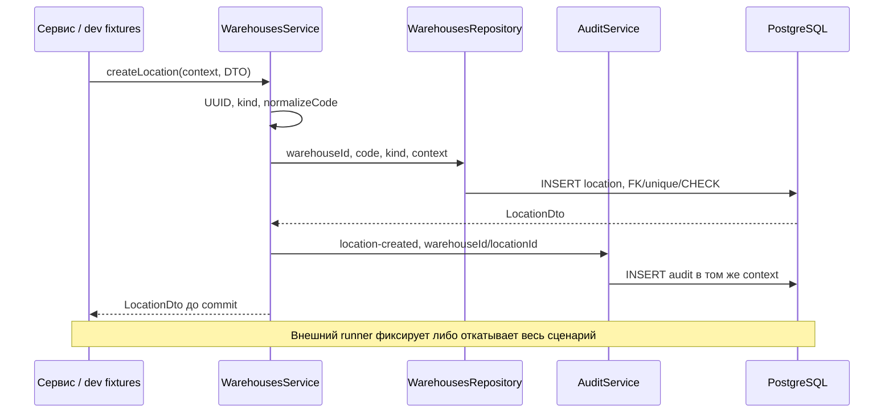

# Warehouses module

Минимальные Warehouse/Location WMS-104; владелец таблиц warehouses и locations.

## Для менеджера

Склад имеет UUID, уникальный code и название. Ячейка имеет UUID, code внутри склада
и назначение receiving/storage/shipping. В этом релизе зона выражена назначением
ячейки, отдельного справочника Zone нет. Dev набор создаёт по одной ячейке каждого
назначения. Размещение receiving→storage реализовано в inventory WMS-203.
UI WMS-208 читает склады/ячейки. Изменение назначения ячейки не реализовано.

## Для разработчика

| Файл                                  | Назначение                                                            |
| ------------------------------------- | --------------------------------------------------------------------- |
| warehouses.module.ts                  | Экспорт WarehousesService; private repository                         |
| services/warehouses.service.ts        | createWarehouse, createLocation, requireLocation                      |
| repositories/warehouses.repository.ts | Только SQL собственных warehouses/locations                           |
| dto/warehouse.dto.ts                  | CreateWarehouse/Location DTO, Warehouse/Location DTO, LocationKind    |
| warehouses.schema.ts                  | FK location→warehouse, unique warehouse code и location code в складе |

Все методы принимают existing context, не делают отдельный commit. Names/codes
нормализуются shared helpers, kind проверяет сервис и SQL CHECK. Composite unique
(warehouseId,id) на locations нужен FK inventory: корректный UUID ячейки другого
склада не подходит. requireLocation(context,warehouseId,locationId) возвращает
LocationDto или ошибку ownership; он не заменяет session/warehouse policy вызывающего.

## Схема и движение данных



Пример: {warehouseId: UUID склада, code: " receiving ", kind: "receiving", metadata}
→ {warehouseId, code: "RECEIVING", kind} → DB генерирует id → LocationDto с теми же
warehouseId/code/kind. DTO создания внутренний; публичный read использует отдельные
WarehouseReadDto/LocationReadDto и DirectoryReadController в HTTP composition.

Для чтения inventory передаёт warehouseId/locationId → requireLocation → SELECT
по id через repository → сервис сравнивает warehouseId → возвращает LocationDto.
Unknown/mismatched location отклоняется, запись не выполняется. Для createWarehouse
аналогичный путь INSERT warehouse → audit, без обращения к location.

## Ошибки, повторы и эксплуатация

Invalid UUID/code/name/kind — безопасная ошибка сервиса. Missing warehouse при
создании location — FK 23503, duplicate code — 23505. Invalid audit откатывает создание.
Одинаковый location code допускается в разных складах, повтор внутри одного запрещён.
Обновления и удаления сервис не предоставляет; DTO с новым kind не меняет существующую ячейку.

DATABASE_URL общий; специальных переменных, events, consumers, admin HTTP и собственных
метрик нет. Runtime SELECT/INSERT; migration owner/admin может менять данные.
Проверки: pnpm test:integration, test:unit, typecheck;
[stock.spec.ts](../../../test/integration/stock.spec.ts).
Миграции: pnpm db:migrate; примеры: pnpm db:seed, только development.
[Правила и модели](../../../../../docs/stock-baseline.md).

WMS-108: ReceivingService.create вызывает WarehousesService.requireLocation;
возвращённая location/FK доказывает наличие склада и ownership. Missing/wrong warehouse
или location → typed LOCATION_NOT_FOUND (HTTP 422). Kind receiving проверяет receiving/inventory.
Доступ проверяется session/warehouse policy WMS-202 до saved replay. Dev actor удалён:
operator/supervisor могут принимать/размещать, order_manager/supervisor управляют заказом и резервом,
все назначенные warehouse роли могут читать; system_admin без назначения не получает складских прав.
Матрица: [ADR-0019](../../../../../docs/adr/0019-warehouse-role-matrix.md),
исполнение policy: [identity flow](../../../../../docs/flows/identity.md).

## Read справочники WMS-208

GET `/api/v1/warehouses` возвращает только склады с readable ролью пользователя;
system_admin без назначения получает `{items:[],nextCursor:null}`.
GET `/api/v1/warehouses/:warehouseId/locations` возвращает только ячейки этого склада:
`{items:[{id,warehouseId,code,kind}],nextCursor:null|string}`.

```mermaid
sequenceDiagram
  participant C as DirectoryReadController
  participant A as AccessService / SessionsService
  participant S as WarehousesService
  participant R as WarehousesRepository / PostgreSQL
  C->>A: run; session и readable warehouse IDs либо requireWarehouse
  A-->>C: Разрешения сервера под user/session locks
  C->>S: listReadableWarehouses либо listLocations, тот же context
  S->>S: Cursor scope: user + grants либо warehouse
  S->>R: WHERE id IN grants либо warehouse_id; id ASC, limit+1
  R-->>C: Явные DTO и cursor
  Note over C,R: Runner завершает read транзакцию; нет domain write/audit/outbox
```

Limit 1..100/default20. Cursor связывает выборку с текущим scope; изменение набора
назначений отклоняет прежний warehouse cursor (400). Пустая выборка успешна, чужой
склад даёт 403, отсутствующая session — 401. SQL predicate повторяет warehouse scope.
Проверки: [directory-reads.spec.ts](../../../test/integration/directory-reads.spec.ts),
общий UI flow — [web](../../../../../docs/flows/web.md). Записи справочников API не предоставляет.
