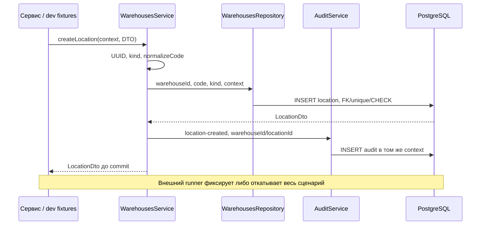

# Warehouses module

Минимальные Warehouse/Location WMS-104; владелец таблиц warehouses и locations.

## Для менеджера

Склад имеет UUID, уникальный code и название. Ячейка имеет UUID, code внутри склада
и назначение receiving/storage/shipping. В этом релизе зона выражена назначением
ячейки, отдельного справочника Zone нет. Dev набор создаёт по одной ячейке каждого
назначения. Перемещение товара, изменение назначения ячейки и UI ещё не реализованы.

## Для разработчика

| Файл | Назначение |
|---|---|
| warehouses.module.ts | Экспорт WarehousesService; private repository |
| services/warehouses.service.ts | createWarehouse, createLocation, requireLocation |
| repositories/warehouses.repository.ts | Только SQL собственных warehouses/locations |
| dto/warehouse.dto.ts | CreateWarehouse/Location DTO, Warehouse/Location DTO, LocationKind |
| warehouses.schema.ts | FK location→warehouse, unique warehouse code и location code в складе |

Все методы принимают existing context, не делают отдельный commit. Names/codes
нормализуются shared helpers, kind проверяет сервис и SQL CHECK. Composite unique
(warehouseId,id) на locations нужен FK inventory: корректный UUID ячейки другого
склада не подходит. requireLocation(context,warehouseId,locationId) возвращает
LocationDto или ошибку ownership; он не заменяет будущую проверку прав пользователя.

## Схема и движение данных

Пример: {warehouseId: UUID склада, code: " receiving ", kind: "receiving", metadata}
→ {warehouseId, code: "RECEIVING", kind} → DB генерирует id → LocationDto с теми же
warehouseId/code/kind. DTO внутренний; public HTTP DTO/controller сейчас отсутствуют.

Для чтения inventory передаёт warehouseId/locationId → requireLocation → SELECT
по id через repository → сервис сравнивает warehouseId → возвращает LocationDto.
Unknown/mismatched location отклоняется, запись не выполняется. Для createWarehouse
аналогичный путь INSERT warehouse → audit, без обращения к location.

## Ошибки, повторы и эксплуатация

Invalid UUID/code/name/kind — безопасная ошибка сервиса. Missing warehouse при
создании location — FK 23503, duplicate code — 23505. Invalid audit откатывает создание.
Одинаковый location code допускается в разных складах, повтор внутри одного запрещён.
Обновления и удаления сервис не предоставляет; DTO с новым kind не меняет существующую ячейку.

DATABASE_URL общий; специальных переменных, events, consumers, admin HTTP и собственных
метрик нет. Runtime SELECT/INSERT; migration owner/admin может менять данные.
Проверки: pnpm test:integration, test:unit, typecheck;
[stock.spec.ts](../../../test/integration/stock.spec.ts).
Миграции: pnpm db:migrate; примеры: pnpm db:seed, только development.
[Правила и модели](../../../../../docs/stock-baseline.md).

WMS-108: ReceivingService.requireReceivingLocation вызывает requireLocation;
возвращённая location/FK доказывает наличие склада и ownership. Missing/wrong warehouse
или location → typed LOCATION_NOT_FOUND (HTTP 422). Kind receiving проверяет receiving/inventory.
Production ACL пока не реализован; local dev actor имеет доступ к складам одной организации.
