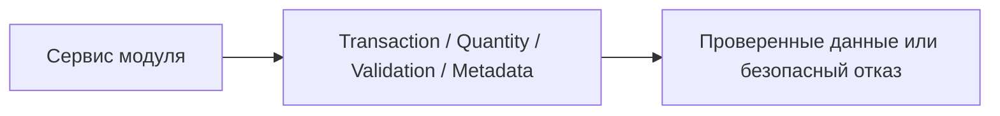

# Shared backend

Общие технические контракты, независимые от бизнес-модулей, транспорта, Nest и ORM.

## Для менеджера

Позволяет разным операциям пользоваться одинаковыми гарантиями атомарности.
Сам по себе не реализует приёмку или учёт остатков.

## Для разработчика

Содержит [transactions](transactions/README.md), [quantities](quantities/README.md),
[validation](validation/README.md), [operation metadata](operations/README.md).
Shared не импортирует infrastructure/modules. Runtime-реализация transaction port —
в database adapter; числовая и текстовая validation выполняется чистыми функциями.
Переиспользуемый test-only код остаётся в test/support, не здесь.
Новых utils-каталогов или общего repository нет. Правила —
[shared/DRY](../../../../docs/shared.md), проверки — `pnpm typecheck`, `pnpm test`.
Конфигурации, SQL, endpoints, событий и собственных фоновых процессов нет.

Пример: service проверяет quantity=10 общим helper, затем использует context
и передаёт actor metadata в AuditService. Shared не пишет в БД; транзакцией
владеет внешний сценарий. Тесты consumers и shared boundary выполняются pnpm test.
