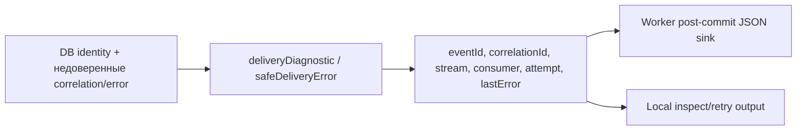

# Диагностика доставки

Для менеджера: одинаковые поля позволяют связать событие, попытку и причину отказа,
не раскрывая пароли, полное содержимое события или токен владения доставкой. Компонент сам не отправляет логи.

Для разработчика: delivery-diagnostic.ts предоставляет DeliveryDiagnostic, deliveryDiagnostic,
DELIVERY_ERROR_CODES и safeDeliveryError. Shared не импортирует Nest/ORM/modules/infrastructure,
не выполняет I/O. Логирование worker и административный inspect используют одну функцию форматирования.

Идентичность поступает из серверных столбцов БД; correlationId проверяется как UUID, неверное
заменяется null, неизвестный last_error — REDACTED. Формат не принимает token/envelope,
а потому их нельзя случайно сериализовать через spread formatter result. Sink обязан
принимать именно этот результат, не произвольную запись драйвера.

Пример: eventId UUID, correlationId UUID/null, stream `{aggregateType:'receipt',aggregateId:UUID,
version:1}`, consumer inventory.putaway, attempt=11 (total, не номер нового budget), lastError
DATABASE_REJECTED/null. Обычный shared вызов не означает commit и не меняет DB state;
worker вызывает I/O sink только после commit либо завершённого rollback.

Unit проверки: [outbox-recovery.spec.ts](../../../test/unit/outbox-recovery.spec.ts),
команда pnpm test:unit. Полный [recovery flow](../../../../../docs/flows/outbox-recovery.md).
Новых env, таблиц и внешних каналов нет. Централизованный logging stack остаётся WMS-401/402.

Комментарии к экспортируемым символам описывают доверие входу и результат фильтрации.
Функции создают новый объект, не меняют входной и ничего не записывают в БД.
Отсутствие ошибки (`null`) отличается от неизвестной ошибки (`REDACTED`): вторую нельзя
считать успешным исходом. Логи не содержат доказательства доставки сами по себе —
подтверждение дают состояние БД и marker. [Карта реализации WMS-111](../../../../../docs/flows/outbox-recovery.md#карта-реализации-и-чтение-кода-wms-111).
