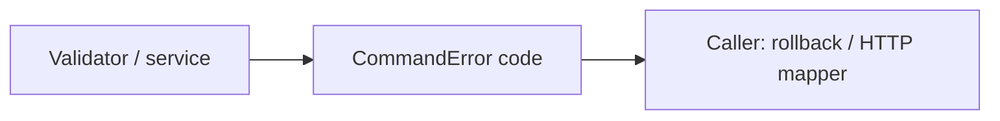

# Безопасные прикладные ошибки

## Для менеджера

Позволяет клиенту отличить неверный ввод/ключ от недоступного dev actor, не раскрывая
пароли и внутренние детали. Сам модуль не пишет audit и не отвечает за HTTP или retry.

## Для разработчика и движение данных

command-error.ts содержит CommandErrorCode и CommandError с доверенным code.
Сервис/validator → `new CommandError('IDEMPOTENCY_CONFLICT')` → вызывающий runner
откатывает транзакцию → HTTP ProblemFilter отображает code в 409 с безопасным текстом.
Ошибка сама не открывает/не откатывает транзакцию, исключение должен получить её владелец.

Никаких arbitrary detail, ORM/Nest imports, I/O, env, таблиц или повторов.
Полный список кодов — тип в command-error.ts, публичные statuses/messages —
infrastructure/http/problem.filter.ts; shared не зависит от adapter.
Пример: неизвестная версия входа имеет свою EventContractError в shared/events,
эти классы не объединяются только по похожему синтаксису.
Проверки: unit/http-foundation.spec.ts и integration/http-commands.spec.ts,
команды pnpm test:unit/test. HTTP failure scenarios не подменяются только mocks.

WMS-108 добавляет typed receipt/ref/stock коды. Receiving, catalog, warehouses и inventory
выбирают безопасный code; статические сообщения внутренних lookup сохранены для
диагностики, mapper не анализирует error.message. 404 документа, 409 posted/conflict
и 422 неверных строк/refs/overflow проверены integration/receiving.spec.ts.
