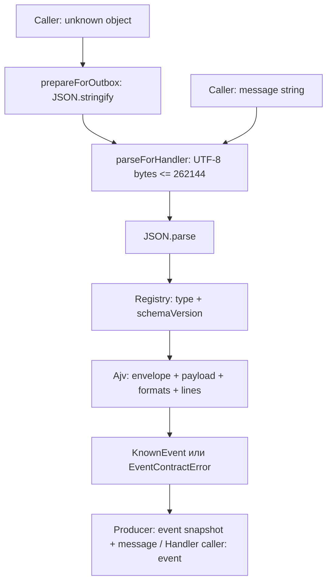

# Контракты событий WMS-105

Общая техническая проверка событий для producer и handler, без Nest, ORM и транспорта.

## Для менеджера

Некорректное сообщение отклоняется до допуска к бизнес-операции. Первый контракт —
`receiving.receipt-posted:1`: 1..1000 строк, целые количества 1..2147483647,
не больше 262144 байт (256 КиБ) JSON UTF-8 вместе с метаданными и расширениями.
Новые необязательные поля принимаются, неизвестная версия отклоняется отдельно.
Большую приёмку нужно разделять на документы до проведения; автоматического дробления нет.
После публикации ужесточать эти ограничения в существующей версии нельзя.

Реализованы проверка, registry, генерация и тесты; outbox writer подключён WMS-106,
receiving HTTP и handler пока отсутствуют. Роли и права этот модуль не проверяет. Проверка контракта сама
по себе не подтверждает приёмку, не создаёт задание и не гарантирует доставку.

## Для разработчика

`EventContracts` — обычный синхронный shared service в services/, без DI decorators.
Controller/repository не нужны: HTTP/SQL отсутствуют. Модули и инфраструктура могут
использовать его; обратных импортов нет. Источник истины — JSON Schema в
[docs/contracts/events](../../../../../docs/contracts/events), решение —
[ADR-0011](../../../../../docs/adr/0011-event-contract-validation.md).

| Файл | Ответственность |
|---|---|
| services/event-contracts.ts | prepareForOutbox(unknown) и parseForHandler(string) |
| event-registry.ts | Локальный список type/version, компиляция validator, limits |
| event-contract.error.ts | Безопасные permanent error codes |
| dto/event.dto.ts | KnownEvent, generated payload alias, PreparedEvent; внутренние DTO |
| generated/event-types.ts | Generated TS из исходных schemas; без ручного редактирования |
| generated/event-schemas.ts | Generated runtime schema bundle; без чтения docs при старте |

Генератор [scripts/generate-event-contracts.cjs](../../../scripts/generate-event-contracts.cjs)
запускается командами из корня:

```sh
pnpm contracts:generate
pnpm contracts:check
pnpm test:unit
```

Пояснения полей события хранятся в `description` исходной JSON Schema: JSON не
поддерживает комментарии, а schema annotations не меняют правила validation.
Генератор переносит descriptions в JSDoc generated типов. Алгоритмы registry,
сериализации, validation и generation дополнительно объяснены комментариями в коде.
Назначение JSON fixtures описано в их README, generated code вручную не комментируется.

`contracts:check` сравнивает bytes обоих artifacts с результатом генерации в памяти,
не меняет checkout, возвращает ненулевой код при missing/stale output. Test prepare
всегда запускает check перед build. CI workflow и breaking-change comparison ещё нет.
При генерации добавленной версии нужно обновить registry, KnownEvent и fixtures.
Версии зависимостей и форматирования закреплены lockfile, установка — frozen lockfile.

Ajv 8.20.0 из `ajv/dist/2020` + ajv-formats 3.0.1 full: strict=true,
validateFormats=true, allErrors=false, coerceTypes/useDefaults/removeAdditional=false.
Schemas компилируются один раз при загрузке registry, ошибки schema останавливают загрузку.
Никаких внешних `$ref`, загрузки схем по сети или пользовательских schemas.
Dialect 2020-12 не смешивается со старыми draft в этом экземпляре Ajv.
UUID проверяется по формату, без требования UUIDv4. date-time проверяет дату и время;
`Z$` дополнительно требует UTC с заглавным Z (даже +00:00 отклоняется).
traceparent ограничен 512 символами; W3C семантику будет проверять OTel отдельно.
Одна ошибка без значений payload ограничивает диагностику; собственных logs/metrics нет.

json-schema-to-typescript 16.0.0 не заменяет runtime validation: integer, UUID,
formats, диапазоны и длина массива не выражены полностью в TS. `maxItems: 0` в
генераторе отключает разворачивание массива в тысячи tuple-типов, а не schema check.
Используется общий поддерживаемый поднабор schemas (object/properties/required,
array/items, const, primitives, bounds/formats); новые keywords проверять на обоих
инструментах. Полная поддержка всех keywords 2020-12 генератором не обещается.

## Взаимодействие и движение данных

Сегодня prepareForOutbox вызывается SQL writer WMS-106 и контрактными тестами;
parseForHandler используется тестами, подключение к worker предстоит.



1. Producer передаёт JSON-совместимые данные, даты уже строками UTC, не ORM objects.
   Сериализация создаёт отдельный snapshot. Circular, BigInt, undefined, functions,
   symbols и не finite numbers отклоняются там, где их видит JSON.stringify replacer.
   `toJSON` подчиняется стандартному JSON.stringify; проверяется именно полученный JSON.
2. Оба входа считают UTF-8 bytes, включая неизвестные поля; consumer проверяет размер
   до JSON.parse. Producer сериализует перед проверкой — лимит не защищает от создания
   огромного JS object в памяти. В будущем transport ограничит bytes до декодирования.
3. JSON разбирается; malformed header — INVALID_EVENT, неизвестные корректные type/version —
   UNSUPPORTED_EVENT. Известная версия проверяется целиком Ajv, без coercion/удаления полей.
4. Producer получает `{ event, message }`, handler caller — KnownEvent. Неизвестные
   optional fields сохраняются на всех уровнях; caller не должен придавать им смысл.
5. Никакого SQL/commit/rollback внутри capability нет. OutboxService WMS-106 вызывает
   prepareForOutbox **до INSERT**, записывает проверенный message в общей
   транзакции; нельзя собирать JSON заново из изменённого объекта. Worker обязан вызвать
   parseForHandler **до handler**, и лишь затем выполнять эффект/marker/cursor в транзакции.
   Отказ внутри сценария должен выйти наружу и откатить его; durable quarantine будет WMS-109.

Пример: [ReceivingPosted fixture](../../../../../docs/contracts/examples/receiving.receipt-posted.v1.json)
с одной строкой quantity=10 → `prepareForOutbox(fixture)` → event с той же quantity,
message с теми же данными. Изменение исходного fixture после вызова snapshot не меняет.
Добавление `payload.futurePayloadField="demo"` проходит и сохраняется;
quantity=0 → `INVALID_EVENT`; schemaVersion=2 → `UNSUPPORTED_EVENT`.

| Код | Причина | Повтор без изменения |
|---|---|---|
| INVALID_JSON | JSON не разобран/не сериализован | Не поможет |
| INVALID_EVENT | Нарушен envelope или payload известного контракта | Не поможет |
| UNSUPPORTED_EVENT | Неизвестные type/version | Нужен поддерживающий код/карантин |
| MESSAGE_TOO_LARGE | Более 262144 UTF-8 bytes | Нужен другой допустимый документ/контракт |

Сообщения ошибок не включают payload или Ajv data. Это не authentication и не
семантическая проверка склада: равенство aggregateId/receiptId, уникальность строк,
существование товара/ячейки, права и состояние документа проверит receiving service.
Повторная validation даёт тот же результат, но не дедуплицирует бизнес-эффект.
Конфигурационных env, таблиц, migrations, собственных retries или фоновых процессов нет.

Проверки: [event-contracts.spec.ts](../../../test/unit/event-contracts.spec.ts)
и [event-generation.spec.ts](../../../test/unit/event-generation.spec.ts): fixtures,
обязательные поля, formats, int4, bounds, точный UTF-8 предел, неизвестные поля/версии
и воспроизводимость/missing/stale outputs. [Runbook](../../../../../docs/runbooks/event-recovery.md)
описывает будущую эксплуатацию, ещё не существующие команды не запускаются.
