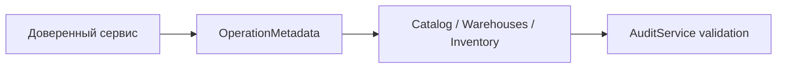

# Operation metadata

Общий внутренний DTO метаданных мутации, переиспользуемый справочниками, inventory и audit.

## Для менеджера

Позволяет связать действия с субъектом, основанием и одним сквозным сценарием.
Сам DTO не выполняет авторизацию и не подтверждает личность пользователя.

## Для разработчика

Файл dto/operation-metadata.dto.ts содержит actorType, actorId, correlationId, reasonCode.
Это TypeScript interface без runtime-логики. Проверки обязательных audit fields
выполняет AuditService; actor должен поступать из доверенного caller context.

Пример: system actor UUID + correlation UUID + reasonCode=dev-fixture передаются
без преобразования; UUID/формат code проверяет audit перед INSERT. Неверный metadata
должен откатить текущий сценарий. DTO не содержит TransactionContext или credentials.
Собственных транзакций, env, events и методов нет; pnpm typecheck и integration/stock.spec.ts.
