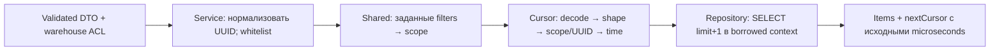

# Cursor pagination

Технический контракт для списков. `preparePageRequest` связывает cursor с маршрутом,
складом и фильтрами. Limit 1..100, default 20. `encodePageCursor` кодирует ключ в base64url.
Cursor не секрет и не авторизация. Права проверяются заново на каждой странице.
Ошибки — VALIDATION_FAILED. SQL выполняет infrastructure, правила фильтров задаёт владелец.
[Флоу, ограничения и тесты](../../../../../docs/flows/warehouse-reads.md).

## Шаги и ответственность

Service нормализует UUID в копии DTO и явно перечисляет разрешённые фильтры.
Общий preparePageRequest удаляет только undefined, сортирует заданные пары и считает
прежний SHA-256 scope. Пустая строка не становится отсутствующим фильтром.
Limit/cursor не входят в scope: размер следующей страницы можно менять.
Input filters не мутируется. Whitelist нельзя заменить передачей всего query,
иначе технические поля и неизвестные параметры изменят протокол cursor.

Decode принимает unknown JSON: сначала ограничивает base64url/длину, затем проверяет
объект, version/scope/UUID, допустимые keys и отдельный timestamp. Date используется
только для проверки календаря; в PagePosition остаётся исходная строка с microseconds.
При любой ошибке наружу выходит VALIDATION_FAILED без parser internals.

PageRequest содержит limit, scope и необязательную position; PagePosition — UUID
и исходное время, если список сортируется по времени. KeysetPage содержит items и
nextCursor, без total/count. SQL adapter формирует continuation/order/projection;
shared не импортирует SQL или бизнес-модули. [Рефактор и evidence](../../../../../docs/reports/readability-refactor.md).
