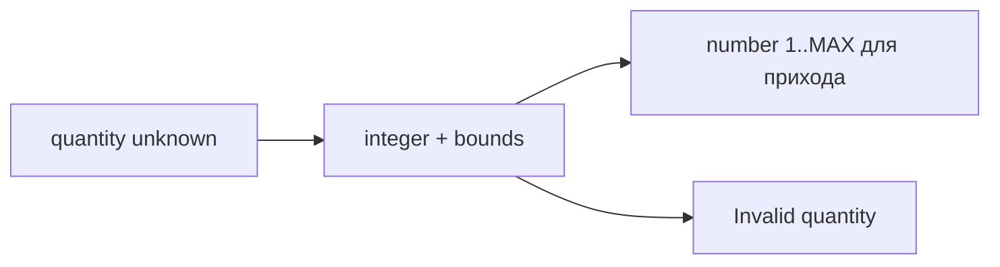

# Quantity contract

Общий технический диапазон количества WMS-104 для inventory, audit и будущих DTO.

## Для менеджера

Считаем целые штуки: остаток от 0 до 2147483647, приход строго положительный.
Дробные единицы и больший диапазон потребуют отдельного решения и миграций.

## Для разработчика

quantity.ts экспортирует MAX_STOCK_QUANTITY, isStockQuantity и requirePositiveQuantity.
Вход unknown → проверка number/integer/range → boolean либо безопасная ошибка.

Пример: 10 → принято; "10", 0 для прихода, 0.5 и MAX+1 → отказ.
Без DB/HTTP/транзакций/собственных настроек. SQL CHECK и draft event quantity
сверяются unit-тестом stock-quantity.spec.ts; pnpm test:unit, typecheck.
Это общий числовой контракт, не правило выбора ячейки или изменения остатка.
