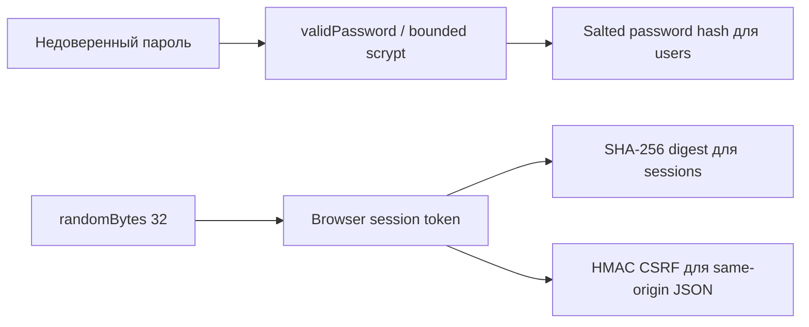

# Секреты и password hashing

Для менеджера: пароль не хранится открытым, session token не попадает в БД целиком;
приложение не может показать прежний пароль оператору. Это внутренние primitives WMS-202,
не самостоятельный login или grant прав. Владельцем auth-сценария остаётся identity.

Для разработчика: password.ts использует Node crypto.scrypt N=131072/r=8/p=1, salt 16 bytes,
derived key 64 bytes, maxmem 256 MiB. Формат фиксирован `scrypt$131072$8$1$<salt hex>$<hash hex>`;
не принимать N/r/p из недоверенного hash. Одновременно не более двух операций на процесс,
без неограниченной очереди; memory cost около 128 MiB на операцию. Нативной npm-зависимости
и experimental Node Argon2 здесь нет. Hashing awaited **вне** транзакции; ошибки не раскрывают
ввод. Новый алгоритм/стоимость потребует плана чтения старых hashes и новой миграции CHECK.

Пароль не trim/normalize/coerce: 15..128 Unicode code points, <=512 UTF-8 bytes, без NUL.
verifyPassword делает ту же дорогую работу для absent/invalid hash через DUMMY_PASSWORD_HASH;
одинаковая работа не обещает одинаковое время всей сети/SQL. Ответ credential failure общий.

secrets.ts: newSecret — randomBytes(32) base64url (43 chars); secretHash — SHA-256 только
высокоэнтропийного token, не пароля. sessionCsrf — HMAC-SHA-256 keyed by session token,
с фиксированным namespace: CSRF связан с сессией без дополнительного секрета между replicas.
equalSecret сравнивает bytes одинаковой длины timingSafeEqual; неправильная длина/Unicode
не бросают исключение. Все функции без Nest/ORM/бизнес-модулей и вывода логов.

Файлы — password.ts и secrets.ts, их экспортируемые символы задокументированы в коде.
Ошибки/побочные эффекты: криптографическая CPU/memory работа может отказать по capacity;
DB/HTTP/commit здесь отсутствуют. Вход/выход синтетического примера: пароль длиной >15
→ salted hash, совпадает только точный пароль; два случайных tokens дают разные digests/CSRF.
Контракты подтверждает [unit suite](../../../test/unit/identity.spec.ts); реальный login/
отзыв/ACL — [integration](../../../test/integration/identity.spec.ts). Полный
[flow](../../../../../docs/flows/identity.md). Это не полный secret manager и не MFA.
