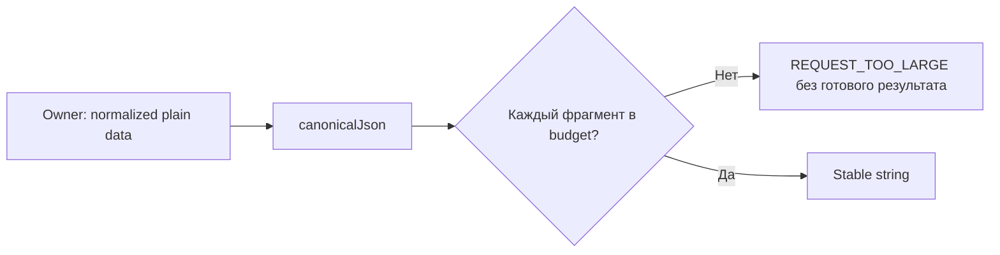

# Детерминированный JSON

## Для менеджера

Порядок полей JSON не создаёт ложного конфликта повторной команды; содержимое
и порядок строк массива продолжают иметь значение. Сам код не меняет склад и не
считает разные бизнес-запросы одинаковыми без нормализации владельцем операции.

## Для разработчика и движение данных

canonical-json.ts экспортирует canonicalJson(unknown): string. Plain input →
проверка глубины/типов/циклов/getters → сортировка object keys → добавление JSON
фрагментов с проверкой UTF-8 budget 256 КиБ → готовая строка. При превышении budget
обход немедленно останавливается. `{b:2,a:1}` и `{a:1,b:2}` дают одинаковую строку; массивы
`[1,2]` и `[2,1]` различны. Shared не вызывает toJSON/getters и не приводит types.
Date/class instances/undefined/BigInt/не finite numbers/holes/циклы отклоняются.
Error code VALIDATION_FAILED или REQUEST_TOO_LARGE не включает входные данные.

Owner нормализует бизнес-поля и явным объектом преобразует DTO instance. Компонент
не выполняет SQL/I/O, не начинает transaction, input не мутирует. Ошибка внутри
callback должна вызвать rollback у внешнего runner. Сохранённый response snapshot
копируется потребителем через JSON.parse, SHA-256 считает idempotency service.
Нет env/таблиц/метрик/собственного retry. Тесты:
[http-foundation.spec.ts](../../../test/unit/http-foundation.spec.ts),
[http-commands.spec.ts](../../../test/integration/http-commands.spec.ts).
Команды pnpm test:unit/test. Это отдельный technical serializer, а JSON Schema
validator событий остаётся shared/events с собственным wire контрактом.

`canonicalSnapshotJson` использует тот же encoder для доверенного server result,
но не применяет request byte budget. Циклы/getters/non-JSON/depth по-прежнему
отклоняются. Это сохраняет полный response snapshot большой истории и replay;
входной fingerprint остаётся ограничен 256 КиБ. Пагинация истории требует отдельного
API contract, сериализатор не обрезает историю и не задаёт произвольный новый лимит.

## Технические структуры и границы безопасности

Здесь нет складских сущностей. `parts` хранит уже проверенные JSON фрагменты,
`bytes` — их суммарный UTF-8 размер для request. `ancestors` содержит только текущую
ветку: повторная ссылка в соседних ветках допустима, ссылка на предка означает цикл.
`visit` проверяет значение и рекурсивно пишет его; `append` проверяет budget до
добавления очередного фрагмента. Вложенные значения не учитываются повторно.
Depth корня=0; depth=64 разрешена, 65 отклоняется.

Объекты используют собственные перечислимые строковые keys. Non-enumerable и Symbol
keys не входят в JSON, дополнительные свойства массива не входят в его элементы.
Числа кодирует JSON.stringify: например, -0 становится 0. Не выполняется Unicode
нормализация. Формат не объявляется реализацией RFC 8785; действующие fingerprint
нельзя менять без плана совместимости saved commands.

Input формируется доверенным кодом из JSON. Этот encoder не sandbox для чужого JS:
операции reflection могут вызвать Proxy traps. Getter полей не вызывается; toJSON
не применяется. Лимит request останавливает разворачивание shared references, но
не ограничивает память уже созданного input, сортировку его keys и временную строку
одного скаляра JSON.stringify. HTTP parser отдельно ограничивает входной body.
Snapshot остаётся без byte budget и требует разумного размера от владельца DTO.
Результат либо целый, либо ошибка; частичная строка наружу не возвращается.

Подробный scope, red/green и проверки — [ревью](../../../../../docs/reports/canonical-json-review.md).
