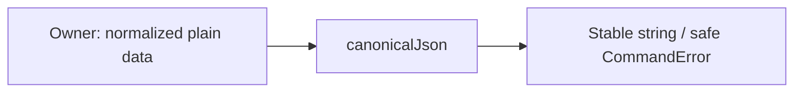

# Детерминированный JSON

## Для менеджера

Порядок полей JSON не создаёт ложного конфликта повторной команды; содержимое
и порядок строк массива продолжают иметь значение. Сам код не меняет склад и не
считает разные бизнес-запросы одинаковыми без нормализации владельцем операции.

## Для разработчика и движение данных

canonical-json.ts экспортирует canonicalJson(unknown): string. Plain input →
проверка глубины/типов/циклов/getters → сортировка object keys → JSON строка →
UTF-8 limit 256 КиБ. `{b:2,a:1}` и `{a:1,b:2}` дают одинаковую строку; массивы
`[1,2]` и `[2,1]` различны. Shared не вызывает toJSON/getters и не приводит types.
Date/class instances/undefined/BigInt/не finite numbers/holes/циклы отклоняются.
Error code VALIDATION_FAILED или REQUEST_TOO_LARGE не включает входные данные.

Owner нормализует бизнес-поля и явным объектом преобразует DTO instance. Компонент
не выполняет SQL/I/O, не начинает transaction, input не мутирует. Ошибка внутри
callback должна вызвать rollback у внешнего runner. Сохранённый response snapshot
копируется потребителем через JSON.parse, SHA-256 считает idempotency service.
Нет env/таблиц/метрик/собственного retry. Тесты:
[http-foundation.spec.ts](../../../test/unit/http-foundation.spec.ts),
[http-commands.spec.ts](../../../test/integration/http-commands.spec.ts).
Команды pnpm test:unit/test. Это отдельный technical serializer, а JSON Schema
validator событий остаётся shared/events с собственным wire контрактом.
