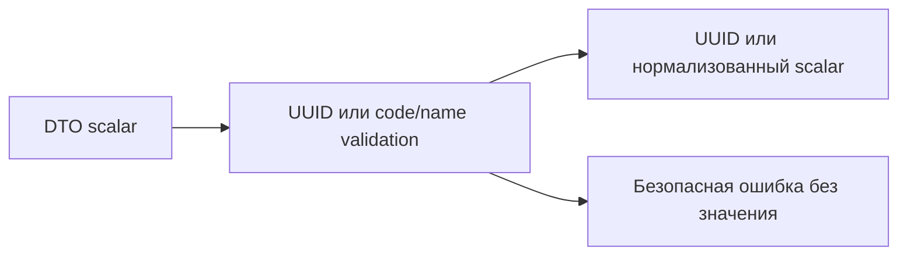

# Resource validation

Переиспользуемые проверки UUID, технических кодов и названий, без знания бизнес-модулей.

## Для менеджера

Одинаковые SKU/codes нормализуются предсказуемо, неправильные идентификаторы
отклоняются без раскрытия их значений в сообщениях ошибок.

## Для разработчика

identifiers.ts: isUuid, requireUuid; resource-fields.ts: normalizeCode, normalizeName.
Код — trimmed uppercase ASCII до 64 символов, имя — trimmed 1..160 без control chars.
UUID проверяется по синтаксису, не по наличию строки/пользовательским правам.

Пример: " demo-1 " → "DEMO-1"; invalid UUID → Invalid productId при доверенном field label.
Нет I/O, SQL, commit/rollback или собственных env settings. Эти функции не заменяют
FK/unique и проверку прав. Потребители: audit, catalog, warehouses, inventory.
Тесты: unit/stock-quantity.spec.ts и integration/stock.spec.ts; pnpm test, typecheck.
