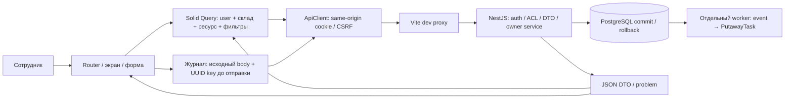

# Web: пользовательский интерфейс WMS

## Для менеджера

Клиентское приложение помогает выполнить складской процесс. Сотрудник входит по
логину и паролю, выбирает доступный склад и работает с документами. Сервер проверяет
права и правила каждой операции. Интерфейс показывает полученное от сервера состояние.

| Раздел     | Действия и результат                                                                                              |
| ---------- | ----------------------------------------------------------------------------------------------------------------- |
| Остатки    | Количество, резерв и доступность по товарам и зонам. Итоги относятся к загруженным строкам.                       |
| Приёмка    | Черновик из нескольких товаров, проведение, ожидание задания размещения.                                          |
| Размещение | Полное выполнение задания из receiving в storage выбранного склада.                                               |
| Заказы     | Черновик, подтверждение, явный частичный резерв, освобождение резерва, план сборки, подготовка отгрузки и отмена. |
| Сборка     | Самоназначение, фактическое количество, частичное выполнение и нехватка.                                          |
| Отгрузка   | Подтверждение сохранённого состава документа или отмена его черновика.                                            |
| История    | Движения и аудит. Аудит доступен только роли с соответствующим правом.                                            |

Отмена после сборки требует полного физического возврата неотгруженного товара в
хранение. Пользователь указывает основание и подтверждает выполнение возврата.
Уже отгруженное количество не отменяется. Автоматического истечения резерва нет.
[Бизнес-правила B1–B4](../../docs/fulfillment-rules.md).

Ошибка сети не означает отмену операции. Приложение сохраняет исходную команду до
отправки. После потери ответа пользователь выбирает исходный склад и нажимает
«Проверить результат с прежним ключом». Повтор может вернуть прежний результат или
выполнить ещё не выполненную команду. Нельзя создавать новую операцию для обхода
неопределённого результата. Журнал переживает перезагрузку страницы в той же вкладке;
закрытие вкладки удаляет его. Это ограничение текущей версии.

## Для разработчика

Стек принят в [ADR-0026](../../docs/adr/0026-solid-frontend.md). Справочники и журнал
команд уточнены в [ADR-0027](../../docs/adr/0027-web-boundaries.md).

| Технология                       | Закреплённая версия | Назначение                                            |
| -------------------------------- | ------------------- | ----------------------------------------------------- |
| Solid / TypeScript               | 1.9.18 / 5.9.3      | Реактивные компоненты, strict types                   |
| Vite / vite-plugin-solid         | 7.3.7 / 2.11.15     | Dev server и статическая сборка                       |
| Solid Router                     | 1.0.1               | Навигация SPA                                         |
| @tanstack/solid-query            | 5.105.3             | Серверные запросы, cache, cursor pages                |
| Tailwind / @tailwindcss/vite     | 4.3.4               | CSS pipeline; базовые компоненты — семантический HTML |
| openapi-typescript               | 7.13.0              | Generated paths и DTO из OpenAPI                      |
| Vitest / coverage-v8             | 4.1.12              | Компонентные и transport/journal tests                |
| @solidjs/testing-library / jsdom | 0.8.10 / 30.1.3     | DOM и Solid tests                                     |
| Playwright, root dependency      | 1.64.1              | Chromium gate с настоящими API/worker/PostgreSQL      |

Версии фиксируются package.json и lockfile. Node: `^22.22.2 || ^24.15.0 || >=26`,
pnpm 10.18.3. Инструкции: [Solid](https://docs.solidjs.com/quick-start),
[Solid Router](https://docs.solidjs.com/solid-router),
[Solid Query](https://tanstack.com/query/latest/docs/framework/solid/overview),
[тестирование Solid](https://docs.solidjs.com/guides/testing),
[Tailwind/Vite](https://tailwindcss.com/docs/installation/using-vite),
[генератор OpenAPI](https://openapi-ts.dev/node).

### Локальный запуск

После установки dependencies и заполнения root `.env` можно выполнить из корня
`pnpm dev:all`. Команда поднимет PostgreSQL, применит миграции и запустит API, worker
и web. `AUTH_ORIGIN` задаёт origin web; `PORT` задаёт API и автоматически передаётся
в Vite proxy. Для обычного запуска отдельные терминалы не нужны.
[Флоу, остановка и диагностика](../../docs/flows/dev-environment.md).

Ниже остаётся вариант отдельного запуска процессов для отладки:

1. Из корня установить зависимости: `pnpm install --frozen-lockfile`.
2. Поднять БД и применить миграции: `pnpm db:up`, `pnpm db:migrate`.
3. Настроить backend по [identity](../../docs/identity.md): реальные серверные сессии,
   пользователь и складские роли. Публичной регистрации и CRUD справочников нет.
   `pnpm db:seed` создаёт новый development-набор без stock. Администратора создаёт
   отдельная процедура bootstrap; назначения выдаются через identity API.
4. Запустить API с origin web. Ниже пример явно выбранных оператором сроков, не defaults:

```sh
AUTH_ORIGIN=http://127.0.0.1:5173 AUTH_SESSION_ABSOLUTE_SECONDS=3600 AUTH_SESSION_IDLE_SECONDS=900 pnpm dev:backend
```

5. В другом терминале выполнить `pnpm web:dev` и открыть `http://127.0.0.1:5173`.
6. Для появления задания размещения запустить отдельный worker: `pnpm build`, затем
   `pnpm worker` с той же БД и корректной backend-конфигурацией.

`127.0.0.1` и `localhost` — разные origin. Их нельзя смешивать. Vite проксирует `/api`
на `http://127.0.0.1:3000` и сохраняет Origin. При другом API-порте передать
`WEB_API_TARGET=http://127.0.0.1:4400 pnpm web:dev` для текущего `.env`. Это server-only настройка;
браузер всегда обращается к относительным `/api/v1/...`. CORS и dev actor не включаются.
Пароли, DATABASE_URL и session secrets нельзя задавать через `VITE_*`.

### Структура и контракты

| Путь                     | Ответственность                                                                   |
| ------------------------ | --------------------------------------------------------------------------------- |
| src/main.tsx             | QueryProvider → SessionProvider → Router → App; подключение CSS                   |
| src/api                  | Типизированный transport, безопасные ошибки; generated/schema.ts не редактировать |
| src/session              | Профиль и CSRF в памяти, login/logout, очистка private cache                      |
| src/commands             | Журнал одной неподтверждённой складской команды на пользователя во вкладке        |
| src/data                 | Query keys, справочники склада, отправка команд и invalidation                    |
| src/components           | Формы, состояния коллекций, labels, таблицы и recovery                            |
| src/pages                | Экраны и composition сценариев; SQL и расчётов бизнес-резерва здесь нет           |
| test                     | Transport/journal, компоненты и workspace regressions                             |
| scripts/generate-api.mjs | Offline generation/check из docs/contracts/openapi.json                           |

`index.html` задаёт русский язык и точку монтирования. `tsconfig.json` включает Solid
JSX/Bundler strict и tests. `vite.config.ts` задаёт proxy, Solid/Tailwind и Vitest coverage.
`package.json` содержит команды и точные версии. JSON не поддерживает комментарии.

`pnpm openapi:generate` обновляет серверную схему; затем `pnpm web:api:generate`
создаёт paths/DTO и числовые ограничения форм из этой схемы. `pnpm web:api:check`
проверяет diff без записи. Transport написан один раз поверх generated контрактов.
В web нет импортов backend-классов, ORM или React runtime.

### Схема взаимодействия



Подробные данные, шаги SQL, ветки ошибки, commit/recovery и тесты находятся у одного
владельца: [docs/flows/web.md](../../docs/flows/web.md).
Пример: форма приёмки `{warehouseId, locationId, lines:[{productId,quantity:10}]}`
→ журнал и `POST /api/v1/receipts` → committed `ReceiptDto` со статусом draft.
Проведение — отдельная команда. Оно начисляет 10 штук и создаёт событие; задание
размещения появляется только после commit worker. UI обновляет запросы после успеха.

### Проверки и ограничения

```sh
pnpm test:web              # 35 tests + все собственные TS/TSX в coverage + baseline
pnpm exec playwright install chromium # один раз, до любого integration/browser gate
pnpm test:web:gate         # Testcontainers, Nest, worker, Vite, Chromium, SQL сверка
pnpm web:api:check
pnpm check:pr              # итоговая проверка всего репозитория
```

Gate не зависит от локальных пользователей или dev volume. Все business-команды
проходят через UI; worker управляется тестом для проверки ожидания. Скриншоты
сохраняются в ignored `apps/web/test-results`. [Результаты и AC](../../docs/reports/wms-208.md).
Unit coverage V8 не включает Chromium; browser gate не повышает его проценты.
Критические transport/journal имеют отдельные пороги, все файлы — baseline ratchet.

Проверены labels, visible focus, skip link, Enter/Tab и основные формы в Chromium.
Полный аудит WCAG, screen reader, Safari/Firefox и мобильные устройства не выполнены.
Статическая сборка `dist`, отдельный Docker image и Kubernetes serving через NGINX
Gateway/TLS проверены в WMS-303. Vite proxy используется только локально. Внешний deployment не выполнен.
Нет SSR, редактирования справочников, управления пользователями в UI и фонового poll:
для обновления внешних изменений есть кнопка «Обновить». Физические действия сотрудник
подтверждает сам; приложение их не измеряет.

Аудит recovery и отказов browser storage: [отчёт](../../docs/reports/application-audit.md).

Static web origin/image WMS-303: [контракт сервера](server/README.md),
[Gateway/TLS flow](../../docs/flows/gateway-tls.md).

SessionProvider меняет локальную session epoch при clear/logout. Поздний 401 и profile прежней epoch не сбрасывают и не восстанавливают нового пользователя; журнал исходной команды сохраняется.
Login/logout выполняются последовательно: браузер применяет Set-Cookie до следующей
операции с credentials. Ошибка входа не блокирует следующую попытку. Складские команды
не входят в эту очередь и не повторяются автоматически.

Проверка сохранённого намерения отделена от I/O sessionStorage. Parser получает unknown
JSON, проверяет scope, строковые UUID, route/body и возвращает явную PendingCommand.
Array-to-string coercion UUID не допускается. Read не отправляет и не удаляет запись;
ошибки storage/parser безопасно дают null. [Ревью и проверки](../../docs/reports/readability-refactor.md).
