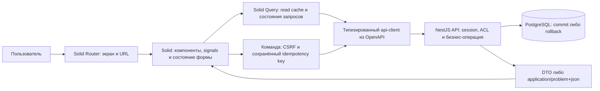

# ADR-0026. Solid для пользовательского интерфейса WMS

- Дата: 2026-11-04.
- Статус: Accepted по выбору пользователя использовать Solid вместо React.
- Частично заменяет [ADR-0001](0001-modular-monolith.md) только в выборе frontend.
- Реализация: WMS-208 выполнена в apps/web; [flow](../flows/web.md), [evidence](../reports/wms-208.md).

## Контекст

Пользователь хочет изучить Solid при создании WMS-интерфейса. Переносить готовый
React-код не требовалось: на момент выбора frontend отсутствовал. UI работает с существующим
NestJS API, session/CSRF, складскими ролями и идемпотентными командами.

## Решение

apps/web реализован как клиентское SPA на Solid, TypeScript strict и Vite.
Маршрутизация — Solid Router (`@solidjs/router`). Серверное состояние — TanStack Query
через `@tanstack/solid-query`. Стили — Tailwind CSS. Первые базовые компоненты можно
создать на семантическом HTML; библиотека сложных UI-компонентов пока не выбрана.
Прежняя запись React/shadcn/ui в целевом стеке заменена этим решением.

SolidStart/SSR не входят в WMS-208: для внутреннего приложения с отдельным NestJS
backend сейчас выбран SPA. Пересмотр режима потребует конкретной задачи и ADR.
Совместимые версии закреплены в package.json/lockfile и перечислены в
[web README](../../apps/web/README.md). Проверены installation, generation, build,
Vitest и Chromium с настоящим API. ADR сам по себе не заменяет эти проверки.

## Ответственность и движение данных

Это реализованный локальный поток WMS-208. Подробности commit, повторов, query scope
и ограничений — в [web flow](../flows/web.md).

- UI импортирует generated API-контракты, а не backend классы/ORM-модели.
- Query хранит серверные данные; signals/store — локальное состояние UI. Не создавать
  две несогласованные копии одного серверного остатка. Router отвечает за навигацию;
  отдельный конкурирующий cache загрузки тех же данных не нужен.
- Реактивность проверяется при смене склада, фильтров и props. Обычная деструктуризация
  reactive props вне tracking scope может потерять обновления; использовать подходящие
  Solid accessors/utilities и подтверждать поведение компонентными тестами.
- API-запросы идут к относительному /api/v1. В dev используются Vite proxy и согласованный
  AUTH_ORIGIN; cookies/CSRF/CORS policy нельзя ослаблять ради запуска web.
- Query keys учитывают склад/фильтры/пользовательский контекст. При logout/смене пользователя
  очищать приватный cache. Сервер проверяет ACL независимо от отображения кнопок.
- После успешной команды обновлять затронутые запросы. Timeout не доказывает rollback;
  сохранять исходный key/нормализованный запрос. Не включать автоматический повтор
  складских mutations с новым key.

## Проверки реализации

WMS-208.1 подключила Solid-совместимые JSX/lint/typecheck/build и тестирование
компонентов к общим командам качества. Jest backend остаётся отдельным окружением.
Не считать backend coverage доказательством покрытия Solid UI.

Проверить смену склада/фильтров без stale UI, loading/empty/error, login/logout и
очистку cache, отсутствие утечки данных другого склада, повтор клика/timeout с тем
же ключом, доступность клавиатуры и браузерный gate 2 из плана.
Границы авторизации, бизнес-ошибки, commit/rollback определяет API, не UI cache.

## Альтернативы и последствия

React остаётся допустимой технической альтернативой, но пользователь выбрал практику
Solid. SolidStart добавил бы серверный frontend runtime, который не требуется текущему
SPA-сценарию. Компоненты и adapters выбираются для Solid: сходный JSX не означает
совместимость React-библиотеки. Не добавлять React runtime ради одного UI-компонента.

Учебная стоимость — освоить tracking/signals и Solid tooling. До установки зависимостей
не обещать размеры bundle, ускорение или полную совместимость библиотек. Критерии
приёмки склада и серверный контракт остаются прежними.

## Источники и согласование документации

Проверены официальные [Solid quick start](https://docs.solidjs.com/quick-start),
[Solid Router](https://docs.solidjs.com/solid-router),
[Solid Query](https://tanstack.com/query/latest/docs/framework/solid/overview) и
[reactive props](https://docs.solidjs.com/concepts/components/props).

Изменение отражено в [архитектуре](../architecture.md), [плане WMS-208](../development-plan.md#wms-208-пользовательский-интерфейс)
и [статусе](../roadmap.md). Ревью сверяет эти документы и отсутствие действующего
React/shadcn выбора; исторический ADR-0001 сохранён со ссылкой на замену.
Проверки реализации и найденные при ревью дефекты перечислены в
[отчёте WMS-208](../reports/wms-208.md). Статическое production serving пока не настроено.
