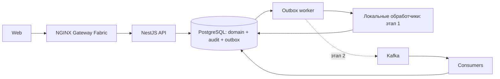

# Архитектура

## Цель и границы

Учебное приложение управления складом с полным путём:
приёмка → размещение → резервирование → сборка → отгрузка.
Учимся корректности транзакций и эксплуатации при повторах и сбоях.
Первый релиз: одна организация, несколько складов, адресные ячейки,
целочисленные количества в штуках. Партии, серии и сроки годности — за рамками.

## Стек и статус

| Слой | Решение | Статус |
|---|---|---|
| Workspace | pnpm + TypeScript | Реализован |
| Backend | NestJS | Каркас реализован |
| Данные | PostgreSQL + Drizzle + SQL | Принято, предстоит внедрить |
| Надёжные события | PostgreSQL transactional outbox | Первый этап |
| Event transport | Kafka, затем Schema Registry | Последующий этап |
| UI | React, Vite, TanStack Query, Tailwind, shadcn/ui | Целевой стек |
| Контейнеры | Docker, Compose | Обязательно |
| Оркестрация | kind, Kubernetes, Helm | Обязательно |
| Внешний HTTP | NGINX Gateway Fabric + Gateway API | Принято |
| Телеметрия | Pino, OpenTelemetry, Prometheus, Grafana, Loki, Tempo | По этапам |
| Проверки | Jest, Supertest, Testcontainers, k6 | По этапам |
| Поставка | GitHub Actions, GHCR, Argo CD | После проверки репозитория и окружения |

## Модули

| Модуль | Владеет |
|---|---|
| identity | Пользователи, роли, сессии |
| catalog | SKU, наименование, единица измерения |
| warehouses | Склады, зоны, ячейки и назначение ячеек |
| receiving | Документы и строки приёмки, проведение |
| inventory | Остатки, движения, резервы, размещение и перемещение |
| fulfillment | Заказы на отгрузку, задания сборки, отгрузки |
| audit | Журнал бизнес-действий |

Инфраструктура предоставляет транзакции, outbox, логи и транспорт.
Модули общаются через прикладные интерфейсы; никто не пишет напрямую
в таблицы другого модуля. Межмодульный сценарий передаёт общий transaction
context, если изменения обязаны фиксироваться атомарно.

`inventory` — единственный владелец изменения количества и резервов.
Проведение приёмки синхронно вызывает inventory в той же транзакции;
событие не должно повторно начислять уже принятый товар.
Асинхронные обработчики выполняют последующие действия: например,
создают задания размещения или обновляют производные представления.

## Процессы



API, worker и consumers разворачиваются независимо, но используют один
backend-пакет и одну БД. Это модульный монолит, не набор микросервисов.
На первом этапе worker читает outbox и вызывает долговечные обработчики;
Nest EventEmitter не является гарантией доставки.

## Целевая структура

```text
apps/backend/src/
  modules/<module>/
    domain/
    application/
    infrastructure/
    presentation/
  infrastructure/
  main.ts
  worker.ts
apps/web/
packages/api-client/          # генерация из OpenAPI
packages/event-contracts/     # будущая генерация из JSON Schema
docs/contracts/              # исходные схемы событий
infra/compose/
infra/helm/
infra/gitops/
```

Создавать директории по мере реализации. Domain не зависит от NestJS,
HTTP, ORM или Kafka. Контроллеры валидируют ввод, application организует
транзакцию, domain проверяет бизнес-правила, infrastructure выполняет I/O.

## Принципы

- Корректность резервов обеспечивается транзакциями, а не eventual consistency.
- SQL constraints дополняют доменные проверки.
- Event-driven обработка не означает полный Event Sourcing.
- Журнал движений объясняет остаток; аудит объясняет действие пользователя.
- Разделение на сервисы возможно позже, только с ADR и явными границами данных.

## Документация и повторное использование

Общие технические capabilities размещаются в `apps/backend/src/shared/`,
адаптеры I/O — в infrastructure. Shared не импортирует бизнес-модули.
См. [правила shared](shared.md) и [обязательный стандарт документации](documentation-standard.md).
