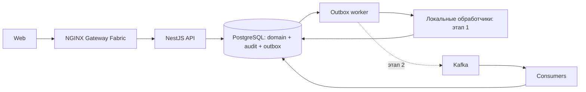

# Архитектура

## Цель и границы

Учебное приложение управления складом с полным путём:
приёмка → размещение → резервирование → сборка → отгрузка.
Учимся корректности транзакций и эксплуатации при повторах и сбоях.
Первый релиз: одна организация, несколько складов, адресные ячейки,
целочисленные количества в штуках. Партии, серии и сроки годности — за рамками.

## Стек и статус

| Слой | Решение | Статус |
|---|---|---|
| Workspace | pnpm + TypeScript | Реализован |
| Backend | NestJS | Каркас реализован |
| Данные | PostgreSQL + Drizzle + SQL | WMS-101: подключение и технический baseline |
| Надёжные события | PostgreSQL transactional outbox | Первый этап |
| Event transport | Kafka, затем Schema Registry | Последующий этап |
| UI | React, Vite, TanStack Query, Tailwind, shadcn/ui | Целевой стек |
| Контейнеры | Docker, Compose | PostgreSQL Compose готов; образ backend предстоит |
| Оркестрация | kind, Kubernetes, Helm | Обязательно |
| Внешний HTTP | NGINX Gateway Fabric + Gateway API | Принято |
| Телеметрия | Pino, OpenTelemetry, Prometheus, Grafana, Loki, Tempo | По этапам |
| Проверки | Jest, Supertest, Testcontainers, k6 | WMS-102: первые три готовы, k6 запланирован |
| Поставка | GitHub Actions, GHCR, Argo CD | После проверки репозитория и окружения |

## Модули

| Модуль | Владеет |
|---|---|
| identity | Пользователи, роли, сессии |
| catalog | WMS-104: создание/lookup Product, SKU, name, unit=piece, без HTTP |
| warehouses | WMS-104: Warehouse/Location, kind зоны, без HTTP |
| receiving | Документы и строки приёмки, проведение |
| inventory | WMS-104: balance/receipt/movement; резервы и перемещения ещё запланированы |
| fulfillment | Заказы на отгрузку, задания сборки, отгрузки |
| audit | Журнал бизнес-действий: WMS-103 write interface реализован, read API ещё нет |

Инфраструктура предоставляет транзакции, outbox, логи и транспорт.
Модули общаются через экспортируемые сервисы; никто не пишет напрямую
в таблицы другого модуля. Межмодульный сценарий передаёт общий transaction
context, если изменения обязаны фиксироваться атомарно.

`inventory` — единственный владелец изменения количества и резервов.
Проведение приёмки синхронно вызывает inventory в той же транзакции;
событие не должно повторно начислять уже принятый товар.
Асинхронные обработчики выполняют последующие действия: например,
создают задания размещения или обновляют производные представления.

## Процессы



API, worker и consumers разворачиваются независимо, но используют один
backend-пакет и одну БД. Это модульный монолит, не набор микросервисов.
На первом этапе worker читает outbox и вызывает долговечные обработчики;
Nest EventEmitter не является гарантией доставки.

## Целевая структура

```text
apps/backend/src/
  modules/<module>/
    <module>.module.ts
    <module>.controller.ts   # если нужен HTTP
    services/
      <module>.service.ts
    repositories/            # если нужна БД
      <module>.repository.ts
    <module>.schema.ts
    dto/
      <operation>.dto.ts     # HTTP или внутренний DTO, назначение описывается явно
  infrastructure/
  main.ts
  worker.ts
apps/web/
packages/api-client/          # генерация из OpenAPI
packages/event-contracts/     # будущая генерация из JSON Schema
docs/contracts/              # исходные схемы событий
infra/compose/
infra/helm/
infra/gitops/
```

По умолчанию используем обычный NestJS: controller → service → repository.
Controller обрабатывает HTTP, service организует сценарий/правила и транзакцию,
repository выполняет SQL/ORM. Межмодульные вызовы проходят через экспортируемые
сервисы, repository остаётся внутренним provider. Schema и локальные helpers
лежат рядом с модулем; повторяемую техническую логику выносим в shared.

Services, repositories и DTO всегда группируются в собственных services/,
repositories/ и dto/, включая единственный файл. Отсутствующий вид компонента
не требует пустой папки. В audit DTO внутренние, а HTTP-контроллера пока нет.
README каждого модуля показывает взаимодействие компонентов, движение/преобразование
данных, ошибки и транзакционные границы с конкретным примером.

Не создаём пустые слои или interface для каждого класса. В AuditModule сейчас
только AuditService/AuditRepository, потому что внешнего HTTP пока нет.
Отдельные сценарии, domain-модель или ports/adapters допустимы при конкретной
необходимости. Причина описывается в README, существенное изменение границ — в ADR.
Подход по умолчанию: [ADR-0009](adr/0009-nest-service-repository-default.md).

## Принципы

- Корректность резервов обеспечивается транзакциями, а не eventual consistency.
- SQL constraints дополняют доменные проверки.
- Event-driven обработка не означает полный Event Sourcing.
- Журнал движений объясняет остаток; аудит объясняет действие пользователя.
- Разделение на сервисы возможно позже, только с ADR и явными границами данных.

## Документация и повторное использование

Общие технические capabilities размещаются в `apps/backend/src/shared/`,
адаптеры I/O — в infrastructure. Shared не импортирует бизнес-модули.
См. [правила shared](shared.md) и [обязательный стандарт документации](documentation-standard.md).

WMS-103 реализует [явный transaction context и audit](transactions.md).
Shared contracts не зависят от ORM; PostgreSQL adapter связывает context с одной
транзакцией. Никаких внешних I/O или скрытых retry в callback; nested run запрещён.
AuditService → AuditRepository используют транзакцию вызывающего сервиса.
Этот общий transaction port сохранён ради атомарности и scope guards; он не
навязывает ports/adapters каждому модулю. Внешние endpoints и события не добавлены.

WMS-104 реализует [минимальный складской baseline](stock-baseline.md).
Сервисы справочников/начисления внутренние, без публичного CRUD. Сквозной сценарий
документа приёмки и outbox пока не подключены. Quantity int4 и immutable movement
зафиксированы [ADR-0010](adr/0010-minimal-stock.md).
