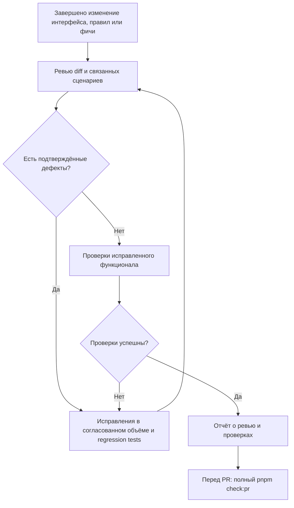

# Требования к код-ревью Warehouse Controller

Применяются к изменениям и к периодическому review существующих модулей. Цель — найти
нарушения бизнес-инвариантов, надёжности и контрактов, а также расхождения описания с кодом.
Результат review не заменяет исполнение проверок и не означает разрешение внешнего deployment.

## Обязательное ревью после изменения функционала

После каждого завершённого изменения интерфейса, бизнес-требований или поведения
фичи исполнитель проводит код-ревью без отдельного запроса пользователя. Для агента
это обязательный шаг выполнения задачи. Правило действует для minor и major изменений
функционала независимо от номера версии, размера diff и наличия PR. Исправление ошибки,
которое меняет поведение, также требует ревью. Не нужно ждать завершения всего этапа:
проверять каждое законченное изменение сценария, а не каждое сохранение файла.

Триггеры ревью:

- Изменился интерфейс: HTTP API, DTO, событие, CLI, публичный интерфейс модуля или UI.
- Изменилось бизнес-правило: переход состояния, расчёт количества, права, лимиты,
  условия выполнения или критерии приёмки.
- Добавлена, изменена или удалена фича, включая её ошибки, побочные эффекты,
  транзакции, конкурентное поведение и восстановление после сбоя.

Если изменились только требования, сверить действующий код и тесты с новыми правилами.
Зафиксировать расхождения и статус реализации. Обновление документа не означает,
что код уже соответствует требованию, и не разрешает реализовать несогласованное правило.

Обязательный порядок:

1. Завершить согласованное изменение кода, контрактов, документации и тестов.
2. Просмотреть итоговый diff, новые файлы и затронутые пути существующего кода
   по критериям этого документа. Зелёные тесты не заменяют чтение кода.
3. Исправить подтверждённые дефекты в пределах порученной реализации. Добавить
   регрессионные тесты, когда дефект затрагивает поведение. Нужное новое бизнес-решение
   вынести на согласование, не подменять его предположением.
4. Повторно провести ревью исправлений и связанных сценариев. Повторять цикл,
   если обнаружены новые дефекты. Неразрешённые замечания указать явно; изменение
   с такими замечаниями не объявлять полностью завершённым.
5. Выполнить проверки затронутого функционала на исправленном коде. При новом
   изменении поведения повторить ревью и соответствующие проверки. Перед PR
   дополнительно выполнить полный `pnpm check:pr` на итоговом diff.
6. В отчёте задачи или PR указать область ревью, найденные и исправленные замечания,
   результат повторного ревью, выполненные команды и оставшиеся ограничения.
   Если подтверждённых замечаний нет, написать это прямо с границами проверки.

«Автоматически» означает обязательное действие исполнителя или агента без напоминания.
`pnpm check:pr` запускает проверки, но не выполняет смысловое код-ревью. CI-бот,
Git hook и внешний сервис ревью этим правилом не настраиваются. Для отдельного запроса
«проведи ревью» без поручения менять код остаётся режим отчёта о замечаниях.

## Критерии до реализации и связь с тестами

Исполнитель определяет стабильные AC ID по [шаблону](templates/change.md) до зависимого
кода. Каждый критерий связан с реализацией, конкретным test title и evidence. Непроверенные
критерии остаются открытыми. Reviewer сверяет ожидаемое бизнес-поведение независимо от
того, как его реализовал автор. Политика покрытия и читаемости — [quality](quality.md).

## Область и источники требований

1. Зафиксировать baseline: git status, diff, новые untracked файлы, затронутые модули/контракты.
2. Прочитать docs/README, architecture/domain, принятые ADR, текущую задачу development-plan,
   module README и владельца flow. Предложения/будущие стадии не считать принятыми требованиями.
3. Проверить код, а не только документацию или наличие tests. Generated output сверять с source
   схемой/генератором, applied SQL — с новыми миграциями; не исправлять applied migration.
4. При полном review описать реально просмотренную область и проверки, не обещать отсутствие
   всех возможных дефектов. При отдельном запросе только на review код не менять. При реализации задачи
   исправления в её согласованном объёме входят в обязательный цикл выше.

## Бизнес-инварианты и транзакции

- Только inventory меняет stock/reservations. Quantity int4 в штуках, available=onHand-reserved.
  Для всех balances reserved=SUM(active allocations), без скрытых исключений для новых/legacy rows.
- Состояния/запрещённые переходы согласованы с текущей стадией; immutable основания и история
  не переписываются. Reserve/release не имитируют физическое movement, B4 исключает expiry.
- Все изменения сценария, movements/allocations, audit, outbox и saved HTTP result используют
  один awaited TransactionContext. Нет nested run, swallowed SQL failure или внешнего I/O в callback.
- Проверять каждый способ записи: INSERT/UPDATE/DELETE/TRUNCATE, ORM upsert и raw SQL.
  Новый guard обязан покрывать весь заявленный инвариант. Для существующего нарушения определить
  fail-closed migration/recovery; не угадывать allocations и не обнулять stock молча.

## Конкуренция и recovery

- Проследить реальный порядок ресурсов и режимы locks всех конкурирующих путей, включая guard,
  application callbacks, worker и admin. Стабильного порядка таблиц недостаточно: SHARE→UPDATE
  upgrade двух callers тоже создаёт deadlock. Для mutation брать нужный режим заранее.
- Проверить absent-key race и unique INSERT, состояние после ожидания locks, DB clock после ожидания.
  SKIP LOCKED допустим для claim, но не должен превращать занятой stock в ложную нехватку.
- Перечислить результаты дубля, crash до/после commit, timeout/потери ответа, stale lease/token,
  rollback промежуточного шага и повторного запуска миграций. Auto retry не предполагать.
- At-least-once handler должен иметь atomic effect/marker/cursor/ack. Не обещать exactly once,
  глобальный порядок или атомарность PostgreSQL+Kafka. Новая подписка требует replay/start-position.

## API, безопасность и контракты

- Доверие каждому input явно определено; actor/roles не берутся из body/headers. Проверить
  warehouse ownership по сохранённому объекту, ACL до idempotency replay и после ожидания locks.
- DTO/runtime/schema/SQL согласованы по UUID, UTC, int4, размерам, duplicate IDs и unknown fields.
  Fingerprint получает нормализованный plain JSON, не credentials или DTO с произвольным prototype.
- Документированы только реализованные routes, статусы, error codes, headers и output DTO.
  Source JSON Schema, примеры, registry, KnownEvent, generated bundle/OpenAPI обновлены совместно.
- Сессии/CSRF/cookie/revoke, bootstrap opt-in, runtime DB role и отсутствие секретов в errors/logs
  проверяются фактически. Development не означает обход auth. Границы DBA/host угроз указаны честно.

## Логические модули и repositories

- По умолчанию controller → service → private repository; сервисы/репозитории/DTO в своих папках.
  Controller отвечает за transport, service — за сценарий/правила, repository — за SQL.
- Модуль экспортирует публичные сервисы. Прямые записи в чужие таблицы запрещены; несколько
  локальных services могут совместно использовать repository владельца, это само по себе не дефект.
- Разделять классы по реальной ответственности и зависимостям, не добавлять обязательные слои,
  ports/tokens/base classes только ради формата. Проверить циклические зависимости и API/worker graphs.
- Shared не импортирует modules/infrastructure. Business rule остаётся у владельца; общая техническая
  логика переиспользуется после поиска rg. При изменении helper проверяются все потребители.

## Понятные имена методов

- Имя метода должно объяснять действие и объект при первом чтении вызова.
  Для бизнес-сценария использовать термин владельца процесса. Более длинное точное
  имя предпочтительнее короткого неоднозначного.
- При необходимости уточнять существенный результат или эффект: создание, чтение,
  проверку, изменение состояния, блокировку. Имя не должно обещать commit, сохранение
  или проверку прав, если метод этого не делает. Границы транзакции также описывать в JSDoc.
- Не использовать `process`, `handle`, `run`, `execute`, `check` или `data` как
  самостоятельное объяснение бизнес-операции. Название класса и контекст вызова учитывать:
  стандартные имена NestJS, lifecycle hooks и методы внешних интерфейсов сохраняют их контракт.
- Не добавлять слова только ради длины. Не включать в имя все параметры или детали ORM.
  Сложность имени может указывать на несколько обязанностей метода; проверить его ответственность.
- Примеры направления именования: `process` → `completePutawayTask`,
  `check` → `assertSessionIsActive`, `getData` → `findActiveAllocationsForOrder`.
  Это примеры требований, а не утверждение о наличии таких методов или задача их переименовать.
- При переименовании обновить вызовы, тесты, JSDoc и схемы движения данных.
  Публичные контракты и внешние реализации проверить на совместимость.

## Простота и технические guards

Проверять одну ответственность функции и явное разделение HTTP/правил/SQL. Не объединять
самостоятельные операции флагами и не выделять абстракцию без реального потребителя.
Typed lint блокирует explicit any, floating/misused Promises и неразрешённые TS suppressions.
Architecture guard проверяет source boundaries/runtime cycles; его исключения не заменяют
ревью schema FK/SQL. Правила и область [quality gates](quality.md#автоматические-проверки).

## Тесты и доказательства

- Каждый поведенческий дефект закреплять regression test; по возможности сначала показать
  отказ на старом коде. Нельзя ослаблять тест ради успешного прогона. Тесты независимы от
  порядка/общих данных/случайного sleep. Fixtures не копируют бизнес-алгоритмы.
- Тест должен проверять observable контракт/инвариант, а не пересказывать вызовы реализации.
  Для locks, миграций, atomicity и outbox нужны реальные PostgreSQL tests, не только mocks.
- Гонка доказывается barriers/наблюдаемыми DB waits и альтернативными исходами, не sleep или
  одним Promise.all. Rejection handlers подключаются сразу, locks/resources освобождаются в finally.
- Fault injection подтверждает rollback после существенного SQL шага; проверки сравнивают
  независимые evidence (balances vs ledger, task vs event), включая отрицательные runtime-role cases.
- Coverage — ориентир, не доказательство корректности. 100% lines не покрывает все interleavings.
  Указывать provider/scope, branches и пропуски; child-process CLI coverage не считать автоматически
  отсутствием tests. Не повышать проценты искусственными tests интерфейсов/generated artifacts.
- Выполнить подходящие typecheck/build/unit/integration и contract generation diff. Без Docker
  integration должна падать, skip/fallback запрещены. Не запускать два test:prepare в одном checkout.
  После успешных проверок повторять их только при новых изменениях/неразрешённых рисках.

## Документация и комментарии

- Проверить [правила ясного технического языка](documentation-standard.md#ясный-технический-язык-принципы-asd-ste100),
  основанные на ASD-STE100 и адаптированные к русскому языку: короткие предложения,
  единые термины, явный участник, одно основное действие на шаг. Для бизнес-процесса
  должны быть понятны условия, последовательность, состояния, результат и ветки отказа.
  Проверять также комментарии и подписи Mermaid. Не заявлять формальное соответствие
  русской документации английскому словарю STE.
- README должен описывать текущие реализованные возможности; историческое ограничение — с датой
  и явной ссылкой на заменяющую реализацию. Дописывание нового раздела не исправляет старое
  противоположное утверждение. Сверять дочерние README и root maps/status, не только новый flow.
- Каждый модуль имеет manager/developer разделы, реальные Mermaid flow/sequence, input/result,
  commit/rollback, ошибки и ссылки на evidence. Большой flow имеет одного владельца.
- Русский file-level JSDoc обязателен; public symbols описывают доверие input, результат, ошибки,
  эффекты. Комментарии объясняют причины locks/проверок и владельца transaction, а не синтаксис.
- В schema-файлах каждое поле объясняет тип, единицы/диапазон, default/NULL, SQL/JS/JSON нюансы;
  ключи/индексы/CHECK — причину. Generated output меняется через source/generator.
- Проверить links, file-catalog, documentation-standard/shared и фактический checklist задачи.
  Комментарий/схема с неверным поведением — дефект документации, даже при зелёных tests.

## Формат замечаний и приоритеты

| Приоритет | Критерий                                                                                            |
| --------- | --------------------------------------------------------------------------------------------------- |
| P0        | Немедленная потеря/раскрытие данных или недоступность, требующая срочного вмешательства             |
| P1        | Существенное нарушение бизнес-инварианта, авторизации или надёжности обычного сценария              |
| P2        | Воспроизводимый дефект отдельной ветки/гонки, пробел защиты или противоречие действующему контракту |
| P3        | Локальная проблема сопровождения/документации с конкретным последствием                             |

Каждое замечание: приоритет, файл/минимальная строка, триггер, фактический результат,
ожидаемый контракт, последствия и направление исправления. Отделять воспроизведённое от
вывода по коду и открытого вопроса. Указывать отсутствующий regression test, когда он важен.
Не придумывать дефекты ради количества, не выдавать вкусовые предпочтения за бизнес-ошибки.

Сначала findings по важности, затем открытые вопросы/ограничения и краткая оценка модулей,
тестов/coverage/документации. Указать, что реально запускалось и что не проверено. При отсутствии
подтверждённых findings сказать это прямо, обозначив границы проверки.

## Обязательный прогон перед PR

Перед каждым PR на итоговом diff выполнять `pnpm check:pr` и фиксировать результат
в описании по [шаблону](templates/pull-request.md). Это format/typed lint/architecture/self-tests/typecheck/build/contracts/
OpenAPI и coverage всех собственных backend файлов плюс все unit и реальные PostgreSQL integration suites. `pnpm test:functional`
удобен во время разработки, но не заменяет полный gate. Без Docker или при ненулевом
exit code gate не пройден. Не скрывать failed tests через skip/fallback/forceExit.

Документировать связь изменённого поведения с проверяющими сценариями, включая
отрицательные ветки, конкурентные операции и rollback. Отдельно указывать границы:
что автоматизировано, что проверено вручную и что не проверялось. Зелёный запуск не
доказывает 100% code coverage. [Полный порядок и Mermaid](pr-checks.md).
Локальный gate пока не является обязательным CI status check на внешнем PR-хостинге.
