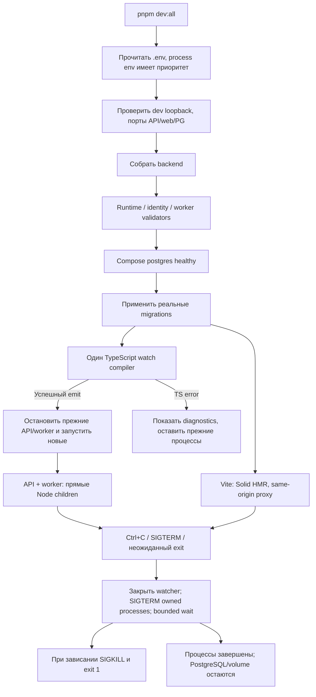

# Единый dev-запуск

Пользователь запускает `pnpm dev:all` из корня. Команда поднимает локальный PostgreSQL,
применяет миграции и запускает API, worker и Solid web. Установка зависимостей
выполняется заранее: `pnpm install --frozen-lockfile`.

## Критерии до реализации

| ID        | Ожидаемый результат                                                                                                            |
| --------- | ------------------------------------------------------------------------------------------------------------------------------ |
| AC-DEV-01 | Одна команда: проверка локального env/портов → build → PostgreSQL healthy → migrations → API/worker/web.                       |
| AC-DEV-02 | Ошибочные env и занятые порты отклоняются явно; чужие процессы не останавливаются.                                             |
| AC-DEV-03 | Один compiler наблюдает backend; успешная компиляция перезапускает API и worker. Ошибка TS оставляет последнюю рабочую версию. |
| AC-DEV-04 | Ctrl+C/SIGTERM закрывают watcher и все дочерние процессы с deadline. PostgreSQL и volume сохраняются.                          |
| AC-DEV-05 | Ошибка подготовки или неожиданный выход сервиса останавливают остальные процессы и дают exit 1. Credentials не печатаются.     |
| AC-DEV-06 | Origin/порты берутся из .env; Vite proxy получает правильный API target, auth/CSRF/ACL сохраняются.                            |

Команда не создаёт пользователей и не наполняет справочники автоматически. Это отдельные
операторские действия. Бизнес-правила, API и миграции не меняются; отдельный ADR не требуется.

## Поток



## Проверки

| AC  | Реализация                                  | Evidence                                                                                                                      |
| --- | ------------------------------------------- | ----------------------------------------------------------------------------------------------------------------------------- |
| 01  | scripts/dev-all.cjs main / DevProcesses.run | Реальный pnpm dev:all: build, Compose healthy, migration completed, API/web HTTP 200, Worker ready                            |
| 02  | readDevConfiguration / assertPortAvailable  | test:dev: неверный env, external DB, совпавшие/занятые порты; второй CLI вернул exit 1 и сохранил первый                      |
| 03  | watchBackend / revision queue               | Временный TS probe: успешный emit сменил оба PID; TS2322 сохранила прежний API; исправление восстановило reload; probe удалён |
| 04  | requestStop / DevProcesses.stop             | Реальный Ctrl+C → exit 0, API/web закрыты; unit SIGTERM и deadline/SIGKILL на настоящих children                              |
| 05  | DevProcesses.run/start, main finally        | test:dev: spawn failure, прерывание preparation, неожиданный exit; рабочий env в stdout не выводится                          |
| 06  | readDevConfiguration / WEB_API_TARGET       | Chromium login → выбор склада → остатки → logout, API PORT=4400 и web 5173; реальная session/CSRF, без bypass                 |

`pnpm test:dev` — девять Node tests без Docker. Они используют синтетический env,
эфемерные loopback sockets и настоящие child processes. IPC ready служит barrier перед
сигналом; cleanup находится в finally. Root check:pr включает эту команду. Покрытие
root CLI не смешивается с Jest/Vitest coverage приложений.

## Конфигурация и запуск

```sh
pnpm install --frozen-lockfile
pnpm dev:all
```

Root `.env` должен содержать NODE_ENV=development, loopback DATABASE_URL с теми же
POSTGRES_* и host-портом, что в Compose, AUTH_ORIGIN web и оба срока AUTH_SESSION__.
Web и API используют разные порты. Пример origin — http://127.0.0.1:5173. Числовая
session policy задаётся оператором, команда не подставляет скрытые сроки.
Если `PORT` изменён, CLI передаёт новый server-only WEB_API_TARGET в Vite сам.
Root `.env` с credentials не передаётся web как клиентский config. У процесса web
остаются parent env и server-only proxy target; не помещать секреты в VITE__.

Полные validators принадлежат backend config/identity/worker. CLI сначала проверяет
локальность и свободные порты, затем собирает backend и вызывает эти validators.
Docker и миграции запускаются только после успешной проверки. Ошибка порта не
завершает чужие процессы. Сначала остановить прежние pnpm dev/worker/web:dev либо app:up.

Порядок исполнения: CLI читает env → Nest build → validators → Compose postgres up
с healthcheck → migrator → TS watcher → API/worker Node children и Vite. Миграции
исполняются до процессов; ошибка миграции выходит с exit 1. Сценарий не вызывает
bootstrap, seed, генерацию схем или npm install и не удаляет volume. Существующие
пользователи, документы, stock, audit и outbox сохраняются.

TypeScript watcher использует существующий TypeScript 5.9.3 без новых dependencies.
Это единственный постоянный backend compiler. Успешный emit последовательно закрывает
прежние API/worker и запускает новую пару. Быстрые изменения coalesce по revision,
чтобы запоздалая сборка не создала вторую пару. При TS error noEmitOnError сохраняет
последний рабочий dist и процессы. Ошибка видна в терминале; это не исполнение нового кода.
Полная initial сборка выполняется до migrate; watcher не удаляет dist на каждой правке.
Vite отвечает за frontend HMR. После изменения `.env` следует перезапустить dev:all.

Ctrl+C/SIGTERM закрывает compiler watcher и сразу сигнализирует owned processes.
Для web сигнал получает сам Vite: он закрывает esbuild по своему протоколу.
SIGTERM всей web группе во время первой dependency scan преждевременно убивал helper
и давал EPIPE/exit1; regression с реальными parent/helper закрепляет порядок.
Остальные команды получают сигнал своей process group,
в том числе во время build/Compose. API/worker получают SIGTERM напрямую; worker
использует свой drain. Общий срок — max(WORKER_SHUTDOWN_TIMEOUT_MS, API_SHUTDOWN_TIMEOUT_MS) + 5000 ms;
API_SHUTDOWN_TIMEOUT_MS задан в lifecycle/api-process. Зависшая
группа получает SIGKILL, результат — exit 1. Неожиданный выход одного сервиса завершает
остальные с exit 1. Без shell wrappers и поиска процессов по имени. Child stdin закрыт:
Vite не перехватывает Ctrl+C у supervisor. PostgreSQL работает detached через Compose
и остаётся после остановки; отдельная `pnpm db:down` сохраняет volume.

## Ограничения и ревью

Нужно остановить dev:all перед check:pr/test:prepare/отдельным Nest watch: они используют
общий dist. Runtime ошибки сервиса останавливают dev:all; после исправления запустить
команду заново. Это явный failure, а не бесконечный цикл crash/restart. При reload
ответ HTTP может потеряться после commit; UI восстанавливает такую команду с прежним
ключом по [web flow](web.md), не считает timeout доказательством rollback.

HTTP readiness проверяет API /health и web. Он не заменяет отдельную DB readiness или
worker probe: worker сообщает о старте собственным Worker ready. Process groups и TTY
проверены на macOS; Windows tree cleanup отдельно не проверен. SIGKILL supervisor или
отключение машины не являются graceful shutdown.

Ревью проверило local-only config, отсутствие credentials в argv/log, сериализацию
restart/shutdown и сборку только одним compiler. Исправлено: signal во время preparation
должен останавливать child немедленно; Vite не должен получать stdin терминала.
Также исправлено подавление exit 1 при drain worker: теперь это неуспешный shutdown.
Регрессионный тест сначала воспроизвёл ложный успех, затем прошёл после исправления.
Повторное ревью и unit/manual checks выполнены. Итоговый `pnpm check:pr` прошёл:
9 dev tests, 9 quality self-tests, 35 Vitest tests и 576 Jest tests (39 suites),
включая Chromium gate 2. Оба coverage baseline прошли без снижения; backend source
и бизнес-контракты этой задачей не изменены. Пробный запуск остановлен через Ctrl+C;
API/web порты закрыты, PostgreSQL доступен. Сохранились 15 демо-заказов,
onHand=1946 и reserved=466. Временный hot reload probe удалён и в проект не добавлен.

Источники API: [TypeScript incremental watcher](https://github.com/microsoft/TypeScript/wiki/Using-the-Compiler-API#writing-an-incremental-program-watcher),
[Node child processes](https://nodejs.org/docs/latest-v24.x/api/child_process.html).
Источник команд — [package.json](../../package.json), реализация —
[dev-all.cjs](../../scripts/dev-all.cjs), тесты — [dev-all.test.cjs](../../scripts/dev-all.test.cjs).

WMS-304: supervisor ждёт max(API shutdown20s, worker shutdown15s)+5s =25s
по default policy. Watch должен быть остановлен до check:pr. Подробный
[порядок завершения и probes](lifecycle.md) задаёт один владелец.
