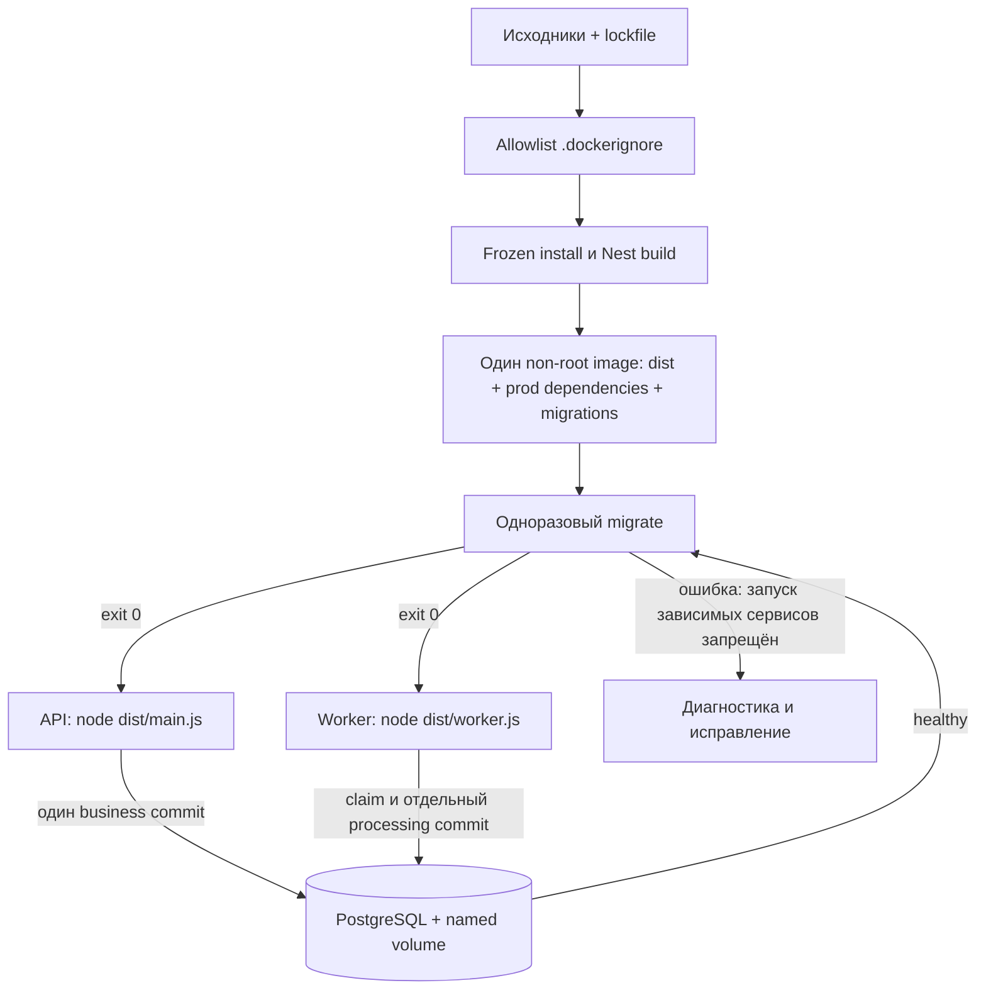
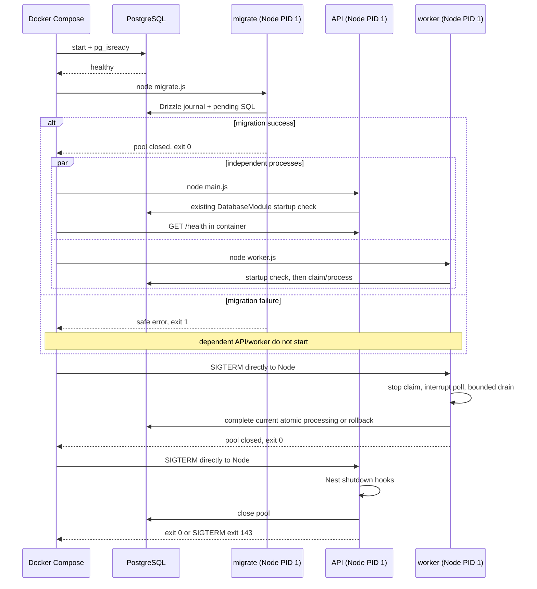

# Docker: запуск и демонстрация gate 1

Владелец подробностей WMS-112: сборка, границы контейнеров, startup/shutdown и
демонстрация первого складского сценария. Для менеджера: приёмка сохраняется при
отключённом worker, повтор команды не начисляет товар второй раз; после запуска
worker создаётся одно задание размещения. Физическое размещение ещё не реализовано.
Это локальный Compose-стенд, не внешний deployment и не Kubernetes.

## Обзор и доверие данным



Build input — только собственные manifest/lock/config/src/drizzle. Generated event
schemas уже находятся в src; Docker не читает docs, .env, test, host dist/node_modules
или Git. **Новый workspace dependency или build input требует обновить allowlist и
Dockerfile.** Не добавлять общий COPY . . ради удобства.
Node 24.22.1 bookworm-slim закреплён digest, pnpm 10.18.3 — явно в tooling stage.
Frozen install не изменяет lockfile. Production-dependencies делает отдельный prod
install (132 packages на проверенном lockfile); build stage ставит dev dependencies
и выполняет Nest build. Runtime начинается с чистого Node base, получает только
production node_modules, dist и drizzle с journal/snapshots/SQL. Host artifacts не нужны.
Обновление base digest/lockfile — отдельное осознанное изменение с повтором проверок.

Image не содержит DATABASE_URL или паролей. Runtime URL передаётся средой Compose;
docker inspect/config способны его показать локальному Docker-администратору.
Секреты не передаются build args, ENV Dockerfile, bind mounts или исходниками.
Docker secret manager, image signing и vulnerability scanner этим этапом не добавлены.

## Запуск разработчиком

Нужны Docker daemon, Compose v2, доступ к публичным registry при первой сборке и
Node/pnpm для convenience-команд/проверочных скриптов на host. Backend на host
устанавливать/компилировать для Docker-сборки не нужно.

1. Если .env отсутствует, скопировать .env.example. Существующий файл не перезаписывать.
2. Для старого .env добавить **CONTAINER_DATABASE_URL**: те же локальные credentials и
   база, но hostname `postgres`, внутренний порт `5432`. Пароль URL-encode.
   Host DATABASE_URL остаётся loopback:15432; это два разных сетевых адреса одной БД.
3. Выполнить:

```sh
pnpm docker:build
pnpm app:up
```

`app:up` собирает тот же image, ждёт postgres health, successful migrate, API health;
worker стартует после миграции независимо от HTTP. API публикуется только на
`127.0.0.1:${API_PORT:-3000}`, PostgreSQL — только на
`127.0.0.1:${POSTGRES_PORT:-15432}`. Внутри контейнера API слушает 0.0.0.0:3000.
NODE_ENV=production, dev actor удалён, admin CLI выключена по умолчанию.
AUTH_ORIGIN и оба срока сессий обязательны; production origin HTTPS. GET /health — 200,
anonymous business — 401; доступ с действующей session зависит от warehouse role/CSRF.
Рабочую приёмку демонстрировать отдельным gate ниже; guard не ослаблен ради Docker.

```sh
# Повторный запуск migrator после изменения SQL, без автоматического build:
pnpm app:migrate
# Остановка, удаление контейнеров/сети, сохранение named volume:
pnpm app:down
```

Первый migration service выполняется автоматически. Compose может переиспользовать
уже завершённый service при неизменном image/config; после новых migrations обязательно
пересобрать image и запустить app:migrate перед новыми API/worker. Миграции не выполняются
в startup каждого процесса и не запускаются параллельно. Runtime DB user пока тот же
локальный dev owner: OS non-root не означает PostgreSQL least privilege. Production
login/grants/rotation пока не provisioned; наружу этот стенд не разворачивать.
`db:up/db:down` сохраняют прежний postgres-only workflow.

Файлы: [Dockerfile](../../apps/backend/Dockerfile),
[base Compose](../../infra/compose/compose.yaml),
[app overlay](../../infra/compose/compose.app.yaml),
[test-only overlay](../../infra/compose/compose.gate.yaml).
Read-only root filesystem, ограниченный tmpfs /tmp, cap_drop ALL и no-new-privileges
относятся ко всем backend-процессам; записи данных идут только через PostgreSQL.
Worker получает только документированные WORKER_* параметры/defaults. Все три команды
наследуют USER node (uid 1000), ENTRYPOINT node; shell и pnpm между Docker и Node нет.

## Startup, readiness и shutdown



Postgres health + completed migration — **startup readiness dependencies**.
API healthcheck — существующий process liveness, не постоянная readiness БД;
после потери БД HTTP health может оставаться зелёным. У worker нет фиктивного
HTTP/PID healthcheck: startup подтверждает `Worker ready`, зависание обработки
не диагностируется состоянием running. Полноценные readiness/probes — будущие этапы.
Worker drain deadline 15s при transaction timeout 10s, Compose grace 20s.
Если изменить WORKER_SHUTDOWN_TIMEOUT_MS, согласовать stop_grace_period; истечение
Docker grace приводит к SIGKILL и последующему lease recovery. Worker сам не
отменяет committed факт. API использует текущий Nest shutdown, собственного hard
deadline для активных HTTP-запросов нет; Docker ограничивает остановку 20s.
Проверенный контейнерный SIGTERM — idle/poll; processing/crash — реальные DB tests
[WMS-109](../reports/wms-109.md)/[WMS-110](../reports/wms-110.md), не новый Docker fault test.

## Автоматическая демонстрация (test-only)

```sh
pnpm docker:image-check
pnpm docker:gate
```

Первая команда собирает из временного чистого context с --no-cache, без host install/dist,
подкладывает уникальный **fake secret** в исключённые .env/.git/node_modules/dist/test,
экспортирует все layers итогового image и ищет canary, затем проверяет image config
(USER, exec entrypoint, отсутствие DB credentials). Образ получает локальный tag
warehouse-backend:local; публикации нет. Это регрессия исключения данных, не доказательство
отсутствия любых секретов в любом исходном файле/зависимости. Нужна временная дисковая
ёмкость для build cache и docker save; Docker-wide prune не используется.

Вторая команда создаёт **свой** проект wms112-UUID, новый postgres-data volume,
случайные синтетические credentials в 0600 tempfile, случайные localhost ports.
Root .env не читается; пересекающиеся shell POSTGRES__/WORKER__/CONTAINER_DATABASE_URL/
BACKEND_IMAGE/API_PORT/COMPOSE_* отбрасываются. Рабочий dev volume не затрагивается.
Финальный finally делает down --volumes **только созданного тестом проекта**, удаляет
tempfile. Docker недоступен/timeout/assertion — ненулевой exit, без skip/fallback.
При жёстком убийстве самого host driver finally не гарантирован: удалить только
оставшийся wms112-UUID project после проверки его labels, не общий dev volume.

```mermaid
sequenceDiagram
  participant T as docker-gate.cjs (test-only driver)
  participant A as API container
  participant P as PostgreSQL / temporary volume
  participant W as worker container
  T->>A: default production health via published localhost port
  T->>A: Anonymous POST business command
  A-->>T: 401, no business writes
  T->>W: stop with SIGTERM; assert exit 0
  T->>A: recreate with dev/test loopback auth origin
  T->>P: Existing dev fixtures CLI (product/warehouse/locations, no stock)
  T->>P: Compiled bootstrap CLI: user + marker + audit COMMIT
  T->>A: Login и admin warehouse role assignment
  T->>A: POST create, DTO one line quantity=10, unique key
  A->>P: command transaction: draft + audit + saved result COMMIT
  T->>A: POST receipt/post with key K
  A->>P: single transaction: stock + movement + audit + event + posted + result COMMIT
  A-->>T: posted snapshot / eventId
  T->>A: same POST / key K
  A->>P: read saved command result, no business callback
  A-->>T: identical posted snapshot
  T->>A: POST with new key
  A-->>T: 409, command transaction ROLLBACK
  T->>P: read SQL: stock 10, movement/event 1, pending delivery, task/marker 0
  T->>P: restart, wait healthy, repeat migrations and same SQL
  T->>W: start production handler
  W->>P: claim COMMIT; task+audit+marker+cursors+ack COMMIT
  T->>P: poll until completed: task/marker 1, stock still 10
  T->>A: repeat K again: identical result
  T->>W: restart then stop: same SQL, exit 0
  T->>A: SIGTERM: no SIGKILL
```

С WMS-202 gate overlay не создаёт actor bypass. Скрипт после seed выполняет настоящую
compiled bootstrap CLI (marker/user/audit), login и защищённый admin role assignment своему
warehouse. Cookie/CSRF/credentials передаются через stdin дочернему процессу и не логируются.
Вход ADMIN не даёт warehouse permission автоматически — это проверяет явное назначение.
Подробный [auth flow](identity.md) — владелец этих шагов. Тестовые сроки 600/300 секунд
явно задаёт private env драйвера; они не являются production defaults. Root .env не читается.
HTTP_HOST=127.0.0.1 — loopback внутри контейнера; business HTTP через exec, не внешний port.
DTO не передаёт actor/lineId/aggregateVersion; новые UUID/time назначают владельцы.

| Состояние                               | onHand / reserved | movement / event | delivery  | task / marker |
| --------------------------------------- | ----------------- | ---------------- | --------- | ------------- |
| Новый dev fixture                       | баланса нет       | 0 / 0            | нет       | 0 / 0         |
| Posting committed, worker остановлен    | 10 / 0            | 1 / 1            | pending   | 0 / 0         |
| Тот же key, новый key с 409, DB restart | 10 / 0            | 1 / 1            | pending   | 0 / 0         |
| Worker обработал                        | 10 / 0            | 1 / 1            | completed | 1 / 1         |
| Повтор posting и worker restart         | 10 / 0            | 1 / 1            | completed | 1 / 1         |

Pending task после delivery completed ждёт физического размещения. Подробные бизнес
вызовы, shared context и rollback: [приёмка](../receiving.md),
[worker flow](worker.md), [putaway flow](putaway.md). Гонки двух workers, fault injection
между шагами, stale leases и неизвестные версии проверяет существующая integration
suite; Docker demo не имитирует эти ветви. Retry runbook подтверждён WMS-111.

## Диагностика и evidence

Нет Docker → запустить daemon/context и повторить; нельзя считать suite пройденной.
Frozen install error → согласовать manifest/lockfile через штатный pnpm install,
не отключать --frozen-lockfile. Migration failure → изучить безопасные logs migration
service и SQL/роль; dependent services не переводить вручную в ready.
Порт занят → API_PORT/POSTGRES_PORT, URL на host согласовать с портом;
container URL всё равно postgres:5432. Old volume password не меняется от нового .env.
Read-only rootfs failure → исправить назначение записи, не снимать read_only вслепую.
Процессы running не доказывают завершение доставки: смотреть SQL/marker/CLI;
local admin CLI по-прежнему требует loopback URL, запускать её на host с host DATABASE_URL.

Проверки и фактические результаты: [WMS-112](../reports/wms-112.md).
Источники реализации: [Docker Node guide](https://docs.docker.com/guides/nodejs/),
[официальные Node image practices](https://github.com/nodejs/docker-node/blob/main/docs/BestPractices.md),
[pnpm Docker](https://pnpm.io/docker).

## Карта комментариев WMS-112

| Файл                                                           | Что объясняется рядом с реализацией                                                                                                    |
| -------------------------------------------------------------- | -------------------------------------------------------------------------------------------------------------------------------------- |
| [.dockerignore](../../.dockerignore)                           | Почему сначала исключается всё, затем разрешаются родители и конкретные build inputs                                                   |
| [Dockerfile](../../apps/backend/Dockerfile)                    | Отдельные full/prod installs, структура pnpm symlinks, новый runtime stage, путь миграций и прямой SIGTERM Node PID 1                  |
| [compose.app.yaml](../../infra/compose/compose.app.yaml)       | Явное отключение учебной identity, read-only rootfs/tmpfs, согласование grace с worker timeout, startup dependencies и предел liveness |
| [compose.gate.yaml](../../infra/compose/compose.gate.yaml)     | Почему test-only loopback origin не отключает session/CSRF/ACL                                                                         |
| [docker-gate.cjs](../../scripts/docker-gate.cjs)               | Доверие argv/среде, таймауты и безопасный stderr, реальные HTTP/SQL, изоляция проекта, условия ожидания, restart и cleanup             |
| [docker-image-check.cjs](../../scripts/docker-image-check.cjs) | Чистые inputs, fake secret, проверка экспортированного archive, хвост между chunks, ограничения проверки и удаление временных файлов   |

Имена переменных, CLI-флаги, SQL/HTTP контракты и машинные коды остаются на английском.
Объяснения назначения, причин проверок и побочных эффектов написаны по-русски. Комментарии
не являются дополнительной реализацией: фактическое выполнение подтверждают проверки,
перечисленные в отчёте. Поиск canary проверяет его буквальные bytes в экспортированном
архиве, а не любые способы кодирования/упаковки секрета или произвольный сторонний image.

Текущий gate после WMS-202 подтверждён [новым отчётом](../reports/wms-202.md);
WMS-112 report сохраняет исторический прогон до замены dev actor.
