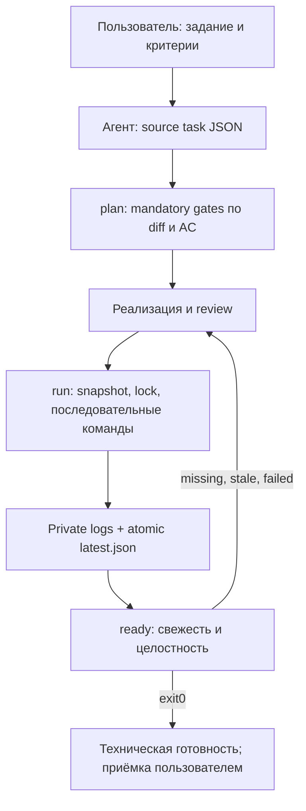

# Постановка и проверка задачи через локальный harness

## Роли и границы

Пользователь даёт задание и бизнес-критерии. Агент готовит task JSON, реализацию,
тесты, документацию и review. Runner запускает проверки и записывает фактические
результаты процессов. Readiness проверяет актуальность evidence. Пользователь
принимает результат по смыслу; runner не может согласовать новое бизнес-решение.

Этот harness локальный: он блокирует exit0 команды готовности, но не финальное
сообщение агента и не merge на сервере. Агент с правом записи artifacts/кода может
подделать JSON или изменить сами gates. От этого защищает внешний CI/controller с
отдельными правами, не hash в том же checkout. Внешний CI добавлен WMS-602: тот же harness запускается в read-only Actions job; publication отделена protected environment.

## Порядок запуска

1. Пользователь формулирует результат. Агент читает AGENTS/план/ADR и определяет
   доверие к input, инварианты, ошибки и границы по change template.
2. Агент до реализации создаёт docs/tasks/<id>.json с request/issuedBy, accepted base
   commit, стабильными AC и source test references. Технические AC можно вывести из
   запроса; новые бизнес-решения согласуются до зависимой реализации.
3. Агент или разработчик запускает `pnpm harness:plan docs/tasks/<id>.json`.
   Команда ничего не проверяет за приложение: она показывает snapshot и обязательные gates.
4. Агент реализует задачу, делает review/fixes/regression tests/re-review и форматирует
   source ДО финального run. Останавливает dev:all/Nest watch, конфликтующие с dist.
5. Запускает `pnpm harness:run docs/tasks/<id>.json`. Команда удерживает один checkout
   lock, запускает gates последовательно, сохраняет stdout/stderr и exit status.
6. После passed запускает `pnpm harness:ready docs/tasks/<id>.json` в том же окружении.
   Только exit0 с TECHNICALLY READY означает актуальный полный технический результат.
7. В финальном ответе агент ссылается на task/AC, run UUID, snapshot и результаты.
   Пользователь проводит приёмку; accepted business result не создаётся автоматически.

## Какие команды обязательны

Всегда выполняются frozen install, check:pr (включая native harness regressions) и
backend/web image checks. WMS-601 добавляет alias `pnpm pr:pipeline <task.json>`
без второго runner; [состав полного pipeline](pr-pipeline.md). Дополнительные
правила policy.cjs: Dockerfile/.dockerignore/Compose и package manifests/lock → backend
и web image-check + Docker gate; Helm/Kubernetes → kubernetes:gate; Kafka resources,
topology и gate script → kafka:gate; Registry tools/resources/event schemas → registry:gate.
WMS-602 добавляет opt-in `imageScan` после всех Docker rebuild gates: он требует Trivy и не публикует images.
WMS-603/604 добавляют gitops и release для infra/gitops/scripts/gitops; общий fixture
image builder также требует release. Shared adapters проверяются до restore/promotion.
Оба выполняют настоящий owned kind; release дополнительно запускает real Kafka proof.
AC могут расширять этот набор только известными IDs. Произвольный executable, argv,
shell script или внешний deployment через task не задаётся. Семантическое покрытие
AC остаётся обязанностью автора/reviewer: ссылка file#test — трассировка, не oracle.

## Что входит в snapshot

SHA256 учитывает HEAD и отсортированный manifest файлов Git: tracked (включая ignored
tracked), dirty content, untracked nonignored, удаления и executable bits. Для symlink
учитывается target string, не содержимое внешнего target. Root/apps backend/web .env*
включаются отдельными hashes без сохранения содержимого. Сам task тоже является input.
State, node_modules и ignored build output не входят. Tracked artifacts/harness запрещён.

Evidence содержит run UUID, snapshot/manifest hashes, Node/pnpm versions, hash значимых
env settings (включая PATH/NODE_* и конфигурацию сервисов), plan и фактические результаты. Креды env не записываются; logs команд
могут содержать чувствительный вывод, поэтому private artifacts не коммитятся.
Dependencies/SDK binaries, mount contents, Docker daemon state и внешние системы
полностью снимком не фиксируются; lockfile и версии не заменяют trusted environment.

Перед/после gate сравнивается content snapshot. Native watcher дополнительно отмечает
writes в inputs, в том числе возврат старых байтов в ходе команды. Он консервативен:
повторная запись тех же bytes также может потребовать rerun. Ошибка watcher делает
run blocked. Это не защита от привилегированного adversary или потерь событий на
неподдерживаемом/network FS; для строгой изоляции нужен immutable execution checkout.

## Когда readiness отказывает

Отсутствует latest.json; run не passed; несовпали snapshot/env/plan; недостаёт результатов;
nonzero exit/signal/timeout; изменён или отсутствует log; существует checkout lock.
Каждый run создаёт собственный каталог UUID и сразу заменяет latest на running:
неуспешный gate не позволяет случайно использовать прошлый passed.
Ready не запускает проверки повторно и не создаёт missing artifact directories.
Обновление документов после run тоже меняет snapshot: их следует завершить заранее,
а финальные измерения читать из artifacts вместо переписывания source task/report.

## Ошибки, timeout и восстановление

У каждого gate deadline30мин. Timeout/SIGTERM/SIGINT направляют SIGTERM process group,
затем через10s SIGKILL; результат не passed. Gate отвечает за readiness своих сервисов
и их штатную остановку; сам exit запуска дочернего процесса не считается readiness.
После hard kill возможны оставшиеся внешние ресурсы: проверять только UUID-owned
ресурсы gate, не удалять рабочую .env/volumes и не выполнять Docker-wide prune.

Lock artifacts/harness/.lock/owner.json хранит PID и task. Одновременный run запрещён
для всех cooperating harness runs в checkout, включая разные tasks. Ручные
check:pr/build/watch команды lock автоматически не соблюдают; их параллельный запуск запрещён правилами проекта. При SIGKILL runner lock может остаться.
Оператор сверяет owner PID/процесс; только убедившись, что run завершён, удаляет
именно artifacts/harness/.lock. Автоматического удаления по возрасту нет: это могло
бы открыть второй build/test:prepare поверх живого первого.

## Критерии этой реализации

HAR-01: изменения content/untracked/deleted/env делают прежнее evidence stale.
HAR-02: mandatory gates не отключаются; missing/failed/tampered logs и lock отклоняются.
HAR-03: write/revert во время gate не получает passed. Тесты — harness.test.cjs;
source task — docs/tasks/harness-runner.json. Results не являются бизнес-приёмкой.

На install pnpm создаёт root filesystem probe `_tmp_<pid>_<32hex>` и удаляет его.
WMS-601 игнорирует только этот неизвестный transient path на install и macOS
self-notification каталога. Известный source проверяется раньше исключения, а
оставшийся новый файл меняет итоговый snapshot. На остальных gates temp writes
не исключаются. Source write/revert на install также обесценивает evidence;
regression — `dependency probes are transient but source writes still invalidate install evidence`.
