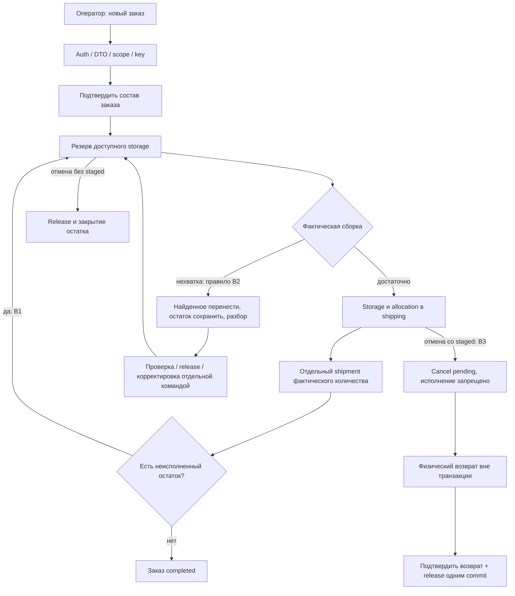

# WMS-201: проект флоу исполнения заказа и критерии приёмки

**Проект исполнения по утверждённым правилам, не реализация.** Бизнес-политики
B1–B4 из [правил](../fulfillment-rules.md#принятые-решения) приняты владельцем
продукта 2026-10-29. Последовательности/числа показывают ожидаемое поведение; дополнительные
проектные детали, например блокировка сомнительной позиции, пока отдельно не утверждены. Существующие integration tests подтверждают
только этап 1; перечисленные AC — задания будущим тестам WMS-203–206, а не passed tests.

## Участники, вход и границы доверия

Триггер — явная команда оператора. В будущем HTTP-controller проверяет DTO и auth,
fulfillment service владеет сценарием, inventory service меняет balances/allocations.
Actor и warehouse ACL определяет серверный auth context WMS-202. Клиент передаёт
UUID документа/строки, фактическое quantity, допустимые source/target locations и
Idempotency-Key; не присылает готовые balances, status, reserved или trusted actor.
Новые DTO/API/event schemas ещё не созданы; логические входы — [draft контракта](../contracts/fulfillment.md).

Корневой HttpCommandsService.run должен оборачивать сценарий и сохранённый response;
все вызываемые сервисы заимствуют один context без nested run. Точные будущие методы
пока не утверждены: стрелки ниже означают ответственность, не существующие endpoints.
Все DB callbacks awaited; физическое перемещение, действия человека и сетевые вызовы
не выполняются внутри повторяемой DB-транзакции.



## Успешная команда и ошибка — проект исполнения

```mermaid
sequenceDiagram
  participant H as HTTP / будущий controller
  participant C as HttpCommandsService (существующий механизм)
  participant F as fulfillment service (будущий)
  participant I as inventory service (будущие операции)
  participant D as PostgreSQL
  participant A as AuditService / OutboxService
  H->>H: Auth/ACL, DTO, нормализация, trusted context
  H->>C: Scope + normalized request + callback
  C->>D: BEGIN; idempotency claim
  alt прежний успешный key и тот же payload
    C->>D: Читать saved response
    C-->>H: Исходный response, без business callback
  else новая команда
    C->>F: Borrowed context + проверенная команда
    F->>D: Lock order / task; проверить состояние
    F->>I: Тот же context + quantity/allocations
    I->>D: Детерминированные locks и guarded changes
    I->>D: Балансы / allocations / движения
    F->>A: Audit и outbox в том же context
    alt все проверки/SQL успешны
      C->>D: Сохранить HTTP result; COMMIT
      C-->>H: Committed response
    else ошибка на любом шаге
      C->>D: ROLLBACK всех изменений
      C-->>H: Безопасный problem response; ошибку не кешировать
    end
  end
```

Idempotency-Key не заменяет проверку состояния и SQL-ограничения. Потерянный HTTP-ответ
после commit повторяют с прежним key. При неизвестном результате сначала читают
состояние; новый key не даёт права повторить движение. Outbox не дублирует синхронное
начисление/перенос в handler. Порядок событий локален агрегату, не всему складу.

## Формат числовых примеров

Один SKU, один склад. `S` — storage, `G` — shipping, пары `(H,R)` = (onHand,reserved).
`A` — active reservation по заказу, показан как storage+shipping; `C` — consumed,
`L` — released. Число движений — **добавленные строки** в рассматриваемом сценарии,
без начальной приёмки/размещения. Нулевые резервные операции не создают физического
movement. Перенос создаёт две связанные записи: source -q и target +q; shipment — одну -q.

Названия source/target/direction здесь логические. Текущий stock_movements принимает
только receipt; WMS-203/206 потребуют новых миграций видов/оснований. Нельзя записать
две ноги с одним operationId: сейчас он UNIQUE на одно движение. Будущий transferId
и отдельные устойчивые operationId ног нужно спроектировать до реализации с тестом rollback.
`q` в каждом movement положительный; знаки ниже означают изменение баланса, не новый
разрешённый отрицательный quantity в существующем контракте.

### AC-01. Частично собрать и отгрузить, затем завершить остаток (B1)

Начальное синтетическое состояние: S=(10,0), G=(0,0), заказ quantity=6. Это состояние
после будущего размещения; новый API подготовки такой БД этим документом не объявляется.

| Шаг после commit          | S(H,R) | G(H,R) | A storage+shipping | C / L | Open / shipped / cancelled | Движения шага; всего |
| ------------------------- | ------ | ------ | ------------------ | ----- | -------------------------- | -------------------- |
| Подтвердить заказ 6       | 10,0   | 0,0    | 0+0                | 0 / 0 | 6 / 0 / 0                  | Нет; 0               |
| Зарезервировать 6         | 10,6   | 0,0    | 6+0                | 0 / 0 | 0 / 0 / 0                  | Нет; 0               |
| Собрать 4                 | 6,2    | 4,4    | 2+4                | 0 / 0 | 0 / 0 / 0                  | S -4, G +4; 2        |
| Провести shipment #1 на 3 | 6,2    | 1,1    | 2+1                | 3 / 0 | 0 / 3 / 0                  | G -3; 3              |
| Собрать оставшиеся 2      | 4,0    | 3,3    | 0+3                | 3 / 0 | 0 / 3 / 0                  | S -2, G +2; 5        |
| Провести shipment #2 на 3 | 4,0    | 0,0    | 0+0                | 6 / 0 | 0 / 6 / 0                  | G -3; 6              |

На каждом шаге R равен active allocations данной ячейки; H не меняется глобально при
сборке. После первой отгрузки общий H=7, после второй H=4. Итог: order completed,
reservation consumed, два immutable shipment. Два движущих SQL шага transfer никогда
не становятся видимыми по отдельности: при сбое второй ноги первая откатывается.
Тот же key каждой команды сохраняет все числа и количество audit/events/movements.

### AC-02. Отмена до сборки (B3)

| Шаг                   | S(H,R) | G(H,R) | A / C / L | Order quantities                        | Движения |
| --------------------- | ------ | ------ | --------- | --------------------------------------- | -------- |
| Резерв 6 из 10        | 10,6   | 0,0    | 6 / 0 / 0 | active, reserved=6                      | 0        |
| Отменить весь остаток | 10,0   | 0,0    | 0 / 0 / 6 | cancelled=6, shipped=0, order cancelled | 0        |

Отмена только освобождает резерв, не списывает и не «возвращает» товар, который не двигался.

### AC-03. Отмена после переноса в shipping (B3)

| Шаг                                           | S(H,R) | G(H,R) | A storage+shipping / C / L | Состояние                                   | Движения; всего |
| --------------------------------------------- | ------ | ------ | -------------------------- | ------------------------------------------- | --------------- |
| Резерв 6 и сборка 4                           | 6,2    | 4,4    | 2+4 / 0 / 0                | active                                      | S -4, G +4; 2   |
| Запрос отмены                                 | 6,2    | 4,4    | 2+4 / 0 / 0                | cancel_pending, reserve/pick/ship запрещены | Нет; 2          |
| Физический возврат без подтверждения БД       | 6,2    | 4,4    | 2+4 / 0 / 0                | cancel_pending, учёт ещё прежний            | Нет; 2          |
| Подтвердить полный возврат 4 и release всех 6 | 10,0   | 0,0    | 0+0 / 0 / 6                | cancelled                                   | G -4, S +4; 4   |

При ошибке confirm-return вся транзакция откатывается к cancel_pending. Если физический
возврат уже состоялся, требуется сверка/повтор по правилам идемпотентности; rollback БД
не отменяет физическое перемещение. Автоматически делать заказ active снова нельзя.

### AC-04. Отмена остатка после частичной отгрузки (B1/B3)

Резерв 6 → сборка 4 → shipment 3 даёт S=(6,2), G=(1,1), A=2+1, C=3, L=0,
три движения. Запрос cancel_pending ничего не меняет. Confirm возврата G 1→S и release
оставшихся 3 даёт S=(7,0), G=(0,0), A=0, C=3, L=3, всего пять движений.
Итог order **closed**, shipped=3/cancelled=3, reservation **closed_mixed**.
Первый posted shipment остаётся неизменным. Нельзя вернуть H к 10 как при полной отмене.

### AC-05. Нехватка при сборке (B2, дополнительные меры на согласовании)

| Шаг                                                                      | S(H,R) | G(H,R) | A / C / L | Остаток заказа                                             | Движения; всего       |
| ------------------------------------------------------------------------ | ------ | ------ | --------- | ---------------------------------------------------------- | --------------------- |
| Резерв 6                                                                 | 10,6   | 0,0    | 6 / 0 / 0 | open=0                                                     | 0                     |
| Ожидалось 6, найдено 4; подтвердить 4                                    | 6,2    | 4,4    | 6 / 0 / 0 | unpicked=2, task shortage                                  | S -4, G +4; 2         |
| Проверка/сообщение о нехватке                                            | 6,2    | 4,4    | 6 / 0 / 0 | Новые выдачи из сомнительной позиции блокируются в проекте | Нет; 2                |
| Явно release недособранных 2                                             | 6,0    | 4,4    | 4 / 0 / 2 | open=2, staged=4                                           | Нет; 2                |
| Отдельная разрешённая корректировка: недостача 2 подтверждена пересчётом | 4,0    | 4,4    | 4 / 0 / 2 | open=2, нужен новый резерв либо отмена                     | Корректировка S -2; 3 |

До пересчёта учётное available=4 не означает, что новую выдачу из сомнительной позиции
можно безопасно разрешить. Корректировка не освобождает чужие резервы и не уменьшает H
ниже R; если мешают другие allocations, сначала нужно явное решение по ним.
Причина/полномочия/блокировка позиции — открытые уточнения, не существующий функционал.
Вариант полного отказа из-за нехватки не выбран. Ошибка SQL/проверок всё равно должна
оставлять исходное состояние команды без частичного переноса.

### AC-06. Конкуренция, ошибки и границы

| Проверка будущего integration test                      | Ожидаемый результат                                                                            |
| ------------------------------------------------------- | ---------------------------------------------------------------------------------------------- |
| Два reserve по 1 при S=(1,0)                            | Один успех, один отказ; S=(1,1), сумма active=1, движений 0                                    |
| Два shipment по 4 одной staged части G=(4,4)            | Один posted, второй отказ; G=(0,0), consumed=4, одно списание                                  |
| Отмена commit раньше shipment                           | Shipment отказан, прежние балансы при cancel_pending; движения от него отсутствуют             |
| Shipment commit раньше отмены                           | Shipped неизменен; отменяется только остаток по AC-04                                          |
| Release commit раньше pick                              | Pick отказан без движения, S.H прежний, S.R уменьшен release                                   |
| Pick commit раньше release                              | Allocation в shipping; простой release отказан до физического возврата                         |
| Сбой после каждой ноги transfer, audit/outbox/result    | Все balances/allocations/movements/audit/events/result команды rollback                        |
| Старый key с прежним payload                            | Исходный snapshot, все счётчики и количество записей прежние                                   |
| Старый key с другим payload / новый key на terminal     | Конфликт, никакого повторного эффекта                                                          |
| q=0, -1, дробь, строка, MAX+1 у количественной операции | Отказ до изменения БД; q=MAX допустим только при достаточном источнике/ёмкости int4 назначения |
| Destination H=MAX и transfer q=1                        | Отказ всей операции, source не списан                                                          |
| Время сильно продвинулось, без явных команд (B4)        | Active reservation и R прежние; expiration job не существует                                   |

Тесты должны применять реальные миграции и PostgreSQL-блокировки, а не только моки.
Нет оснований считать эти AC пройденными до реализации WMS-203–206.

## Гонка cancel / shipment — проект B3

```mermaid
sequenceDiagram
  participant C as Cancel command
  participant P as PostgreSQL / order lock
  participant S as Shipment posting
  C->>P: Lock order, повторно читать status/staged
  S->>P: Запрос той же блокировки, ожидание
  C->>P: cancel_pending + audit/outbox/result COMMIT
  P-->>S: Получить lock и новое состояние
  S->>P: cancel_pending запрещает списание
  S->>P: ROLLBACK, без movement/consumption
  Note over C,S: При обратном порядке shipment остаётся posted; отмена касается лишь остатка
```

Expiration по принятому B4 не участвует в гонке: нет автоматической команды или TTL.
Будущий TTL потребует отдельного согласования, тех же блокировок и повторного чтения,
а не удаления allocation по timestamp вне inventory service.
