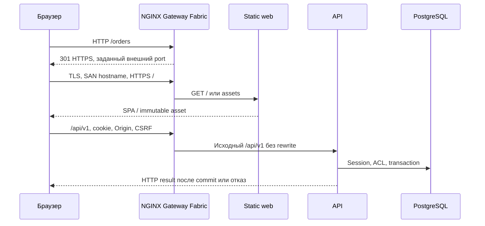

# WMS-303: Gateway и TLS

Владелец внешнего HTTP — этот flow. Реализация: Helm templates `gateway.yaml`,
`web.yaml`, [static origin](../../apps/web/server/README.md) и
[`gateway-check.cjs`](../../scripts/gateway-check.cjs). Критерии и результаты —
[отчёт WMS-303](../reports/wms-303.md). Базовый запуск и PostgreSQL остаются у
[WMS-301](kind-helm.md) и [WMS-302](kubernetes-app.md). Lifecycle rollout на активных операциях — WMS-304.

## Вход, доверие и границы

Оператор выбранного local context задаёт hostname, внешний HTTPS port, image digest,
точный `auth.origin` и существующий TLS Secret того же namespace. Сертификат должен
иметь SAN этого hostname. Host, Origin, cookies и forwarded headers клиента
недоверенные. Actor/roles/warehouse ACL определяет backend session. Web не получает
DB credentials. TLS private key не входит в values, rendered chart или Git.

Предусловия: работающие PostgreSQL, migration Job, API/worker и права оператора на
установку CRDs/controller. Gateway API 1.6.3 и NGINX Gateway Fabric 2.8.1 — отдельные
platform dependencies. Application chart не устанавливает их и по умолчанию не
включает Gateway/web. Community ingress-nginx не используется.
[Совместимость](https://docs.nginx.com/nginx-gateway-fabric/overview/technical-specifications/),
[официальная установка](https://docs.nginx.com/nginx-gateway-fabric/install/helm/).

## Установка platform

Все команды выполнять с отдельным kubeconfig и явно выбранным локальным context.
Пример ниже использует `kind-warehouse-dev`; не подставлять внешний cluster.

```sh
kubectl kustomize 'https://github.com/nginx/nginx-gateway-fabric/config/crd/gateway-api/standard?ref=v2.8.1' > /tmp/gateway-crds.yaml
kubectl --context kind-warehouse-dev apply -f /tmp/gateway-crds.yaml
helm install ngf oci://ghcr.io/nginx/charts/nginx-gateway-fabric --version 2.8.1 -n nginx-gateway --create-namespace --kube-context kind-warehouse-dev --wait --timeout 180s
```

Полученный OCI chart имеет digest
`sha256:f474def07eae1ebe37591507801118fbe11b676fa93ad50d28f5097df9b3f94b`.
Gate закрепляет также SHA256 нормализованного (`trim`) CRD bundle:
`e6d95c97d798bd68f8838a95ad4db14bfea0ff7e7d1c8ce2fb7f6ad7fd9593d3`.
`WMS_GATEWAY_CRDS=/path/gateway-crds.yaml` задаёт явно скачанный bundle; другой hash
прерывает проверку. Это полезно при недоступности remote `kubectl kustomize`.

## Движение запроса



HTTP listener 80 разрешает только redirect. HTTPS listener 443 завершает TLS.
`PathPrefix /api` выбирает API Service 3000; более короткий `/` выбирает web Service 8080. Backend уже владеет `/api/v1`, поэтому URLRewrite отсутствует. Неизвестный API
возвращает 404. Неизвестный UI route получает index.html; после login и выбора склада
Solid показывает «Страница не найдена». Отсутствующий asset возвращает 404.
`allowedRoutes` разрешает только текущий namespace. Service — ClusterIP, web не
проксирует API. При недоступном API NGINX возвращает 502/503; static web остаётся доступен.

## Локальный DNS и сертификат

Для постоянного dev-стенда оператор сопоставляет `warehouse.local` адресу gateway
в `/etc/hosts` либо local DNS. При localhost port-forward это `127.0.0.1`.
Автоматически hosts и системное trust store не меняются. Для CLI достаточно
`curl --resolve warehouse.local:8443:127.0.0.1 --cacert /path/ca.crt https://warehouse.local:8443/`.
Не использовать `-k`.

Создать сертификаты вне репозитория. Пример использует OpenSSL с поддержкой `-addext`:

```sh
umask 077
mkdir -p /tmp/warehouse-dev-tls
openssl req -x509 -newkey rsa:2048 -nodes -keyout /tmp/warehouse-dev-tls/ca.key -out /tmp/warehouse-dev-tls/ca.crt -days 7 -subj '/CN=Warehouse Dev CA' -addext 'basicConstraints=critical,CA:TRUE'
openssl req -newkey rsa:2048 -nodes -keyout /tmp/warehouse-dev-tls/tls.key -out /tmp/warehouse-dev-tls/tls.csr -subj '/CN=warehouse.local'
printf '%s\n' 'subjectAltName=DNS:warehouse.local' 'basicConstraints=critical,CA:FALSE' 'keyUsage=digitalSignature,keyEncipherment' 'extendedKeyUsage=serverAuth' > /tmp/warehouse-dev-tls/tls.ext
openssl x509 -req -in /tmp/warehouse-dev-tls/tls.csr -CA /tmp/warehouse-dev-tls/ca.crt -CAkey /tmp/warehouse-dev-tls/ca.key -CAcreateserial -out /tmp/warehouse-dev-tls/tls.crt -days 7 -extfile /tmp/warehouse-dev-tls/tls.ext
kubectl --context kind-warehouse-dev -n warehouse-dev create secret tls warehouse-tls --cert=/tmp/warehouse-dev-tls/tls.crt --key=/tmp/warehouse-dev-tls/tls.key
```

Для обычного браузера macOS оператор импортирует **только ca.crt** в свою связку
«Вход», проверяет имя/fingerprint, явно разрешает доверие SSL и перезапускает браузер.
CA private key не импортировать и не передавать другим пользователям. После удаления
стенда удалить доверие этой dev CA. Просроченный сертификат пересоздать и заменить
TLS Secret; ключи не коммитить. Kubernetes Secret требует защиты доступа к namespace.

## Images и application values

```sh
docker build -f apps/web/Dockerfile -t warehouse-web:local .
kind load docker-image warehouse-web:local --name warehouse-dev
```

API/worker digest остаётся единым. Web имеет отдельный image digest. После загрузки
проверить фактический manifest digest в CRI; Docker Desktop может менять manifest
при import. Gate сверяет config hash и создаёт canonical digest alias через
[`kind-image.cjs`](../../scripts/kind-image.cjs), не заменяет digest изменяемым tag.

В дополнение к `values-dev.yaml` создать локальный **несекретный** overlay:

```yaml
web:
  enabled: true
  image:
    repository: warehouse-web
    digest: sha256:<64 hex символа фактического manifest digest>
    pullPolicy: Never
gateway:
  enabled: true
  hostname: warehouse.local
  tlsSecret: warehouse-tls
  redirectPort: 8443
  webPort: 8080
  # webService пустой: chart выберет <release>-web.
auth:
  origin: https://warehouse.local:8443
```

```sh
helm upgrade --install warehouse infra/helm/warehouse --kube-context kind-warehouse-dev -n warehouse-dev -f infra/helm/warehouse/values-dev.yaml -f /path/backend-release-values.yaml -f /path/gateway-values.yaml --wait --timeout 180s
kubectl --context kind-warehouse-dev -n warehouse-dev get gateway,httproute
kubectl --context kind-warehouse-dev -n warehouse-dev get deployment,service
```

`backend-release-values.yaml` содержит обязательные digest/session settings из WMS-302,
но не Secret data. При внешнем Service задать `gateway.webService`; без него требуется
`web.enabled=true`. `gateway.redirectPort` должен совпадать с browser HTTPS port,
`auth.origin` — с полным browser origin, включая нестандартный port.
Успешный `Gateway Programmed` не доказывает готовность data plane: дождаться
`kubectl rollout status deployment/<gateway-data-plane>` и затем port-forward
`service/<gateway-data-plane> 8443:443 8081:80 --address 127.0.0.1`.
Имена data plane получить из списка resources, не угадывать для другого release.

## Auth, forwarded headers и размер запроса

Backend использует `__Host-wms_session`: Secure, HttpOnly, SameSite=Strict, Path=/,
без Domain. Exact Origin и session CSRF проверяет backend; NGINX не заменяет Origin.
Express trust proxy остаётся выключен: forwarded headers не определяют actor,
security policy или разрешённый Origin. Поддельные X-Forwarded-Host/Proto/For и
X-Actor-Id не обходят session/ACL. Нельзя считать socket IP за NGINX адресом реального
клиента для rate limiting; доверенные proxy CIDR и client-IP policy сюда не входят.

JSON parser API ограничивает тело 256 KiB. Gate посылает 270000 символов через NGINX
и ожидает 413; это не заявление о таком же лимите для всех файлов/методов NGINX.
Wrong Origin и wrong CSRF дают 403, anonymous warehouse read — 401. Отказы не
создают складских команд. TLS внутри single-node dev network не обеспечивает mTLS
между gateway и API; production hardening и network policy требуют отдельной задачи.

## Автоматическая проверка и ограничения trust

`pnpm gateway:gate` создаёт собственный kind cluster, namespace, PostgreSQL и Secrets,
проверяет WMS-302, устанавливает platform, web и Gateway. Затем проверяет TLS chain и
hostname настоящим Node HTTPS client с явной CA; тот же запрос без CA должен отказать.
Chromium использует ephemeral profile с pin только SPKI нового test leaf через
`--ignore-certificate-errors-spki-list`. Это ограниченное test exception, а не проверка
системного browser trust store. `ignoreHTTPSErrors` не используется. Доверие CA в
обычном пользовательском браузере на машине автоматически не устанавливается.

Через реальный UI выполняются login → выбор склада → приёмка 10 → worker/размещение
→ резерв/сборка/отгрузка 3 → остаток 7 → неизвестная страница → logout. Fixtures идут
через production seed/bootstrap owners в отдельном admin Pod. Runtime DB login не
получает дополнительных прав. Gate проверяет spoof/CSRF/oversize и отключение API.
Ошибка останавливает gate; finally закрывает Chromium/port-forward и удаляет только
созданный cluster/temp credentials. Нужны Docker, kind, kubectl, Helm, OpenSSL,
Playwright Chromium и доступ к pinned images/CRDs. Tool paths можно передать через
WMS_KIND/WMS_KUBECTL/WMS_HELM. Root `.env`, dev volumes и внешний deployment не используются.

## Диагностика и cleanup

Сначала проверять conditions Gateway/HTTPRoute: Accepted, Programmed, ResolvedRefs;
затем controller logs, rollout data plane, Services/endpoints и события namespace.
`kubectl describe gateway`, `kubectl describe httproute`, `kubectl get events` и
`kubectl logs -n nginx-gateway deployment/ngf-nginx-gateway-fabric` помогают отличить
missing Secret/ref от неготового Pod. Не печатать Secret data, cookies и credentials.

Удалить application: `helm uninstall warehouse --kube-context kind-warehouse-dev -n warehouse-dev`.
Удалить controller: `helm uninstall ngf --kube-context kind-warehouse-dev -n nginx-gateway`.
Это сохраняет PostgreSQL platform PVC и CRDs. Удаление CRDs удаляет все соответствующие
Gateway/Route объекты кластера; не применять такую очистку к общему cluster.
Для disposable стенда удалить только его cluster после проверки имени и отсутствия
нужных данных; порядок безопасного удаления PostgreSQL — у WMS-301/302.
Single-node kind не доказывает HA, внешний load balancer, production DNS или rollout
без потери активных операций. Последнее проверяет WMS-304.

## Ожидание новой API revision в локальном gate

Port-forward выбирает новый внешний порт; gate записывает соответствующий AUTH_ORIGIN
и обновляет приложение. До login нужно дождаться текущей observed generation,
updated/available/total replicas и ровно desired Ready Pods без старых/terminating
upstream. Helm wait и anonymous GET401 сами по себе недостаточны: старый Pod тоже
готов и возвращает401, но отклонит новый Origin с403.

`hasReadyApiRevision` в `scripts/kubernetes-state.cjs` проверяет Deployment и PodList.
Gateway gate затем повторяет только безопасный GET до401 и выполняет один login POST.
Auth/CSRF policy не ослабляется; POST не повторяется автоматически. AC-R04-05 проверяет
старый ready/new starting Pod, завершённую revision, terminating/пустой список и stale
observed generation. [Исправление и команды](../reports/review-fixes-r04-r06.md).
