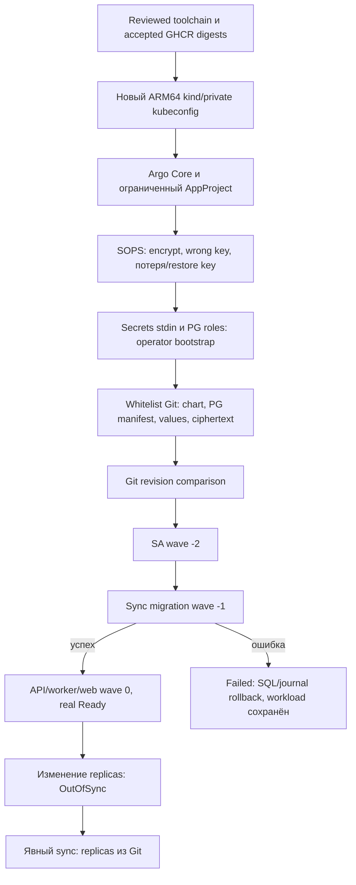
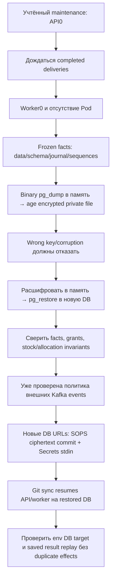

# GitOps → выпуск → восстановление

Владелец WMS-603/604. Согласован новый local kind ARM64 и синтетические данные.
[ADR-0040](../adr/0040-local-gitops-release-recovery.md),
[актуальный runtime ADR-0041](../adr/0041-runtime-without-system-openssl.md),
[команды/модули](../../scripts/gitops/README.md), [source lock](../../infra/gitops/README.md).
Это воспроизводимая локальная репетиция. Она не меняет рабочие volumes и не публикует
новые fixture images в registry. Production и внешняя GitOps installation не заявлены.

## Вход, доверие и права

Оператор проверяет chart, toolchain hashes, source task, current local scan и historical WMS-602 registry digests.
Tools загружаются по HTTPS и проверяются до исполнения. Новый kind получает отдельный
kubeconfig mode0600; текущий context пользователя не меняется. Directory mkdtemp private,
keys вне source Git. Runtime Pod не получает service-account token или DDL credentials.
Core controller остаётся clusterwide внутри owned kind; AppProject разрешает только
один Git URL/namespace и CM/SA/Service/Deployment/Job. UI/API Argo server отсутствует.

Неизвестная revision, checksum, mutable digest, failed readiness, SQL/HTTP ошибка или
cleanup failure запрещают успех. Sync запускается только после сравнения нужной
Git revision; operation UUID защищает наблюдение от результата предыдущего sync.
Автоматический retry ошибочной операции отсутствует. После ошибки оператор принимает
новое решение и делает новый Git commit/sync.

## Установка и данные

Перед migration отдельные short-lived Pod выполняют реальный historical GHCR pull Always.
CRI config обязан совпасть с WMS-602 checked config; Node/uid/architecture проверяются.
Этот probe проверяет доступ и не развёртывает WMS прежнего уязвимого runtime.
Core и локальные fixtures импортируются через selected-platform archive: Docker config
сверяется с CRI, затем используется platform digest. Multiarch index не выдаётся за config.

Source repo создаётся заново в private directory. Node server отдаёт только bare Git
GET внутри ClusterIP; keys/.env/рабочий .git отсутствуют. Fresh local baseline заново строит оба Dockerfile, сканирует exact bytes и связывает
config с kind CRI; runtime input digest учитывает untracked, ignored build inputs
запрещены. Изменение build inputs/tag/config до import вызывает отказ. Values содержат
local platform digest/Never и коммитятся, Application указывает40hex commit. DB manifest хранится в этом Git,
но PG/roles/Secrets — предварительный bootstrap оператора. Argo управляет chart workload;
оно не управляет жизненным циклом PG/ключей. SOPS ciphertext не рендерится chart.
Secret drift не исправляется автоматически: оператор расшифровывает и reconcile через
stdin. Расшифрованные bytes присутствуют в памяти оператора/Kubernetes Secret/процесса,
не в Git или Argo manifests. Base64 Kubernetes Secret сам по себе не шифрование at rest.

Bootstrap и смена DB URLs передают JSON в штатный stdin-режим `sops encrypt` без
позиционного файла. `--filename-override` задаёт логическое имя `secrets.json` в private
directory, а `--config` явно выбирает private config; plaintext-файл не создаётся.
На Linux stdin от Node child_process является socket: повторное открытие `/dev/stdin`
даёт ENXIO. Проверки roundtrip, чужого ключа и восстановления ключа остаются обязательными.
[SOPS-STDIN-01](../tasks/sops-stdin.json) проверяет контракт adapter в
[native tests](../../scripts/pr-checks/checks.test.cjs); реальный Linux ARM64 SOPS
дополнительно проверяется в контейнере. Native fixture сам по себе не доказывает криптографию.

603 negative: temporary migration создаёт marker и делает division-by-zero. Реальная
транзакция откатывает marker/journal; API Deployment spec/generation не меняются даже
при новом desired auth/image. Новый исправляющий Git commit возвращает checked values.
Drift проверяется изменением replicas1→2, наблюдением OutOfSync и sync обратно1.
Runtime SA получает отказ на чужой namespace Secret.

## Release checklist и HTTP demo

Перед выполнением оператор подтверждает: synthetic context, pinned image/config,
schema/event compatibility, план backup/restore, запрет down migration и внешних effects
rollback. Программа проверяет неизменность runtime build-input digest после fresh build/scan;
старый tag или исторический commit не заменяет текущий checked baseline.
В конце checklist отмечается выполненным только после всех assertions.

`release:drill` сначала выполняет существующий `cutover:drill` с реальными PG/Kafka/mTLS
и production owners. Это отдельный профиль, не Kafka deployment в GitOps kind. Он
проверяет backup shadow, forward/reverse boundary, markers/cursors и отказ active claim.
Политика [cutover](transport-cutover.md) не разрешает слепо восстановить старый backup
поверх исходной DB и повторить уже опубликованные сообщения.

После чистого GitOps bootstrap production seed/bootstrap owners создают synthetic
fixtures/operator. Privileged fixture Pod удаляется; HTTP client не имеет DB credentials.
Session login проверяет Secure/HttpOnly/SameSite/Host cookie, настоящий CSRF и warehouse
ACL. HTTP flow: receive10 → putaway10 → reserve/pick3 → ship3; БД показывает onHand7,
reserved0, order completed. Это API demo через внутренний upstream transport;
новый browser/TLS/Ingress тест этим не заявляется. Полный check:pr отдельно проверяет
Chromium в прежнем web gate.

Baseline A — fresh scanned local image без системной libssl; новую GHCR publication
этот согласованный local drill не выполняет. Compatible image B содержит только новую nullable technical column и следующую journal
entry. Поток реальных receipt create/post идёт до, во время и после sync. Проверяются
новый Ready Pod/image, отсутствие HTTP failures и correlated structured Pino telemetry.
Нагрузка bounded; это continuity proof, не capacity baseline или production SLO.
Git rollback на A сохраняет committed column/journal/data; прежний post key возвращает
сохранённый результат без нового stock effect.

Failed SQL fixture не допускает rollout; corrected SQL в следующем образе проходит.
Отдельный **успешно committed** rename receipt_lines.quantity ломает старый SQL:
HTTP500 не оставляет header/stock. Image rollback A по-прежнему даёт500. Новая forward
migration возвращает совместимое имя; обе journal entries остаются, явный retry прежнего
failed key создаёт один draft. Applied source SQL не переписывается.

## Backup/restore и границы атомарности

Maintenance — явное действие, recorded times; manual sync не отменяет его сам.
Dump имеет custom binary format и не перекодируется UTF-8. Plaintext dump не сохраняется
на диск. age encrypted file mode0600 находится вне Git. Restore создаёт новую DB
warehouse_restore_UUID в owned PG, не DROP/overwrite original. Global roles уже существуют
в этом synthetic PG; production restore roles/credentials требует отдельного runbook.

Сверка использует raw PostgreSQL JSONB: microseconds/int64 не проходят через JS Date/Number.
Хешируются каждая public table, schema columns, migration journal и sequences. Проверены
0≤reserved≤onHand, reserved=SUM(active), runtime отказ UPDATE immutable movements.
Consumer resume разрешён только после validation и fresh transport proof. Смена Secrets
плюс Git sync пересоздаёт ранее остановленные Pod; оба процесса проверяют выбранную DB.
Replay исходного post key сохраняет бизнес-данные, effects, outbox/processed markers и
streams. Original DB остаётся. Нет заявления об atomic DB+Kafka или exactly once.

## Evidence и операционные ограничения

Команды и поля summaries описаны в scripts README. Source reports содержат AC→code→test
и результаты ревью; итоговую freshness подтверждает только harness:ready текущего snapshot.
Не редактировать runner JSON вручную. Финальные времена читать из program-generated
evidence, а не обновлять source после harness run. Hard kill может прервать finally;
ручная очистка допускается только после проверки принадлежности UUID ресурсов.

Ключи/backup этого drill удаляются при cleanup. Production нужны независимый escrow,
restore rehearsal на отдельном failure domain, retention, TLS/SSO и измеренные RPO/RTO.
Core HA, внешний Git auth, private GHCR credentials и внешний cluster здесь не проверяются.
