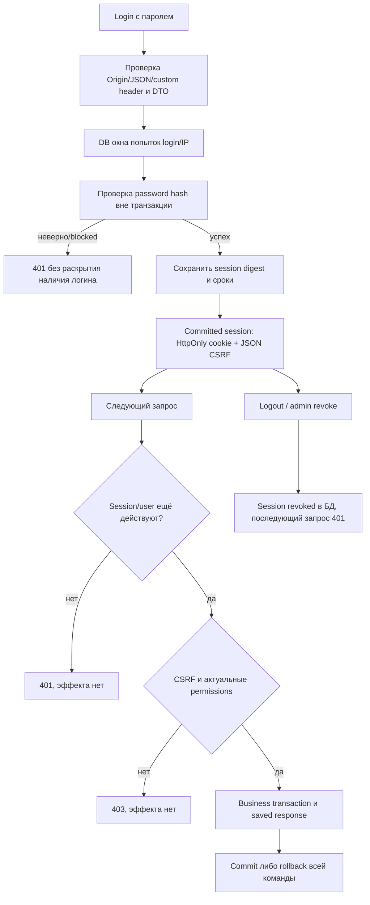
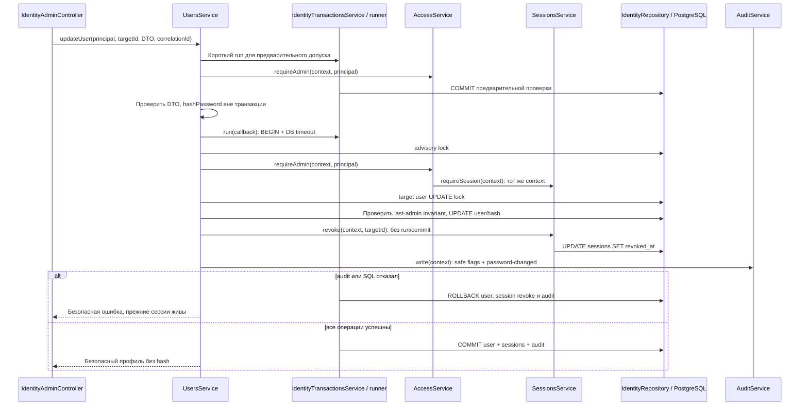
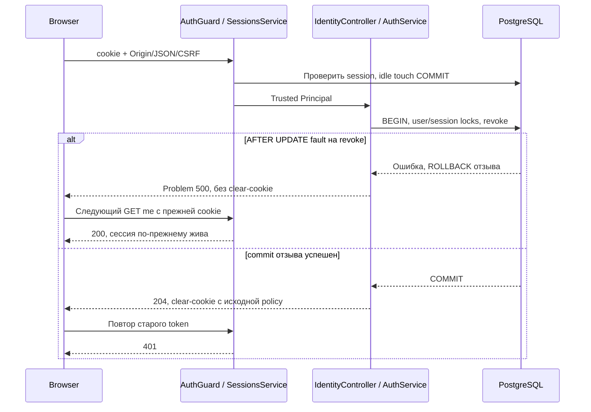

# WMS-202: вход, сессии, складские права и bootstrap

Владелец подробного флоу реализованной identity. Для менеджера: личность пользователя
проверяется на сервере, складские действия зависят от назначения именно на нужный склад;
выход/отзыв действительно закрывает сессию, а не только убирает cookie с экрана.
[Матрица](../identity.md#роли-и-складская-матрица), [ADR-0018](../adr/0018-server-sessions.md),
[ADR-0019](../adr/0019-warehouse-role-matrix.md), [технические решения](../adr/0020-session-implementation.md).
Физические операции fulfillment WMS-203–206 здесь не объявляются реализованными.

## Входные данные и участники

Production HTTP graph: HttpModule → AuthGuard + IdentityModule, IdentityController и
IdentityController → AuthService/UsersService, IdentityAdminController → UsersService;
AuthGuard → SessionsService/AccessService, ReceivingController → AccessService. Все SQL
остаются во внутреннем IdentityRepository. База данных
общая с WMS, но identity не пишет чужие складские таблицы. WorkerModule не импортирует
HTTP/identity и сохраняет прежний system actor для своих внутренних сценариев.

| Ввод                             | Доверие / преобразование                                                                          |
| -------------------------------- | ------------------------------------------------------------------------------------------------- |
| login/password JSON              | Недоверенные DTO; login ASCII 3..64 → lowercase, пароль не trim/coerce/normalize                  |
| session cookie                   | Недоверенная capability: ровно один token нужного имени, канонический base64url; поиск по SHA-256 |
| Origin/Content-Type/CSRF headers | Exact configured origin, JSON, правильный связанный CSRF; не полномочия пользователя              |
| actorId/role из body/header      | Не используются; лишние поля DTO отклоняются                                                      |
| receiptId/warehouseId            | UUID недостаточно: actual warehouse берётся из сохранённого receipt либо validated create DTO     |
| role list admin-команды          | Закрытый список, уникальные значения; [] отзывает только указанный warehouse                      |
| Principal                        | Только userId/sessionId после AuthGuard; passwordHash/token в нём отсутствуют                     |

Данные хранят users, sessions, warehouse_roles, auth_login_windows и retained marker
identity_bootstrap. [Schema](../../apps/backend/src/modules/identity/schemas/users.schema.ts)
и соседние файлы schemas/ поясняют каждую колонку, тип/default/nullability и ключи. Миграции 0018/0019 новые;
[Drizzle README](../../apps/backend/drizzle/README.md#wms-202) объясняет grants/trigger.

## Обзор для менеджера



## Login: не держать DB locks во время scrypt

`POST /api/v1/auth/login` не использует HttpCommandsService. Fingerprint от plaintext
password стал бы быстрым проверочным hash и ослабил бы scrypt; session cookie также
не должна попадать в saved command response. Login допускает несколько независимых сессий.

```mermaid
sequenceDiagram
  participant C as Браузер
  participant G as AuthGuard / DTO pipe
  participant S as AuthService
  participant SS as SessionsService
  participant R as IdentityRepository / PostgreSQL
  C->>G: Origin + JSON + X-CSRF-Protection:1 + login/password
  G->>G: Только явно разрешённый login route
  G->>S: Валидный DTO + socket peer
  S->>R: Tx A: IP window, затем login window; COMMIT
  alt окно исчерпано
    S-->>C: 429, без scrypt/session cookie
  else окно допускает
    S->>R: Tx B: читать кандидат user; COMMIT
    S->>S: scrypt вне транзакции, dummy hash для absent/invalid record
    alt неверный пароль или inactive
      S-->>C: Общий 401, без cookie
    else проверка успешна
      S->>R: Tx C: user FOR SHARE, перечитать active/password hash
      S->>SS: create(context, current.id): тот же Tx C
      SS->>R: INSERT session digest + absolute/idle deadlines
      SS-->>S: Raw token/CSRF только для cookie transport
      S->>R: COMMIT Tx C
      S-->>C: Set-Cookie и JSON user/csrfToken, no-store
    end
  end
```

Соль 16 bytes, scrypt N=2^17/r=8/p=1, key 64 bytes. Не более двух hashing operations
на API-процесс, ошибка capacity не создаёт сессию. Параметры из строки БД не управляют
объёмом scrypt. Новый пароль 15..128 Unicode code points, <=512 UTF-8 bytes, без NUL
и невалидных UTF-16 surrogate; проверяется точный секрет. Это не MFA/список скомпрометированных
паролей. Необратимый hash не означает, что слабый пароль становится сильным.

Окна PostgreSQL: максимум 50 попыток/socket peer и 10/login за 15 минут, включая успехи.
Отказ лимита не откатывает уже посчитанные попытки. Блокированный peer не добавляет новые
случайные login keys. Forwarded headers не определяют IP; перед внешним proxy эту policy
нужно настроить под реального клиента и нагрузку. Это не полная DDoS-защита; отдельного
автоматического purge auth_login_windows/session history пока нет.

Если пароль сменили между чтением и scrypt, повторная проверка hash под lock отклоняет
старый пароль. Ошибка INSERT/commit не выдаёт cookie. Потеря ответа после session commit
может оставить неиспользованную сессию до expiry/revoke; повторный login создаёт другую.

## Cookie, CSRF и current-user

HTTPS cookie `__Host-wms_session`: Secure/HttpOnly/SameSite=Strict/Path=/, без Domain.
Dev/test HTTP допускается только при loopback AUTH_ORIGIN и использует имя wms_session.
Backend не завершает TLS: внешний доступ требует HTTPS gateway и закрытого прямого HTTP.
Точное значение AUTH_ORIGIN задаётся без path, query и credentials. CORS не включён.

Login защищён exact Origin, JSON Content-Type и custom X-CSRF-Protection:1: cross-origin
browser preflight не получает разрешения. Для всех остальных unsafe requests требуется
X-CSRF-Token из login/me, HMAC session token с namespace warehouse:csrf:v1. Смена сессии
меняет CSRF. Константный Origin/CSRF без действующей session не создаёт actor. SameSite
не заменяет эту проверку, HttpOnly не обещает защиту от всех действий XSS в приложении.

`GET /api/v1/auth/me` даёт только безопасный профиль, свои grants и CSRF для browser tab.
Пароль/session token/hash не возвращаются в JSON. CSRF сам по себе не session capability.
Ответы no-store; для me также Vary: Cookie. Не передавать token в URL/query/логи.

## Повторная авторизация receiving до dedup

Рабочие endpoints create/get/post receipt теперь требуют сессию. Роль operator на A
и viewer на B не дают запись на B. system_admin без складского назначения получает 403.

```mermaid
sequenceDiagram
  participant H as AuthGuard
  participant C as ReceivingController
  participant S as HttpCommandsService
  participant I as AccessService
  participant SS as SessionsService
  participant D as PostgreSQL
  H->>SS: authenticate(cookie): user lock, session lookup/idle touch
  SS-->>H: Только Principal
  H->>H: CSRF + metadata + Idempotency-Key
  H->>C: CommandScope actor из Principal
  C->>S: execute(scope, normalized, work, authorize)
  S->>D: BEGIN
  S->>I: authorize(context), даже для replay
  I->>SS: requireSession(context, principal)
  SS->>D: user/session FOR SHARE, проверить сроки/active
  I->>D: warehouse roles именно сохранённого объекта
  alt допуск запрещён
    S->>D: ROLLBACK без чтения saved result
  else разрешено
    S->>D: Idempotency claim
    alt готовый response
      S->>D: Читать result; COMMIT
    else новая команда
      S->>D: Receiving + Inventory + Audit + Outbox + result; COMMIT
    end
  end
```

GET receipt выполняет чтение и warehouse policy в одной read-транзакции; nested run нет.
Чужой существующий документ — 403, отсутствующий — 404; модель не маскирует существование
всех UUID одинаковым 404. SQL queries ограничены фактическим объектом, списков чужих складов
пока нет, а собственные grants выдаются только в me. Будущие stock/order endpoints должны
использовать тот же публичный requireWarehouse, не считать набор ролей на login неизменяемым.

AuthGuard выполняет короткий sliding touch с session UPDATE. Долгая команда той же сессии
может задержать следующий touch; это не скрытая очередь бизнес-команд. Конкурентные posting
tests используют две реальные сессии одного actor, чтобы наблюдать receipt/dedup lock,
а не session touch. User/session SHARE locks держатся до command/replay commit, поэтому
admin UPDATE target user ждёт завершения уже допущенного callback.

## Expiry/revoke и административные гонки

После ожидания session lock repository читает действительность отдельным SQL statement:
значение `clock_timestamp()` до ожидания могло бы устареть и разрешить sliding touch уже
истёкшей сессии. Regression integration test удерживает реальный row lock до истечения
idle deadline и проверяет отказ без продления.

Решение о действительности — revoked_at IS NULL, active user и обе даты > clock_timestamp
в PostgreSQL. Guard touch обновляет idle не дальше absolute. Сессия не превращается в
бессрочную от регулярной активности. Значения абсолютного/idle срока пока не утверждены,
поэтому AUTH_SESSION_ABSOLUTE_SECONDS и AUTH_SESSION_IDLE_SECONDS обязательны явно:
30..86400, idle<=absolute, без скрытых defaults. В tests/gate собственные synthetic сроки.
Это **не** истечение товарного резерва: B4 WMS-201 сохраняется.

```mermaid
sequenceDiagram
  participant B as Уже допущенная business command
  participant D as PostgreSQL user/session locks
  participant A as Admin revoke / смена grants
  B->>D: User/session SHARE + current permission
  A->>D: Admin advisory lock; target user UPDATE (ожидание)
  B->>D: Effect/result COMMIT либо ROLLBACK
  D-->>A: Target lock получен
  A->>D: Update/revoke/grants + audit COMMIT
  B->>D: Новая команда или старый key
  D-->>B: 401 session revoked либо 403 grant removed
```

Авторизация — в точке проверки под lock, не обещание прервать уже начатую разрешённую
транзакцию при наступлении времени expiry. После её завершения следующая проверка
откажет. Уже committed shipment/receipt не отменяются logout или блокировкой пользователя.

Logout отзывает текущую сессию и после commit очищает cookie. Admin может адресно отозвать
сессию или все сессии target user. Блокировка/смена пароля также отзывает все target sessions.
Admin-набор меняется под advisory lock (202,1), чтобы два конкурентных изменения не удалили
последнего active system_admin. Auth и target user проверяются повторно внутри admin transaction.

Admin create/update/role/revoke не кешируют credential inputs через HttpCommandsService.
Действия, warehouseId, безопасные bool changes и session UUID проходят через AuditService;
каждая added/removed role имеет свой статический reasonCode. Пароль/hash/CSRF/raw request
в audit не передаются. Ошибка аудита откатывает изменение пользователя/grants/revoke.

## Разделение сервисов: общий context при смене пароля

Это локальное разделение внутри IdentityModule, а не четыре независимо коммитящих модуля.
IdentityTransactionsService — private provider с прежним runner/timeout. Auth/Sessions не
зависят от UsersService; UsersService зависит от Access/Sessions, Access — от Sessions:
циклических DI зависимостей и forwardRef нет. IdentityRepository остаётся общим внутри владельца
таблиц; разделение SQL на repositories здесь не требовалось.



Внутри callback фактический порядок — advisory lock → повторный admin допуск → target UPDATE
lock → user update → session revoke → audit. Отзыв сессий не фиксируется отдельно и не
использует HTTP/Kafka. Новый integration case ставит AFTER INSERT fault на audit_entries:
после 500 прежний hash остаётся, две target sessions живы, audit пуст. Успешная ветка
покрыта существующим password reset test; гонки grants/last admin и возврат replay после
отзыва продолжают использовать production сервисы с реальными locks.

## Bootstrap: отдельная одноразовая процедура

`pnpm identity:bootstrap` запускает compiled bootstrap.js, не HTTP endpoint. Перед ним
нужны build/migrations и заполненная auth policy. Опция IDENTITY_BOOTSTRAP_ENABLED=true
только на один вызов; DB login должен состоять в warehouse_identity_bootstrap (dev owner
superuser проходит). Допускается loopback URL либо dev/test Docker hostname postgres.
Роль warehouse_app не может создать retained marker. Public register/bootstrap routes отсутствуют.

Ввод — только JSON stdin `{login,password}`, <=4096 bytes; argv/env не принимают пароль.
UTF-8 декодируется после накопления chunks, чтобы не разрезать символ секрета.
Advisory lock + отсутствие users + retained marker гарантируют один успешный bootstrap;
marker, первый admin и audit фиксируются вместе. Удалять маркер для повторного bootstrap нельзя.
CLI выводит только event/id/login, не пароль. Общий предел 30s включает stdin/init/hash/close.

Из корня, после настройки .env и `pnpm db:migrate && pnpm build`, пример с вводом из терминала
без credential в shell history/argv/env (требует Python 3 и pnpm в PATH):

```sh
python3 -c 'import getpass,json,os,subprocess; value={"login":getpass.getpass("Login: "),"password":getpass.getpass("Password: ")}; subprocess.run(["pnpm","identity:bootstrap"],input=json.dumps(value),text=True,env={**os.environ,"IDENTITY_BOOTSTRAP_ENABLED":"true"},check=True)'
```

system_admin после bootstrap всё ещё не warehouse_operator. Для receiving нужен явный
POST назначения warehouse role через защищённый admin API. `pnpm db:seed` остаётся
development-only CLI справочников под доверенным DB-доступом; HTTP auth graph для seed
не создаётся и privilege пользователя приложения им не выдаётся. DB/host admin доверен
по T7, это не публичный обход через HTTP.

## Синтетические запросы и ответы

Это шаблоны, реальные credentials/cookie сюда не подставлять для коммита/логов.

```http
POST /api/v1/auth/login
Origin: <AUTH_ORIGIN>
Content-Type: application/json
X-CSRF-Protection: 1

{"login":"operator.one","password":"<секрет длиной 15..128 символов>"}
```

Успех 200: `{"user":{"id":"<uuid>","login":"operator.one","active":true,"systemAdmin":false},"csrfToken":"<csrf>"}`
и HttpOnly session cookie. POST receiving отправляет cookie, тот же Origin, JSON,
X-CSRF-Token и Idempotency-Key. `GET me` возвращает профиль, warehouseRoles и csrfToken;
logout отправляет cookie/Origin/CSRF/JSON и получает 204 с очисткой cookie.

## Карта evidence

| Ветка                                                              | Проверка                                                                     |
| ------------------------------------------------------------------ | ---------------------------------------------------------------------------- |
| Password exactness/salt/fixed params, malformed hash/Unicode       | test/unit/identity.spec.ts                                                   |
| Origin/config без defaults, bounded сроки и redaction error        | test/unit/identity.spec.ts                                                   |
| Login/me/logout, hash-only persistence, safe cookies/response      | test/integration/identity.spec.ts                                            |
| Wrong/unknown/blocked, expired/idle/revoked, failed session INSERT | Та же integration suite, реальные SQL faults                                 |
| Warehouse operator A/viewer B, IDOR и replay после revoke          | Та же integration suite                                                      |
| Admin change rollback, password reset, last-admin race             | Та же integration suite                                                      |
| Bootstrap opt-in/DB role/one-time state                            | Настоящий compiled child CLI в integration suite                             |
| DB role revoke ждёт ongoing authorization                          | FOR SHARE/UPDATE и waitForDatabaseLock в integration suite                   |
| Receiving transactions, idempotency/rollback/posting races         | Существующие receiving/http-commands suites с реальными session fixtures     |
| Image + gate 1 + API/worker SIGTERM                                | scripts/docker-image-check.cjs и scripts/docker-gate.cjs; результат в отчёте |

[Integration source](../../apps/backend/test/integration/identity.spec.ts),
[unit source](../../apps/backend/test/unit/identity.spec.ts), [отчёт](../reports/wms-202.md).
Нет обещания защиты от DBA/host compromise, MFA/SSO/password recovery или готового TLS gateway.

## Evidence HTTP transport и logout failure

Триггер: POST /api/v1/auth/logout с действующей cookie и CSRF. DTO пустой; actor выбирается
server-side guard. SessionsService.authenticate сначала фиксирует короткий idle touch.
Затем AuthService.logout → SessionsService.logout открывает отдельный bounded run для
повторной проверки и отзыва; это не одна транзакция с guard touch.



В integration test `logout storage failure rolls back revoke and never clears browser cookie`
trigger падает только при non-null revoked_at, поэтому проверяется именно logout, а не guard
idle touch. Unit controller tests задерживают completion Promise, доказывая отсутствие
успешной cookie/ответа до завершения сервиса. Они покрывают и HTTPS __Host policy, хотя
обычный test harness работает на loopback HTTP; настоящий TLS deployment здесь не моделируется.

Дополнительные ветки evidence: single-session revoke (вторая/чужая session живы), [] role
replacement (другой warehouse сохранён и removed audit записан), missing admin target →404,
malformed login DTO →400 без session/cookie/секретов, четыре роли со всеми действиями ADR-0019.
[Integration source](../../apps/backend/test/integration/identity.spec.ts),
[controller unit](../../apps/backend/test/unit/identity.controller.spec.ts),
[auth orchestration unit](../../apps/backend/test/unit/auth.service.spec.ts),
[HTTP boundary unit](../../apps/backend/test/unit/identity-http.spec.ts).
Измерение `pnpm test:identity:coverage` имеет обязательный controller threshold 100%;
child CLI bootstrap coverage не объединяется с Jest, хотя реальные CLI tests выполняются.
