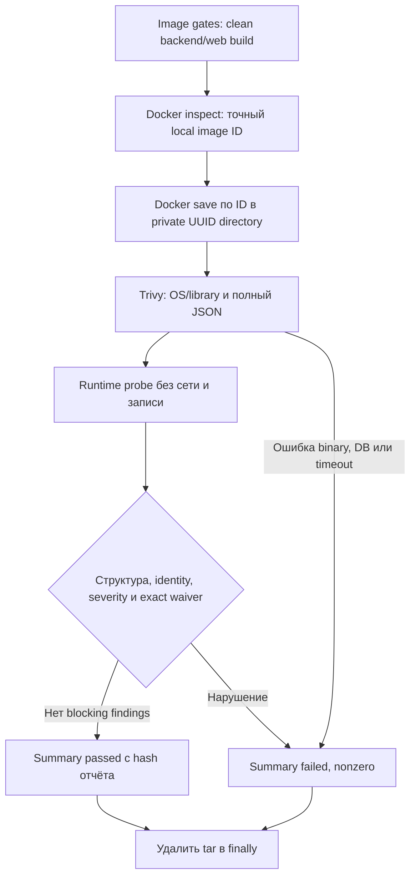

# Локальный image scan: вход, эффекты и отказы

WMS-602.3 реализует локальную подготовку поставки. Пользователь подтвердил GitHub Actions + GHCR; после локальной подготовки новым поручением разрешил реальный release и проверку pull.
Реальный PR/CI/release выполнен; ARM64 target kind скачал оба digest из GHCR и удалён.
[Source copy целевого proof](../reports/wms-602-pull-evidence.json). [Команды и установка](../../scripts/image-release/README.md),
[AC и review](../reports/wms-602.md).

1. Оператор запускает image gates и `pnpm images:scan`. Скрипт требует Trivy 0.76.2.
   Нет доступа к Docker/DB — отказ, без fallback. Оператор доверяет scanner executable
   и публичной vulnerability DB. Складские credentials не передаются scanner.
2. `main` создаёт artifacts/image-scan/UUID и summary running через общий atomic writer.
   На hard kill running не считается успехом. Запуски не используют общий latest.
3. `scanImage` читает Docker inspect ID фиксированного local tag. Далее export идёт
   по ID: замена tag другим процессом не меняет проверяемый образ.
4. Trivy получает tar, пустой config и environment без TRIVY_*; CLI задаёт OS/library,
   vuln scanner, полный JSON, отсутствие ignorefile и включение unfixed. Сеть нужна
   только scanner DB. После scanner запускается короткий runtime probe без сети/записи; SQL, audit/outbox и миграции не вызываются.
5. `verifyRuntime` проверяет exact base/Node/uid, отсутствие tooling/native addons и shared OpenSSL.
   Исключения применяются только при этих условиях. `validateReport` проверяет schema v2, container_image, Metadata.ImageID, равное config digest archive bytes,
   непустой OS result и структуру vulnerabilities. Например, HIGH CVE без FixedVersion
   даёт отказ; LOW остаётся в отчёте и counts. Только адресные UNKNOWN могут получить waiver по [review policy](../../scripts/image-release/README.md#runtime-и-review-исключений). Чужой image ID даёт отказ даже без CVE.
6. Успешный результат включает image ID, исходные counts, waived entries, runtime proof, hash policy и SHA-256 JSON. Ошибка прерывает
   следующие images, сохраняет JSON и summary failed; tar удаляется finally.
   После устранения причины нужно повторить всю команду. Старый passed не используется.

Нет общей транзакции image/registry: локальный scan не доказывает внешний push/pull,
соответствие опубликованного manifest проверенному commit или отсутствие всех уязвимостей.
Inspect ID может быть OCI index; Trivy ImageID проверяется по config bytes. Registry manifest digest и целевой pull относятся
к WMS-602.4–602.5; фактическое выполнение описано в отчёте. Автоматический внешний rollout в эту подготовку не входит.

## Подготовленные GitHub Actions и GHCR

`validate.yaml` принимает pull_request и workflow_call. Token имеет contents:read;
checkout credentials не сохраняются, actions закреплены exact SHA. Linux tools имеют
pinned versions/checksums. Frozen install и Chromium предшествуют harness plan/run/ready.
После failed gate export checked images не выполняется. Reports сохраняются 7 дней.

`release-images.yaml` принимает только workflow_dispatch на default branch. Validation
повторяется для этого commit; передаются проверенные backend/web tar и SHA256SUMS с
commit.txt. Publish job ждёт validation и environment ghcr-release, имеет packages:write,
но не checkout/исполнение candidate source. Он проверяет hashes/commit, загружает tar,
публикует unique tag sha-COMMIT-run-ID-ATTEMPT, читает registry digest и выполняет pull
по canonical reference. digests.tsv хранится 90 дней и связывает commit/image/digest.
Tags не являются защитой от registry admin: потребитель должен использовать digest.

До первого внешнего запуска оператор должен настроить environment ghcr-release с
required reviewers и ограничением default branch, разрешить GitHub Packages для repo
и проверить visibility/access. Имя environment в YAML само по себе review не обеспечивает.
Не добавлять PAT в build args/layers. Для private images целевому cluster нужен отдельный
read:packages credential через Secret вне Git. Runner pull не доказывает cluster pull.

После отдельно разрешённой публикации: скачать release-digests/validation-evidence
одного run; сверить commit с проверенным checkout; получить `IMAGE@sha256:...` из TSV;
в целевом окружении выполнить `docker pull IMAGE@sha256:...` либо проверить Pod
imageID при отдельно разрешённом rollout. Зафиксировать architecture, digest, commit,
run URL, pull identity и exit status без credentials. WMS-602 выполнила этот шаг в disposable Actions kind; production target не проверялся.
Частичный push backend до отказа web не откатывается: не считать такую пару release;
сохранить digests/logs, исправить причину и повторить validation с новым unique tag.

Подход согласован с [GitHub GHCR documentation](https://docs.github.com/en/actions/tutorials/publish-packages/publish-docker-images)
и [Trivy filtering](https://trivy.dev/docs/latest/configuration/filtering/).

## Разрешённый выпуск ARM64

Пользователь согласовал полный путь: source branch → PR → CI → merge → manual release
→ pull в отдельном kind ARM64. Validation и publisher используют ubuntu-24.04-arm;
Helm/Trivy закреплены Linux ARM64 checksums. Это single-platform linux/arm64 release,
не multiarch manifest и не обещание запуска на amd64. Перед publish проверяются именно
переданные tar; последующий kind pull использует GHCR digest, без kind load/local cache.
Приложение/БД не разворачиваются: smoke Pods проверяют Node/uid и соответствие imageID.
Credentials передаются через private temporary registry Secret и удаляются с cluster.

```mermaid
flowchart LR
  PR[Source PR] --> CI[ARM64 validation/harness]
  CI --> M[Согласованный merge]
  M --> V[Manual release: повтор validation]
  V --> A[Approval ghcr-release]
  A --> P[Publish checked tar и digests.tsv]
  P --> K[Fresh ARM64 verify-pull: packages read]
  K --> C[New kind: cache empty, Secret через stdin]
  C --> S[Pods pull digest, CRI identity и Node smoke]
  S --> E[Cleanup и target-pull-evidence]
```

verify-pull получает refs через job outputs publisher. Перед download tools сверяются
SHA256; kubeconfig временный и не входит в artifacts. Только evidence.json сохраняет
commit/run/reference/CRI identity и runtime facts. Ошибка pull/identity/smoke/cleanup
делает release workflow failed; успешно опубликованный image при таком отказе не
считается прошедшим target validation. Повтор получает новый run attempt/tag.

После review identity порядок исправлен: backend/web image checks → Docker gate →
final imageScan → checked export. Экспорт не полагается на tag: проверяет inspect ID,
raw report hash и config bytes архива, сохраняет checked config IDs в artifact.
Target verifier сравнивает CRI id с этими IDs. Старый release44601420726 имел backend
scan/export mismatch и не является accepted final evidence; новый принятый release с полной цепочкой identity приведён в отчёте.
