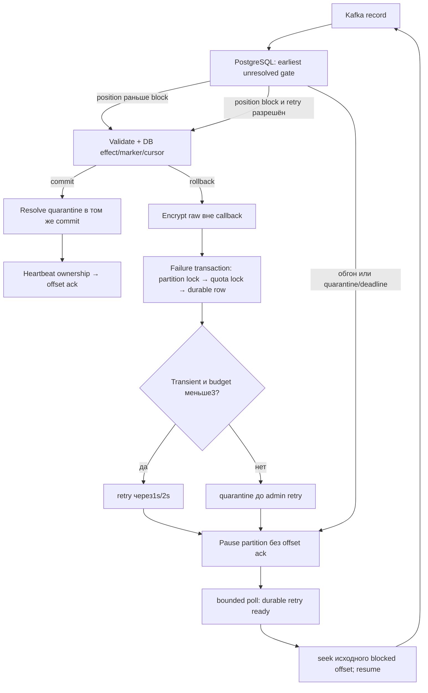

# WMS-504: Kafka → application handler → PostgreSQL → offset

## Вход, права и результат

Участник — отдельный backend consumer с mTLS identity `inventory-putaway`.
Broker разрешает Read/Describe только receipt topic и Read group `inventory.putaway`.
Actor для business audit задаёт существующий ReceivingPostedHandler, не Kafka headers.
API user/warehouse ACL при смене transport не изменяются. Приложение не доверяет
Kafka payload на основании TLS: каждый record проходит schema и retained identity checks.

Результат — pending PutawayTask, audit, processed marker и consumer cursor в одном
PostgreSQL commit. Stock не начисляется повторно. Offset хранится отдельно в Kafka
после DB commit. Transport at least once; общего commit двух систем нет.

Вне WMS-504: автоматическое переключение рабочего worker, перенос backlog, HA,
полная репетиция cutover WMS-506. Recovery WMS-505 описан ниже отдельным opt-in режимом.
Opt-in consumer не включён в dev:all/Compose/Helm автоматически. Один backend image
содержит `dist/consumer.js`; deployment adapter consumer пока не добавлен.

## Шаги выполнения

```mermaid
sequenceDiagram
  participant K as Kafka receipt partition
  participant C as KafkaApplicationConsumer
  participant M as KafkaMessageService
  participant A as ApplicationConsumerService
  participant H as ReceivingPostedHandler / InventoryService
  participant DB as PostgreSQL
  K->>C: record с прежним eventId
  C->>C: heartbeat + ownership epoch
  C->>M: последовательно один record
  M->>M: schema, headers, topic/key/partition
  M->>DB: BEGIN + bounded timeout
  M->>A: borrowed TransactionContext
  A->>DB: exact retained envelope, lock consumer cursor, marker
  alt новый event и cursor=version-1
    A->>H: handle(context,event)
    H->>DB: task + business audit
    A->>DB: marker + advance cursor
  else marker уже есть и cursor>=version
    A->>A: пропустить handler
  else gap / identity conflict
    A-->>M: ошибка → ROLLBACK
    M-->>C: fail-stop без offset ack
  end
  M->>M: локальная проверка ownership
  M->>DB: COMMIT
  M-->>C: applied / duplicate
  C->>K: heartbeat; commit offset+1 только при ownership
  K-->>C: ack generation/member
  C->>C: resolveOffset
```

1. Пользователь/оператор отдельно запускает consumer после release schemas и подготовки
   credentials. Startup проверяет opt-in, TLS/БД, наличие receipt topic с3partitions и
   group join. Только после этого `/health/ready` может вернуть200.
2. KafkaJS использует `readUncommitted:false`, `autoCommit:false`,
   `eachBatchAutoResolve:false`, `partitionsConsumedConcurrently:1`. Внутри batch —
   последовательный for/await без Promise.all. Это ограничивает throughput, но упрощает
   порядок и recovery. Control records транзакционного publisher обрабатывает SDK.
3. EventContracts проверяет UTF-8 size, JSON, known type/schemaVersion и payload.
   Tombstone/null, неизвестная версия, другой key/topic/partition, несовпадающие
   content-type/event-type/schema-version headers не допускаются к handler.
4. KafkaMessageService открывает runner. ConsumerRepository сравнивает весь envelope
   с immutable outbox event. Порядок JSON object keys незначим; значения и порядок arrays
   должны совпасть. Нельзя заменить payload у существующего eventId или импортировать
   событие, которого нет в retained PostgreSQL.
5. INSERT consumer_streams ON CONFLICT + FOR UPDATE сериализуют и absent-key race,
   и конкуренцию local/Kafka worker. Cursor принадлежит logical name/aggregateType/id.
   Без marker требуется ровно previous+1; с marker требуется cursor>=version.
   Старое событие без marker тоже ошибка, а не разрешение пропустить историю.
6. Новый event вызывает тот же application handler. Handler effect, audit, marker и
   cursor фиксируются одним DB commit. Ошибка handler/marker/cursor откатывает всё.
   Kafka consumer не меняет local delivery status: прежний worker при replay сам увидит
   marker и завершит свою доставку без второго эффекта.
7. Ownership проверяется локально до/после application service. Heartbeat monitor
   выполняется вне callback runner, не добавляя network I/O к DB transaction.
   Замеченный revoke/SIGTERM даёт rollback. Если revoke ещё неизвестен во время DB commit,
   committed effect сохраняется: следующий владелец обработает duplicate.
8. После DB commit adapter проверяет heartbeat/epoch/isRunning/isStale и вызывает
   commitOffsets с `BigInt(offset)+1n`. Generation/member остаются от текущего batch;
   broker отклоняет чужую generation. Только broker ack разрешает resolveOffset.
   Crash/lost ack после DB commit не повторяют business effect при replay.

## Rebalance, отказ и границы

KafkaJS instrumentation listeners асинхронны. REBALANCING не является synchronous
revoke callback. Поэтому гарантируется прекращение работы после обнаружения потери
ownership, а не одновременность с broker coordinator. Ни isStale (он отражает seek),
ни readiness не заменяют heartbeat/generation fencing. Старый eachBatch не делает
rejoin перед offset commit. Это проверено на установленном KafkaJS2.2.4 и real rebalance.

Heartbeat interval1s, session timeout15s, DB operation<=10s; shutdown по умолчанию20s.
CPU-blocking handlers запрещены. SIGTERM останавливает новый record, отзывает local
epoch и ограниченно ждёт rollback/cleanup. При deadline exit1 ОС закрывает DB sockets.
SIGKILL не является graceful drain. Startup/ready/live разделены; readiness требует
assignment + DB, liveness проверяет процесс без внешних сервисов.

В legacy режиме WMS-504 любая ошибка record/DB/offset/heartbeat прекращает consumer без успешного ack.
SDK autorestart выключен; retries сетевого клиента ограничены5повторами. Это не retry
DB transaction. Opt-in quarantine/recovery WMS-505 описан ниже. Ошибка блокирует весь instance, включая его остальные
partitions. Повторный запуск без исправления причины снова остановится на том же месте.
Для логов используются фиксированные consumer.halted/process.failed и безопасный
errorCode; raw SDK errors, PEM и payload не печатаются. Диагностика WMS-505 описана ниже.

Retention способен удалить целый необработанный stream. Проверка aggregate gap
обнаруживает N+1 без N, но не доказывает существование уже удалённых целиком aggregates.
До cutover оператор сверяет Kafka start offsets с retained outbox и backup. Нельзя
лечить это reset cursor/сменой groupId/from-latest. Автоматического retention recovery нет.

## Запуск и проверка готовности

Сначала — `pnpm build`, текущие migrations, Kafka/Strimzi profile и release check
`pnpm registry:check`. Не менять рабочую `.env` для теста. Значения env передаёт оператор
из своего secret manager/локальной приватной оболочки. TLS files не коммитятся.

| Настройка                               | Значение / ограничение                                                                    |
| --------------------------------------- | ----------------------------------------------------------------------------------------- |
| DATABASE_URL                            | существующая БД с retained outbox, runtime warehouse_app                                  |
| CONSUMER_ENABLED                        | строго true                                                                               |
| CONSUMER_START                          | строго retained-cursor; это признание сохранённых markers/cursors, не автоперенос backlog |
| CONSUMER_BROKERS                        | явные host:port через запятую, TLS listener                                               |
| CONSUMER_CA_FILE / CERT_FILE / KEY_FILE | отдельные CA/client cert/key files inventory-putaway                                      |
| CONSUMER_TRANSACTION_TIMEOUT_MS         | default10000;50..10000                                                                    |
| CONSUMER_SHUTDOWN_MS                    | default20000;15000..60000                                                                 |
| CONSUMER_HEALTH_PORT                    | default9102;1..65535                                                                      |

```sh
pnpm consumer
# Другой терминал, после consumer.ready:
curl --fail http://127.0.0.1:9102/health/startup
curl --fail http://127.0.0.1:9102/health/ready
curl --fail http://127.0.0.1:9102/health/live
# Ctrl-C/SIGTERM: прекратить новый record, завершить/откатить DB run, закрыть clients/pool.
```

Root `pnpm consumer` вызывает backend script → `node dist/consumer.js` без rebuild.
Нужны именно env consumer, а не publisher certificate/ACL. Для Docker тот же image:
entrypoint `node dist/consumer.js`, private TLS volume read-only; этот документ не
разворачивает внешний стенд и не создаёт deployment автоматически.

## Диагностика и N+1

Для legacy fail-stop искать consumer.halted/process.failed в JSONL и delivery.completed по eventId /
aggregateId / correlationId. В PostgreSQL проверять processed_events и consumer_streams
для inventory.putaway; в Kafka — group inventory.putaway, partition и committed offset.
Не считать offset доказательством business effect без DB marker/cursor.
Read-only SQL: `select * from consumer_streams where consumer_name='inventory.putaway';`.
Credentials/raw envelope не публиковать в troubleshooting output.

После local N Kafka N+1 использует тот же cursor. История и markers не копируются и
не сбрасываются. Начальная Kafka offset позиция выбирается отдельным cutover runbook,
не номером aggregate version: несколько aggregates разделяют одну partition.
Существующие domain writers не создают второе receipt-posted для одного receipt;
тест N+1 проверяет transport protocol на синтетическом valid stream с technical handler.
Реальный складской тест проверяет первый receipt-posted и его duplicate обоими transport.

[AC, ревью, команды и evidence](../reports/wms-504.md).

## WMS-505: durable partition gate и encrypted recovery

Новый режим включается явно `CONSUMER_RECOVERY_ENABLED=true`. Старый запуск без него
не требует ключа и остаётся fail-stop. Однако уже существующая quarantine всегда
проверяется: отключение crypto profile не разрешает обгон заблокированного offset.
Сначала применить migration0034 через штатный `pnpm db:migrate` к выбранному стенду.
Тесты не применяют её к рабочему `.env`/volume: используется disposable PostgreSQL.

| Env                          | Смысл                                                                                                |
| ---------------------------- | ---------------------------------------------------------------------------------------------------- |
| CONSUMER_RECOVERY_ENABLED    | true включает encrypted failure persistence и pause/retry                                            |
| CONSUMER_QUARANTINE_KEY_FILE | существующий regular private file0400/0600 текущего uid, ровно32 random bytes; symlink leaf запрещён |
| CONSUMER_QUARANTINE_KEY_ID   | стабильный slug key version, 1..64 символа                                                           |
| OUTBOX_ADMIN_ENABLED         | true только для явных local admin Kafka CLI commands                                                 |

Key file не коммитится, не выводится и не хранится в env value. Каждый ciphertext
сохраняет keyId; при rotation старые key files сохраняются для export до конца retention.
CLI export старой записи запускается с соответствующим keyId/file. Автоматического
KMS/key rotation нет. Потеря ключа означает невозможность расшифровать raw.



Partition lock `(505,partition)` сериализует gate/effect/failure/admin retry. Earliest
unresolved offset запрещает применение последующих records даже другого aggregate в
этой partition. Earlier duplicate replay разрешён, но processed marker проверяется
общим application service. Если Kafka start ошибочно находится после blocked record,
pause/resume возвращается к исходному blocked offset, а не к текущему входному.
Advisory lock не заменяет Kafka generation/ownership guard: обе защиты нужны.

Failure сохраняется отдельной transaction после полного rollback handler. Уникальная
source identity — consumer/topic/partition/offset. Ciphertext не перезаписывается при
повторе; SHA256 snapshot должен совпасть. SQL/crypto/quota failure приводит к fail-stop
без offset ack и без plaintext fallback. Oversized raw не обрезается.

Transient failure: максимум3 committed failures на budget, backoff1s/2s; третий failure
переходит в quarantine. Permanent contract/identity/gap/handler rejection — сразу quarantine.
Attempts и audit не обнуляются; manual retry устанавливает retry_base=attempts. Счётчик
не включает crash до failure commit: это не обещание ограничить число OS restarts.
DB effect/marker/cursor/quarantine resolved фиксируются вместе; Kafka ack остаётся отдельным.

Один pause poll в секунду на partition, максимум3. Он не выполняет SQL в бизнес callback,
не размножает запросы при scrape и не возобновляет отозванную assignment. Rebalance
снимает старые timers, новый owner заново читает durable gate. Активные partitions
обрабатываются независимо с concurrency3; порядок records внутри partition последовательный.

### Административные команды

CLI использует текущие migrations, NODE_ENV=development/test, loopback DATABASE_URL,
OUTBOX_ADMIN_ENABLED=true и членство DB login в warehouse_outbox_admin. UUID оператора
не даёт прав сам по себе и является заявлением trusted локального администратора.
Граница доверия совпадает с existing outbox recovery CLI; внешней auth API нет.

```sh
pnpm kafka:admin inspect --id <quarantine-uuid>
pnpm kafka:admin retry --id <quarantine-uuid> --operator <operator-uuid> --reason handler-fixed
pnpm kafka:admin export --id <quarantine-uuid> --operator <operator-uuid> --reason diagnostic --output <canonical-new-file>
pnpm kafka:admin cleanup --id <operation-uuid> --operator <operator-uuid> --reason expired-resolved
```

Inspect выводит только metadata/hash/errorCode, никогда body/key/headers/ciphertext.
Retry не вызывает handler и не устанавливает Kafka offset: он атомарно открывает budget
с AuditService. Ошибка аудита откатывает reset. Исправление handler/schema/environment
должно предшествовать retry; неизменённый poison снова блокируется. Ни ручного skip,
ни правки envelope, ни сброса cursor/markers команда не предлагает.

Export требует matching key file, explicit operator/reason, новый файл0600 и canonical
parent path без symlinks. На macOS `/tmp` и `/var` могут быть symlinks: использовать
реальный `/private/...` parent. Audit фиксирует authorization до записи file; filesystem
failure не означает завершённый export, не отменяет уже сохранённый audit. Plaintext
доступен только в этом файле; оператор управляет его удалением и доступом.

Cleanup — отдельное ручное действие. operation-uuid обозначает bulk-вмешательство;
удаляются только resolved старше7дней. Unresolved не удаляются. Общая квота256MiB raw
учитывает resolved до cleanup; лимит одной записи1MiB относится к полному lossless
encoded snapshot (base64 overhead включён). Поведение переполнения — остановка без ack.

### Метрики и диагностика

`WMS_METRICS_PORT` включает существующий runtime metrics listener. Новые серии:

- wms_kafka_partition_lag{partition="0|1|2"}: broker high offset минус committed offset,
  включая Kafka control records; это не число бизнес-операций.
- wms_kafka_lag_scrape_success / wms_kafka_lag_sample_age_seconds: статус cached broker
  probe каждые5s, один in-flight probe. Broker I/O не выполняется из DB transaction/scrape.
- wms_kafka_records{status="retry|quarantine"}: durable unresolved records.
- wms_kafka_oldest_blocked_age_seconds{status="retry|quarantine"}: возраст first failure.
- wms_kafka_oldest_unprocessed_age_seconds: максимум возраста retained receipt event без
  inventory.putaway marker и unresolved failure; включает задержку publisher, не только broker.

UUID/eventId/error text/offset не являются labels. Нулевые серии сохраняются для
resolution. Подробности source address доступны только admin inspect и PostgreSQL.
Retention Kafka может удалить нужный record: encrypted quarantine сохраняет evidence,
но retry из неё не создаёт replacement event и не разрешает пропуск. Такой случай
требует отдельного replay/cutover решения WMS-506.

Неисправимый malformed record этот CLI не пропускает. Для продолжения потребуется
отдельная согласованная replay/cutover процедура; автоматического skip нет.

После failure commit выводятся consumer.partition_retry / consumer.partition_blocked:
quarantineId, partition0..2, safe errorCode, attempt и eventId при наличии валидного UUID.
quarantineId позволяет вызвать inspect напрямую из structured log; не требуется искать
UUID в свободном message. Эти поля не добавляются в Loki labels. Пример Explore:
`{service="warehouse-backend",process="worker"} | json | quarantineId="<uuid>"`.
Resolved сохраняет исторический errorCode/attempts до cleanup; это не новая ошибка.
При нескольких replicas/group scrape lag gauge агрегируется max by(partition), не sum.

Cold startup отдельно проверяет read-only OffsetFetch coordinator до join. Только
GROUP_LOAD_IN_PROGRESS/GROUP_COORDINATOR_NOT_AVAILABLE/NOT_COORDINATOR_FOR_GROUP/
REBALANCE_IN_PROGRESS получают bounded readiness wait15s с интервалом200ms; client
network retries сохраняют собственный bound. Auth/config error не скрывается retry.
SDK crash reason допускает только известный protocol code, raw message не выводится.

Permanent quarantine sticky: поздний transient failure другого in-flight обработчика
увеличивает attempts, но не открывает retry и не стирает первоначальную причину.
SQL guard разрешает выход только quarantine→retry с новым retry_base=attempts;
runtime role не имеет UPDATE retry_base. Resolved — terminal state до manual cleanup.
