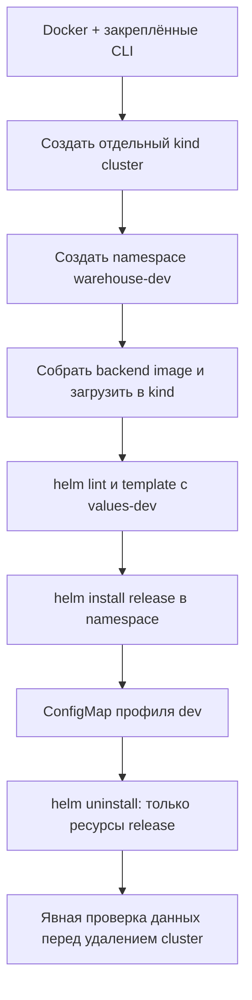

# Локальный kind и Helm — WMS-301

Документ описывает учебный single-node стенд и его границы. В WMS-301 проверен
chart 0.1 с ConfigMap профиля; chart 0.2 WMS-302 содержит API/worker и Job:
[установка и обязательные values](kubernetes-app.md). PostgreSQL устанавливается отдельно,
Gateway/TLS относятся к WMS-303.
Рабочий Compose и его PostgreSQL volume независимы от kind.

## Ресурсы и версии

Указанные ниже версии проверены на этой машине в отдельном временном каталоге
и чистом кластере. Kubernetes 1.32 достиг конца поддержки 2026-02-28 и не выбран
целевым вариантом.

Проверенная машина: macOS arm64, 11 CPU, 18 GiB RAM; Docker VM: 11 CPU и около
7,65 GiB RAM. На host было свободно около 51 GiB. Эти цифры — наблюдение, а не
универсальный минимальный размер. Cluster, image build и тесты конкурируют за
память и место Docker VM. Не очищать Docker-wide cache/volumes ради стенда.

| Инструмент | Закреплённая версия | Назначение                                           |
| ---------- | ------------------- | ---------------------------------------------------- |
| kind       | v0.33.0             | Создание одноузлового cluster в Docker               |
| Kubernetes | v1.37.0             | kind node image из release kind v0.33.0, digest ниже |
| kubectl    | v1.37.0             | Клиент той же minor версии, что API server           |
| Helm       | v3.22.0             | Chart API v2; поддерживает Kubernetes 1.37           |

Совместимость Helm 3.22/Kubernetes 1.37 следует из [официальной таблицы](https://helm.sh/docs/v3/topics/version_skew/).
Digest node image взят из [release kind v0.33.0](https://github.com/kubernetes-sigs/kind/releases/tag/v0.33.0).
Helm 3 приближается к окончанию поддержки; перед обновлением использовать совместимый
поддерживаемый release и заново выполнить проверки. Фактические установленные версии
и непроверенные операции фиксирует [отчёт](../reports/wms-301.md).

Установите эти версии по официальным инструкциям [kind](https://kind.sigs.k8s.io/docs/user/quick-start/#installation), [kubectl](https://kubernetes.io/docs/tasks/tools/) и [Helm](https://helm.sh/docs/intro/install/). Для загружаемых binary сверяйте SHA-256 с опубликованным поставщиком. Docker Desktop на проверенной машине содержит kubectl 1.32.2 внутри app bundle; ссылка /usr/local/bin/kubectl может быть повреждена, поэтому она не подтверждает доступность команды в PATH.

```sh
kind version
kubectl version --client
helm version --short
docker info
```

В документации Kubernetes client допускает не более одной minor версии отличия от
API server. Здесь клиент и сервер используют одну minor 1.37. Выбор иных версий
требует новой проверки совместимости и release digest.

## Вход, изоляция и порядок

Оператор доверяет своей локальной машине и выбирает namespace. Команды явно задают
KUBECONFIG, cluster name и namespace. Пример использует отдельный временный kubeconfig;
он не меняет текущий пользовательский context. Перед созданием убедитесь, что имя
кластера не занято: не удаляйте существующий cluster с таким именем.



```sh
export KUBECONFIG="$(mktemp -t warehouse-kind-kubeconfig)"
kind get clusters
# Остановиться, если warehouse-dev уже существует.
kind create cluster --name warehouse-dev --image 'kindest/node:v1.37.0@sha256:a1ed56cfb0e7b93589bdf97c8cd566405a265939e3620fc4f5de89adff580ae5' --wait 180s
kubectl --context kind-warehouse-dev create namespace warehouse-dev
docker build -f apps/backend/Dockerfile -t warehouse-backend:local .
kind load docker-image warehouse-backend:local --name warehouse-dev
# Helm lint/template требуют explicit release values, как описано в WMS-302.
# Для chart 0.2 сначала provision Secrets и explicit image/auth values по WMS-302.
# Install/upgrade/uninstall: docs/flows/kubernetes-app.md
```

Передавать `--kube-context` и `-n` во все Helm операции. Загруженный image используется chart WMS-302 по RepoDigest. У image с tag
`:local` будущий Pod должен использовать `imagePullPolicy: Never` или `IfNotPresent`;
тег не является immutable digest. Несовпадение архитектуры или отсутствие image
вызывает ошибку запуска будущего Pod, не означает успешную установку приложения.

## PostgreSQL и сохранность данных

PostgreSQL — отдельная platform dependency, не Helm dependency данного chart.
Для будущего dev стенда предусмотрены одна PostgreSQL 17 и отдельный PVC с
ReadWriteOnce на kind StorageClass `standard` (local-path), размер задаёт оператор.
PostgreSQL ресурсы application chart не создаёт; готовность БД,
миграции, DB credentials и restore не проверены. Синтетический файл в PVC
сохранился после замены Pod; проверенный StorageClass имеет reclaim policy Delete.

PVC в single-node kind сохраняет данные при перезапуске Pod, но данные находятся
в Docker node и не являются backup. Возможности конкретного provisioner нужно
проверить `kubectl get storageclass standard -o yaml`: политика reclaim может
быть Delete. Удаление PVC/namespace и особенно `kind delete cluster` может
безвозвратно удалить данные, включая локальные volumes узла. Helm uninstall
сам по себе не следует считать backup или гарантией сохранности PVC: ownership и
reclaim зависят от реальных ресурсов и storage class.

Порядок удаления: остановить записи; определить kubeconfig/context, namespace,
PVC/PV и потребителей; сохранить и проверить backup, если данные нужны; сначала
`helm uninstall`; затем отдельно решить судьбу PVC и namespace. Только после
подтверждения, что данные не нужны, удалить **именно созданный** cluster:
`kind delete cluster --name warehouse-dev`. Удаление кластера — необратимый шаг.
Не использовать Docker prune и не удалять Compose volumes. Удалить временный
kubeconfig после проверки, что это именно созданный для стенда файл.

## Диагностика и ограничения

`docker info`, `kind get clusters`, `kubectl --context kind-warehouse-dev get nodes`,
`helm status warehouse -n warehouse-dev --kube-context kind-warehouse-dev` помогают
найти ошибку daemon, context или release. После неуспешного install посмотреть
`helm list -a -n warehouse-dev --kube-context kind-warehouse-dev` и события namespace.
Не выводить Secret manifests и kubeconfig в отчёт.

Один узел и одна БД не дают HA, отказоустойчивости, backup/restore, внешнего TLS
или production security. Полноценные API/worker readiness и реальный
складской gate 3 относятся к WMS-304. Install ConfigMap не является доказательством
готовности WMS. Текущий результат и проверки: [WMS-301](../reports/wms-301.md).
