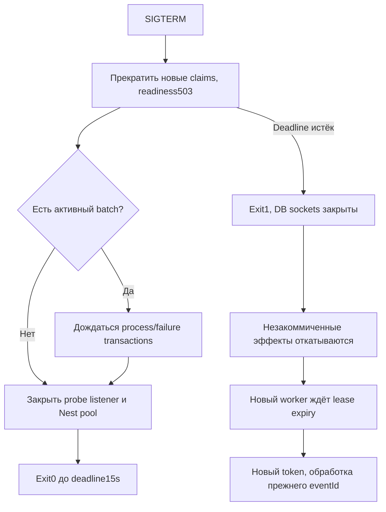

# WMS-304: probes, завершение и обновление приложения

## Вход, права и результат

Kubelet вызывает GET /health/startup, /health/ready, /health/live. Они технические,
доступны без cookie и не возвращают credentials, DB URL, backlog или данные склада.
API слушает3000; worker —9100, без Service/Gateway. Бизнес-команды по-прежнему
проходят session/Origin/CSRF/warehouse ACL и idempotency. GET /health сохраняет
старый liveness-контракт. Root / остаётся техническим API greeting.

| Probe   | Что доказывает                                    | Отказ                                                                               |
| ------- | ------------------------------------------------- | ----------------------------------------------------------------------------------- |
| startup | Nest init завершён; listener доступен             | До init listener отсутствует; startup failures перезапускаются Kubernetes           |
| live    | Event loop отвечает HTTP                          | Не зависит от PostgreSQL; outage не должен создавать restart storm                  |
| ready   | Startup завершён, drain не начат, SELECT1 успешен | 503 при отказе pool/БД/drain; новых warehouse запросов через Service быть не должно |

Readiness не обещает доступность каждой таблицы/роль/grant/schema или успешность
следующей команды. Pool acquisition ограничен5s, query_timeout probe1s; kubelet
timeout2s может раньше признать probe неуспешным. SELECT не имеет бизнес-эффектов.
Первоначальный DatabaseService init проверяет PostgreSQL до открытия listener;
при задержке БД startup может завершиться ошибкой и повториться как новый Pod attempt.

## Ход API shutdown

```mermaid
sequenceDiagram
 participant K as Kubernetes
 participant A as API process
 participant H as HTTP listener
 participant D as PostgreSQL
 K->>A: SIGTERM
 A->>A: draining=true, deadline20s
 A->>H: server.close, прекращение новых connections
 Note over A,H: Уже принятые active responses продолжаются
 H->>D: Завершить transaction активной команды
 alt Commit успешен
 D-->>H: Saved HTTP result и бизнес-эффект атомарны
 H-->>H: Отправить response, если socket ещё открыт
 else DB timeout/ошибка
 D-->>H: Rollback; ошибка без скрытого retry
 end
 H-->>A: Все active responses завершены
 A->>D: app.close → pool.end
 A-->>K: Exit0
```

Middleware после correlation, до body parser, возвращает503 для нового запроса,
если drain уже установлен. Server.close затем прекращает приём connections.
Kubernetes EndpointSlice/NGINX обновляются асинхронно: запоздавший запрос может
получить503/reset. Это не обещание обновления без единого HTTP отказа.

Signals регистрируются до startup. Init явно отделён от listen: stop проверяется до init и после await init.
Если signal пришёл во время init, новый listener не открывается. Общий deadline20s охватывает также init и cleanup. При rejected cleanup
deadline остаётся активным; ошибка close не доказывает освобождение ресурсов. При превышении
процесс выходит1; ОС закрывает DB sockets. Grace Kubernetes30s больше deadline.
SIGKILL пропускает middleware/finally и принудительно закрывает sockets.

## Timeout операции и транзакции

PostgresTransactionRunner задаёт transaction_timeout и statement_timeout10s до
callback; таймаут ограничивает DB operation, включая ожидания и idle callback.
Identity задаёт собственный5s budget, worker — валидированный worker transaction
budget (default10s). Runner не повторяет callback. Scoped context отзывается в finally.
Внешнее I/O внутри business callback остаётся запрещено.

Если HTTP response потерян после commit, новая попытка использует тот же URL/body/key.
Сервер заново проверяет session/ACL и возвращает saved result; создание нового key
не восстанавливает неизвестный результат. Timeout не означает автоматически,
что commit отсутствует: состояние определяют persisted result и исходный key.

## Worker shutdown и восстановление



Claim, начавшийся до signal, может committed, но новый handler после stop не стартует.
Такие claims безопасно ждут expiry. Active handler держит stream/delivery locks до
commit; другой worker пропускает locks через SKIP LOCKED. Default lease30s больше
transaction10s. Worker deadline15s больше transaction budget, grace30s больше drain.
Worker HTTP listener — только probes; он не запускает warehouse controllers.

При входе в обработку repository сначала получает locks, затем новым statement
сверяет token/status/cursor/deadline по свежим часам БД. Это исправляет R-01:
lease, истёкший во время ожидания неизменённых строк, больше не разрешает handler.
Effect, task audit, marker, cursors и ack получают один commit. После commit kill
не отменяет этот факт; повторное чтение marker не применяет эффект повторно.
Подробности протокола: [worker flow](worker.md).

## Rollout и совместимость

Helm использует один immutable image digest для API/worker/migrator. Сначала
serialized migration Job, затем Deployments. maxUnavailable0/maxSurge1 сохраняют
старый Pod до readiness нового; minReadySeconds3 не считает краткую готовность
устойчивым rollout. Progress deadline180s ограничивает зависшее обновление.
Surge workers допускает перекрытие процессов; fencing выполняют DB locks/tokens,
а не replicas1. Readiness worker не прекращает polling сама: остановка — только signal.

Expand release добавляет nullable поле/таблицу без требования нового значения от
старого кода. Contract/drop/обязательные поля допускаются позже, после завершения
старых процессов и отдельной проверки. Event v1 сохраняет схему/семантику; новый
consumer не сбрасывает marker/cursor. Schema rollback не равен image rollback.

## Проверка Gate3

`pnpm lifecycle:gate` включает чистый kind/Helm install, WMS-302 failure checks,
NGF/TLS и реальный Chromium flow этапа2. Затем scripts/lifecycle-check.cjs:

1. Останавливает PostgreSQL StatefulSet и проверяет readiness503/live200 у API/worker,
   восстановление readiness после запуска и отсутствие liveness restarts.
2. Ставит test-only PostgreSQL advisory barrier перед UPDATE receipt после stock
   записей. Наблюдает реальный DB wait, force-delete API Pod, ждёт исчезновения DB
   backend. Проверяет draft/отсутствие movement, повторяет исходный key.
3. Удаляет API после commit; replay возвращает тот же snapshot с одним movement.
4. Останавливает worker перед task INSERT/commit аналогичным DB barrier; удаляет Pod,
   ждёт rollback и lease recovery. Проверяет ровно один task/audit/marker.
5. Удаляет worker после завершения delivery и проверяет сохранение этих фактов.
6. Собирает временный release image с отдельной additive migration: nullable поле
   application_metadata.lifecycle_release_note. Этот SQL/journal существует только
   во временном build context, applied migrations репозитория не изменяются.
7. Применяет migration новым migrator, пока старые API/worker Pods ещё работают;
   выполняет v1 receipt на прежних процессах, затем rolling release обрабатывает
   подготовленный v1 backlog. Сверяет task и readiness после обновления.

Все barrier hooks/DDL/credentials принадлежат только disposable cluster. Finally
закрывает blocker, browser/port-forward, удаляет cluster и временные файлы. Рабочая
.env и dev volumes не используются. Точные результаты — [отчёт](../reports/wms-304.md).

Для локальных tools допустимы WMS_KIND/WMS_KUBECTL/WMS_HELM. Закреплённый CRD bundle
передаётся через WMS_GATEWAY_CRDS и проверяется hash, как в [Gateway flow](gateway-tls.md).
Ни один failure не пропускается через skip/fallback/forceExit.

## Диагностика и ограничения

Смотреть `kubectl get pods`, `describe pod`, `logs --previous`, rollout status и events
в явных local context/namespace. Для DB outage восстанавливать dependency; liveness
не должна перезапускать приложение ради её недоступности. При failed migration
использовать [migration runbook](kubernetes-app.md). Не сбрасывать delivery tokens,
markers или idempotency results вручную ради успешного rollout.

Single-node kind и PostgreSQL replicas1 не являются HA. Потеря узла может остановить
все компоненты; PVC не заменяет backup. Перед внешним стендом отдельно утвердить
storage/reclaim, backup/restore drill, Secret encryption/rotation и TLS trust.

API preStop в Kubernetes ждёт5s после начала Pod termination для распространения
EndpointSlice/Gateway. Бюджет5s + API deadline20s укладывается в grace30s;
при прямом Docker SIGTERM preStop отсутствует, process deadline остаётся20s.

Process deadlines требуют работающего JS event loop. CPU-blocking callbacks
запрещены; при зависании Node окончательную границу обеспечивает Kubernetes SIGKILL
после grace period, а PostgreSQL отдельно ограничивает DB transaction по своим часам.
