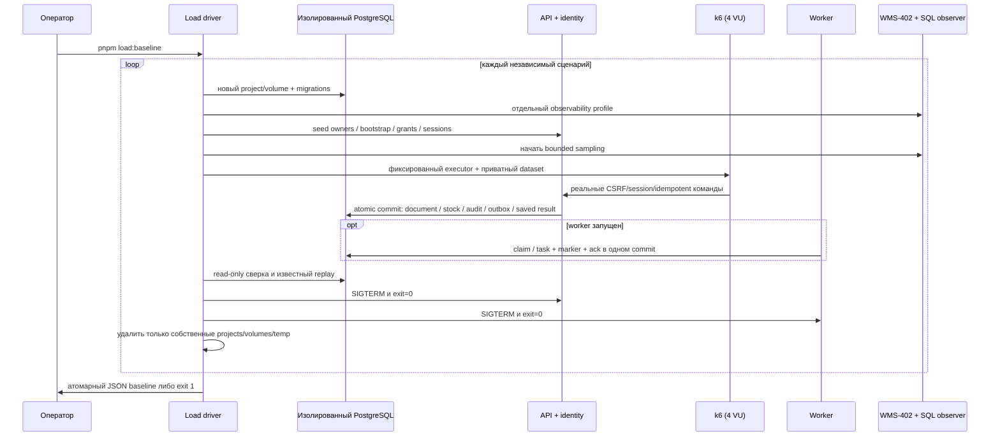

# Нагрузочные сценарии и сверка WMS-403

Владелец запуска — [scripts/load](../../scripts/load/README.md), сценариев —
[load/k6](../../load/README.md), evidence — [отчёт](../reports/wms-403.md).
Это ограниченный локальный baseline с заданным входным потоком. Он не определяет максимальную
производительность, production capacity, HA или SLO.

## Вход, права и подготовка

Вход — одно из `throughput|sku|backlog|baseline`, без дополнительных аргументов.
Нет принимаемого URL, DSN или режима подключения к существующей БД. UUID Compose
project и его monitoring project создаются внутри driver. Секреты синтетические:
случайный DB пароль и пароль тестовых пользователей, cookie и CSRF tokens.
Driver принимает только локальный Unix Docker socket; remote contexts отклоняются
до создания контейнеров. Env/dataset — временные файлы 0600 в каталоге 0700. k6 получает dataset как
read-only mount под UID/GID оператора. Ничего из этих данных не сохраняется
в git или JSON отчёте; root `.env` не читается и не меняется.

Docker transport удаляет пересекающиеся переменные из inherited environment,
передаёт аргументы массивом без shell и ограничивает время/объём вывода.
Compose объединяет base + app + observability application + gate + load overlay.
Новый PostgreSQL volume проходит реальные migrations. Отдельный профиль
Prometheus/Grafana/Loki/Tempo/Alloy/Alertmanager/receiver включён для каждого
сценария; уведомления остаются на локальном receiver.

API слушает container loopback. k6 использует `--network container:<api>` и
`http://127.0.0.1:3000`; опубликованный порт не открывает этот listener наружу.
Auth origin ровно тот же. Development здесь разрешает HTTP loopback, а session,
warehouse ACL, CSRF, validation и idempotency работают штатно. Локальный CLI
bootstrap включён явно только для одноразового admin. Admin назначает себе и
каждому VU warehouse roles через защищённое HTTP API. Каждый VU имеет своего
пользователя и session: общий session touch lock не подменяет конкуренцию stock.

## Dataset и независимость сценариев

`seed-dev` вызывает Catalog/Warehouses owners и создаёт product/warehouse и три
location: receiving/storage/shipping. Он не начисляет stock. Воспроизводятся
форма данных, роли, количества, параметры и последовательность. UUID и суффиксы
SKU случайны для изоляции, одинаковые UUID между запусками не обещаются.

| Сценарий   | Dataset до измерения                                                                        | Нагрузка                                                                         | Состояние worker                          |
| ---------- | ------------------------------------------------------------------------------------------- | -------------------------------------------------------------------------------- | ----------------------------------------- |
| throughput | 4 склада × 1 SKU, нулевой stock, 4 оператора                                                | 10 приёмок/с, 20 s, максимум 4 VU; создать однострочную приёмку qty=1 → провести | Запущен                                   |
| sku        | 1 SKU/склад, приёмка qty=1 проведена и размещена в storage; 4 разных active заказа по 1 шт. | 4 VU × 1 reserve                                                                 | Штатно остановлен после подготовки        |
| backlog    | 4 склада × 1 SKU, нулевой stock                                                             | 4 VU × 25 приёмок qty=1, ровно 100 post                                          | Остановлен до k6, затем запущен для drain |

После setup driver ждёт фиксированные 15 s для settling только что запущенного
monitoring. Setup/login и контрольные HTTP-команды не входят в метрики k6. Отдельного k6 warmup
нет: первые соединения входят в результат. Throughput использует `constant-arrival-rate`: 10 итераций/с, по два HTTP запроса
на итерацию. До четырёх VU обслуживают заданный поток; нехватка VU и dropped
iterations означают отказ. Один умеренный rate не определяет saturation point.
Граничный tick executor может дать 201 вместо 200 приёмок: сверяются фактические
completed iterations, posted counter и ровно два HTTP запроса на пару. Backlog
имеет ровно 100 документов.

В SKU driver заранее открывает отдельную транзакцию и берёт `FOR UPDATE` ровно
одного storage balance. Затем он запускает k6 и наблюдает четыре `Lock` waiters
в `pg_stat_activity`. Только после этого делает COMMIT барьера. Это доказывает
пересечение реальных запросов; случайные sleep не используются. Barrier deadline
5 s меньше request/transaction timeout. `finally` освобождает lock при отказе.
Отдельно сохраняются `barrier.waiters/holdMs`. Эта искусственная задержка входит
в четыре latency samples: такие quantiles не описывают обычную latency резерва.
После барьера один резерв успешен, три получают именно `INSUFFICIENT_STOCK`.
Отмена победителя через API освобождает allocation, не меняя физический остаток.

## Метрики и критерии остановки

Бюджет хранится в [config.cjs](../../scripts/load/config.cjs), k6 image закреплён
tag+registry digest. API/PG: по 2 CPU/512 MiB; worker: 1 CPU/256 MiB;
k6: 1 CPU/256 MiB. Общая Docker VM и monitoring остаются дополнительной нагрузкой.
CPU limits ограничивают время, но не резервируют ядра. Профиль monitoring сохраняет
собственные memory/retention limits WMS-402. Версии, CPU model/count, host RAM/load,
Docker CPU/RAM/OS, image IDs, commit, dirty flag и hash runtime/harness inputs
сохраняются в JSON. Host free RAM не учитывает macOS reclaimable/compressed memory.
Стенд должен оставаться активным: sleep/wake нарушает измерение, может истечь
session TTL или оборваться Docker exec. На Mac команда `caffeinate -i pnpm load:baseline`
временно запрещает idle sleep, не меняя постоянную настройку питания. После паузы
машины прежний прогон не принимается, нужен новый чистый стенд.

k6 сохраняет p50/p95/p99/avg/min/max/count HTTP latency, request errors, iterations,
число проведённых приёмок и успешных/отклонённых резервов. `receipt_pair_http_ms`
складывает duration create+post и не является полной wall-clock latency итерации.
`measuredMs` driver включает старт/остановку k6 и barrier; для HTTP RPS используется
k6 `http_reqs.rate`, для пар — `receipts_posted.rate`. Не делить число HTTP запросов
на два при незавершённых итерациях: сверка требует отсутствие draft receipts.
`http_req_failed` считает ожидаемые 409 допустимыми; отдельный `unexpected_responses`
проверяет код проблемы и минимальную форму успешного ответа. Три конфликта всё равно
явно отражаются в бизнес-результате, а не исчезают из отчёта.

SQL observer использует отдельный pool max=3 и `application_name=wms-load-observer`.
Последовательный sample примерно каждые 100 ms читает:

- active/Lock waiters и max age заблокированного запроса для application_name
  `warehouse-controller`; текст SQL и параметры не сохраняются;
- pending/processing/retry/dead/completed и возраст самого старого незавершённого
  event по времени вставки; completed delivery не означает размещённый товар;
- commit/rollback/deadlock counters PostgreSQL.

`sampledWaiterMs` — интеграл числа waiters между сэмплами с приближением слева;
короткое ожидание может не попасть в sample. Query age включает работу до ожидания,
поэтому не называется временем lock. Barrier observation независим от периодического
sample и может видеть больший пик. PostgreSQL stats публикуются с задержкой;
`postShutdownSnapshot` сохраняет counters после закрытия app connections. Это не
per-statement profiler, `pg_stat_statements` здесь не установлен. SQL sampling и
полный WMS-402 добавляют overhead; сопоставлять можно только одинаковые профили.

Защитные условия завершают прогон ошибкой:

- любой неожиданный HTTP статус/JSON/problem code, error rate >0, dropped iteration;
- request timeout 10 s, HTTP p99 >=5 s; k6 gracefulStop 15 s, maxDuration 60 s
  для fixed iteration сценариев, общий timeout Docker client k6 100 s;
- не достигнуты 4 DB waiters за 5 s или worker drain не завершён за 60 s;
- dead delivery, новый DB deadlock, backlog >1000, observer error/сверхлимит samples;
- расхождение любого бизнес-инварианта, повторный эффект или нештатный SIGTERM exit;
- ошибка удаления собственных ресурсов.

Observer отменяет k6 при нарушении своих stop criteria. Timeout Docker client
не означает остановку контейнера, поэтому driver отдельно удаляет именованный k6.
Таймаут startup/build ограничен 300 s, monitoring Compose — 240 s, readiness каждого
компонента — отдельным deadline. Эти пределы — dev safety budget, не SLO WMS-404.
Автоматических повторов бизнес-команды нет. Key детерминирован по run/scenario/VU/
iteration/operation. Известный успешный post явно replay-ится тем же actor/key/body
после нагрузки; SQL сверка подтверждает неизменность фактов.

## Backlog и drain

Перед backlog k6 проверяется реальная остановка worker с exit=0. После 100 post
должны быть 100 pending, 0 completed, 0 tasks и markers. Затем worker запускается,
проверяется readiness и полное обнуление pending/processing/retry/dead. `drain.elapsedMs`
считает монотонное время от команды старта до наблюдённого полного завершения;
`eventsPerSecondIncludingStartup` включает старт, readiness и опросы. Это консервативная
end-to-end скорость данного пакета, не максимум постоянного consumer throughput.
Массив `samples` содержит рост/разбор очереди по времени, в том числе возможные
переходы processing. Пустые промежуточные сэмплы допустимы при очень быстрой обработке.

## Сверка committed результата

После k6 и drain отдельный read-only repeatable-read snapshot проверяет:

1. `0 <= reserved <= on_hand`; reserved равен сумме active allocations на balance.
2. Балансы равны ledger: receipt/transfer-in прибавляют, transfer-out/shipment
   вычитают. FULL JOIN обнаруживает движение без соответствующего баланса.
3. allocated = active + released + transferred + consumed, части неотрицательны.
4. Нет повторных operation_id movements, source_receipt_line tasks и event markers.
   В текущем стенде один consumer; правило не обобщается на будущих consumers.
5. У каждой posted receipt line ровно один receipt movement нужного количества,
   event, completed delivery, task и marker; нет draft receipt и pending HTTP result.
6. Числа документов/движений/задач/markers/остаток совпадают с k6 success counter.
   Для SKU отдельно сверяются 1 active allocation/reserved=1 и затем released=1/
   reserved=0 при тех же onHand=1/movements=3.

Movement/audit/outbox пишут штатные владельцы в общей транзакции. Harness ничего
не исправляет прямым SQL; контрольная транзакция барьера только читает под lock.
SQL mismatch не превращается в успешный benchmark даже при зелёных HTTP thresholds.

## Artifact, диагностика и cleanup

JSON schemaVersion=1: `machine/source` — provenance, `scenarios[].budget/dataset` —
параметры, `k6.metrics` — агрегаты, `before/afterLoad/finalSnapshot/postShutdownSnapshot`
— снимки, `samples/contention` — наблюдения, `barrier/drain` — специальные фазы,
`verification` — результаты ledger сверки. `apiResourceSample` — одиночный sample
после нагрузки, не peak consumption; конфигурационные лимиты указаны отдельно.
Committed baseline — данные, а не конфигурация runtime; комментарии JSON заменяет
этот документ. `source.runtimeAndHarnessSha256` исключает docs/reports и не создаёт
самоссылку. Dirty checkout не выдаётся за конкретный чистый commit.

При отказе driver пишет `artifacts/load/*-failed.json`: безопасную фазу и полностью
завершённые предыдущие сценарии. Partial сценарий сохраняет доступные samples, summary и committed facts с
`status=failed`; если k6 убит до handleSummary или SQL недоступен, этих данных нет.
Partial результат не становится accepted baseline. Raw Docker/pg errors и временный dataset
не переносятся в публичный artifact. Успешный файл появляется после cleanup.

Для ручной диагностики активного прогона использовать `docker ps --filter name=wms403`
и scoped `docker logs <имя-api/worker>`; это operational logs с политикой WMS-401.
Не выводить `docker inspect` целиком или `compose config`: там есть credentials.
Не использовать глобальные `docker system prune`/`volume prune`. После SIGKILL или
потери daemon проверить конкретный UUID проекта, удалить только его контейнеры,
сети и volumes с label `com.docker.compose.project=<точный-UUID-project>`, затем
связанный каталог `wms403-*` в системном temp. Потеря процесса не гарантирует finally.
Рабочие volumes и `.env` не меняются; уничтожение dev данных не входит в этот flow.

## Ограничения

Использованные API k6 описаны в первичной документации:
[expectedStatuses](https://grafana.com/docs/k6/latest/javascript-api/k6-http/expected-statuses/),
[handleSummary](https://grafana.com/docs/k6/latest/results-output/end-of-test/custom-summary/),
[фиксированные request tags](https://grafana.com/docs/k6/latest/using-k6/tags-and-groups/).
Совместимость закреплённого image проверяется реальным прогоном, а не названием latest docs.

Одна короткая локальная машина, общий Docker VM и фоновые процессы не образуют
статистически устойчивую capacity оценку. Четыре SKU reserve samples проверяют
конкурентный результат; p99 из четырёх запросов не является надёжным percentile
популяции. Здесь нет gateway/TLS/browser rendering, внешнего network latency,
продолжительного soak, поиска предельного arrival rate, большой номенклатуры, backup/restore,
Kafka или отказов диска. Эксперименты с lease/crash остаются в WMS-304, recovery
drill и согласование SLO — WMS-404. Нельзя переносить числа в production без
повторного измерения на согласованном storage/ресурсах и репрезентативных данных.
