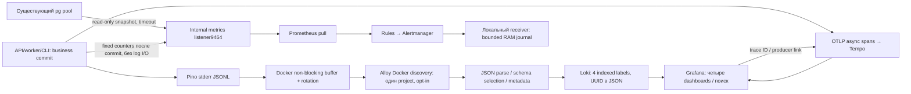

# WMS-402: logs, metrics, traces и локальные сигналы

## Вход, права и предусловия

Оператор включает отдельный локальный profile. Приложение и PostgreSQL остаются
в собственном project; рабочая .env/volumes не меняются ради теста. Предпосылки:
Docker, свободные loopback порты, память Docker VM для приложения и monitoring.
Мониторинг не предоставляет warehouse ACL. Correlation/trace UUID не являются правами
или audit scope. Реальная session/CSRF/warehouse policy проверяется общим business gate.

[ADR-0031](../adr/0031-local-observability.md) — архитектурное решение.
[Команды запуска/cleanup](../../infra/observability/README.md),
[AC → реализация → tests](../reports/wms-402.md).

## Сбор и доверие к данным

1. Discovery и loki.source.docker синхронизируются раздельно по2s. Default source60s
   не подходит короткому CLI. Test wrapper ждёт реальный Loki acknowledgement после
   завершения CLI, не меняя business runtime и его независимость от log I/O.
   Application overlay добавляет wms.logs=true для API/worker/migrate. Alloy фильтрует
   именно WMS_APP_PROJECT. Иные Docker projects не становятся targets. Standalone CLI
   должен быть discoverable контейнером с этим project label и opt-in; host CLI не собирается.
2. Docker API даёт project/container metadata. Collector не добавляет UUID в index labels.
   В Compose namespace означает project; pod отсутствует. Для Kubernetes необходим отдельный
   deployment/discovery с namespace/pod/container metadata и RBAC; он не реализован этим профилем.
3. JSON parser отбрасывает malformed строки и записи без operational service/process/module.
   CLI stdout результата, включая payload inspect/bootstrap, не является operational log.
   Fallback WMS-401 имеет обязательную schema и environment unknown, потому сохраняется.
4. Разрешены только service=warehouse-backend, известные process/environment/module.
   Stage pack временно переносит metadata, structured_metadata сохраняет project/container,
   stage output восстанавливает исходную JSON строку. label_keep оставляет четыре labels.
   discover_service_name=[] запрещает Loki добавлять пятый service_name автоматически.
5. JSON LogQL parser создаёт query-time fields/labels. Они не равны indexed stream labels:
   проверять cardinality через Loki series API. Поиск `| json | eventId="..."` не создаёт index.
6. Grafana Loki derived field извлекает traceId и открывает Tempo datasource; Tempo
   tracesToLogsV2 ищет JSON traceId через Loki custom query. Deferred handler имеет отдельный
   trace с producer link WMS-401; искать попытки также по eventId/aggregateId/correlationId.

## Метрики и dashboards

[Metrics README](../../apps/backend/src/infrastructure/metrics/README.md) владеет SQL,
единицами, labels и таймаутами. Counters сбрасываются при restart, histogram — секунды.
HTTP включает health probes; dashboard отдельно показывает business operation outcomes.
Queue age — возраст исходного outbox event, не lease timeout и не срок физического putaway.
Пять status дают нулевые серии при отсутствии доставки, чтобы alert мог разрешиться.
DB failure даёт scrape_success=0, а не ложный нулевой backlog; отдельное rule замечает unknown.

Dashboards provisioned из JSON: пользовательская операция (latency/results/business/logs),
очередь (count/age), workers (scrape/outcomes/logs), infrastructure (up/pool waiting/count).
Четыре textbox фильтра — correlationId/eventId/aggregateId/errorCode, default regex `.*`.
UUID не становятся metric labels. Количество event series ограничено LOG_EVENTS.

## Alerts и порядок fault drill

Dead>0 for5s; active pending/retry/processing age>60s for5s; handling error increase за1m
или durable dead/retry>0 for5s. Durable часть нужна для ошибки до первого scrape нового
worker. Up=0 либо outbox scrape_success=0 for15s — неизвестное состояние monitoring.
Evaluation/scrape5s, Alertmanager group_wait1s/group_interval5s/repeat1h.
Это предварительные dev thresholds; baseline/SLO — WMS-403/404.

`pnpm observability:gate` включает общий Docker gate:

1. Чистые projects/БД, migration, production/loopback auth, bootstrap и warehouse role.
2. Worker остановлен, receipt posted/replayed — stock10 и один event без task/marker.
3. Реальный pending age достигает threshold; local receiver получает firing.
4. Временный disposable trigger перед insert task вызывает23514. Worker rollback-ит effect,
   сохраняет dead. Dead/error firing фиксируется HTTP receiver, без внешних сообщений.
5. Trigger удалён в finally; production outbox retry CLI через свой loopback tunnel проверяет
   dev opt-in и DB admin role. Новый attempt даёт одну task/marker. Receiver получает resolved.
6. CLI fallback проверяет unknown/CONFIG_INVALID; синтетический stdout-canary не попадает в Loki.
7. Logs одного receipt ищутся из API и worker; CLI records доступны; четыре indexed labels,
   document IDs/errorCode, реальные Tempo producer/consumer traces и Grafana provisioning проверяются.
8. Loki останавливается. Новая receipt-команда commit-ится и worker завершается без Loki;
   collector исчерпывает bounded retry и пишет diagnostic о drop. Нет rollback складского эффекта.
9. Loki возвращается; collector останавливается. Ещё одна новая команда завершается. После
   restart collector новая команда снова видна в Loki. Историческая полнота не обещается.
10. Общий gate проверяет placement/order reserve/replay/release/cancel и SIGTERM;
    finally удаляет только свои projects/volumes и tempfile credentials.

## Потери, доступ и восстановление

Alloy batch256KiB, wait1s, HTTP timeout2s, backoff500ms..2s, максимум3 retries.
Без sender WAL batch после исчерпания retries теряется. Docker file rotation10MiB×3
на приложение и non-blocking memory buffer1MiB допускают drop. Alloy positions в volume
сохраняются при restart, но не создают exactly once: возможны пропуски/повторы и утрата
старого segment после rotation. Loki outage сам не тормозит warehouse transaction.
Host/Docker disk/memory exhaustion может повлиять на все процессы; drill не доказывает
изоляцию от исчерпания общих ресурсов.

Loki/Tempo не имеют auth в dev. Published порты только loopback; внутренняя сеть доверенная.
Alloy читает Docker socket: mount ro не означает read-only API permission. Внешний стенд
требует RBAC/proxy, TLS/auth, storage quotas, backup/restore и secret management.
Receiver journal RAM ограничен и теряется при restart; он доказывает локальную доставку,
а не является долговечным журналом инцидентов. Retention/очистка — README профиля.
Standalone receiver регистрирует SIGTERM/SIGINT, закрывает HTTP listener и ждёт
текущие requests до 2 s. Затем закрывает оставшиеся HTTP connections. Compose даёт
5 s grace. Это предотвращает default PID 1 поведение с последующим SIGKILL/137;
обычный stop даёт exit 0. Прерывание недоставленного webhook не создаёт durable ack:
Alertmanager использует свой retry, RAM journal не становится надёжным storage.
Не использовать глобальный Docker prune или down --volumes существующего app project.
