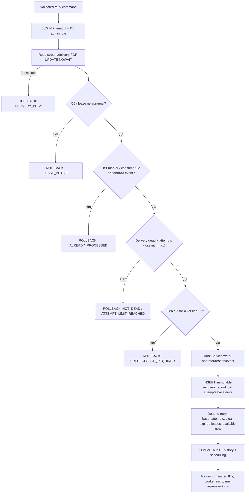
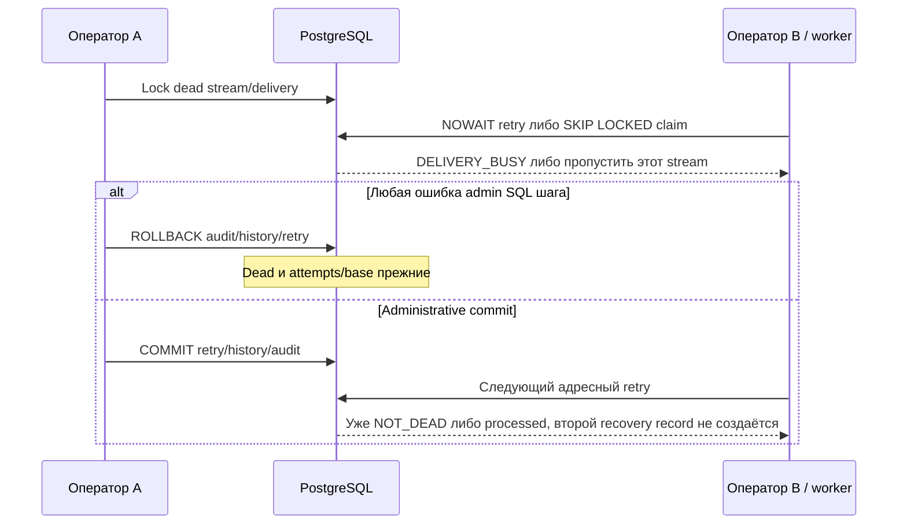

# Inspect → адресный retry → worker: флоу WMS-111

Реализованные локальные команды восстановления. [Runbook с командами](../runbooks/event-recovery.md),
[worker protocol](worker.md), [бизнес-handler](putaway.md), [ADR-0017](../adr/0017-local-outbox-recovery.md).

## Для менеджера: что подтверждает восстановление

Операция приёмки уже committed, stock=10 и movement=1. Сбой создания задачи оставил delivery
dead, но не отменил приёмку. Оператор устраняет причину, смотрит состояние и разрешает retry
конкретной доставки с причиной. Worker создаёт task и marker одной transaction. Итог восстановления:
delivery completed, task pending, stock по-прежнему 10, movement/event/task по одному.

```mermaid
flowchart LR
  Fail["Handler failure: delivery dead"] --> Signal["Local signal: alert / exit 2"]
  Signal --> Inspect["Inspect event + consumer: safe snapshot"]
  Inspect --> Fix["Оператор устраняет причину"]
  Fix --> Retry["Retry: operator UUID + reasonCode"]
  Retry --> Commit["COMMIT retry + audit + history"]
  Commit --> W["Отдельный worker: следующий claim"]
  W --> Done["COMMIT task + marker + cursors + completed"]
  Done --> Check["Inspect/signal: эффект один, alert снят"]
```



Команда retry не выполняет handler и не обещает исправление причины. Неисправленный код,
schema или source FK приведут к повторному dead. Не все dead можно исправить retry:
corrupted immutable facts требуют отдельного решения, а не ручной правки payload/cursor.

## Источники данных и полномочия

| Данные                                    | Источник / доверие                                                            |
| ----------------------------------------- | ----------------------------------------------------------------------------- |
| eventId, consumer                         | CLI flags, UUID и server destination validation до DB                         |
| operatorId                                | Обязательный UUID локального вызывающего; не authenticated directory identity |
| reasonCode                                | Технический slug до 96 символов, без свободного текста/PII                    |
| administrationCorrelationId               | Новый server UUID данного CLI запуска                                         |
| source correlationId                      | Envelope UUID либо null при invalid value, не входной admin correlation       |
| status/attempts/base/lease/cursors/marker | Повторное чтение PostgreSQL, не данные предыдущего inspect                    |
| payload preview                           | Explicit opt-in, full EventContracts validation, allowlist первых 10 lines    |

CLI требует explicit dev/test, opt-in и loopback DB URL **до** Nest/pool. Внутри каждого service
run проверяется warehouse_outbox_admin membership. SET ROLE tests проверяют именно current_user.
Shell/DB доступ и знание operator UUID не заменяют production authentication; remote admin API нет.

## Inspect: безопасный advisory snapshot

```mermaid
sequenceDiagram
  participant C as outbox-admin CLI
  participant S as OutboxRecoveryService
  participant R as RecoveryRepository
  participant DB as PostgreSQL
  C->>C: Strict args + local environment guard
  C->>S: inspect(address, includePayload)
  S->>DB: BEGIN; timeout; DB role check
  S->>R: read без row locks
  R->>DB: Event/delivery/lease + marker/cursors snapshot
  R->>DB: Последние 20 recovery records
  S->>S: Safe diagnostic + UTC timestamps + payload projection
  S->>DB: COMMIT read transaction
  S-->>C: JSON result без token/raw envelope
  C->>C: Print result; finally close pool
```

Один SELECT состояния согласован сам с собой; history читается следующим statement при read
committed, поэтому весь inspect не обещает repeatable-read snapshot. Он не блокирует worker.
Пока оператор читает stdout, delivery уже могла измениться. Retry не доверяет этому снимку.
Токен исключён, доступны until/active отдельно для stream и delivery. Error только allowlist
или REDACTED; payload по умолчанию omitted. --payload показывает source UUID/quantity, lineCount,
truncated, но не extensions, произвольные имена/комментарии или schema validation details.

## Retry: locks, проверки и одна административная transaction



Delivery not found возвращает DELIVERY_NOT_FOUND. Ошибка role/SQL/audit/commit откатывает
весь run. WHERE адресует eventId+consumer; нет команды всех dead, force/replay/reset flags.
Stream locks имеют ту же область, что worker; NOWAIT не ждёт истечения чужого active handler.
Processing с истёкшим lease всё равно NOT_DEAD: это обычный путь recovery worker, не admin retry.

```mermaid
sequenceDiagram
  participant O as Оператор
  participant S as OutboxRecoveryService
  participant A as AuditService
  participant DB as PostgreSQL
  participant W as Worker
  O->>S: retry(eventId, consumer, operatorId, reasonCode)
  S->>DB: BEGIN; role; NOWAIT locks; state checks
  S->>A: write(context, delivery-retry-scheduled)
  A->>DB: INSERT audit
  S->>DB: INSERT outbox_recovery_actions
  S->>DB: UPDATE delivery retry/base и clear stream lease
  S->>DB: COMMIT
  S-->>O: RecoveryId + auditId + прежний total attempt
  W->>DB: Claim версии cursor+1, новый token, attempts+1
  W->>DB: Effect + marker + cursors + completion в transaction B
```

Audit actor=user с утверждённым operator UUID, entity=outbox-event/eventId, reasonCode и новым
administration correlation. History содержит прежнее состояние и auditId. Неуспешная попытка
retry не создаёт audit/history, потому что вмешательство не committed. При потере stdout после
commit повтор не делает новый reset: status уже retry/processing/completed, его следует inspect.

## Attempts и новый budget без удаления истории

| Шаг, maxAttempts=10       | Total attempts | Retry base | Потрачено в этом budget | Статус     |
| ------------------------- | -------------- | ---------- | ----------------------- | ---------- |
| Исчерпаны обычные попытки | 10             | 0          | 10                      | dead       |
| Административный COMMIT   | 10             | 10         | 0                       | retry      |
| Новый claim               | 11             | 10         | 1                       | processing |
| Worker COMMIT             | 11             | 10         | 1                       | completed  |

Worker сравнивает attempts-base с maxAttempts и рассчитывает backoff по этому budget attempt.
Diagnostics всегда показывает **общий** attempt=11. История хранит previousAttempts=10 и старый
base/error. Scheduling сохраняет last_error до следующего outcome; success очистит текущий error,
но прежний code останется в immutable recovery history. SQL запрещает уменьшение attempts;
изменить base может только admin role на допустимом dead→retry переходе. Вмешательство не
сбрасывает eventId/envelope, cursors, markers, tasks или созданные domain effects.

## Конкуренция, rollback и локальный сигнал



Signal одним SQL statement считает dead, backlog (pending/retry/processing), blockedStreams
(next version dead), expiredProcessing и oldestBacklogAgeSeconds по created_at event. Dead
отдельно от active backlog. Alert если dead≥deadLimit, backlog≥backlogLimit либо active backlog
старше maxAgeSeconds. Defaults: 1 / 100 / 60s. Это наблюдение, не автоматический retry.
Node exit 0 healthy / 2 alert / 1 denial/failure; stdout JSON, уведомлений наружу нет.
Future centralized logging/metrics/notifications — WMS-401/402, не обещание готового Loki/Pino.

## Evidence и ограничения

[outbox-recovery.spec.ts integration](../../apps/backend/test/integration/outbox-recovery.spec.ts):
production handler failure и actual child inspect/retry/signal, role denial/admin group,
NOWAIT lock/live lease, predecessor/marker refusal, two operators, SQL fault после каждого
существенного admin шага, exhausted budget и int4 limit, safe payload/error и signal age.
[Unit boundary](../../apps/backend/test/unit/outbox-recovery.spec.ts): strict args/opt-in,
structured fields/redaction и sink failure. Старые worker/putaway/HTTP suites также обязательны.

Runbook command `pnpm outbox:recovery-check` запускает изолированный PostgreSQL и настоящий
compiled CLI. Fault injection находится только в test fixture; dev data не меняются. Внешнее
развёртывание, production login provisioning, authenticated operator directory, external alerts,
replay/rebuild и исправление corrupted immutable facts не реализованы этим этапом.

## Карта реализации и чтение кода WMS-111

Подробные русские комментарии находятся рядом с проверками и SQL, а не только в этой схеме.
Начинать чтение удобно в следующем порядке:

| Файл / участок                                                                                                 | Ответственность и существенное ограничение                                                                         |
| -------------------------------------------------------------------------------------------------------------- | ------------------------------------------------------------------------------------------------------------------ |
| [outbox-admin.ts](../../apps/backend/src/infrastructure/outbox/outbox-admin.ts)                                | argv → local guard → Nest-контекст → сервис → безопасный JSON; общий deadline 15s включает закрытие пула           |
| [recovery-options.ts](../../apps/backend/src/infrastructure/outbox/recovery-options.ts)                        | Проверка UUID, server destination, причины, числовых порогов; неизвестные/повторные флаги запрещены до подключения |
| [recovery.dto.ts](../../apps/backend/src/infrastructure/outbox/dto/recovery.dto.ts)                            | Контракты адреса, команды и порогов; operator UUID утверждает вызывающий, а не каталог пользователей               |
| [outbox-recovery.service.ts](../../apps/backend/src/infrastructure/outbox/services/outbox-recovery.service.ts) | Один runner на команду, проверка роли и состояний, аудит через владельца, безопасный preview                       |
| [recovery.repository.ts](../../apps/backend/src/infrastructure/outbox/repositories/recovery.repository.ts)     | Заимствованный context, SQL NOWAIT, запись history и scheduling без собственного commit; таймауты по 5s            |
| [outbox.schema.ts](../../apps/backend/src/infrastructure/outbox/outbox.schema.ts)                              | retry_attempt_base и outbox_recovery_actions; назначение ограничений и ссылки на аудит/delivery                    |
| [delivery-diagnostic.ts](../../apps/backend/src/shared/diagnostics/delivery-diagnostic.ts)                     | Чистый выбор полей, проверка correlation UUID и маскирование неизвестной ошибки                                    |
| [delivery-logger.ts](../../apps/backend/src/infrastructure/worker/delivery-logger.ts)                          | Локальный JSON stdout после завершения транзакции; ошибка вывода не отменяет commit                                |
| [worker.repository.ts](../../apps/backend/src/infrastructure/worker/repositories/worker.repository.ts)         | Бюджет attempts-base, сбор claims/exhausted без I/O под блокировками                                               |
| [worker.service.ts](../../apps/backend/src/infrastructure/worker/services/worker.service.ts)                   | Вывод результата только после commit; backoff по текущему бюджету, общий attempt в логах                           |
| [worker-loop.ts](../../apps/backend/src/infrastructure/worker/services/worker-loop.ts)                         | allSettled сохраняет независимость потоков; ошибка persistence связана с конкретным claim по индексу               |
| [Миграции README](../../apps/backend/drizzle/README.md#wms-111)                                                | Назначение 0016/0017, SQL-права и триггеры; applied/generated SQL не редактируется для комментариев                |
| [Интеграционные тесты](../../apps/backend/test/integration/outbox-recovery.spec.ts)                            | Настоящий CLI, AFTER-trigger fault, удерживаемые блокировки, конкурирующие операторы, роль и rollback              |
| [Unit-тесты](../../apps/backend/test/unit/outbox-recovery.spec.ts)                                             | Граница ввода, redaction, отказ stdout, остановка poll через тестовый барьер                                       |
| [database-harness.ts](../../apps/backend/test/support/database-harness.ts)                                     | Cleanup полного FK-графа вместе с recovery history; отключение trigger только в disposable admin БД                |

### Что означает диагностическое чтение

В inspect основное состояние и история читаются **двумя** SQL-запросами при обычном
read committed. Каждый запрос видит свой снимок, поэтому между ними worker или другой
оператор может выполнить commit. Inspect не блокирует поток, не резервирует право на retry
и не обещает согласованную картину всех таблиц на один момент. Все решения retry принимает
по новому чтению с блокировками. Signal использует один агрегирующий запрос, но его результат
тоже является наблюдением на момент выполнения, а не постоянной гарантией отсутствия dead.

### Отказы и действие оператора

| Код                   | Что произошло                                        | Следующий шаг                                                                 |
| --------------------- | ---------------------------------------------------- | ----------------------------------------------------------------------------- |
| INVALID_ARGUMENTS     | Неверные флаги/UUID/получатель/причина/порог         | Исправить команду, не искать проблему в БД                                    |
| LOCAL_ACCESS_REQUIRED | Нет явного локального разрешения или URL не loopback | Проверить dev/test и среду, не ослаблять guard                                |
| ADMIN_ROLE_REQUIRED   | current_user не член warehouse_outbox_admin          | Использовать разрешённый локальный DB login; UUID оператора прав не добавляет |
| DELIVERY_NOT_FOUND    | По адресу eventId+consumer нет доставки              | Сверить сохранённый eventId и получателя                                      |
| DELIVERY_BUSY         | NOWAIT встретил удерживаемую SQL-блокировку          | Дождаться текущего владельца, повторно inspect                                |
| LEASE_ACTIVE          | Один из lease ещё активен                            | Дать worker завершиться; не стирать токен/lease вручную                       |
| ALREADY_PROCESSED     | Есть marker либо consumer cursor уже прошёл событие  | Не повторять эффект, изучить текущий результат                                |
| NOT_DEAD              | Состояние не dead                                    | Для expired processing работает автоматический lease recovery                 |
| PREDECESSOR_REQUIRED  | Один из курсоров не стоит на предыдущей версии       | Исследовать предшественника; не перескакивать порядок                         |
| ATTEMPT_LIMIT_REACHED | Общий attempts достиг int4 max                       | Обычный retry не исправляет предел; требуется отдельное решение               |

Неизвестные ошибки CLI выводятся как ADMIN_COMMAND_FAILED; ADMIN_CLEANUP_FAILED относится
к закрытию ресурсов, ADMIN_DEADLINE_EXCEEDED — к общему сроку выполнения. Такой отказ вывода
или закрытия после успешного commit не доказывает rollback: сначала inspect, затем решение.
Raw stack, SQL и credentials не нужны для выбора ветки; для подробной диагностики остаются
проверенный runbook и состояние БД. Выход 2 от signal — штатный alert, а не отказ команды.
