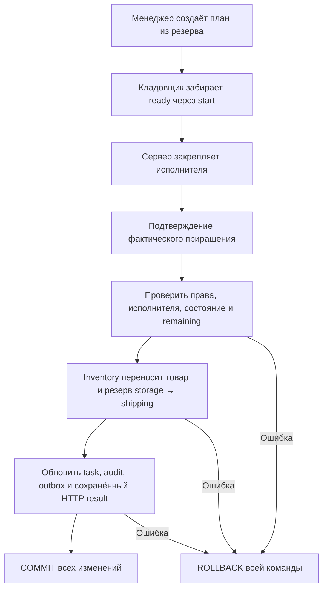
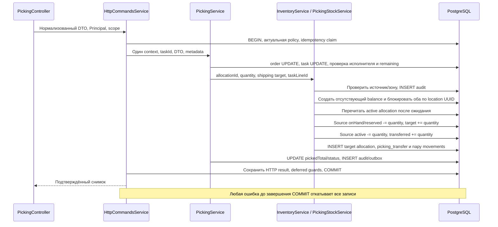
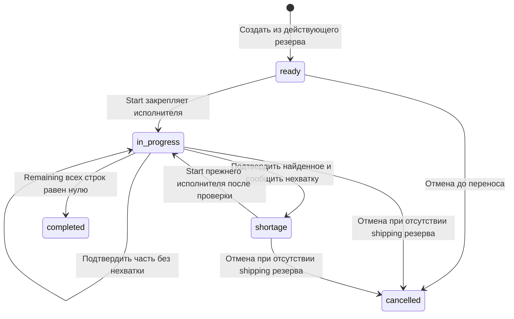
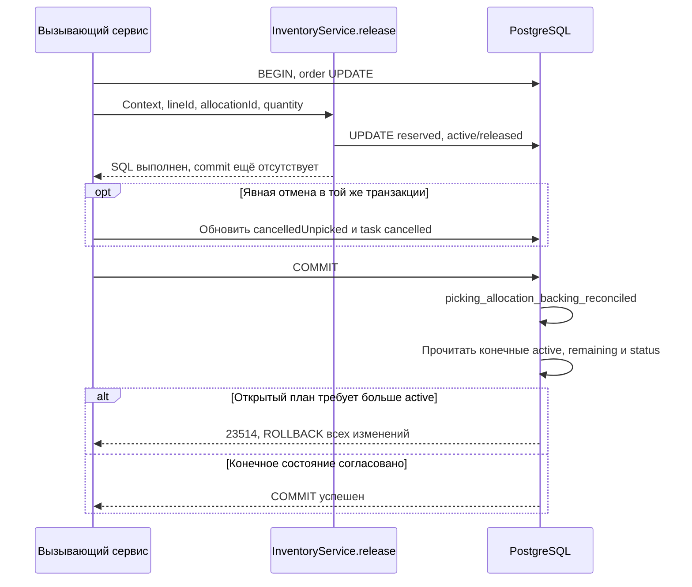

# WMS-205: исполнение сборки заказа

Реализовано 2026-11-01. Владелец продукта утвердил первый вариант назначения:
менеджер создаёт план, кладовщик сам принимает его через start.
[ADR-0023](../adr/0023-picking-execution.md) уточняет ADR-0022 и сохраняет B1–B4.

## Для менеджера

Задание планирует только уже зарезервированный товар. Создание не увеличивает резерв
и не перемещает товар. Кладовщик забирает свободное задание. Сервер закрепляет его
за пользователем из действующей сессии. Подтверждать может только этот исполнитель
с действующим складским правом pick. Переназначения в этом API нет.

Пример: заказано и зарезервировано 10 штук. Кладовщик нашёл 6 и сообщил нехватку.
После подтверждения в хранении остаются 4 штуки с резервом 4. В отгрузке находятся
6 штук с резервом 6. Строка показывает planned=10, pickedTotal=6, remaining=4.
Состояние задания — shortage. Общий остаток и общий резерв не изменились.
Повтор исходного запроса ничего не переносит.

Нехватка не списывает товар и не освобождает оставшийся резерв. После проверки товара
исполнитель повторяет start и продолжает сборку. Нулевая нехватка не создаёт движения.
Отмена до первого переноса освобождает резерв и закрывает задание. После переноса
нужен физический возврат WMS-206. Пока возврат не реализован, отмена отклоняется с 409
без изменения данных. Автоматического expiration нет по B4.

## Участники и доверие входу

PickingController отвечает за HTTP и нормализацию DTO. PickingService в fulfillment
владеет планом, исполнителем, состоянием и общим context команды. PickingRepository
изменяет только собственные task/lines. InventoryService передаёт физическую операцию
внутренним PickingStockService/PickingStockRepository. Только inventory меняет остатки,
allocations, историю переноса и movements. Сервисы используют один TransactionContext.
Worker новый сценарий не запускает; новых процессов и очередей нет.

DTO содержит taskLineId, actualQuantity, shortage и необязательный targetLocationId.
Все поля недоверенные. HTTP pipeline проверяет форму и int4 диапазон. Контроллер приводит
UUID к нижнему регистру и создаёт plain JSON без undefined до fingerprint.
Источник товара, SKU, склад и план берутся из сохранённых allocation/task/order.
Actor и исполнитель берутся из Principal, а не из тела запроса.

## HTTP-контракты

Все пути ниже начинаются с /api/v1. Изменения требуют session, Origin, JSON,
X-CSRF-Token и Idempotency-Key. Policy вызывается до saved replay.

| Метод и путь                        | Доступ                          | Результат                                   |
| ----------------------------------- | ------------------------------- | ------------------------------------------- |
| POST /orders/:orderId/picking-tasks | order                           | 201 PickingTaskDto; тело отсутствует или {} |
| POST /picking-tasks/:taskId/start   | pick                            | 200 PickingTaskDto; тело отсутствует или {} |
| POST /picking-tasks/:taskId/confirm | pick и закреплённый исполнитель | 200 PickingTaskDto                          |
| GET /picking-tasks/:taskId          | read фактического склада        | Текущий PickingTaskDto                      |

Пример confirm: `{"taskLineId":"<uuid>","actualQuantity":6,"targetLocationId":"<shipping-uuid>","shortage":true}`.
Это приращение, а не накопительный итог. Ноль разрешён только при shortage=true;
при нуле targetLocationId не нужен. Положительное количество требует shipping ячейку
своего склада. Нельзя подтвердить больше remaining. Сообщение shortage требует
оставшееся количество задания после подтверждения.

Задание содержит 1..1000 строк источников allocations. Один SKU может иметь несколько
строк. Пустой план отклоняется. Одновременно открыт только один план заказа.
GET показывает planned, pickedTotal, cancelledUnpicked и remaining каждой строки.
GET заказа разделяет reservedStorage/reservedShipping по фактической зоне allocation.
Открытое количество исключает оба действующих резерва. Историческое pickedTotal
не является признаком отгрузки и не должно исчезнуть при будущем возврате.

## Пошаговое исполнение

API — один процесс; PostgreSQL — отдельный процесс. Никакого внешнего I/O внутри
транзакции нет. Порядок locks: user/session policy → idempotency → order → task →
balances по product/location. Отмена и release используют тот же order lock.
GET задания удерживает order SHARE: строки и состояние относятся к одному снимку.
Создание отсутствующего target balance следует тому же порядку, что SELECT FOR UPDATE.

reserved уменьшается вместе с onHand в источнике и увеличивается вместе с onHand
в назначении. Свободное количество не меняется. Источник allocation не переписывается:
allocated=active+released+transferred. PickingTransfer связывает источник и новый shipping
allocation. Это не release, который вернул бы обеспечение в open и позволил забрать товар
другому заказу. Независимый release при открытом плане отклоняется с 409.

## Состояния и конкуренция

Подтверждение требует in_progress: сначала обязателен start. Это уточнение проектного
перехода из ready зафиксировано ADR-0023. Терминальные задания не принимают новое
подтверждение. Исходный ключ возвращает прежний снимок после актуальной проверки прав.

Два start сериализуются по order/task. Только первый закрепляет исполнителя. Второй
получает конфликт состояния либо запрет чужого назначения. Два confirm с новыми ключами
последовательно перечитывают remaining: при остатке 10 две команды по 6 не выполняются обе.

Если cancel завершился раньше confirm, подтверждение получает 409. Если confirm завершился
раньше cancel, отмена получает 409 и сохраняет shipping резерв до физического возврата.
Сессия может истечь, но резерв товара не истекает вместе с ней. Фонового expiration job нет.

## Миграции и событие

0026_late_skrulls.sql — generated DDL трёх таблиц, transferred и picking_transfer_id.
0027_picking_guards.sql — grants, lifecycle/immutable/retained и deferred проверки.
Пара размещения остаётся с transferId/FK PutawayTask и прежним deferred guard.
Пара сборки использует отдельный pickingTransferId/FK PickingTransfer. CHECK допускает
ровно одно основание пары, UNIQUE запрещает дубль направления. Перед commit проверяются
зоны, SKU/склад, количества, source/target allocations, pickedTotal и два движения с общим audit.
reserved=SUM(active) проверяется для каждого balance. DBA способен обойти triggers.
Test cleanup снимает retention только в собственной disposable БД. Applied SQL не редактируется.

PickingProgressed v1: type fulfillment.picking-progressed, aggregate picking-task,
payload taskId/orderId/action. Source schema, пример, registry и generated TS обновлены.
OrderChanged v1 не менялся. Подписчиков нового агрегата нет; retained outbox факт ещё
не означает внешнюю доставку. Новая подписка требует destination/replay решения.
Лимит envelope — 262144 UTF-8 bytes с optional extensions.

## Ошибки и доказательства

400 — неверное количество, зона, строка или пустой план. 401 — недействующая сессия.
403 — чужой склад/исполнитель. 404 — задание отсутствует. 409 — состояние, второй план,
release открытого плана или отмена собранного. Ошибка SQL/аудита даёт безопасный отказ
и откат. При потере ответа клиент повторяет тот же ключ. Секреты и SQL наружу не выводятся.

[Picking integration](../../apps/backend/test/integration/picking.spec.ts) использует
реальные migrations и PostgreSQL. Барьер order FOR UPDATE и waitForDatabaseLock
доказывают пересечение двух start, двух confirm и cancel/confirm. Проверяются:

- Частичная сборка 10 → 6+4, shortage/resume, completed, отсутствие двойного переноса при replay.
- Нулевая нехватка без movements, превышение remaining и неверная зона.
- Чужой исполнитель/склад, отзыв роли до saved replay и expired session без release товара.
- Отмена до сборки, отказ отмены после переноса и конфликт второго плана/release.
- AFTER faults на восьми таблицах: balances, allocations, movements, transfer, task line,
  audit, event и saved HTTP result; после rollback повтор работает.
- Команда под warehouse_app и запрет переписывания истории.
- Независимая сверка каждого balance с SUM(active allocations).

[Contract unit tests](../../apps/backend/test/unit/event-contracts.spec.ts) проверяют новый
fixture на producer/handler, optional extensions, UUID, UTC, action и неизвестную версию.
Прежние putaway/reservation tests проверяют совместимость. [Отчёт](../reports/wms-205.md)
фиксирует фактически выполненные проверки и ограничения.

## Защита обеспечения при изменении allocation, review 2026-11-02

Миграция 0028 добавляет обратную проверку: изменение источника тоже проверяет открытый
план. Это защищает от другого потребителя InventoryService.release, который соблюдает
order lock, но не вызывает предварительную проверку fulfillment.
Проверка выполняется под runtime ролью warehouse_app, не только владельцем таблиц.

Constraint trigger AFTER INSERT/UPDATE allocation — DEFERRABLE INITIALLY DEFERRED.
Он читает текущее сохранённое active, а не NEW.active промежуточного UPDATE.
Поэтому обычная сборка проходит после изменения pickedTotal, а release с последующей
отменой плана проходит независимо от порядка SQL в callback. Самостоятельный release
ready/in_progress/shortage плана откатывается на commit. Предварительный HTTP-отказ 409
в fulfillment сохраняется; прямой storage-отказ не выдаётся клиенту как успешный release.

Перед установкой trigger миграция блокирует запись в allocations/tasks/lines и проверяет
существующие планы. При расхождении preflight останавливается с 23514 без исправления
истории. Оператор должен отдельно разобраться с данными; миграция не создаёт резерв
и не объявляет физическую сборку выполненной. Applied migrations 0026/0027 не меняются.

В [picking.spec.ts](../../apps/backend/test/integration/picking.spec.ts) добавлены проверки
runtime release для всех трёх открытых состояний. Тест отмечает завершение callback,
затем ожидает отказ commit и сверяет неизменность active/released/status и общий ledger.
Отдельно подтверждены release → cancel → commit и остановка реального preflight SQL
на искусственном legacy mismatch. Отключение trigger для legacy setup допустимо только
в disposable admin-БД теста. Комментарий reservedShipping в OrderLineDto исправлен:
поле показывает действующий shipping резерв, а не постоянный ноль.
