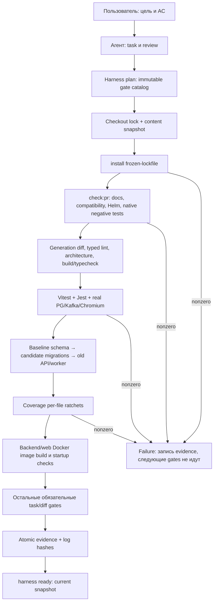

# Локальный PR pipeline и проверка release compatibility

WMS-601 объединяет действующие команды в воспроизводимую локальную проверку. Внешние
Actions/GHCR/Argo CD относятся к WMS-602–604 и этой командой не устанавливаются.
Пользователь задаёт цель/AC, агент оформляет [task](../tasks/wms-601.json), реализует,
проводит review и запускает pipeline. Технический exit0 не заменяет бизнес-приёмку.

```sh
pnpm harness:plan docs/tasks/wms-601.json
pnpm pr:pipeline docs/tasks/wms-601.json
pnpm harness:ready docs/tasks/wms-601.json
```

## Вход, доверие и критерии

Input — source task, Git baseline policy, собственные source files и pinned toolchain.
Task JSON не задаёт executable/shell/argv. База release.json закреплена exact SHA;
исходный dev baseline — commit WMS-506, поскольку release tags пока нет. При смене
base оператор/reviewer проверяет нужный release, историю migrations и контракты.
Нельзя автоматически принять HEAD после отказа comparison. Shallow clone должен
содержать этот commit; missing object/неancestor означает отказ.

Node/pnpm — root packageManager/engines; Docker обязателен; Playwright Chromium
устанавливается `pnpm exec playwright install chromium`. Helm закреплён3.22.0 по
[toolchain](kind-helm.md). Для нестандартного пути задать WMS_HELM. Не запускать
параллельно dev:all/Nest watch/test:prepare/check:pr; они меняют общий dist.



## Шаги и данные

1. Alias pr:pipeline передаёт путь task существующему harness:run. Runner захватывает
   checkout lock и снимает content snapshot. Он владеет private logs/deadline/signals.
   Второй runner не начинает конкурирующий build. [Механизм](engineering-harness.md).
2. Install выполняет `pnpm install --frozen-lockfile --prefer-offline`. При наличии
   cache сеть не нужна; missing package может потребовать registry. Расхождение manifest/
   lockfile — failure до проверки приложения. Lockfile не регенерируется автоматически.
3. check:pr запускает docs/compatibility/Helm и отрицательные self-tests, затем прежние
   generation/typecheck/build/tests/coverage. Generated artifacts сравниваются штатными
   generators; исправлять output вручную или переписывать его во время gate нельзя.
4. Docs guard читает весь Git inventory. Требует явную запись каждого собственного файла
   в каталоге, file-level @file, JSDoc public TS functions/classes/methods, README backend
   modules/shared/infrastructure. JS/TS syntax проверяется compiler parser. Generated TS
   и applied Drizzle output имеют явных владельцев; их не редактируют ради @file.
   Links проверяются локально, включая Markdown anchors/ref definitions и editor :line.
   Наличие JSDoc не доказывает корректность текста, типов, SQL или бизнес-процесса.
5. Compatibility guard читает base contracts через Git show и current source через общий
   inventory. Старые event schemas не исчезают, прежняя topology не меняется, applied SQL/
   meta snapshots сохраняются, старый journal — точный prefix. API existing wire shapes
   консервативно сохраняются; annotations не являются разрешением изменить property с тем же
   именем. Новые paths допустимы. Весь baseline проверяется даже для уже committed diff.
6. Migration suite экспортирует Git archive baseline во временную папку, ставит собственные
   frozen dependencies и строит прежний backend. Рабочая .env/.git не экспортируется.
   PostgreSQL fixture сначала применяет прежний journal. Прежние API services создают
   receipt/stock/outbox, прежний worker создаёт task/marker. Candidate migrations применяются
   production session-serialized migrator два раза. История/остатки/markers сохраняются.
   Старый API/worker снова проводит операцию после upgrade; затем текущий build делает то же.
   Source .env и рабочие volumes не используются. Cleanup закрывает все pools/containers
   и удаляет только принадлежащий тесту checkout.
7. Helm lint/template проверяет base/dev и optional web/gateway/publisher. Digest synthetic,
   Secret values отсутствуют; этот offline render не утверждает install/rollout в cluster.
   Real deployment regression остаётся kubernetes:gate по diff/task policy.
8. Backend/web image gates обязательны для каждого полного harness run. Docker functional
   gate запускается по task/diff policy; WMS-601 явно включает его. Publisher/consumer/
   migration entrypoints проверяются настоящими integration suites.
9. Readiness читает только passed current snapshot с полным набором результатов и
   неизменёнными logs/env hashes. Любая source edit после run требует повторного run.
   Комментарии/документы также меняют snapshot. Evidence вручную не исправляется.

## Negative proof, review и ограничения

Native test создаёт отдельный Git repo, коммитит валидный API, затем коммитит breaking
change при сохранённом baseline. Настоящий harness проходит install fixture gate,
получает nonzero compatibility и не запускает marker следующего шага/image gates.
Зелёный check против одного HEAD такую ошибку не обнаружил бы. Другой test меняет
manifest после создания lockfile: настоящий pnpm frozen install отказывает, lock неизменён.

Все receipts/users/session в tests синтетические. Compile/tool logs могут содержать
source snippets; artifacts не коммитятся. Нет skip, mock fallback для БД, forceExit,
внешней публикации или рассылки сообщений. Нет обещания production HA, disaster restore,
100% branch coverage приложения или доказательства произвольной SQL совместимости.
Migration suite проверяет критический receipt/task/marker путь и остальные candidate
business suites; расширение schema требует собственных targeted rollback/concurrency
cases и expand/contract review. Новый dependency graph может потребовать сеть для
воспроизведения старого build; недоступность registry — failure, а не skip.

[AC, результаты ревью, рефакторинг, команды и ограничения](../reports/wms-601.md).
