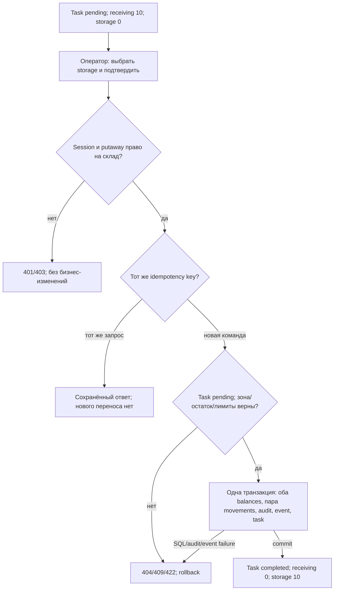
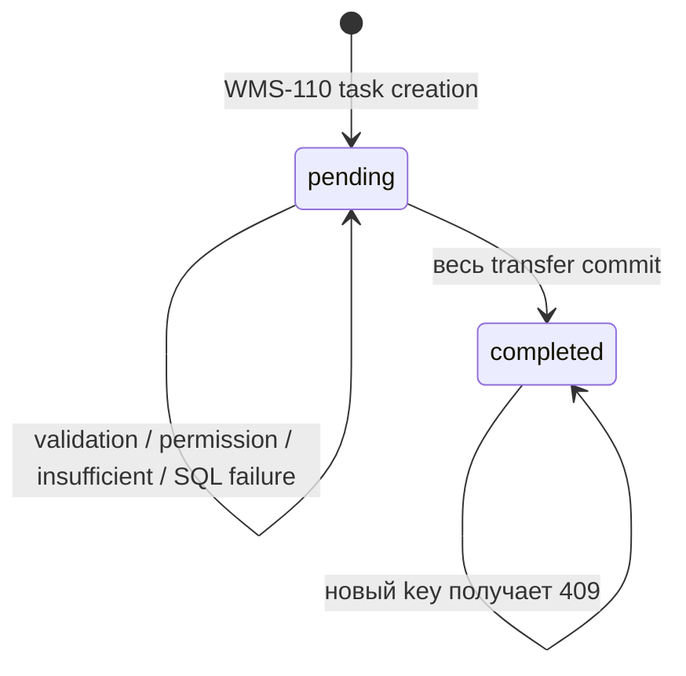

# WMS-203: выполнение размещения

Реализованный API сценарий продолжает [создание задания WMS-110](putaway.md).
Решение/границы — [ADR-0021](../adr/0021-putaway-execution.md), код принадлежит inventory.
Система подтверждает действие оператора, а не обнаруживает физический перенос сама.

## Для менеджера: что меняется

После приёмки: receiving=10, storage отсутствует/0, task pending. Worker создал задание,
но товар всё ещё в приёмке. Оператор выбирает storage ячейку того же склада и подтверждает
всё количество задания. После успешного ответа receiving=0, storage=10, task completed.
Общий stock=10, reserved не меняется. При любой ошибке остаётся предыдущее состояние.



Ограничения: только receiving → storage одного склада, полный quantity из task, без
partial execution/cancel/general transfer. Reservе allocations пока нет. Перенос свободной
части не меняет reserved: source 11/reserved 1 → перенос 10 → source 1/reserved 1, target 10/0.
Если source 10/reserved 1 и task=10, команда отклоняется INSUFFICIENT_STOCK.

## Вход, DTO и права

- POST `/api/v1/putaway-tasks/:taskId/execute`, body `{"targetLocationId":"UUID"}`.
- Session cookie, точный Origin, JSON, X-CSRF-Token и UUID Idempotency-Key обязательны.
- target UUID нормализуется lowercase до fingerprint. Лишние quantity/source/actor/status запрещены DTO pipe.
- warehouse определяется по сохранённой task. operator/supervisor имеют putaway, viewer и order_manager — нет.
  system_admin без складской роли не получает бизнес-доступ.
- GET `/api/v1/putaway-tasks/:taskId` требует read на фактическом складе, показывает pending/completed снимок.
- Controller использует InventoryService, AccessService, HttpCommandsService; SQL напрямую не вызывает.

## Реальные вызовы и границы commit

```mermaid
sequenceDiagram
  participant B as Browser
  participant G as AuthGuard / SessionsService
  participant C as InventoryController
  participant H as HttpCommandsService / runner
  participant A as AccessService
  participant I as InventoryService / PutawayExecutionService
  participant D as PostgreSQL repositories
  participant AU as AuditService
  participant O as OutboxService
  B->>G: cookie + Origin/CSRF + key + DTO
  G->>D: короткий authenticate/idle touch COMMIT
  G->>C: Trusted Principal + CommandScope
  C->>H: execute(scope, normalized target/body, work, authorize)
  H->>D: BEGIN
  H->>I: readPutawayTask(context, taskId)
  H->>A: requireWarehouse(context, principal, task.warehouseId, putaway)
  A->>D: user/session SHARE + current grants
  H->>D: claim idempotency key/fingerprint
  alt сохранённый одинаковый ответ
    H->>D: читать result; COMMIT
    H-->>B: исходный JSON
  else новый key
    H->>I: executePutawayTask(context, taskId, targetId, server metadata)
    I->>D: task FOR UPDATE; require pending
    I->>I: WarehousesService: receiving/storage и тот же warehouse
    I->>D: ensure нулевые balances + FOR UPDATE в порядке location UUID
    I->>D: available/capacity check; source debit; target credit
    I->>AU: write(context): completion audit
    I->>D: INSERT transfer-out и transfer-in, transferId=taskId
    I->>O: append(context): PutawayCompleted v1
    O->>D: putaway-task sequence + immutable event, без deliveries
    I->>D: UPDATE task completed + target/time/event/audit
    H->>D: saved HTTP result; COMMIT + deferred pair check
    H-->>B: 200 completed snapshot
  end
```

Весь command context один, включая authorizer до saved replay; nested run и внешнего I/O нет.
Task source provenance остаётся immutable. Source receipt eventId используется как causationId;
correlationId/actor приходят из server CommandScope, а не из task payload/HTTP body.
Генерация UUID и UTC timestamp локальная. SQL/audit/contract ошибки выходят до runner.
Результат до COMMIT не является подтверждением; HTTP disconnect не отменяет DB commit.

## Порядок блокировок и absent-key race

User/session SHARE → idempotency key → task UPDATE → balance keys в стабильном ASCII порядке
lowercase location UUID (warehouse/product одинаковы). Для каждого ключа сначала INSERT 0
ON CONFLICT DO NOTHING, затем SELECT FOR UPDATE. INSERT и locks имеют один порядок, чтобы
два callers не захватили разные absent keys в противоположном порядке.

```mermaid
sequenceDiagram
  participant A as Task A: 10 шт.
  participant B as Task B: 7 шт.
  participant D as PostgreSQL balances
  A->>D: ensure/lock первый ключ
  B->>D: тот же порядок; ждать row/unique lock
  A->>D: ensure/lock второй ключ; debit/credit; COMMIT
  D-->>B: lock доступен, читать уже новое onHand
  B->>D: debit/credit; COMMIT
  Note over D: Один target balance, receiving 0, storage 17
```

Integration barrier удерживает реальный source row, ждёт два `pg_stat_activity` Lock wait,
затем снимает barrier. Второй caller может ждать unique INSERT target, а не source row;
это проверяет гонку создания назначения, без надежды на случайный timing Promise.all.
Разные задачи блокируют разные task rows; общий баланс сериализует арифметику.
Один task с разными keys → один 200, второй 409; с одинаковым key → два идентичных 200.

## Состояние, ошибки и восстановление



- 400 VALIDATION_FAILED — неверный UUID/лишние поля; 401/403 — session/CSRF/warehouse policy.
- 404 PUTAWAY_TASK_NOT_FOUND — task отсутствует; чужой существующий склад →403 при чтении/авторизации.
- 422 LOCATION_NOT_FOUND — target чужого склада/отсутствует; INVALID_PUTAWAY_LOCATION — receiving/shipping target.
- 409 INSUFFICIENT_STOCK — quantity > onHand-reserved; 422 STOCK_LIMIT_EXCEEDED — int4 overflow назначения.
- 409 PUTAWAY_ALREADY_COMPLETED — новый key на completed; IDEMPOTENCY_CONFLICT — прежний key с другим body.
- 500 неизвестная SQL/audit ошибка — safe problem; 503 transient conflict/storage error, без auto retry.

Ошибка после source debit откатывает debit, пустой target INSERT и все следующие изменения.
AFTER faults на credit/audit/movement/event/task также не оставляют ни половины переноса,
ни completion audit/event/counter, ни saved HTTP result. После устранения причины прежний key
можно повторить. Нельзя вручную сбрасывать task completed в pending ради повтора.

DB: unique transferId/kind, FK на task/audit/balance и state guard дополняются deferred check
пары movements на COMMIT. Runtime имеет UPDATE только completion columns, не source.
DELETE/TRUNCATE retained; простой TRUNCATE task теперь также запрещает FK stock movements.
Старый audit создания и event-основание не переписываются. DBA способен обойти guards.

## Контракт события и доставка

`inventory.putaway-completed:1`, aggregateType putaway-task, aggregateId=taskId, первая версия=1.
JSON Schema 2020-12/formats и MAX_EVENT_BYTES=262144 применяются до outbox write и на handler boundary.
Quantity int4 1..2147483647, UUID/UTC Z обязательны, неизвестные optional extensions сохраняются.
Schema не доказывает DB provenance; state guard/service связывают task, event и movements.

Подписчиков putaway-task пока нет: event хранится immutable в outbox, delivery/stream не создаются.
Receipt writer/worker по-прежнему доставляет полный receipt stream inventory.putaway. Нет обещания
внешней доставки либо задачи на обработку нового события. Новый consumer требует migration/replay
и начальной позиции; retained events не удаляются. CLI preview нового типа безопасно omitted.

## Синтетический пример и evidence

Пример UUID задания `16000000-0000-4000-8000-000000000001`, назначения
`16000000-0000-4000-8000-000000000002`. POST body содержит только targetLocationId.
Ответ 200 содержит status completed, quantity 10, обе ячейки, completionAuditId,
completedEventId и completedAt UTC; GET возвращает текущий снимок.
Полный event пример: [PutawayCompleted v1](../contracts/examples/inventory.putaway-completed.v1.json).
OpenAPI генерируется из production controller/DTO, не ручного JSON.

[Integration source](../../apps/backend/test/integration/putaway-execution.spec.ts):

| Ветка                               | Реальная проверка                                                                                            |
| ----------------------------------- | ------------------------------------------------------------------------------------------------------------ |
| Success/replay/new key              | receiving 0/storage 10, 2 legs, 1 completion event, task completed; прежний key не меняет evidence           |
| Task/absent balance race            | один task с одинаковыми/разными keys; две task на один новый target; SQL barrier обоих callers               |
| Insufficient/reserve/overflow       | source 0/9/reserved=1, target int4 max; полный rollback                                                      |
| Free stock with reserve             | source 11/1 →1/1, target 10/0, reserve не перемещён                                                          |
| Permissions/zones/foreign warehouse | viewer read-only, outsider denied, replay после revoke forbidden, receiving/shipping/foreign target rejected |
| Fault boundaries                    | AFTER debit/credit/audit/movement/event/task, evidence полностью прежний, retry same key успешен             |
| SQL protection                      | runtime warehouse_app completion, completed source/state immutable, orphan half-pair commit rejected         |
| DTO/contract                        | HTTP bad/extra fields; event schema version/quantity/UUID/UTC/optional extensions в unit contracts suite     |

Production/test-only различаются: прямые SQL stock setup и fault triggers существуют только в
изолированном Testcontainers harness. Модули API/worker используют реальные migrations/owners.
Физический scanner, UI, общий transfer API, cancel/partial и consumers нового события — будущее.
