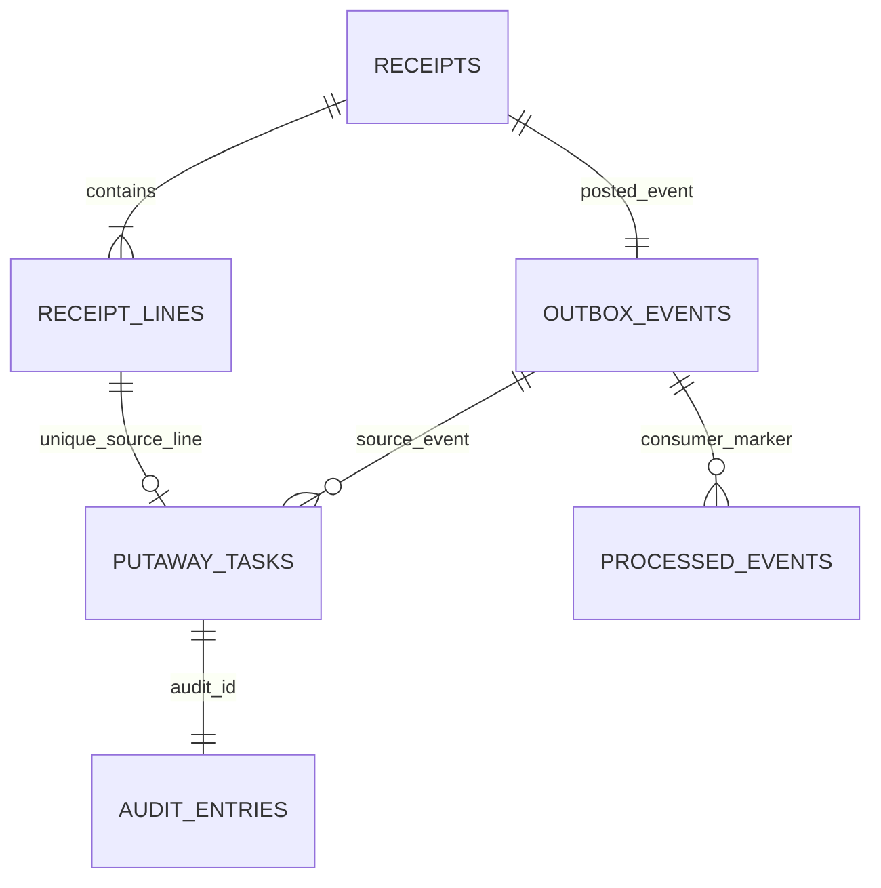
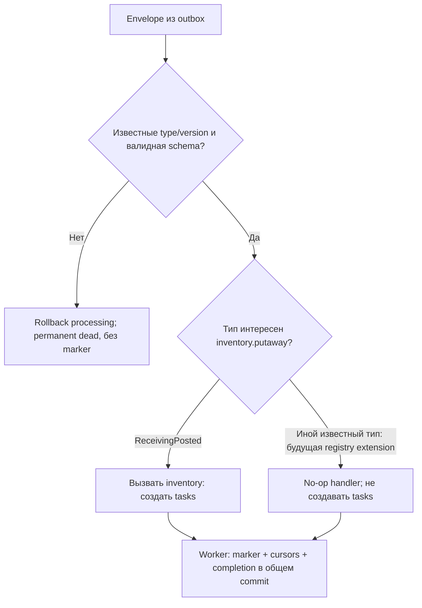
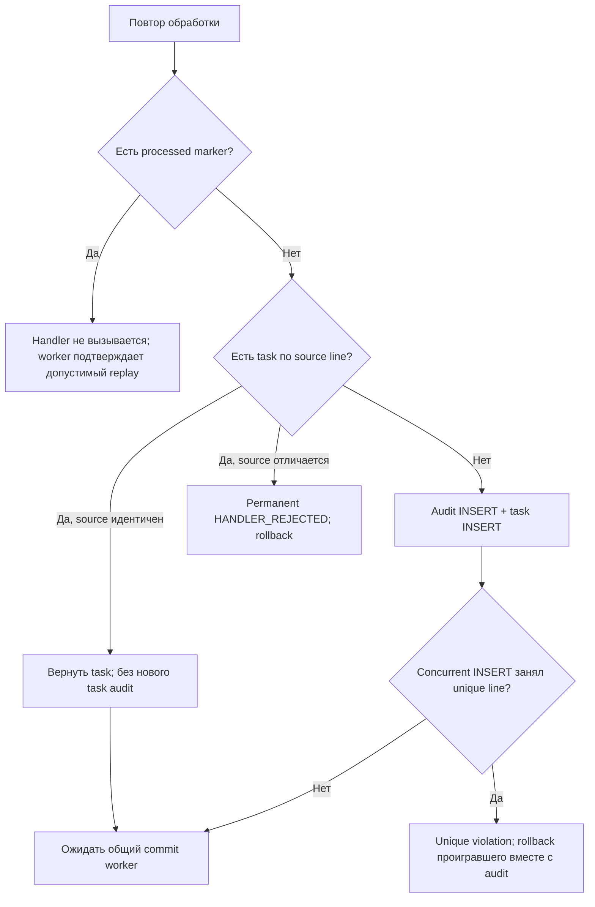

# Приёмка → event → PutawayTask: подробный флоу WMS-110

Реализованный production сценарий создания заданий размещения. Предусловия: новые migrations,
posted receipt и отдельный запущенный worker. HTTP API остаётся в isolated dev/test режиме;
worker не открывает HTTP. [Протокол worker](worker.md), [приёмка](../receiving.md),
[ADR-0016](../adr/0016-durable-putaway-handler.md).

## 1. Бизнес-результат и общий путь

Оператор принял 10 штук: receipt posted, receiving balance=10, одно immutable movement
и ReceivingPosted уже committed. До обработки delivery pending и task отсутствует.
Worker создаёт **pending PutawayTask quantity=10**, delivery становится completed,
но balance остаётся 10 и movement остаётся один. Pending task ожидает физического
размещения; completed delivery означает, что задание надёжно создано.

```mermaid
flowchart LR
  HTTP["Провести приёмку"] --> API["ReceivingService / InventoryService.receive"]
  API --> A["COMMIT R: posted + stock 10 + movement + audit + event"]
  A --> D["Delivery pending; task отсутствует"]
  D --> W["Worker claim: token / lease"]
  W --> H["ReceivingPostedHandler"]
  H --> I["InventoryService.createPutawayTasks"]
  I --> B["COMMIT B: task + task audit + marker + cursors + completion"]
  B --> T["Task pending 10; stock всё ещё 10"]
  T -. "Будущее: выполнение размещения" .-> Future["Выбор storage location и движение товара"]
```



Здесь R — бизнес-транзакция приёмки, B — processing transaction worker. Между ними
есть отдельный короткий claim run A, подробно показанный в [worker flow](worker.md).
После B нет нового receipt event или movement. Физическое размещение, task execution/cancel,
назначение target location, UI и task HTTP endpoints ещё не реализованы.

## 2. Данные и доказательство происхождения



ER показывает выбранный receipt-posted факт; outbox в целом допускает другие факты
и версии агрегата. FK task → posted receipt event транзитивно ведёт к outbox event;
в task нет отдельного дублирующего FK непосредственно на outbox.

| Поле задания                 | Источник / проверка                                          |
| ---------------------------- | ------------------------------------------------------------ |
| id                           | UUID создаёт inventory; отдельная identity задания           |
| sourceReceiptId              | payload.receiptId; совпадает с event.aggregateId             |
| sourceReceiptLineId          | lines.receiptLineId, unique глобально для tasks              |
| sourceEventId                | immutable eventId; вместе с lineId явный unique origin key   |
| warehouseId/sourceLocationId | payload; composite FK сверяет с posted receipt               |
| productId/quantity           | строка event; composite FK сверяет с receipt line            |
| status                       | server constant pending; SQL CHECK, без входного поля status |
| auditId                      | обязательный результат AuditService.write в том же context   |
| createdAt                    | timestamp текущей DB transaction                             |

Первый FK связывает receiptId/warehouse/location/event с одной строкой receipts.
Второй связывает receiptId/lineId/product/quantity с одной receipt line. Нельзя
подставить товар из другой строки, другое количество, чужую ячейку или новый event
для старой строки. Новые receiving unique keys — targets FK, не новые бизнес-идентификаторы.
Полноту payload из всех строк документа обеспечивает producer ReceivingService; consumer
не дублирует чтение чужих repositories. SQL constraints не заменяют все правила producer.

## 3. Вход, доверие и dispatch полного потока

Worker читает JSONB сохранённого event, вызывает EventContracts.parseForHandler и
проверяет routing identity/token/cursor. Handler получает KnownEvent и opaque context,
но не создаёт run самостоятельно. Metadata actor не берётся из event payload:
actorType=system, actorId=fdbeb4bc-9e7b-4abb-a7b9-0fcd698cb7d1,
reasonCode=receipt-posted, correlationId — исходного event.



Сейчас registry имеет только ReceivingPosted v1, поэтому реальных известных неинтересных
типов ещё нет. No-op routing ветка реализована и проверена unit-тестом adapter с surrogate;
он не регистрирует новый контракт и не доказывает допустимость surrogate в production.
Неизвестные type/version никогда не проходят в no-op. ConsumerName остаётся inventory.putaway,
claim получает полный receipt stream, не выбирает только интересующие типы SQL-фильтром.

## 4. Вызовы и граница commit

```mermaid
sequenceDiagram
  participant W as WorkerService
  participant DB as PostgreSQL
  participant H as ReceivingPostedHandler
  participant I as InventoryService
  participant P as PutawayService / PutawayRepository
  participant A as AuditService
  W->>DB: BEGIN processing; lock stream/delivery; проверить token
  W->>DB: Lock consumer cursor; проверить processed marker
  W->>H: handle(context, KnownEvent)
  H->>I: createPutawayTasks(context, event + server metadata)
  I->>P: create(context, command)
  P->>P: Snapshot/schema, aggregate=receiptId, unique lines/products
  loop Receipt lines по lineId
    P->>DB: SELECT task по sourceReceiptLineId
    alt Идентичная task уже есть
      Note over P,A: Вернуть существующую task без нового audit
    else Task отсутствует
      P->>A: write(context, inventory.putaway-task-created)
      A->>DB: INSERT audit
      A-->>P: auditId
      P->>DB: INSERT task pending; FK и unique constraints
    end
  end
  P-->>I: Tasks ещё не committed
  I-->>H: Result
  H-->>W: Awaited callback завершён
  W->>DB: INSERT marker; consumer cursor; completed; delivery cursor
  W->>DB: COMMIT всех consumer effects
```

1. Composition root WorkerModule импортирует InventoryModule, регистрирует реальный
   ReceivingPostedHandler в WORKER_HANDLERS. API AppModule worker не импортирует.
2. Handler передаёт context в публичный InventoryService; private PutawayService проверяет
   собственную runtime schema snapshot до первого await. Caller mutation не меняет event.
3. Идентификаторы нормализуются lowercase; aggregateId и receiptId должны совпасть,
   duplicate line/product отклоняются до task/audit writes. Quantity/UUID/limits берутся
   из общего EventContracts, не из отдельно переписанной schema.
4. Строки сортируются по lineId для согласованного порядка unique keys. Repository читает
   и пишет только putaway_tasks; constraints проверяют связи с receiving.
5. Existing task сравнивается со всеми source-полями. Точное совпадение возвращает прежний
   результат; конфликт — PutawayInputError, который handler переводит в permanent HANDLER_REJECTED.
6. Для новой task создаются UUID и audit через AuditService, затем INSERT task с auditId.
   Audit содержит только safe quantity/product/warehouse/location; raw event в журнал не пишется.
7. Handler не вызывает receive, credit, appendMovement или OutboxService. Worker после callback
   пишет marker/cursors/completion; только его COMMIT подтверждает tasks. Любой отказ откатывает
   task batch и audit, оставляя уже подтверждённый receipt/stock нетронутыми.

## 5. Повторы и конфликт отсутствующей строки



Stream lock сериализует обычные worker delivery; SELECT task не блокирует отсутствующую
строку. Поэтому прямые concurrent вызовы inventory защищены ещё SQL unique constraint.
Проигравший direct callback должен выйти с ошибкой до runner. Нельзя catch unique внутри
callback и продолжать: созданный до INSERT audit иначе потеряет смысл основания.
Последующий worker увидит идентичную task, не добавит audit и запишет свой marker.

Новый ReceivingPosted eventId для уже запланированной line — другой факт, не redelivery.
Он становится dead и не создаёт второе задание. Обычная redelivery сохраняет eventId.

## 6. Сбой до и после commit

```mermaid
sequenceDiagram
  participant W as Worker process
  participant DB as PostgreSQL
  participant N as Новый worker
  W->>DB: Claim COMMIT; processing BEGIN
  W->>DB: INSERT task audit + task
  alt SIGKILL до processing commit
    Note over W: Процесс завершён
    DB->>DB: ROLLBACK task/audit/marker/cursors
    Note over N,DB: После DB lease expiry
    N->>DB: Reclaim с новым token, создать task/audit и marker
    N->>DB: COMMIT: одна task
  else SIGKILL после processing commit
    W->>DB: COMMIT task + audit + marker + cursors + completion
    Note over W: Процесс завершён
    N->>DB: Claim
    DB-->>N: Completed delivery не выбирается
  end
```

| Момент, одна line quantity=10             | Task / task audit               | Marker / оба cursors | Stock / movements | Delivery                                     |
| ----------------------------------------- | ------------------------------- | -------------------- | ----------------- | -------------------------------------------- |
| Receipt posted, worker ещё не работал     | 0 / 0                           | 0 / 0                | 10 / 1            | pending                                      |
| После claim commit                        | 0 / 0                           | 0 / 0                | 10 / 1            | processing                                   |
| Во время handler до commit                | Другому соединению ещё не видны | Ещё не подтверждены  | 10 / 1            | processing                                   |
| Processing rollback                       | 0 / 0                           | 0 / 0                | 10 / 1            | retry/dead либо processing до lease recovery |
| Processing commit и любые обычные повторы | 1 / 1                           | 1 / 1                | 10 / 1            | completed                                    |

Для двух строк task/audit создаются по две, marker — один на event, cursor продвигается
на одну event version. Fault после второй строки отменяет обе tasks, но receipt stock=20
сохраняется. Доставка at least once; это не обещание exactly once для внешнего I/O.

## 7. Диагностика и проверки

Запуск: `pnpm db:migrate`, `pnpm build`, отдельные API и `pnpm worker` с одним DATABASE_URL.
Старые pending inventory.putaway deliveries будут обработаны автоматически после запуска
обновлённого worker; публиковать их заново через append не нужно. Для исторических fake facts
без реального posted receipt FK вернёт permanent failure, не фиктивную task.

[putaway-result.sql](../examples/putaway-result.sql) — read-only psql script, параметр
`-v receipt_id=<UUID>`. Показывает receipt → line → posted event → task → audit,
delivery status и оба cursors/marker. До handler task_id null, после — pending task UUID.
Путь event.correlationId → task.auditId → audit.correlationId помогает расследованию.
Local inspect/retry CLI готова WMS-111, [проверенные команды](../runbooks/event-recovery.md).
UI пока нет; ручной reset marker/cursor не предлагается.

| Проверяемый путь                                                           | Evidence                                                                                                       |
| -------------------------------------------------------------------------- | -------------------------------------------------------------------------------------------------------------- |
| Настоящий registered handler, task pending, stock/movement/event неизменны | [putaway.spec.ts](../../apps/backend/test/integration/putaway.spec.ts), happy path и SQL proof                 |
| Старый token, marker replay и прямой inventory repeat                      | putaway.spec.ts, duplicate delivery                                                                            |
| Два processors ждут реальные locks                                         | putaway.spec.ts, two workers with same token                                                                   |
| Absent source-line race и rollback loser audit                             | putaway.spec.ts, concurrent direct inventory calls                                                             |
| Task/audit/marker/cursors/completion fault и multi-line rollback           | putaway.spec.ts, AFTER triggers и second line task                                                             |
| Неверное основание, новый fact той же line, restricted runtime role        | putaway.spec.ts, semantic/source/role cases                                                                    |
| Реальный SIGKILL до/после commit                                           | [worker-process.spec.ts](../../apps/backend/test/integration/worker-process.spec.ts), production putaway cases |
| Server actor, permanent mapping и future known no-op branch                | [receiving-posted.handler.spec.ts](../../apps/backend/test/unit/receiving-posted.handler.spec.ts)              |

Ограничения: отсутствуют выполнение/отмена, target location, task list API/UI, компенсации,
административный replay и Kafka. При добавлении исполнения task потребуются новые state/SQL
constraints/migrations; текущие pending задачи immutable, не менять старые migrations.
