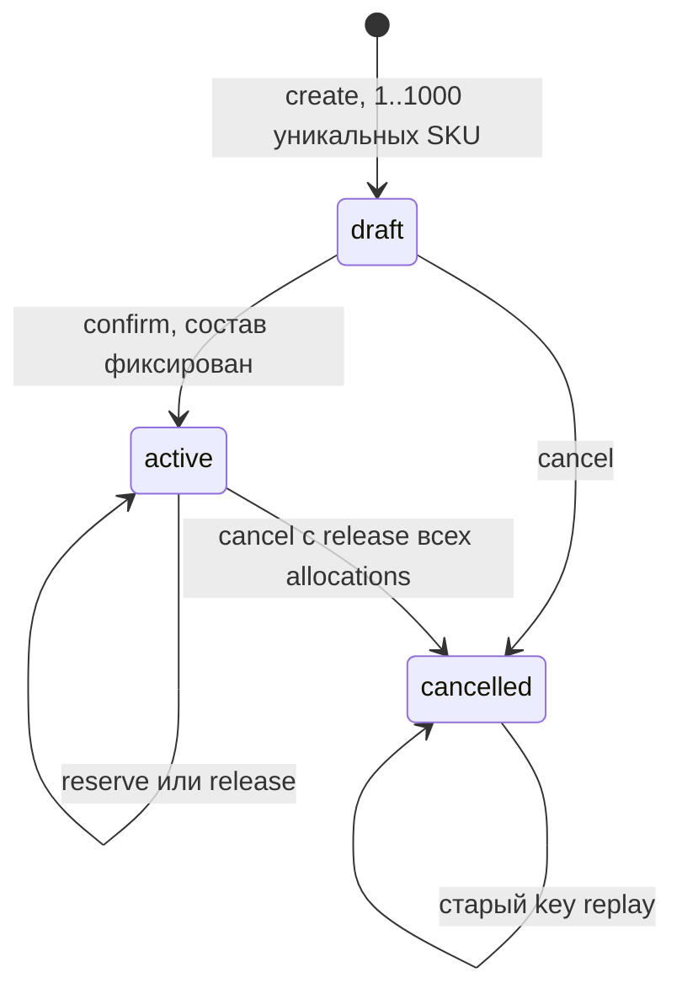
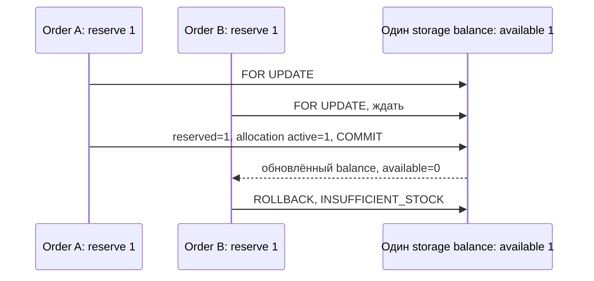
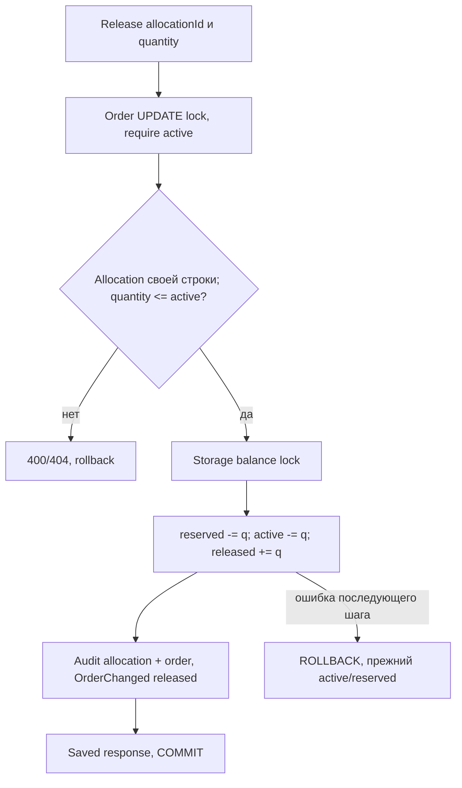

# WMS-204: заказ, резервирование и явное освобождение

Реализованный backend flow по [ADR-0022](../adr/0022-order-reservations.md).
Fulfillment владеет заказом, inventory — allocations и reserved. Picking/shipping пока отсутствуют.

## Бизнес-сценарий и состояния

Заказ на 10 штук создаётся draft и отдельно подтверждается в active. Подтверждение stock
не меняет. Оператор явно запрашивает резерв 6: open=4, reservedStorage=6. Release 2 возвращает
open=6, reservedStorage=4. Cancel до сборки освобождает остальные 4: cancelled=10, active=0,
заказ cancelled. onHand во всех этих шагах неизменен; физических movements нет.

Если запросить 10 при доступных 6, команда откатывается целиком. Для частичного обеспечения
нужно явно запросить 6. Многострочный вектор тоже атомарен: успех первых строк не фиксируется,
если последующей не хватает stock. Резервируются только storage своего склада.



Новый key на запрещённый переход даёт 409, а не повторный эффект. Прежний key с прежним
запросом возвращает исходный JSON snapshot; GET возвращает текущий снимок. Другой payload
прежнего key даёт IDEMPOTENCY_CONFLICT. Времени истечения, TTL и jobs нет (B4).

## HTTP контракт и доверие

Бизнес-префикс /api/v1, пути в таблице начинаются с /orders; все mutations требуют session/Origin/JSON/CSRF/UUID Idempotency-Key.
Actor берётся только из server principal. DTO запрещают лишние поля, quantity — int4 1..MAX
без coercion; UUID приводятся к lowercase и строки сортируются перед fingerprint.

| Endpoint                                           | Ввод                                     | Право склада | Результат                       |
| -------------------------------------------------- | ---------------------------------------- | ------------ | ------------------------------- |
| POST /orders                                       | warehouseId, lines[{productId,quantity}] | order        | 201 draft                       |
| GET /orders/:id                                    | UUID path                                | read         | 200 текущий OrderDto            |
| POST /orders/:id/confirm                           | отсутствует или {}                       | order        | 200 active                      |
| POST /orders/:id/reserve                           | lines[{lineId,quantity}]                 | reserve      | 200 allocations + counters      |
| POST /orders/:id/allocations/:allocationId/release | quantity                                 | cancel       | 200 snapshot с историей release |
| POST /orders/:id/cancel                            | отсутствует или {}                       | cancel       | 200 cancelled                   |

Матрица ADR-0019: order_manager/supervisor управляют заказами и резервом; viewer читает,
warehouse_operator не получает order/reserve автоматически. system_admin без warehouse grants
также не имеет этих прав. Для существующего объекта warehouse берётся из сохранённого order,
не из client body. Неизвестный order/allocation →404; чужой склад/отозванные права →403.

Output явно типизирован OrderDto/OrderLineDto/AllocationDto. quantity — исходный заказ;
open/reservedStorage/cancelled объясняют текущую обеспеченность. reservedShipping/shipped=0
до WMS-205/206. AllocationDto содержит id/balanceId/allocated/active/released, без SQL snake_case.

## Исполнение reserve и единая транзакция

```mermaid
sequenceDiagram
  participant C as Browser
  participant G as AuthGuard
  participant H as FulfillmentController
  participant T as HttpCommandsService / runner
  participant A as AccessService
  participant F as FulfillmentService
  participant I as InventoryService / ReservationsService
  participant D as Private repositories / PostgreSQL
  participant AU as AuditService
  participant O as OutboxService
  C->>G: cookie, key, Origin/CSRF, validated DTO
  G->>D: Authenticate/idle touch, короткий COMMIT
  G->>H: trusted Principal + CommandScope
  H->>T: normalized plain JSON + work + authorize
  T->>D: BEGIN
  T->>F: warehouse(context, id): без order lock
  T->>A: requireWarehouse(context, principal, actual warehouse, reserve)
  A->>D: user/session SHARE, актуальные grants
  T->>D: Idempotency claim/fingerprint
  alt прежний успешный запрос
    T->>D: читать сохранённый result; COMMIT
    T-->>C: исходный snapshot
  else новая команда
    T->>F: change(context, orderId, reserve, quantities)
    F->>D: order FOR UPDATE, затем читать текущие lines/allocations
    F->>F: active, уникальные lineId, количество <= open
    loop SKU по productId; ячейки по locationId
      F->>I: reserve(context, warehouse, line, product, quantity)
      I->>D: storage balances FOR UPDATE, без SKIP LOCKED
      I->>D: reserved += take, INSERT allocation
      F->>AU: audit каждого allocation с точным quantity
    end
    F->>AU: audit изменения заказа
    F->>O: OrderChanged v1: action reserved
    O->>D: order sequence + immutable envelope
    T->>D: saved response; COMMIT + deferred reconciliation
    T-->>C: 200 OrderDto
  end
```

Весь callback awaited, контекст непрозрачен и один для всех владельцев. Вложенных run,
автоматического retry и внешнего I/O нет. Любой недостаток/SQL/audit/outbox/result failure
откатывает все предыдущие изменения и idempotency claim. Потеря ответа не отменяет commit:
клиент повторяет исходный key.

Authorizer проверяет warehouse до claim/replay, удерживает user/session locks до commit.
GET сначала делает metadata read и authorization, затем order FOR SHARE и согласованный
снимок состава. Это сохраняет порядок user/session → order и не вводит обратного порядка
блокировок при конкурирующем отзыве прав. В mutation order UPDATE получается после claim.

## Подбор и конкуренция

Порядок: user/session → key → order → productId → locationId. OrdersRepository выдаёт строки
по UUID productId; inventory выбирает только storage balances, отсортированные по UUID locationId.
Это технический детерминированный подбор, не FIFO: партий/возраста товара нет.

FOR UPDATE ждёт конкурента, после ожидания используется актуальная версия balance. SKIP LOCKED
не применяется: временно занятый stock нельзя молча считать отсутствующим. Блокируются все
существующие storage позиции SKU, включая нулевую доступность, затем вычисляется onHand-reserved.
Новая позиция, появившаяся после начала подбора, может потребовать следующей явной попытки.



Тест удерживает внешний row lock, запускает две разные server sessions и дожидается двух
pg_stat_activity Lock waits, затем снимает barrier. Это доказывает конкуренцию, а не только
совпадение результатов двух последовательно успевших запросов. Один заказ сериализует
reserve/release/cancel на parent FOR UPDATE. Cancel перебирает SKU/location в том же порядке.
Release конкретного allocation берёт ровно его balance lock и не меняет другие заказы.

## Release и история

Allocation связывает immutable lineId/balanceId с allocated. В текущем этапе
allocated=active+released; consumed отсутствует до shipment. Partial release уменьшает active,
увеличивает released и уменьшает balance.reserved. Закрытая запись не удаляется и не открывается
обратно; следующий reserve создаёт новый allocation UUID. Изменения каждого allocation
аудируются с точным количеством, субъектом и correlationId в общем commit.



B3: отмена до сборки выполняет release всех активных allocations и переводит заказ cancelled.
В текущей модели нет shipping allocations и shipped quantity. Физический возврат после сборки
не имитируется release: он относится к будущим WMS-205/206.

## БД и reconciliation

Новые migrations: 0022 orders/order_lines/stock_allocations и FK/CHECK; 0023 order aggregate;
0024 column grants, retained/immutable guards, indexes и deferred reconciliation.
Старые migrations не меняются. Runtime warehouse_app может SELECT/INSERT; UPDATE только
orders.status и allocation.active/released. Source состава и allocation нельзя переписать,
DELETE/TRUNCATE запрещены. DBA способен обойти эти ограничения.

Deferred checks выполняются на COMMIT, когда отдельные UPDATE balance/INSERT allocation уже
завершены. Проверяется active sum, покрытие строки и соответствие склада/SKU/storage.
После исправления ревью migration 0025 проверяет INSERT/UPDATE всех balances, включая
позиции без allocation history. Ненулевой reserved без основания больше не может закоммититься.
Перед заменой guard migration блокирует записи balances/allocations и выполняет полную сверку.
При расхождениях — ошибка 23514 и rollback migration без записи journal; автоматического
сброса reserved/создания выдуманных allocations нет. Оператор сначала разбирает происхождение
расхождений и восстанавливает согласованные основания с аудитом, затем повторяет migrate.
Synthetic receiving-reserve tests не коммитят невалидный ledger: проверка арифметики выполняется
в откатываемом fault callback без отключения production guards.

Независимая SQL сверка из integration suite, результат должен быть пустым:

```sql
SELECT b.id
FROM stock_balances b
LEFT JOIN stock_allocations a ON a.balance_id=b.id
GROUP BY b.id
HAVING b.reserved<>coalesce(sum(a.active),0)
    OR b.reserved<0 OR b.reserved>b.on_hand;
```

SUM выполняется PostgreSQL bigint, не суммируется как безусловно точный JS number по складу.
Allocated/active/released каждой записи int4, active одной строки ограничен quantity int4.

## События, ошибки и границы

fulfillment.order-changed v1: aggregateType=order, aggregateId=payload.orderId. Action —
created/confirmed/reserved/released/cancelled. Payload — ссылка на изменившийся заказ и action,
не snapshot состава; детали allocations доступны в истории и audit. Sequence выделяет outbox.
Consumers пока нет: факт retained без delivery, новый consumer требует replay/start-position плана.
Schema 2020-12/UUID/UTC Z/256KiB и неизвестные optional fields проходят обычный EventContracts.

400 — DTO/дубли/invalid release; 401/403 — session/CSRF/warehouse; 404 — order/allocation;
409 — state/open conflict, insufficient stock либо fingerprint conflict; 422 — справочник/FK;
500/503 — безопасный storage fault без SQL/payload/stack. Ошибки не кешируются.

Ограничения: allocations/history в ответе пока без pagination и растут с числом операций;
очистки истории/TTL нет. Picking/shipping/consumed, backorder/FIFO/межскладские операции,
UI и блокировка сомнительного физического stock — будущие задачи, не часть WMS-204.

## Evidence

[PostgreSQL suite](../../apps/backend/test/integration/reservations.spec.ts): success/replay,
partial release/cancel/history, два заказа на последнюю единицу с DB barrier, несколько ячеек,
недостаток и многострочный rollback, reserve↔release, faults allocation/audit/outbox,
release/cancel rollback, runtime grants, state/DTO/unknown allocation и denied replay после revoke.
Прямой UPDATE managed reserved с несовпадением ledger отвергается deferred guard 23514.
[DTO unit](../../apps/backend/test/unit/order-dto.spec.ts) и
[event contract unit](../../apps/backend/test/unit/event-contracts.spec.ts) проверяют runtime границы.
