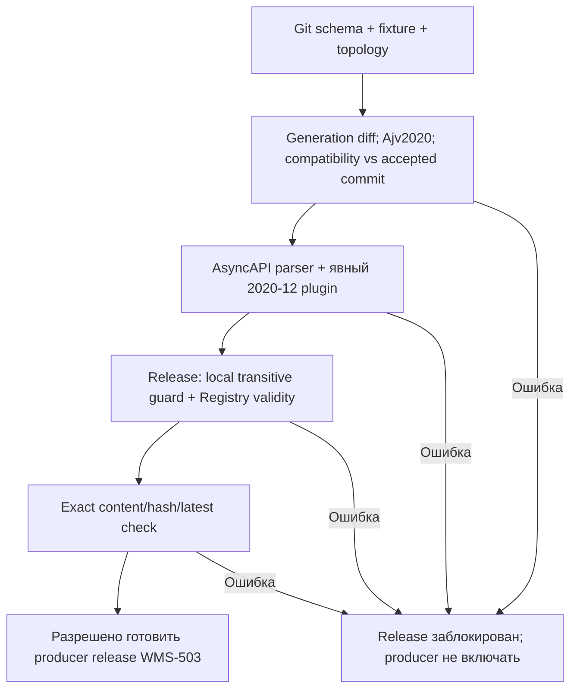

# WMS-502: выпуск Kafka contracts из Git

## Участники и доверие

Оператор выпускает schemas из проверенного Git commit. Source — docs/contracts/events,
fixtures — examples; runtime validators/types создаёт прежний генератор. Registry
не определяет actor/ACL, остатки или DB cursor. Он хранит schema metadata и проверяет
изменения, не валидирует каждое Kafka сообщение вместо consumer.

## Schema/subject/version

Один topic на aggregate stream, не event type/major schema. Key — aggregateId
canonical lowercase UTF-8 UUID. Artifact `<eventType>.v<schemaVersion>` в group default;
revision hash — только версия schema content, не eventId и не aggregateVersion.
JSON envelope сохраняет eventId/type/schemaVersion/aggregateType/aggregateId/
aggregateVersion/occurredAt/correlationId/payload и optional trace/causation fields.
Ни globalId Registry, ни schema-ID prefix не добавляются в wire value.
Optional transport headers content-type/x-event-type/x-schema-version описаны в
AsyncAPI; если они присутствуют, producer/consumer должны сверять их с envelope.
Headers не переопределяют envelope/actor. Trace context остаётся validated envelope
по WMS-401; transport headers могут быть только диагностической копией.

| Aggregate    | Topic                                | Consumer                                                      |
| ------------ | ------------------------------------ | ------------------------------------------------------------- |
| receipt      | warehouse.receiving.events           | inventory.putaway: прежнее logical/group имя                  |
| putaway-task | warehouse.inventory.putaway.events   | Подписчик ещё не зарегистрирован                              |
| order        | warehouse.fulfillment.order.events   | Подписчик ещё не зарегистрирован; order/shipping facts вместе |
| picking-task | warehouse.fulfillment.picking.events | Подписчик ещё не зарегистрирован                              |

WMS-501 реально создаёт только receipt topic. Остальные адреса — contract topology;
provisioning/ACL обязателен перед включением соответствующего publisher в WMS-503.
Новый consumer требует replay/start-position плана; нельзя начать с произвольного latest.
Все четыре потока существуют как retained outbox facts, но не все имеют deliveries.

## Consumers-first и совместимость

1. Определить last accepted Git commit и snapshot Registry/список revisions.
2. Изменить source schema/fixtures, выполнить contracts:generate и asyncapi:generate.
3. Выполнить schemas:check, test:registry и check:pr; сравнить с accepted base.
4. Сначала развернуть consumers, которые понимают старые и новые type/major. Для
   новых logical consumers заранее согласовать DB cursor/replay/start boundary.
5. Выполнить WMS_SCHEMA_BASE=<accepted commit> pnpm registry:publish, затем registry:check на том же Git commit. Registry
   rules VALIDITY=FULL / COMPATIBILITY=NONE проверяются вместе с local FULL_TRANSITIVE
   guard по всей истории. Native Registry compatibility2020-12 не поддерживается;
   direct privileged REST write обходит local guard и не является разрешённым release path.
6. Только после successful checks включать новую producer версию; WMS-503 дополнительно
   проверяет broker ack, singleton, eventId, sequencing. Этот pipeline не включает producer.
7. Unknown major/schema type — отказ consumer до effect/marker и offset commit.
   Durable retry/quarantine и влияние на partition реализует WMS-505; не пропускать молча.

Локальный checker разрешает annotations и optional unconstrained extensions в open
objects. Сужение типа, bounds, required, enums, if/then и остального unsupported
поднабора отклоняется. Это достаточное, не необходимое условие FULL compatibility.
Optional typed addition к open schema может исключить уже допустимые старые значения;
для этого нужен новый major либо отдельное доказательство/ADR, не downgrade dialect.
Новые major создают новый artifact, но продолжают прежние topic/key и logical consumer.

## Неуспешная/частичная публикация

Нет атомарности Git + пяти Registry artifacts. Сериализовать operator release,
остановить включение нового producer при любой ошибке. Missing artifact означает
незавершённый bootstrap; drift/rule failure нельзя считать successful release.
Повторная publication идентичного content idempotent. Не переписывать старую revision.
Если ошибка произошла после создания пустого artifact до rules, сначала оператор
проверяет отсутствие опубликованных versions и явно восстанавливает rules, затем
повторяет publish/check. Если schema уже опубликована, не удалять историю ради green:
восстановить accepted Git или новый совместимый revision/major по consumers-first.
In-memory dev Registry можно удалить и воспроизвести текущий каталог из Git. Это
не восстановление полной истории: для transitive release проверки нужны все accepted
revisions либо их воспроизведение в release порядке по Git history. Production history
требует backup/restore и отдельного persistence/auth решения.

## Evidence и ограничения

[Отчёт WMS-502](../reports/wms-502.md) содержит фактические команды и server results.
[AsyncAPI](../contracts/asyncapi.json) generated: source generator в scripts/registry,
не редактировать output вручную. Runtime consumer использует pinned Ajv и локальный
bundle; Kafka SDK/offset/rebalance proof относится к WMS-504, не к schema spike.
