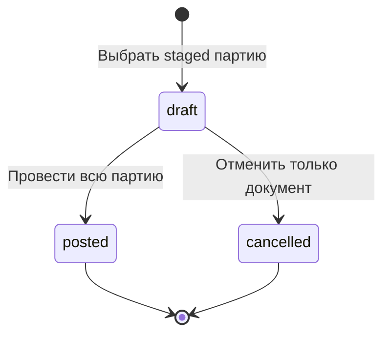
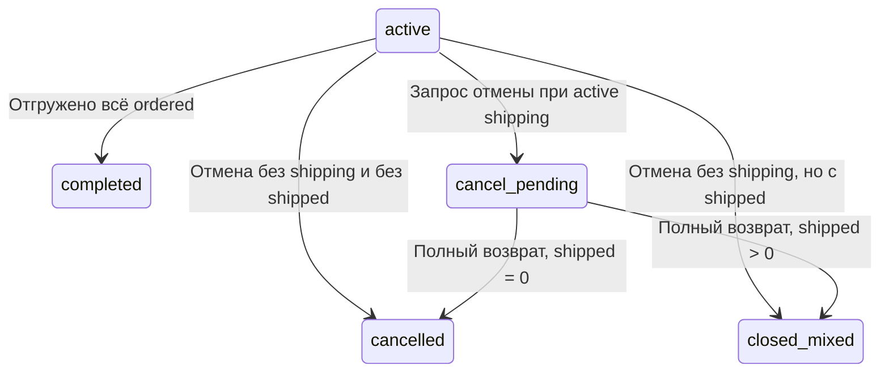
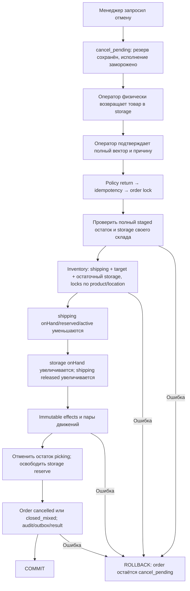
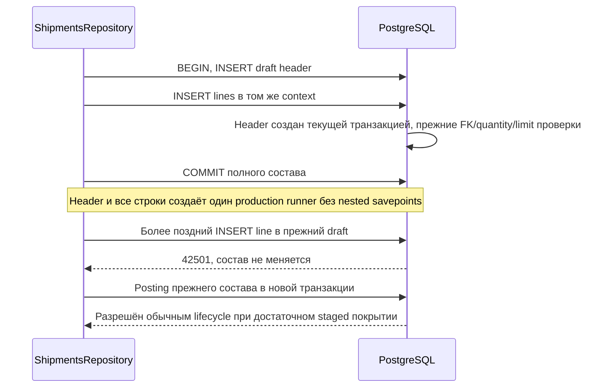

# WMS-206: отгрузка и физический возврат при отмене

Реализация B1–B4, решение [ADR-0024](../adr/0024-shipment-compensation.md).
Менеджер видит отгруженное отдельно от подготовленного и отменённого. Подготовка
shipment не списывает товар. Проведение списывает всю выбранную партию атомарно.
Отменённый draft оставляет товар и резерв прежними.

## Участники, вход и границы доверия

ShippingController проверяет HTTP-форму, нормализует UUID/порядок строк в plain JSON.
ShippingService в fulfillment владеет shipment/cancellation. Только InventoryService
изменяет stock/allocations через private ShippingStockService/Repository.
OrdersRepository/ShipmentsRepository и inventory repositories остаются внутренними.
Все эффекты используют один TransactionContext; worker не участвует.

Сессия, actor и права задаются сервером. DTO не принимает role/status/consumed/balance.
Клиент выбирает allocationId и количество партии; сервер проверяет, что allocation
принадлежит заказу и shipping его склада. Actor берётся из Principal. reasonCode —
проверенный ASCII код 3..64, а не произвольный текст или персональные данные.
Проверка склада выполняется по сохранённому заказу до idempotency claim и saved replay.

Все пути под /api/v1. Unsafe команды требуют cookie, Origin, JSON, CSRF и Idempotency-Key.

| Команда                                   | DTO                                                   | Право и результат                            |
| ----------------------------------------- | ----------------------------------------------------- | -------------------------------------------- |
| POST /orders/:orderId/shipments           | reasonCode, lines[{allocationId,quantity}]            | ship; 201 draft                              |
| GET /shipments/:shipmentId                | Нет                                                   | read своего склада; текущий снимок           |
| POST /shipments/:shipmentId/post          | Нет или {}                                            | ship; 200 posted                             |
| POST /shipments/:shipmentId/cancel        | reasonCode                                            | ship; 200 cancelled, stock прежний           |
| POST /orders/:orderId/cancel              | Нет или {}                                            | cancel; cancel_pending либо закрытый остаток |
| POST /orders/:orderId/cancellation-return | reasonCode, lines[{lineId,quantity,targetLocationId}] | return; закрытый остаток                     |

Prepare и return содержат 1..1000 уникальных строк; UUID сравниваются в lowercase.
Quantity — int4 штуки 1..2147483647. Shipment selects allocations, return selects order lines.
В return обязателен полный active shipping остаток каждой строки; лишние/пропущенные
строки, частичный вектор, receiving/shipping target и чужой склад отклоняются.
Произвольное списание shortage или возврат уже shipped товара не предоставлены.

## Состояния и наблюдаемые количества





cancel_pending запрещает новые pick/reserve/ship. Отзыв доступа проверяется на каждой
попытке, включая replay. Shipment draft может устареть, если другую партию провели
раньше: новое posting проверяет покрытие заново и при нехватке полностью откатывается.

GET order: ordered = open + reservedStorage + reservedShipping + shipped + cancelled.
shipped — SUM(consumed). released/transferred не считаются active и не увеличивают shipped.
В закрытой отмене cancelled=ordered-shipped, open=0. Исторический pickedTotal не стирается.
У allocation есть consumed, released, transferred, active и производное состояние
active/consumed/released/closed_mixed/transferred. Это количества с историей, не флаг клиента.

Пример: принято и собрано 10. Shipment на 6 → onHand=4, reserved=4, shipped=6.
Cancel → cancel_pending, четыре штуки остаются в отгрузке с резервом. Оператор возвращает
их в storage и подтверждает полный вектор на 4. После commit: storage onHand=4/reserved=0,
shipping=0/0, order closed_mixed, shipped=6, cancelled=4. Повтор того же ключа ничего не переносит.

## Транзакция posting

```mermaid
sequenceDiagram
  participant C as ShippingController
  participant H as HttpCommandsService
  participant F as ShippingService
  participant I as InventoryService
  participant D as PostgreSQL
  C->>H: shipmentId, server scope
  H->>D: BEGIN, session/warehouse policy, idempotency claim
  H->>F: Один context
  F->>D: Order UPDATE → shipment UPDATE
  F->>D: Перечитать draft и immutable lines
  F->>I: Explicit shipping allocations/quantities/line IDs
  I->>D: Проверить источники, INSERT audit
  I->>D: Заблокировать все balances по product/location
  I->>D: Перечитать active/onHand/reserved после ожидания
  I->>D: onHand/reserved/active -= q; consumed += q
  I->>D: INSERT unique effect и расход movement
  F->>D: shipment posted, при полном исполнении order completed
  F->>D: INSERT audit и ShippingChanged
  H->>D: Saved result, deferred guards, COMMIT
  H-->>C: posted snapshot
  Note over H,D: Любая ошибка до завершения COMMIT откатывает все записи
```

Новый ключ на posted/cancelled — 409. Старый ключ после актуальной policy возвращает
снимок первоначального commit. Уникальная shipmentLineId в ShippingEffect дополнительно
исключает повторное основание расхода. operationId движений уникальны. Exactly once не обещается.

## Физический возврат B3



Действия человека происходят вне транзакции БД. При SQL rollback физический товар сам
не возвращается обратно: требуется сверка, заказ остаётся pending. Locks не удерживаются
во время переноски товара. Вектор агрегирован по order line, сервер раскрывает его в
все исходные allocations; это поддерживает многократные частичные сборки одного SKU.
До stock изменений inventory собирает объединение source/target balances полного вектора
и всех активных storage balances заказа, включая строки без staged. Order lock удерживается
в том же context. Все ключи создаются/блокируются по product/location, затем меняются stock
и остаточный reserve. Поздний release повторно получает уже принадлежащие транзакции locks.
Без объединения return в B и поздний release A конфликтовали с reserve A→B другого заказа.
AC-R05-01 в shipping integration удерживает настоящий return после effects, наблюдает
pg_blocking_pids конкурирующего reserve и проверяет оба ответа 200, ledger и replay.
Переполнение int4 target откатывает весь возврат. Новые storage allocations не создаются:
B3 освобождает резерв, а не повторно резервирует товар.

## SQL-защита, события и ошибки

Миграция 0029 — generated DDL shipments/lines/effects, consumed и нового movement FK.
0030 — grants, lifecycle, immutable/retained и deferred сверки. Старые applied SQL не меняются.
Прежние putaway/picking основания и deferred guards сохранены. Movement имеет ровно одно
основание. Unique(effect,kind), unique(shipmentLineId), FK и deferred проверки сопоставляют
количество, allocation, документ, audit и движение/пару. Consumed/released shipping требуют
историю. Возврат требует завершения отмены в том же commit. Сверяется reserved=SUM(active)
каждого balance и SUM(active+consumed)<=ordered каждой строки. DBA может обойти guards.

ShippingChanged v1 — новое имя в order stream, payload orderId/action/optional shipmentId.
OrderChanged/PickingProgressed v1 не расширяются несовместимыми действиями. Source schemas,
fixtures, registry/generated bundle и OpenAPI обновлены вместе. Подписчиков order stream нет;
retained fact не означает внешнюю доставку. Message/body <=262144 UTF-8 bytes.

400 — форма/quantity/неполный возврат/чужой allocation. 401 — сессия. 403 — складское право.
404 — документ отсутствует. 409 — lifecycle, stale draft/нехватка; 422 — неверная target
location или overflow; неизвестный SQL fault — безопасный 500. Секреты/SQL в ответ не попадают.

## Evidence

[Shipping integration](../../apps/backend/test/integration/shipping.spec.ts) использует
реальные migrations и PostgreSQL: partial/full shipment, replay, два draft на последние
штуки, draft cancellation, cancel_pending, mixed closure, возврат после partial picking,
ACL и отзыв роли перед replay. Барьер order FOR UPDATE и две реальные сессии доказывают
конкуренцию posting; cancel/post race проверяет обе возможные очередности фиксации.
AFTER SQL faults проверяют rollback списания и возврата до saved result с повтором того же key.
Ledger сверяется независимым SUM(active), движения — с эффектами/quantities.

[Общий fixture](../../apps/backend/test/support/reserved-picking.fixture.ts) используется
picking и shipping suites, вызывает production owners и HTTP, не копирует правила остатков.
[DTO unit](../../apps/backend/test/unit/shipping-dto.spec.ts) проверяет UUID/int4/reason/unknown fields.
[Contract tests](../../apps/backend/test/unit/event-contracts.spec.ts) проверяют новое событие.
[Фактический отчёт](../reports/wms-206.md) фиксирует выполненные команды и ограничения.

## Исправления review: состав документа и идентичность события

Миграция 0031 запрещает INSERT строки в shipment после транзакции создания header.
Ранее warehouse_app мог дополнить закоммиченный draft новым allocation: UPDATE/DELETE
строк были запрещены, но INSERT не был привязан к созданию документа. Это меняло бы
текущий состав относительно сохранённого ответа подготовки.



Технический guard сравнивает системный xmin header с PostgreSQL ID текущей транзакции.
Это локальный признак транзакции создания в используемом runner, не бизнес-ID и не поле
публичного API. Не использовать xmin для HTTP/idempotency keys или долгосрочной версии
документа. Бизнес-история остаётся в UUID, immutable lines, effects и audit. Старые
документы не переписываются. DELETE/UPDATE/TRUNCATE строк и прежняя проверка состава
сохраняются; нормальная подготовка нескольких строк выполняется в одном context.

ShippingChanged теперь условно требует shipmentId для shipment-prepared/posted/cancelled.
Для cancellation-requested/completed достаточно orderId. UUID-формат проверяется общим
payload.properties.shipmentId; then добавляет только обязательность поля. Локальное
объявление свойства в then сохраняет strictRequired Ajv, глобальный strict не ослаблялся.
Source schema и generated artifacts обновлены генератором, опубликованные старые
OrderChanged/PickingProgressed не менялись. Существующий producer уже задавал ID для
shipment, поэтому штатные факты не меняют форму. Исторические outbox записи не правятся.

Evidence: два PostgreSQL regression cases проверяют runtime INSERT после commit с новым
allocation (отказ не вызван UNIQUE) и штатный multi-line prepare/post. Пять contract cases
проверяют все три shipment action без ID на producer/handler и две cancellation action
без shipmentId. [Отчёт](../reports/wms-206.md) фиксирует итоговый прогон.
